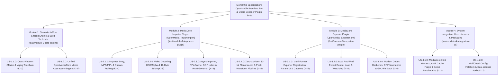

# Master Architecture Decomposition Roadmap
## Project: Open-Source Modern Codec & Container Plugin Suite for Adobe Premiere Pro (MediaCore)

- **Domain / Field Profile**: `software` (`.agents/field-profile.json`)
- **Plugin Governance**: `some-divide-and-conquer` (Rules: `AGENTS.md`)
- **Reference Architecture Report**: `بناء إضافة مفتوحة المصدر لبريمير.md`
- **Architectural Paradigm**: Three-Tier Connector-Core Separation Pattern (Adobe Premiere Pro C++ SDK + FFmpeg 7.1 LTS / 8.0 Engine)
- **Target Host Environments**: Adobe Premiere Pro CC, Adobe Media Encoder CC, After Effects CC, Audition CC (Windows x64 `.prm` / macOS Apple Silicon & x86_64 `.bundle` in shared `MediaCore/7.0`)

---

## 1. Executive Architectural Summary

This specification defines a complete, open-source, production-grade media infrastructure plugin suite for **Adobe Premiere Pro** and **Adobe Media Encoder** providing native import (replacing closed-source **Autokroma Influx**) and export (replacing **Voukoder Pro**) for modern multimedia containers (**MKV**, **WebM**, **MP4**, **MOV**, **OGG**, **AVI**, **FLV**) and next-generation video/audio codecs (**AV1**, **VP9**, **VP8**, **FFV1**, **H.264/HEVC**, **ProRes**, **Opus**, **FLAC**, **Vorbis**).

### 1.1 The Three-Tier Connector-Core Architectural Invariant
Adobe Premiere Pro’s C++ MediaCore SDK enforces a strict **Single Entry Point** rule per binary DLL/bundle (`xImportEntry` for Importers; `xSDKExport` for Exporters), unlike After Effects or Photoshop. Furthermore, Adobe SDK headers carry proprietary licensing prohibiting public redistribution in Git repositories, while FFmpeg and modern software codecs (`libsvtav1`, `dav1d`, `libvpx`, `x264`, `x265`) utilize LGPLv2.1+ or GPLv3 licenses.

To satisfy both technical and legal constraints, the system enforces a **Three-Tier Connector-Core Architecture**:
1. **Tier 1 — Host Application Layer**: Adobe Premiere Pro & Adobe Media Encoder managing memory, timelines, and SweetPea callback suites (`PrSDKPPixSuite`, `PrSDKPPixCreatorSuite`, `PrSDKPPixCacheSuite`, `PrSDKAudioSuite`, `PrSDKSequenceRenderSuite`, `PrSDKSequenceAudioSuite`, `PrSDKExporterUtilitySuite`, `PrSDKExportParamSuite`, `PrSDKExportProgressSuite`, `PrSDKCaptioningSuite`, `PrSDKErrorSuite`, `PrSDKMemorySuite`).
2. **Tier 2 — Lightweight Connector Layer (MIT / Apache-2.0 License)**: Two independent native C++ plugin binaries installed into the unified `MediaCore/7.0` directory (`C:\Program Files\Adobe\Common\Plug-ins\7.0\MediaCore` on Windows; `/Library/Application Support/Adobe/Common/Plug-ins/7.0/MediaCore` on macOS):
   - `OpenMedia_Importer.prm` / `.bundle`: Native Importer implementing `xImportEntry`, `IMPT` and `PiPL` binary resources, priority $\ge 100$ override, `imGetSourceVideo` (8/10/12-bit + Alpha, 16-byte rowbytes stride alignment), `imCreateAsyncImporter` (`AsyncImporterEntry` / `aiClose`), `PrSDKPPixCacheSuite` integration, `imQuietFile` & 50% dynamic RAM limiting, and `imImportAudio7` 32-bit float planar zero-conform audio (`avoidAudioConform = kPrTrue` + `kRandomAccessImport` + `imGetPeakAudio`).
   - `OpenMedia_Exporter.prm` / `.bundle`: Native Exporter implementing `xSDKExport`, multi-container iteration (`exportReturn_IterateExporter`), dynamic UI validation (`exSelValidateParamChanged` with `rebuildAllParams = kPrTrue`), Match Source (`canMatchSource`), Closed Captions (`canEmbedCaptions`), Push Model (`DoMultiPassExportLoop`) and Pull Model (`RenderVideoFrameAndConformToPixelFormat`) rendering, pause/resume (`suiteError_ExporterSuspended` / `WaitForResume`), and GOP-closing abort handling.
3. **Tier 3 — Unified Dynamic Core Engine (`libOpenMediaCore`, LGPLv2.1+ / GPLv3)**: Shared C++17 dynamic runtime library (`.dll` / `.dylib`) encapsulating FFmpeg 7.1 LTS / 8.0 (`libavformat`, `libavcodec`, `libswscale`, `libswresample`, `libavutil`), CPU codecs (`dav1d`, `libsvtav1`, `libaom`, `libvpx`, `libopus`, `libflac`), and GPU hardware acceleration (`d3d11va`, `nvdec`, `av1_nvenc` / `hevc_nvenc` with NVIDIA driver $\ge 570.0$, AMD `amf`, Intel `qsv`/`vaapi`, and FFmpeg 8.0 `vulkan` AV1 encode & VP9/AV1 decode).

```mermaid
flowchart TD
    subgraph Host ["Tier 1: Adobe Creative Cloud Host Environment"]
        PPro["Adobe Premiere Pro (MediaCore)"]
        AME["Adobe Media Encoder (Batch Queue & Test Harness)"]
    end

    subgraph Connectors ["Tier 2: Connector Layer (MIT / Apache-2.0, MediaCore/7.0)"]
        Imp["OpenMedia_Importer.prm (.bundle)<br/>(xImportEntry, IMPT/PiPL, Priority 100,<br/>imGetSourceVideo, imCreateAsyncImporter, imImportAudio7)"]
        Exp["OpenMedia_Exporter.prm (.bundle)<br/>(xSDKExport, exportReturn_IterateExporter,<br/>DoMultiPassExportLoop, Param & Caption Suites)"]
    end

    subgraph CoreEngine ["Tier 3: Unified Dynamic Core Engine (LGPLv2.1+ / GPLv3)"]
        CoreLib["libOpenMediaCore (.dll / .dylib)<br/>(ICoreDemuxer, ICoreVideoDecoder, ICoreAudioDecoder,<br/>ICoreVideoEncoder, ICoreAudioEncoder, ICoreMuxer)"]
        FFmpeg["FFmpeg 7.1 LTS / 8.0<br/>(avformat, avcodec, swscale, swresample, avutil)"]
        CPUCodecs["Open-Source CPU Codecs<br/>(dav1d, libsvtav1, libvpx-vp9, libopus, libflac)"]
        HW["GPU Hardware Acceleration<br/>(NVDEC/NVENC >=570.0, D3D11VA, AMD AMF, Intel QSV/VA-API, Vulkan Video)"]
    end

    PPro -->|SweetPea Importer Suites| Imp
    PPro -->|SweetPea Exporter Suites| Exp
    AME -->|Batch Export & Preset (.epr) Loop| Exp

    Imp -->|Clean C++17 ABI Boundary| CoreLib
    Exp -->|Clean C++17 ABI Boundary| CoreLib

    CoreLib --> FFmpeg
    CoreLib --> CPUCodecs
    CoreLib --> HW
```

---

## 2. Four-Level Decomposition Hierarchy



---

## 3. Dynamic Unit Sizing Matrix ($S_{\text{story}} \to K$) Summary

Every User Story is evaluated across the 4 weighted dimensions defined in `spec-decomposition`:
$$S_{\text{story}} = (0.35 \times D_1) + (0.25 \times D_2) + (0.20 \times D_3) + (0.20 \times D_4)$$
- $D_1$ (35%): Functional / Deliverable Surface (Selectors / Subsystems / Handlers)
- $D_2$ (25%): Production Code Volume (LOC)
- $D_3$ (20%): Logic / Concurrency / Hardware / Algorithmic Complexity
- $D_4$ (20%): Disjoint File Boundaries

| Story ID | User Story Title | $D_1$ (35%) | $D_2$ (25%) | $D_3$ (20%) | $D_4$ (20%) | Score $S_{\text{story}}$ | Unit Count ($K$) | Target Slice Size |
| :--- | :--- | :---: | :---: | :---: | :---: | :---: | :---: | :--- |
| **`US-1.1.0`** | Cross-Platform Build System & vcpkg Infrastructure | 2 | 2 | 2 | 2 | **2.00** | **3 Units** | ~170 LOC / unit |
| **`US-1.2.0`** | Unified OpenMediaCore Media Abstraction Engine | 2 | 3 | 3 | 3 | **2.65** | **5 Units** | ~180 LOC / unit |
| **`US-2.1.0`** | Importer Entry, Resource Registration & Stream Probing | 2 | 2 | 3 | 2 | **2.20** | **4 Units** | ~160 LOC / unit |
| **`US-2.2.0`** | Video Frame Decoding, Color Spaces & 16-Byte Stride | 3 | 3 | 3 | 3 | **3.00** | **5 Units** | ~180 LOC / unit |
| **`US-2.3.0`** | Async I/O Importer, PPix Cache, GOP Index & RAM Governor | 3 | 3 | 4 | 3 | **3.20** | **6 Units** | ~190 LOC / unit |
| **`US-2.4.0`** | Zero-Conform 32-bit Planar Audio & Multi-Channel Pipeline | 3 | 3 | 2 | 3 | **2.80** | **5 Units** | ~160 LOC / unit |
| **`US-3.1.0`** | Exporter Registration Loop, Dynamic Param UI & Captions | 3 | 3 | 3 | 3 | **3.00** | **5 Units** | ~180 LOC / unit |
| **`US-3.2.0`** | Dual Push/Pull Export Render Loops & Progress Watchdog | 2 | 3 | 3 | 3 | **2.65** | **5 Units** | ~170 LOC / unit |
| **`US-3.3.0`** | Multi-Codec Hardware/Software Pipeline, CRF & Fallback | 3 | 3 | 4 | 3 | **3.20** | **6 Units** | ~200 LOC / unit |
| **`US-4.1.0`** | MediaCore Host Verification, AME Harness & Scrub Benchmarks | 2 | 2 | 2 | 2 | **2.00** | **3 Units** | ~200 LOC / unit |
| **`US-4.2.0`** | Cross-Platform MultiCPackConfig Packaging & License Audit | 2 | 2 | 2 | 2 | **2.00** | **3 Units** | ~170 LOC / unit |
| **TOTAL** | **4 Modules, 11 User Stories** | — | — | — | — | — | **50 Units** | **100% Parallel** |

---

## 4. Complete 50-Unit Master Index & Disjoint File Ownership

| Module | Story | Unit ID | Unit Branch | Primary Deliverable & Owned Production / Test Files |
| :--- | :--- | :--- | :--- | :--- |
| **M1** | `US-1.1.0` | `unit-1` | `feat/us-1.1.0/unit-1-cmake-core-targets` | `CMakeLists.txt`, `cmake/CompilerWarnings.cmake`, `tests/build/test_cmake_targets.cmake` |
| **M1** | `US-1.1.0` | `unit-2` | `feat/us-1.1.0/unit-2-vcpkg-manifest-deps` | `vcpkg.json` (FFmpeg 7.1/8.0 + dav1d, svtav1, vpx, opus, flac, nvcodec, vulkan), `vcpkg-configuration.json`, `tests/build/test_vcpkg_manifest.py` |
| **M1** | `US-1.1.0` | `unit-3` | `feat/us-1.1.0/unit-3-adobe-sdk-resolver` | `cmake/FindAdobeSDK.cmake`, `tests/mocks/mock_sdk/...`, `tests/build/test_find_adobe_sdk.cmake` |
| **M1** | `US-1.2.0` | `unit-1` | `feat/us-1.2.0/unit-1-core-demuxer` | `include/openmedia/demuxer.hpp`, `src/core/demuxer.cpp`, `tests/core/test_demuxer.cpp` |
| **M1** | `US-1.2.0` | `unit-2` | `feat/us-1.2.0/unit-2-video-decoder` | `include/openmedia/video_decoder.hpp`, `src/core/video_decoder.cpp`, `tests/core/test_video_decoder.cpp` |
| **M1** | `US-1.2.0` | `unit-3` | `feat/us-1.2.0/unit-3-audio-decoder` | `include/openmedia/audio_decoder.hpp`, `src/core/audio_decoder.cpp`, `tests/core/test_audio_decoder.cpp` |
| **M1** | `US-1.2.0` | `unit-4` | `feat/us-1.2.0/unit-4-video-encoder` | `include/openmedia/video_encoder.hpp`, `src/core/video_encoder.cpp`, `tests/core/test_video_encoder.cpp` |
| **M1** | `US-1.2.0` | `unit-5` | `feat/us-1.2.0/unit-5-core-muxer-audio-enc` | `include/openmedia/muxer.hpp`, `src/core/muxer.cpp`, `tests/core/test_muxer_pipeline.cpp` |
| **M2** | `US-2.1.0` | `unit-1` | `feat/us-2.1.0/unit-1-importer-entry-dispatch` | `include/importer/importer_entry.hpp`, `src/importer/importer_entry.cpp`, `tests/importer/test_importer_registration.cpp` |
| **M2** | `US-2.1.0` | `unit-2` | `feat/us-2.1.0/unit-2-impt-pipl-resources` | `resources/importer_resources.rc`, `resources/importer_pipl.r`, `resources/Info_Importer.plist.in`, `tests/importer/test_importer_resources.cpp` |
| **M2** | `US-2.1.0` | `unit-3` | `feat/us-2.1.0/unit-3-file-probe-timebase` | `include/importer/file_probe.hpp`, `src/importer/file_probe.cpp`, `tests/importer/test_file_probe_timebase.cpp` |
| **M2** | `US-2.1.0` | `unit-4` | `feat/us-2.1.0/unit-4-multi-stream-tracker` | `include/importer/stream_tracker.hpp`, `src/importer/stream_tracker.cpp`, `tests/importer/test_stream_tracker.cpp` |
| **M2** | `US-2.2.0` | `unit-1` | `feat/us-2.2.0/unit-1-source-video-handler` | `include/importer/source_video.hpp`, `src/importer/source_video.cpp`, `tests/importer/test_source_video.cpp` |
| **M2** | `US-2.2.0` | `unit-2` | `feat/us-2.2.0/unit-2-pixel-format-8u` | `include/importer/pixel_format_8u.hpp`, `src/importer/pixel_format_8u.cpp`, `tests/importer/test_pixel_format_8u.cpp` |
| **M2** | `US-2.2.0` | `unit-3` | `feat/us-2.2.0/unit-3-pixel-format-hdr` | `include/importer/pixel_format_hdr.hpp`, `src/importer/pixel_format_hdr.cpp`, `tests/importer/test_pixel_format_hdr.cpp` |
| **M2** | `US-2.2.0` | `unit-4` | `feat/us-2.2.0/unit-4-stride-alignment-engine` | `include/importer/stride_align.hpp`, `src/importer/stride_align.cpp`, `tests/importer/test_video_decoding_stride.cpp` |
| **M2** | `US-2.2.0` | `unit-5` | `feat/us-2.2.0/unit-5-sws-frame-scaler` | `include/importer/frame_scaler.hpp`, `src/importer/frame_scaler.cpp`, `tests/importer/test_frame_scaler.cpp` |
| **M2** | `US-2.3.0` | `unit-1` | `feat/us-2.3.0/unit-1-async-importer-engine` | `include/importer/async_importer.hpp`, `src/importer/async_importer.cpp`, `tests/importer/test_async_importer.cpp` |
| **M2** | `US-2.3.0` | `unit-2` | `feat/us-2.3.0/unit-2-ppix-cache-bridge` | `include/importer/ppix_cache_bridge.hpp`, `src/importer/ppix_cache_bridge.cpp`, `tests/importer/test_ppix_cache_bridge.cpp` |
| **M2** | `US-2.3.0` | `unit-3` | `feat/us-2.3.0/unit-3-keyframe-ring-buffer` | `include/importer/keyframe_ring_buffer.hpp`, `src/importer/keyframe_ring_buffer.cpp`, `tests/importer/test_keyframe_ring_buffer.cpp` |
| **M2** | `US-2.3.0` | `unit-4` | `feat/us-2.3.0/unit-4-memory-governor-quiet` | `include/importer/memory_governor.hpp`, `src/importer/memory_governor.cpp`, `tests/importer/test_memory_governor.cpp` |
| **M2** | `US-2.3.0` | `unit-5` | `feat/us-2.3.0/unit-5-d3d11va-nvdec-decoder` | `include/importer/d3d11va_nvdec_decoder.hpp`, `src/importer/d3d11va_nvdec_decoder.cpp`, `tests/importer/test_d3d11va_nvdec_decoder.cpp` |
| **M2** | `US-2.3.0` | `unit-6` | `feat/us-2.3.0/unit-6-vulkan-video-decoder` | `include/importer/vulkan_video_decoder.hpp`, `src/importer/vulkan_video_decoder.cpp`, `tests/importer/test_vulkan_video_decoder.cpp` |
| **M2** | `US-2.4.0` | `unit-1` | `feat/us-2.4.0/unit-1-audio-import7-extractor` | `include/importer/audio_extractor.hpp`, `src/importer/audio_extractor.cpp`, `tests/importer/test_audio_extractor.cpp` |
| **M2** | `US-2.4.0` | `unit-2` | `feat/us-2.4.0/unit-2-audio-conform-bypass` | `include/importer/audio_conform_bypass.hpp`, `src/importer/audio_conform_bypass.cpp`, `tests/importer/test_audio_conform_bypass.cpp` |
| **M2** | `US-2.4.0` | `unit-3` | `feat/us-2.4.0/unit-3-peak-waveform-generator` | `include/importer/peak_waveform_generator.hpp`, `src/importer/peak_waveform_generator.cpp`, `tests/importer/test_peak_waveform_generator.cpp` |
| **M2** | `US-2.4.0` | `unit-4` | `feat/us-2.4.0/unit-4-multi-channel-router` | `include/importer/multi_channel_router.hpp`, `src/importer/multi_channel_router.cpp`, `tests/importer/test_multi_channel_router.cpp` |
| **M2** | `US-2.4.0` | `unit-5` | `feat/us-2.4.0/unit-5-audio-resampler` | `include/importer/audio_resampler.hpp`, `src/importer/audio_resampler.cpp`, `tests/importer/test_audio_resampler.cpp` |
| **M3** | `US-3.1.0` | `unit-1` | `feat/us-3.1.0/unit-1-exporter-entry-iterate` | `include/exporter/exporter_entry.hpp`, `src/exporter/exporter_entry.cpp`, `resources/exporter_resources.rc`, `tests/exporter/test_exporter_entry.cpp` |
| **M3** | `US-3.1.0` | `unit-2` | `feat/us-3.1.0/unit-2-param-builder-versioning` | `include/exporter/export_param_builder.hpp`, `src/exporter/export_param_builder.cpp`, `tests/exporter/test_export_param_builder.cpp` |
| **M3** | `US-3.1.0` | `unit-3` | `feat/us-3.1.0/unit-3-match-source-engine` | `include/exporter/match_source_engine.hpp`, `src/exporter/match_source_engine.cpp`, `tests/exporter/test_match_source_engine.cpp` |
| **M3** | `US-3.1.0` | `unit-4` | `feat/us-3.1.0/unit-4-captioning-suite-embedder` | `include/exporter/caption_embedder.hpp`, `src/exporter/caption_embedder.cpp`, `tests/exporter/test_caption_embedder.cpp` |
| **M3** | `US-3.1.0` | `unit-5` | `feat/us-3.1.0/unit-5-dynamic-ui-validator` | `include/exporter/dynamic_ui_validator.hpp`, `src/exporter/dynamic_ui_validator.cpp`, `tests/exporter/test_dynamic_ui_validator.cpp` |
| **M3** | `US-3.2.0` | `unit-1` | `feat/us-3.2.0/unit-1-push-multipass-loop` | `include/exporter/push_render_loop.hpp`, `src/exporter/push_render_loop.cpp`, `tests/exporter/test_push_render_loop.cpp` |
| **M3** | `US-3.2.0` | `unit-2` | `feat/us-3.2.0/unit-2-pull-sequence-renderer` | `include/exporter/pull_sequence_renderer.hpp`, `src/exporter/pull_sequence_renderer.cpp`, `tests/exporter/test_pull_sequence_renderer.cpp` |
| **M3** | `US-3.2.0` | `unit-3` | `feat/us-3.2.0/unit-3-audio-pull-orchestrator` | `include/exporter/audio_pull_orchestrator.hpp`, `src/exporter/audio_pull_orchestrator.cpp`, `tests/exporter/test_audio_pull_orchestrator.cpp` |
| **M3** | `US-3.2.0` | `unit-4` | `feat/us-3.2.0/unit-4-progress-suspend-watchdog` | `include/exporter/progress_watchdog.hpp`, `src/exporter/progress_watchdog.cpp`, `tests/exporter/test_progress_watchdog.cpp` |
| **M3** | `US-3.2.0` | `unit-5` | `feat/us-3.2.0/unit-5-gop-tail-flusher` | `include/exporter/gop_tail_flusher.hpp`, `src/exporter/gop_tail_flusher.cpp`, `tests/exporter/test_gop_tail_flusher.cpp` |
| **M3** | `US-3.3.0` | `unit-1` | `feat/us-3.3.0/unit-1-cpu-codec-backends` | `include/exporter/cpu_codecs.hpp`, `src/exporter/cpu_codecs.cpp`, `tests/exporter/test_cpu_codecs.cpp` |
| **M3** | `US-3.3.0` | `unit-2` | `feat/us-3.3.0/unit-2-nvenc-570-encoder` | `include/exporter/nvenc_encoder.hpp`, `src/exporter/nvenc_encoder.cpp`, `tests/exporter/test_nvenc_encoder.cpp` |
| **M3** | `US-3.3.0` | `unit-3` | `feat/us-3.3.0/unit-3-amf-qsv-vaapi-encoder` | `include/exporter/amf_qsv_encoder.hpp`, `src/exporter/amf_qsv_encoder.cpp`, `tests/exporter/test_amf_qsv_encoder.cpp` |
| **M3** | `US-3.3.0` | `unit-4` | `feat/us-3.3.0/unit-4-vulkan-av1-encoder` | `include/exporter/vulkan_encoder.hpp`, `src/exporter/vulkan_encoder.cpp`, `tests/exporter/test_vulkan_encoder.cpp` |
| **M3** | `US-3.3.0` | `unit-5` | `feat/us-3.3.0/unit-5-rate-control-normalizer` | `include/exporter/rate_control_normalizer.hpp`, `src/exporter/rate_control_normalizer.cpp`, `tests/exporter/test_rate_control_normalizer.cpp` |
| **M3** | `US-3.3.0` | `unit-6` | `feat/us-3.3.0/unit-6-chroma-guard-fallback` | `include/exporter/chroma_fallback_guard.hpp`, `src/exporter/chroma_fallback_guard.cpp`, `tests/exporter/test_chroma_fallback_guard.cpp` |
| **M4** | `US-4.1.0` | `unit-1` | `feat/us-4.1.0/unit-1-deployment-validator` | `tests/integration/include/deployment_validator.hpp`, `tests/integration/src/deployment_validator.cpp`, `tests/integration/test_deployment_validator.cpp` |
| **M4** | `US-4.1.0` | `unit-2` | `feat/us-4.1.0/unit-2-scrub-latency-benchmark` | `tests/integration/include/scrub_benchmark.hpp`, `tests/integration/src/scrub_benchmark.cpp`, `tests/integration/test_scrub_benchmark.cpp` |
| **M4** | `US-4.1.0` | `unit-3` | `feat/us-4.1.0/unit-3-ame-harness-cache-purge` | `tests/integration/include/ame_queue_validator.hpp`, `tests/integration/src/ame_queue_validator.cpp`, `tests/integration/test_ame_queue_validator.cpp` |
| **M4** | `US-4.2.0` | `unit-1` | `feat/us-4.2.0/unit-1-windows-msi-installer` | `packaging/cpack/CPackConfig_Windows.cmake`, `packaging/cpack/windows/wix_patch.xml`, `tests/packaging/test_windows_cpack.cmake` |
| **M4** | `US-4.2.0` | `unit-2` | `feat/us-4.2.0/unit-2-macos-pkg-installer` | `packaging/cpack/CPackConfig_macOS.cmake`, `packaging/cpack/macos/distribution.xml`, `packaging/cpack/macos/postinstall.sh`, `tests/packaging/test_macos_cpack.cmake` |
| **M4** | `US-4.2.0` | `unit-3` | `feat/us-4.2.0/unit-3-license-compliance-packager` | `packaging/cpack/MultiCPackConfig.cmake`, `packaging/scripts/audit_licenses.py`, `packaging/scripts/generate_third_party_notices.py`, `tests/packaging/test_license_audit.py` |

---

## 5. Unified Repository Directory Architecture

All 4 modules and 50 implementation units strictly adhere to a single unified directory layout and C++17 namespace hierarchy (`openmedia`, `openmedia::importer`, `openmedia::exporter`, `openmedia::qa`):

```text
AV1/
├── CMakeLists.txt                               # Root CMake >= 3.20 (US-1.1.0 unit-1)
├── vcpkg.json                                   # Pinned FFmpeg 7.1/8.0 manifest (US-1.1.0 unit-2)
├── vcpkg-configuration.json                     # Baseline & registry config (US-1.1.0 unit-2)
├── cmake/
│   ├── CompilerWarnings.cmake                   # Strict C++17 flags (US-1.1.0 unit-1)
│   └── FindAdobeSDK.cmake                       # External -DADOBE_PP_SDK validator (US-1.1.0 unit-3)
├── include/
│   ├── openmedia/                               # Module 1 Core Engine headers (namespace openmedia)
│   │   ├── core_types.hpp                       # Base Contract (Pre-seeded on Module 1)
│   │   ├── demuxer.hpp                          # US-1.2.0 unit-1
│   │   ├── video_decoder.hpp                    # US-1.2.0 unit-2
│   │   ├── audio_decoder.hpp                    # US-1.2.0 unit-3
│   │   ├── video_encoder.hpp                    # US-1.2.0 unit-4
│   │   └── muxer.hpp                            # US-1.2.0 unit-5
│   ├── importer/                                # Module 2 Importer headers (namespace openmedia::importer)
│   │   ├── importer_types.hpp                   # Base Contract (Pre-seeded on Module 2)
│   │   ├── importer_entry.hpp                   # US-2.1.0 unit-1
│   │   ├── file_probe.hpp                       # US-2.1.0 unit-3
│   │   ├── stream_tracker.hpp                   # US-2.1.0 unit-4
│   │   ├── source_video.hpp                     # US-2.2.0 unit-1
│   │   ├── pixel_format_8u.hpp                  # US-2.2.0 unit-2
│   │   ├── pixel_format_hdr.hpp                 # US-2.2.0 unit-3
│   │   ├── stride_align.hpp                     # US-2.2.0 unit-4
│   │   ├── frame_scaler.hpp                     # US-2.2.0 unit-5
│   │   ├── async_importer.hpp                   # US-2.3.0 unit-1
│   │   ├── ppix_cache_bridge.hpp                # US-2.3.0 unit-2
│   │   ├── keyframe_ring_buffer.hpp             # US-2.3.0 unit-3
│   │   ├── memory_governor.hpp                  # US-2.3.0 unit-4
│   │   ├── d3d11va_nvdec_decoder.hpp            # US-2.3.0 unit-5
│   │   ├── vulkan_video_decoder.hpp             # US-2.3.0 unit-6
│   │   ├── audio_extractor.hpp                  # US-2.4.0 unit-1
│   │   ├── audio_conform_bypass.hpp             # US-2.4.0 unit-2
│   │   ├── peak_waveform_generator.hpp          # US-2.4.0 unit-3
│   │   ├── multi_channel_router.hpp             # US-2.4.0 unit-4
│   │   └── audio_resampler.hpp                  # US-2.4.0 unit-5
│   └── exporter/                                # Module 3 Exporter headers (namespace openmedia::exporter)
│       ├── exporter_types.hpp                   # Base Contract (Pre-seeded on Module 3)
│       ├── exporter_entry.hpp                   # US-3.1.0 unit-1
│       ├── export_param_builder.hpp             # US-3.1.0 unit-2
│       ├── match_source_engine.hpp              # US-3.1.0 unit-3
│       ├── caption_embedder.hpp                 # US-3.1.0 unit-4
│       ├── dynamic_ui_validator.hpp             # US-3.1.0 unit-5
│       ├── push_render_loop.hpp                 # US-3.2.0 unit-1
│       ├── pull_sequence_renderer.hpp           # US-3.2.0 unit-2
│       ├── audio_pull_orchestrator.hpp          # US-3.2.0 unit-3
│       ├── progress_watchdog.hpp                # US-3.2.0 unit-4
│       ├── gop_tail_flusher.hpp                 # US-3.2.0 unit-5
│       ├── cpu_codecs.hpp                       # US-3.3.0 unit-1
│       ├── nvenc_encoder.hpp                    # US-3.3.0 unit-2
│       ├── amf_qsv_encoder.hpp                  # US-3.3.0 unit-3
│       ├── vulkan_encoder.hpp                   # US-3.3.0 unit-4
│       ├── rate_control_normalizer.hpp          # US-3.3.0 unit-5
│       └── chroma_fallback_guard.hpp            # US-3.3.0 unit-6
├── src/
│   ├── core/                                    # Module 1 implementation (.cpp)
│   ├── importer/                                # Module 2 implementation (.cpp)
│   └── exporter/                                # Module 3 implementation (.cpp)
├── resources/
│   ├── importer_resources.rc                    # Windows IMPT & PiPL (llvm-rc / windres)
│   ├── importer_pipl.r                          # macOS PiPL resource
│   ├── Info_Importer.plist.in                   # macOS Cocoa Bundle plist
│   └── exporter_resources.rc                    # Exporter PiPL & version info
├── packaging/
│   ├── cpack/
│   │   ├── MultiCPackConfig.cmake               # Unified CPack orchestrator
│   │   ├── CPackConfig_Windows.cmake            # Windows MSI / NSIS -> MediaCore/7.0
│   │   ├── CPackConfig_macOS.cmake              # macOS PKG / DMG -> MediaCore/7.0
│   │   ├── windows/
│   │   └── macos/
│   └── scripts/
│       ├── audit_licenses.py                    # SPDX & zero-Adobe-header auditor
│       └── generate_third_party_notices.py      # LGPL/GPL source offer generator
└── tests/
    ├── mocks/mock_sdk/                          # Clean-room mock types for CI compilation
    ├── build/                                   # US-1.1.0 CMake & vcpkg tests
    ├── core/                                    # US-1.2.0 unit tests
    ├── importer/                                # US-2.1.0 .. US-2.4.0 unit tests
    ├── exporter/                                # US-3.1.0 .. US-3.3.0 unit tests
    ├── integration/                             # US-4.1.0 Host harness & benchmarks
    └── packaging/                               # US-4.2.0 CPack & license tests
```

---

## 6. Hard Architectural Invariants & Six Quality Gates

### 6.1 Four Core Discipline Invariants
1. **Invariant A (Pure Deliverable Production Only)**: Every unit `unit-1..K` across all 11 stories produces primary executable production artifacts AND corresponding unit tests. Zero validation-only or test-only units exist.
2. **Invariant B (Zero Inter-Unit Blocking — 100% Parallel Execution)**: All $K$ units within a story execute concurrently in isolated Git worktrees without waiting for sibling units. Shared base contracts (`core_types.hpp`, `importer_types.hpp`, `exporter_types.hpp`, `mock_premiere_suites.hpp`) are pre-seeded on the parent story branch prior to branching `unit-1..K`.
3. **Invariant C (Mandatory `.worktrees/` Isolation)**: All branch work executes inside `.worktrees/<branch-sanitized-name>`.
4. **Invariant D (Cascading PR Merge & In-PR Reporting)**: Units merge sequentially ($1 \to 2 \to \dots \to K$) via `gh pr merge <PR> --merge` with all quality gate reports posted directly to GitHub PR conversations.

### 6.2 Six Quality Gates
- **Gate G0 (Build, Lint & Format)**: 0 compiler errors/warnings (`-Wall -Wextra -Wpedantic` / `/W4`), Clang-Tidy clean, 100% `clang-format` compliance.
- **Gate G1 (Tests & Traceability)**: 100% Gherkin AC coverage; $\ge 90\%$ line coverage, $\ge 85\%$ branch coverage via CTest.
- **Gate G2 (Security Gateway — `security-audit`)**: 0 CVE/CWE vulnerabilities, STRIDE mitigation, 16-byte stride memory safety, secure DLL loading (`LOAD_LIBRARY_SEARCH_SYSTEM32`), zero proprietary Adobe header leakage.
- **Gate G-Complexity (`cyclomatic-complexity`)**: Cyclomatic Complexity $CC \le 6$ target, $CC \le 10$ ceiling, $CC > 15$ hard blocker; nesting depth $\le 2$.
- **Gate G-Docs**: 100% public C++ APIs documented with Doxygen comments and runnable unit test examples.
- **Gate G-Review**: Formal review verdict posted to the GitHub PR conversation by the independent Reviewing Council President.
