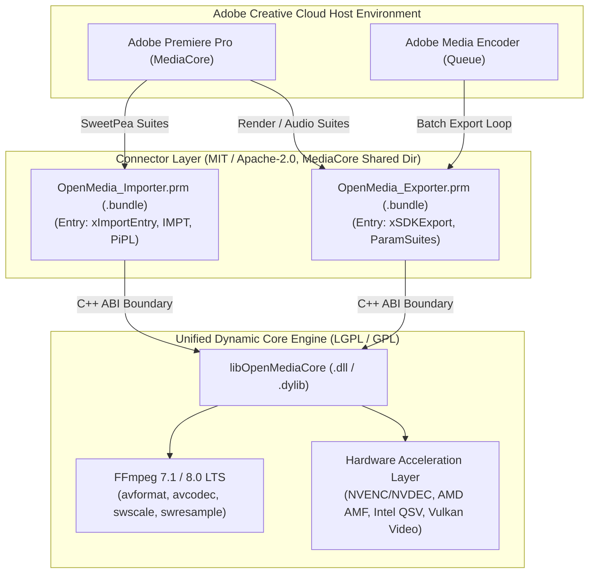
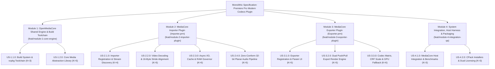

# Master Architecture Decomposition Roadmap
## Project: Open-Source Modern Codec & Container Plugin Suite for Adobe Premiere Pro (MediaCore)

- **Domain / Field Profile**: `software` (`.agents/field-profile.json`)
- **Plugin Governance**: `some-divide-and-conquer` (Rules: `AGENTS.md`)
- **Architectural Paradigm**: Connector-Core Separation Pattern (Adobe Premiere Pro C++ SDK + FFmpeg 7.1/8.0 Engine)
- **Target Host Environments**: Adobe Premiere Pro CC, Adobe Media Encoder CC, After Effects CC (Windows x64 `.prm` / macOS Apple Silicon & x86_64 `.bundle`)

---

## 1. Executive Architectural Summary

The monolithic specification defines an open-source, production-grade media infrastructure plugin for **Adobe Premiere Pro** and **Adobe Media Encoder** to provide native import and export capabilities for modern multimedia containers (**MKV**, **WebM**, AVI, MP4) and high-efficiency video/audio codecs (**AV1**, **VP9**, **VP8**, **Opus**, **FLAC**).

### 1.1 The Connector-Core Architectural Invariant
Adobe Premiere Pro’s C++ SDK enforces a strict single-entry-point rule per binary DLL/bundle (`xImportEntry` for Importers; `xSDKExport` for Exporters). Furthermore, Adobe SDK headers carry proprietary licensing, while FFmpeg components utilize LGPL/GPL. 

To overcome these structural and legal constraints, the architecture adopts a **three-tier Connector-Core model**:
1. **Host Layer**: Adobe Premiere Pro & Adobe Media Encoder invoking SweetPea callback suites (`PPix Suite`, `Audio Suite`, `SequenceRenderSuite`, `PPixCacheSuite`).
2. **Connector Layer (MIT / Apache-2.0)**: Two lightweight native C++ binaries residing in `MediaCore/7.0`:
   - `OpenMedia_Importer.prm` / `.bundle`: Native Importer connector implementing `xImportEntry` with priority $\ge 100$.
   - `OpenMedia_Exporter.prm` / `.bundle`: Native Exporter connector implementing `xSDKExport`.
3. **Core Media Engine Layer (`libOpenMediaCore`, LGPLv2.1+ / GPLv3)**: Shared dynamic runtime library linking FFmpeg (`libavformat`, `libavcodec`, `libswscale`, `libswresample`, `libavutil`) and hardware acceleration SDKs (NVIDIA NVENC/NVDEC, AMD AMF, Intel QSV, Vulkan Video).



---

## 2. Four-Level Decomposition Hierarchy



---

## 3. Dynamic Unit Sizing Matrix ($S_{\text{story}} \to K$) Summary

Every User Story is evaluated across the 4 weighted dimensions defined in `spec-decomposition`:
$$S_{\text{story}} = (0.35 \times D_1) + (0.25 \times D_2) + (0.20 \times D_3) + (0.20 \times D_4)$$
- $D_1$ (35%): Functional / Deliverable Surface (Endpoints / Components / Handlers)
- $D_2$ (25%): Production Code Volume (LOC)
- $D_3$ (20%): Logic / Concurrency / Algorithmic Complexity
- $D_4$ (20%): Disjoint File Boundaries

| Story ID | User Story Title | $D_1$ (35%) | $D_2$ (25%) | $D_3$ (20%) | $D_4$ (20%) | Score $S_{\text{story}}$ | Unit Count ($K$) | Target Slice Size |
| :--- | :--- | :---: | :---: | :---: | :---: | :---: | :---: | :--- |
| **`US-1.1.0`** | Cross-Platform Build System & vcpkg Infrastructure | 2 | 2 | 2 | 2 | **2.00** | **3 Units** | ~170 LOC / unit |
| **`US-1.2.0`** | Unified OpenMediaCore Media Abstraction Engine | 2 | 3 | 3 | 3 | **2.65** | **5 Units** | ~160 LOC / unit |
| **`US-2.1.0`** | Importer Entry, Resource Registration & Stream Probing | 2 | 2 | 3 | 2 | **2.20** | **4 Units** | ~150 LOC / unit |
| **`US-2.2.0`** | Video Frame Decoding, Color Spaces & 16-Byte Stride | 3 | 3 | 3 | 3 | **3.00** | **5 Units** | ~180 LOC / unit |
| **`US-2.3.0`** | Async I/O Importer, PPix Cache & RAM Governor | 3 | 3 | 4 | 3 | **3.20** | **6 Units** | ~180 LOC / unit |
| **`US-2.4.0`** | Zero-Conform 32-bit Planar Audio & Multi-Channel Pipeline | 3 | 3 | 2 | 3 | **2.80** | **5 Units** | ~150 LOC / unit |
| **`US-3.1.0`** | Exporter Registration Loop & Dynamic Parameter UI | 3 | 3 | 3 | 3 | **3.00** | **5 Units** | ~170 LOC / unit |
| **`US-3.2.0`** | Dual Push/Pull Export Render Loops & Progress Watchdog | 2 | 3 | 3 | 3 | **2.65** | **5 Units** | ~160 LOC / unit |
| **`US-3.3.0`** | Multi-Codec Hardware/Software Pipeline & Fallback | 3 | 3 | 4 | 3 | **3.20** | **6 Units** | ~200 LOC / unit |
| **`US-4.1.0`** | MediaCore Host Verification & Latency Benchmarks | 2 | 2 | 2 | 2 | **2.00** | **3 Units** | ~200 LOC / unit |
| **`US-4.2.0`** | Cross-Platform CPack Packaging & License Audit | 2 | 2 | 2 | 2 | **2.00** | **3 Units** | ~170 LOC / unit |
| **TOTAL** | **4 Modules, 11 User Stories** | — | — | — | — | — | **50 Units** | **100% Parallel** |

---

## 4. Hard Architectural Invariants & Discipline

### Invariant A: Pure Deliverable Production Only
Every unit `unit-1..K` MUST produce primary executable production artifacts and corresponding unit tests. Zero "validation-only", "review-only", or "integration-test-only" units are permitted. Story-wide and module-wide integration testing is executed exclusively at the Story Leader tier after cascading merges.

### Invariant B: Zero Inter-Unit Blocking (100% Parallel Execution)
All $K$ Unit Implementers within a story execute concurrently in isolated Git worktrees without waiting for sibling units. Zero blocking is guaranteed by:
1. **Disjoint File Paths**: Each unit exclusively authors its designated source and test files.
2. **Base Contract Seeding**: All shared structs, C++ abstract interfaces, and enums are committed to the story branch (`feat/us-M.S.0-<slug>`) *prior* to branching `unit-1..K`.
3. **Independent Compilation**: Each unit links against the base contract and builds/tests independently.

### Invariant C: Mandatory `.worktrees/` Directory Isolation
No agent may edit files on `main` or in the root workspace. All feature branches, bugfixes, and reviews must occur within dedicated worktrees at `.worktrees/<branch-sanitized-name>`.

### Invariant D: Cascading PR Pipeline & In-PR Conversation Reporting
Units merge strictly via `gh pr merge <PR> --merge` in ordered sequence ($1 \to 2 \to \dots \to K$). All Implementation Reports, Security Audits (Gate G2), Complexity Metrics (Gate G-Complexity), and Review Verdicts (Gate G-Review) are posted directly into GitHub PR conversations (`gh pr comment`). Local markdown clutter (`.agents/reports/`, `KANBAN.md`) is prohibited.

---

## 5. Specification Directory Layout (`docs/user-stories/`)

```text
docs/
├── architecture/
│   └── DECOMPOSITION_ROADMAP.md                 # Master Architecture Roadmap (this file)
└── user-stories/
    ├── module-1-core-engine/
    │   ├── README.md                            # Module 1 Overview, Story Index, Shared Contracts
    │   ├── us-1.1.0-build-system-vcpkg.md       # US-1.1.0 Complete Spec Kit (K=3)
    │   └── us-1.2.0-core-media-library.md       # US-1.2.0 Complete Spec Kit (K=5)
    ├── module-2-importer-plugin/
    │   ├── README.md                            # Module 2 Overview, Selectors Lifecycle
    │   ├── us-2.1.0-importer-registration-stream-discovery.md # US-2.1.0 Complete Spec Kit (K=4)
    │   ├── us-2.2.0-video-decoding-pixel-alignment.md         # US-2.2.0 Complete Spec Kit (K=5)
    │   ├── us-2.3.0-async-caching-memory-governor.md          # US-2.3.0 Complete Spec Kit (K=6)
    │   └── us-2.4.0-zero-conform-audio-pipeline.md            # US-2.4.0 Complete Spec Kit (K=5)
    ├── module-3-exporter-plugin/
    │   ├── README.md                            # Module 3 Overview, Exporter Lifecycle
    │   ├── us-3.1.0-exporter-registration-params-ui.md        # US-3.1.0 Complete Spec Kit (K=5)
    │   ├── us-3.2.0-export-render-engine.md                   # US-3.2.0 Complete Spec Kit (K=5)
    │   └── us-3.3.0-codecs-hardware-fallback.md               # US-3.3.0 Complete Spec Kit (K=6)
    └── module-4-integration-qa/
        ├── README.md                            # Module 4 Overview, Host Harness Layout
        ├── us-4.1.0-mediacore-host-integration-harness.md     # US-4.1.0 Complete Spec Kit (K=3)
        └── us-4.2.0-cpack-distribution-packaging.md           # US-4.2.0 Complete Spec Kit (K=3)
```

---

## 6. Six Quality Gates Enforcement

All unit PRs, story promotion PRs, and module PRs must obtain unconditional sign-off across all 6 quality gates:
1. **Gate G0 (Build, Lint & Format)**: 0 compiler errors, 0 linter warnings (Clang-Tidy), 100% `clang-format` compliance.
2. **Gate G1 (Tests & Traceability)**: 100% acceptance criteria verified; $\ge 90\%$ line coverage, $\ge 85\%$ branch coverage.
3. **Gate G2 (Security Gateway — `security-audit`)**: 0 CVE/CWE vulnerabilities, STRIDE threat mitigation, memory-safety invariants, constant-time crypto comparison, zero secret leaks.
4. **Gate G-Complexity (`cyclomatic-complexity`)**: Cyclomatic Complexity $CC \le 6$ target, $CC \le 10$ ceiling, $CC > 15$ hard merge blocker; nesting depth $\le 2$.
5. **Gate G-Docs**: 100% public C++ APIs documented with Doxygen comments and runnable unit test demonstrations.
6. **Gate G-Review**: Formal review verdict posted to the GitHub PR conversation by the independent Reviewing Council President.
