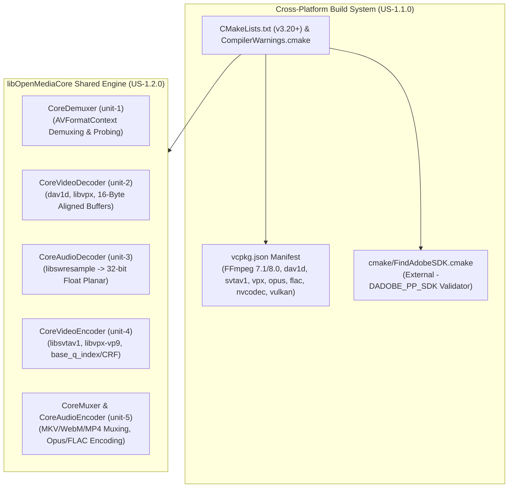

# Module 1: OpenMediaCore Shared Engine & Build Infrastructure

- **Module Identifier**: `module-1-core-engine`
- **Module Branch**: `feat/module-1-core-engine`
- **Field Profile**: `software` (`.agents/field-profile.json`)
- **Primary Deliverables**:
  1. Cross-platform CMake ($\ge 3.20$) + Microsoft `vcpkg` build toolchain with pinned FFmpeg 7.1 LTS / 8.0 dependencies (`dav1d`, `svtav1`, `vpx`, `opus`, `flac`, `nvcodec`, `vulkan`) and external Adobe Premiere Pro C++ SDK resolution (`-DADOBE_PP_SDK=/path/to/sdk`).
  2. `libOpenMediaCore` unified C++17 dynamic library (`.dll` / `.dylib`) isolating Adobe proprietary SDK headers from LGPLv2.1+/GPLv3 FFmpeg internals under the **Connector-Core pattern**.
  3. Complete demuxing (`CoreDemuxer`), video decoding (`CoreVideoDecoder`), 32-bit float planar audio decoding/resampling (`CoreAudioDecoder`), video encoding (`CoreVideoEncoder`), and container muxing + audio encoding (`CoreMuxer`) subsystems with standalone CTest suites.

---

## 1. Module Overview & Architectural Context

Module 1 forms the foundational core of the entire plugin suite. Because Adobe Premiere Pro enforces a single entry point per binary (`xImportEntry` in `OpenMedia_Importer.prm` and `xSDKExport` in `OpenMedia_Exporter.prm`), statically linking FFmpeg into both connectors would cause duplicate symbol collisions, massive binary bloat, and license incompatibility between Adobe's proprietary SDK headers and FFmpeg's LGPL/GPL terms.

Module 1 establishes:
1. **`libOpenMediaCore`**: A shared dynamic library exporting a clean C++17 ABI encapsulating `libavformat`, `libavcodec`, `libswscale`, `libswresample`, and `libavutil`.
2. **Strict License Isolation**: Adobe SDK headers are never committed to the repository; CMake validates `-DADOBE_PP_SDK=/path/to/sdk` externally.
3. **Complete Codec & Hardware Manifest**: Version-pinned `vcpkg.json` providing software and hardware codecs (`dav1d`, `svtav1`, `vpx`, `opus`, `flac`, `nvcodec`, `vulkan`).



---

## 2. User Story Index & Dynamic Sizing

| Story ID | Branch | Title | Score ($S_{\text{story}}$) | Unit Count ($K$) | Status |
| :--- | :--- | :--- | :---: | :---: | :---: |
| **`US-1.1.0`** | `feat/us-1.1.0-build-system-vcpkg` | Cross-Platform Build System & vcpkg Toolchain | **2.00** | **3 Units** | `Ready` |
| **`US-1.2.0`** | `feat/us-1.2.0-core-media-library` | Unified OpenMediaCore Media Abstraction Engine | **2.65** | **5 Units** | `Ready` |

---

## 3. Base Contract Seeding for Module 1 (`include/openmedia/core_types.hpp`)

To guarantee **Invariant B (Zero Inter-Unit Blocking)** across all stories in Module 1, Module 2, and Module 3, the complete C++17 base contract is seeded on `feat/module-1-core-engine` before branching:

```cpp
// include/openmedia/core_types.hpp
#pragma once
#include <cstdint>
#include <cstddef>
#include <string>
#include <memory>
#include <vector>

namespace openmedia {

enum class MediaType { Video, Audio, Subtitle, Unknown };

enum class VideoCodecID { AV1, VP9, VP8, FFV1, H264, HEVC, ProRes, Unknown };
enum class AudioCodecID { Opus, FLAC, Vorbis, AAC, PCM, Unknown };
enum class SubtitleCodecID { SRT, ASS, WebVTT, Unknown };

enum class PixelFormat {
    BGRA_8U,                // PrPixelFormat_BGRA_4444_8u (Standard 8-bit + Alpha)
    YUV420P_8U,             // PrPixelFormat_YUV_420_MPEG4_FIELD_PICTURE_PLANAR_8u_601/709
    YUV420P_10LE,           // 10-bit 4:2:0 planar
    YUV422P_10LE,           // 10-bit 4:2:2 planar
    YUV444P_10LE,           // 10-bit 4:4:4 planar (AV1 Professional Profile 2)
    YUV444P_12LE,           // 12-bit 4:4:4 planar
    RGB444_10U,             // PrPixelFormat_RGB_444_10u (10-bit HDR)
    UYVY_422_32F,           // PrPixelFormat_UYVY_422_32f (32-bit float YUV)
    BGRA_4444_32F_LINEAR,   // PrPixelFormat_BGRA_4444_32f_Linear (32-bit float Linear HDR)
    NV12,                   // Hardware surface 8-bit 4:2:0
    P010LE                  // Hardware surface 10-bit 4:2:0
};

enum class ChromaSubsampling { YUV420, YUV422, YUV444 };

enum class HardwareAccelBackend {
    None,           // Pure CPU software decoding/encoding (dav1d / libsvtav1 / libvpx)
    D3D11VA,        // Direct3D 11 Video Acceleration
    NVDEC,          // NVIDIA NVDEC hardware decode
    NVENC,          // NVIDIA NVENC hardware encode (requires driver >= 570.0 for AV1/HEVC in FFmpeg 8.0)
    AMF,            // AMD Advanced Media Framework
    QSV_VAAPI,      // Intel QuickSync Video / VA-API
    VulkanVideo     // FFmpeg 8.0 Vulkan Video (VK_KHR_video_encode_av1 / decode_vp9 / decode_av1)
};

struct RationalTime {
    int64_t num{0};
    int64_t den{1};
};

struct StreamInfo {
    int streamIndex{-1};
    MediaType type{MediaType::Unknown};
    VideoCodecID videoCodec{VideoCodecID::Unknown};
    AudioCodecID audioCodec{AudioCodecID::Unknown};
    std::string codecName;
    RationalTime timebase;
    int64_t durationTicks{0};
    // Video properties
    int width{0};
    int height{0};
    RationalTime frameRate;         // vidScale = num, vidSampleSize = den
    RationalTime pixelAspectRatio{1, 1};
    PixelFormat pixFmt{PixelFormat::BGRA_8U};
    ChromaSubsampling chroma{ChromaSubsampling::YUV420};
    int bitDepth{8};
    bool hasAlpha{false};
    bool isVFR{false};
    // Audio properties
    int sampleRate{0};
    int channels{0};
    uint64_t channelLayoutMask{0};
};

struct RawVideoFrame {
    int width{0};
    int height{0};
    PixelFormat format{PixelFormat::BGRA_8U};
    int bitDepth{8};
    int rowBytes[4]{0};             // Guaranteed 16-byte aligned row stride
    uint8_t* planes[4]{nullptr};
    int64_t pts{0};
    int64_t dts{0};
    int64_t frameIndex{0};
    bool isKeyframe{false};
};

struct RawAudioBatch {
    int sampleRate{0};
    int channels{0};
    int numSamples{0};
    float** planarData{nullptr};    // 32-bit float uninterleaved (0 dB = +/- 1.0f)
    int64_t startSamplePts{0};
};

struct EncodedPacket {
    int streamIndex{0};
    MediaType mediaType{MediaType::Unknown};
    std::vector<uint8_t> data;
    int64_t pts{0};
    int64_t dts{0};
    int64_t duration{0};
    bool isKeyframe{false};
};

struct VideoEncodeConfig {
    VideoCodecID codec{VideoCodecID::AV1};
    HardwareAccelBackend hwBackend{HardwareAccelBackend::None};
    int width{1920};
    int height{1080};
    RationalTime frameRate{30000, 1001};
    RationalTime pixelAspectRatio{1, 1};
    PixelFormat inputPixFmt{PixelFormat::BGRA_8U};
    ChromaSubsampling targetChroma{ChromaSubsampling::YUV420};
    int bitDepth{8};                // 8, 10, or 12
    int normalizedCrf{24};          // UI Slider 0..63 -> mapped to base_q_index (0..255) or CQ (0..51)
    int targetBitrateKbps{0};
    int maxBitrateKbps{0};
    int gopSize{120};
    int preset{6};
    bool twoPass{false};
    int passNumber{1};
    std::string statsLogData;
};

struct AudioEncodeConfig {
    AudioCodecID codec{AudioCodecID::Opus};
    int sampleRate{48000};
    int channels{2};
    uint64_t channelLayoutMask{0};
    int bitrateKbps{192};
};

struct SubtitleTrackConfig {
    SubtitleCodecID codec{SubtitleCodecID::SRT};
    std::string languageCode{"eng"}; // ISO 639-2 / RFC 5646
    std::string title;
};

class ICoreDemuxer {
public:
    virtual ~ICoreDemuxer() = default;
    virtual bool openFile(const std::string& utf8Path) = 0;
    virtual std::vector<StreamInfo> getStreams() const = 0;
    virtual bool readNextPacket(EncodedPacket& outPacket) = 0;
    virtual bool seekToTimestamp(int streamIndex, int64_t targetPts, bool backwardKeyframe = true) = 0;
    virtual void quietFile() = 0;   // Releases file descriptors on Premiere imQuietFile
    virtual void close() = 0;
};

class ICoreVideoDecoder {
public:
    virtual ~ICoreVideoDecoder() = default;
    virtual bool initialize(const StreamInfo& stream, HardwareAccelBackend preferredHw = HardwareAccelBackend::None) = 0;
    virtual bool sendPacket(const EncodedPacket& packet) = 0;
    virtual bool decodeNextFrame(RawVideoFrame& outFrame) = 0;
    virtual HardwareAccelBackend activeBackend() const = 0;
    virtual void flush() = 0;
};

class ICoreAudioDecoder {
public:
    virtual ~ICoreAudioDecoder() = default;
    virtual bool initialize(const StreamInfo& stream, int targetSampleRate = 0) = 0;
    virtual bool sendPacket(const EncodedPacket& packet) = 0;
    virtual bool decodeAudioBatch(int numRequestedSamples, RawAudioBatch& outBatch) = 0;
    virtual void flush() = 0;
};

class ICoreVideoEncoder {
public:
    virtual ~ICoreVideoEncoder() = default;
    virtual bool initialize(const VideoEncodeConfig& config) = 0;
    virtual bool encodeFrame(const RawVideoFrame& frame, std::vector<EncodedPacket>& outPackets) = 0;
    virtual bool flush(std::vector<EncodedPacket>& outPackets) = 0;
    virtual HardwareAccelBackend activeBackend() const = 0;
};

class ICoreAudioEncoder {
public:
    virtual ~ICoreAudioEncoder() = default;
    virtual bool initialize(const AudioEncodeConfig& config) = 0;
    virtual bool encodeAudioBatch(const RawAudioBatch& batch, std::vector<EncodedPacket>& outPackets) = 0;
    virtual bool flush(std::vector<EncodedPacket>& outPackets) = 0;
};

class ICoreMuxer {
public:
    virtual ~ICoreMuxer() = default;
    virtual bool openContainer(const std::string& outputPath, const std::string& formatName) = 0;
    virtual int addVideoStream(const VideoEncodeConfig& config) = 0;
    virtual int addAudioStream(const AudioEncodeConfig& config) = 0;
    virtual int addSubtitleStream(const SubtitleTrackConfig& config) = 0;
    virtual bool writeHeader() = 0;
    virtual bool writeInterleavedPacket(const EncodedPacket& packet) = 0;
    virtual bool writeTrailerAndClose() = 0;
};

} // namespace openmedia
```

---

## 4. Cascading Merge & Validation Plan

1. **US-1.1.0 Execution**: Units `unit-1..3` execute in parallel worktrees and merge cascadingly ($1 \to 2 \to 3$) into `feat/us-1.1.0-build-system-vcpkg`, followed by Gate G0..G-Review sign-off into `feat/module-1-core-engine`.
2. **US-1.2.0 Execution**: Units `unit-1..5` execute in parallel worktrees and merge cascadingly ($1 \to 2 \to 3 \to 4 \to 5$) into `feat/us-1.2.0-core-media-library`, followed by Gate G0..G-Review sign-off into `feat/module-1-core-engine`.
3. **Module 1 Promotion**: Module Leader runs the complete CTest suite under AddressSanitizer (ASan) and merges `feat/module-1-core-engine` into `main`.

---

## 5. Influx v1.7.1 & v2.0.0 Beta 1 Core Engine Enhancements

1. **Dual-PRM Build Targets & Binary Hardening (`US-1.1.0`)**:
   - Builds both `OpenMedia_Importer.prm` (normal priority `0x00`) and `OpenMedia_ImporterHP.prm` (high priority `0x01`) from shared object library `OpenMedia_Importer_obj`, with Release `LTCG`, `AVX2`/`SSE4.1` SIMD flags, and Windows PE security flags (`ASLR`, `DEP/NX`, `High Entropy VA`).
2. **WebM Final-Frame Drain, Timestamp Zeroing & Empty-Video Guard (`US-1.2.0` — `CoreDemuxer` & `CoreVideoDecoder`)**:
   - Normalizes non-zero start timestamps (`start_time > 0` or `!rft=1`) so frame 0 corresponds to the first decoded picture.
   - Drains all buffered frames at EOF so WebM (VP9/AV1) and Chrome/YouTube recordings never drop their final frame.
   - Rejects files with zero decodable video frames (`CoreStatus::NoDecodableFrames`: `"No decodable video frames in file"`).
   - Integrates `NVDEC`, `D3D11VA`, and `VideoToolbox` (Apple Silicon M1+) hardware decode contexts with `drainBeforeFallback()` for seamless CPU fallback.
3. **Fault-Tolerant Audio, `xHE-AAC`, Silent Stream Synthesis & 5/6-Channel MOV PCM (`US-1.2.0` — `CoreAudioDecoder`)**:
   - Supports `Opus`, `FLAC`, `Vorbis`, `xHE-AAC`, `AAC`, `MP3`, `AC3`, `DTS`, and 5/6-channel MOV `PCM` (e.g., ARRI AMIRA ProRes).
   - Substitutes planar float silence (`0.0f`) on isolated corrupt audio packets or empty declared audio tracks instead of failing the import, and immediately releases OS file handles on fatal audio errors so files are never locked on Windows.
