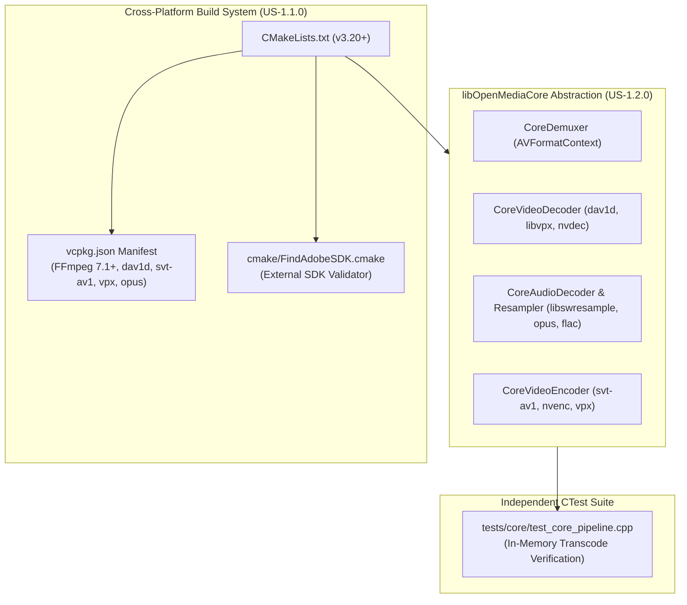

# Module 1: OpenMediaCore Shared Engine & Build Infrastructure

- **Module Identifier**: `module-1-core-engine`
- **Module Branch**: `feat/module-1-core-engine`
- **Field Profile**: `software` (`.agents/field-profile.json`)
- **Primary Deliverables**:
  1. Cross-platform CMake + vcpkg build toolchain with pinned FFmpeg 7.1/8.0 dependencies and external Adobe Premiere Pro C++ SDK integration.
  2. `libOpenMediaCore` unified C++ abstraction library isolating Adobe SDK interfaces from FFmpeg LGPL/GPL implementations.
  3. Standalone CTest test harness verifying in-memory demuxing, decoding, audio resampling, and encoding independent of Adobe Premiere Pro.

---

## 1. Module Overview & Architectural Context

Module 1 forms the foundational core of the entire plugin suite. In accordance with the **Connector-Core architectural pattern**, Adobe Premiere Pro requires separate plugin binaries for importers (`.prm`) and exporters (`.prm`). Direct linkage of FFmpeg libraries into both plugin connectors would cause duplicate symbol collisions, binary bloat, and license violations.

Module 1 establishes:
1. **`libOpenMediaCore`**: A shared dynamic library (`.dll` on Windows, `.dylib` on macOS) providing a clean, thread-safe C++17 API encapsulating FFmpeg (`libavformat`, `libavcodec`, `libswscale`, `libswresample`, `libavutil`).
2. **Strict License Separation**: Adobe proprietary headers are kept strictly outside the repository via CMake `-DADOBE_PP_SDK=/path/to/sdk`. The connector layer is MIT-licensed, while `libOpenMediaCore` encapsulates FFmpeg under LGPLv2.1+/GPLv3.
3. **Reproducible vcpkg Manifest**: Dependency version pinning for FFmpeg 7.1/8.0, dav1d, SVT-AV1, libvpx, opus, and flac across Windows and macOS.



---

## 2. User Story Index & Dynamic Sizing

| Story ID | Branch | Title | Score ($S_{\text{story}}$) | Unit Count ($K$) | Status |
| :--- | :--- | :--- | :---: | :---: | :---: |
| **`US-1.1.0`** | `feat/us-1.1.0-build-system-vcpkg` | Cross-Platform Build System & vcpkg Toolchain | 2.00 | **3 Units** | `Todo` |
| **`US-1.2.0`** | `feat/us-1.2.0-core-media-library` | Unified OpenMediaCore Media Abstraction Engine | 2.65 | **5 Units** | `Todo` |

---

## 3. Base Contract Seeding for Module 1

To guarantee **Invariant B (Zero Inter-Unit Blocking)**, the following base C++ interfaces and structs are seeded on `feat/module-1-core-engine` and the respective story branches before spawning unit implementers:

```cpp
// include/openmedia/core_types.hpp
#pragma once
#include <cstdint>
#include <string>
#include <memory>
#include <vector>

namespace openmedia {

enum class MediaType { Video, Audio, Subtitle, Unknown };

enum class VideoCodecID { AV1, VP9, VP8, H264, HEVC, ProRes, Unknown };
enum class AudioCodecID { Opus, FLAC, AAC, PCM, Vorbis, Unknown };

enum class PixelFormat {
    BGRA_8U,
    YUV420P_8U,
    YUV420P_10LE,
    RGB444_10U,
    UYVY_422_32F,
    BGRA_4444_32F_LINEAR,
    NV12
};

struct RationalTime {
    int64_t num{0};
    int64_t den{1};
};

struct StreamInfo {
    int streamIndex{-1};
    MediaType type{MediaType::Unknown};
    std::string codecName;
    RationalTime timebase;
    int64_t durationTicks{0};
    // Video
    int width{0};
    int height{0};
    RationalTime frameRate;
    PixelFormat pixFmt{PixelFormat::BGRA_8U};
    int bitDepth{8};
    // Audio
    int sampleRate{0};
    int channels{0};
    uint64_t channelLayout{0};
};

struct RawVideoFrame {
    int width{0};
    int height{0};
    PixelFormat format;
    int rowBytes[4]{0};
    uint8_t* planes[4]{nullptr};
    int64_t pts{0};
    bool isKeyframe{false};
};

struct RawAudioBatch {
    int sampleRate{0};
    int channels{0};
    int numSamples{0};
    float** planarData{nullptr}; // 32-bit float non-interleaved
    int64_t pts{0};
};

class ICoreDemuxer {
public:
    virtual ~ICoreDemuxer() = default;
    virtual bool openFile(const std::string& path) = 0;
    virtual std::vector<StreamInfo> getStreams() const = 0;
    virtual bool seekExact(int streamIndex, int64_t targetPts) = 0;
    virtual void close() = 0;
};

class ICoreVideoDecoder {
public:
    virtual ~ICoreVideoDecoder() = default;
    virtual bool initialize(const StreamInfo& stream) = 0;
    virtual bool decodeNextFrame(RawVideoFrame& outFrame) = 0;
    virtual void flush() = 0;
};

class ICoreAudioDecoder {
public:
    virtual ~ICoreAudioDecoder() = default;
    virtual bool initialize(const StreamInfo& stream) = 0;
    virtual bool decodeAudioBatch(int numRequestedSamples, RawAudioBatch& outBatch) = 0;
    virtual void flush() = 0;
};

} // namespace openmedia
```

---

## 4. Cascading Merge & Validation Plan

1. **Unit Execution**: Units `unit-1..3` of US-1.1.0 execute in parallel; merge cascadingly $1 \to 2 \to 3$ into `feat/us-1.1.0-build-system-vcpkg`.
2. **Story 1.1 Review**: Council review Gate G0..G-Review on Story PR #1. Cascading merge into `feat/module-1-core-engine`.
3. **Unit Execution**: Units `unit-1..5` of US-1.2.0 execute in parallel; merge cascadingly $1 \to \dots \to 5$ into `feat/us-1.2.0-core-media-library`.
4. **Story 1.2 Review**: Council review Gate G0..G-Review on Story PR #2. Cascading merge into `feat/module-1-core-engine`.
5. **Module PR**: Module Leader opens PR into `main` (`feat(module-1): OpenMediaCore Engine & Build Toolchain`), runs whole-module CTest suite, and merges via `gh pr merge`.
