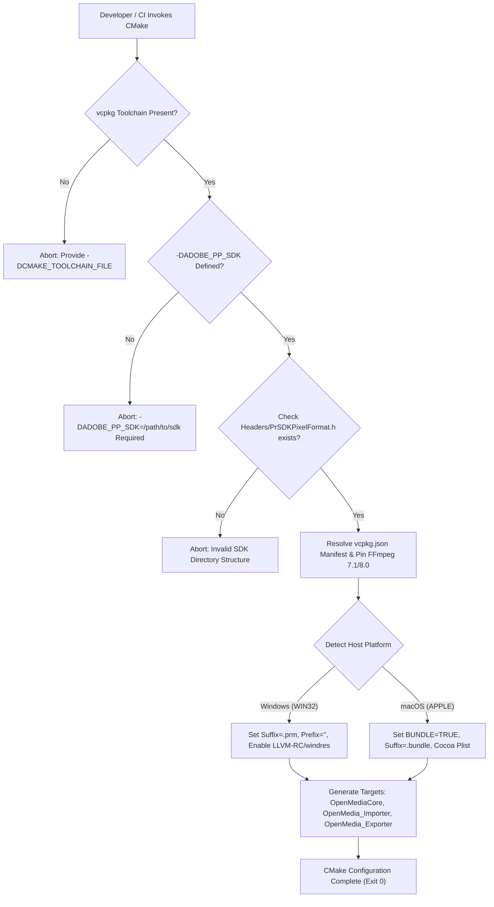

# User Story `US-1.1.0`: Cross-Platform Build System & vcpkg Toolchain

- **Module**: `module-1-core-engine`
- **Story Branch**: `feat/us-1.1.0-build-system-vcpkg`
- **Field Profile**: `software` (`.agents/field-profile.json`)
- **Story Decomposition Score ($S_{\text{story}}$)**: `2.00` $\to$ **`3` Parallel Implementation Units (`unit-1..3`)**

---

## 1. Spec Kit Specifications

### 1.1 User Story Narrative
> **As an** open-source plugin engineer,  
> **I want** a standardized cross-platform CMake (>=3.20) and vcpkg build infrastructure with external Adobe Premiere Pro SDK linking,  
> **So that** developers on Windows and macOS can build and package the importer and exporter binaries (`.prm` and `.bundle`) reproducibly without committing proprietary Adobe SDK headers or dealing with binary dependency drift.

#### 1.1.1 Preconditions
- CMake >= 3.20 and C++17 compatible compiler (MSVC 2019/2022 on Windows; Apple Clang / LLVM on macOS) installed on system `$PATH`.
- Git and GitHub CLI (`gh`) verified via `./scripts/preflight-check.sh`.
- Microsoft vcpkg available or configured via submodule/environment variable `VCPKG_ROOT`.

#### 1.1.2 Postconditions
- `cmake -B build -S . -DCMAKE_TOOLCHAIN_FILE=[vcpkg]/scripts/buildsystems/vcpkg.cmake -DADOBE_PP_SDK=/path/to/sdk` successfully configures the project.
- Pinned FFmpeg 7.1/8.0 libraries (`avformat`, `avcodec`, `swscale`, `swresample`, `avutil`) are fetched and built via vcpkg manifest mode.
- Missing `-DADOBE_PP_SDK` emits a fatal CMake configuration error explaining how to acquire the SDK, protecting repository legal compliance.

### 1.2 Acceptance Criteria (Gherkin Scenarios)

```gherkin
Feature: Cross-Platform Build Toolchain and External SDK Resolution

  Scenario: AC-1 — Successful CMake configuration with valid external SDK path
    Given a clean workspace with vcpkg manifest mode enabled
    And a valid path to Adobe Premiere Pro SDK passed via -DADOBE_PP_SDK
    When CMake configuration is executed with CMAKE_BUILD_TYPE=Release
    Then CMake successfully discovers all required FFmpeg pkg-config/vcpkg targets
    And verifies the existence of Adobe SDK "Headers" and "Utils" directories
    And defines targets for libOpenMediaCore, OpenMedia_Importer, and OpenMedia_Exporter

  Scenario: AC-2 — Missing Adobe SDK parameter rejection
    Given a developer running CMake configuration without -DADOBE_PP_SDK
    When CMake generates build files
    Then CMake terminates with FATAL_ERROR
    And prints a clear message directing the developer to provide -DADOBE_PP_SDK=/path/to/sdk
    And leaves zero incomplete build artifacts

  Scenario: AC-3 — Dependency version pinning and target naming invariant
    Given the vcpkg manifest file vcpkg.json
    When dependencies are resolved
    Then FFmpeg version is strictly pinned to 7.1 LTS or 8.0
    And includes sub-libraries: libavformat, libavcodec, libswscale, libswresample, libavutil
    And outputs .prm suffix on WIN32 and .bundle on APPLE
```

### 1.3 Test Cases & Traceability Matrix

| Test Case ID | Mapped AC | Owning Unit | Test Level | Description & Input Vector | Expected Result & Pass Threshold |
| :--- | :---: | :---: | :---: | :--- | :--- |
| `TC-1.1.1` | `AC-1` | `unit-1` | Unit (CMake) | Run `cmake -B build -DADOBE_PP_SDK=tests/mocks/mock_sdk` | Configuration passes; exit code 0 |
| `TC-1.1.2` | `AC-2` | `unit-3` | Negative | Run `cmake -B build` without `-DADOBE_PP_SDK` | FATAL_ERROR emitted; exit code != 0 |
| `TC-1.1.3` | `AC-3` | `unit-2` | Manifest Check | Parse `vcpkg.json` for exact version pinning | All 6 FFmpeg libs pinned; 0 unversioned deps |

---

## 2. Technical Implementation Plan

### 2.1 Domain Invariants & Storage Schema
- **License Boundary Isolation**: The repository MUST NOT contain Adobe Premiere Pro SDK proprietary header files (`PrSDK*.h`). CMake enforces external path consumption.
- **Binary Suffix Invariant**:
  - Windows: Prefix `""`, Suffix `".prm"` (Dynamic link library recognized by Adobe MediaCore).
  - macOS: `BUNDLE TRUE`, Suffix `".bundle"`.
- **vcpkg Manifest Configuration (`vcpkg.json`)**:
```json
{
  "$schema": "https://raw.githubusercontent.com/microsoft/vcpkg-tool/main/docs/vcpkg.schema.json",
  "name": "openmedia-premiere-plugin",
  "version-string": "1.0.0",
  "dependencies": [
    {
      "name": "ffmpeg",
      "version>=": "7.1.0",
      "default-features": false,
      "features": ["avcodec", "avformat", "swscale", "swresample", "avutil", "vpx", "opus", "dav1d"]
    }
  ],
  "builtin-baseline": "382a945938bf804c0ecdd61c94297b7b2de2dc3b"
}
```

### 2.2 Activity Diagram



---

## 3. Expected Folder Architecture at the Project

```text
d:\AV1\
├── CMakeLists.txt                               # Owned by unit-1
├── vcpkg.json                                   # Owned by unit-2
├── vcpkg-configuration.json                     # Owned by unit-2
├── cmake/
│   ├── FindAdobeSDK.cmake                       # Owned by unit-3
│   └── CompilerWarnings.cmake                   # Owned by unit-1
└── tests/
    └── mocks/
        └── mock_sdk/                            # Owned by unit-3
            └── Examples/
                ├── Headers/PrSDKPixelFormat.h   # Mock header for CI testing
                └── Utils/PrSDKEntry.h
```

---

## 4. Implementation Units in Detail & Specialist Agent Assignment

### 4.1 Story Decomposition Score ($S_{\text{story}}$) & Dynamic Unit Count ($K$)
- **$D_1$ (35% Surface)**: `2` (3 CMake modules/manifests)
- **$D_2$ (25% Volume)**: `2` (~500 LOC CMake scripts)
- **$D_3$ (20% Complexity)**: `2` (Cross-platform toolchain flags and target properties)
- **$D_4$ (20% Boundaries)**: `2` (3 orthogonal files)
- **Calculated Score**: $S_{\text{story}} = 0.35(2) + 0.25(2) + 0.20(2) + 0.20(2) = \mathbf{2.00} \to \mathbf{3\text{ Parallel Units}}$

### 4.2 Detailed Unit Specifications (`unit-1..3`)

#### `unit-1` (`feat/us-1.1.0/unit-1-cmake-core-targets`)
- **Deliverable Scope**: Root `CMakeLists.txt` defining C++17 standard, strict compiler warnings (`CompilerWarnings.cmake`), shared library target `OpenMediaCore`, and connector targets (`OpenMedia_Importer`, `OpenMedia_Exporter`) with OS-specific suffixes (`.prm`/`.bundle`).
- **Owned Files**: `CMakeLists.txt`, `cmake/CompilerWarnings.cmake`.
- **Target Complexity**: $CC \le 4$, nesting $\le 2$.

#### `unit-2` (`feat/us-1.1.0/unit-2-vcpkg-manifest-deps`)
- **Deliverable Scope**: `vcpkg.json` and `vcpkg-configuration.json` configuring manifest mode, pinned FFmpeg 7.1/8.0 with required features (`avcodec`, `avformat`, `swscale`, `swresample`, `dav1d`, `vpx`, `opus`).
- **Owned Files**: `vcpkg.json`, `vcpkg-configuration.json`.
- **Target Complexity**: Strict JSON schema compliance.

#### `unit-3` (`feat/us-1.1.0/unit-3-adobe-sdk-resolver`)
- **Deliverable Scope**: `cmake/FindAdobeSDK.cmake` module that validates `-DADOBE_PP_SDK`, verifies required header presence, and exports `AdobeSDK::Headers` and `AdobeSDK::Utils` imported targets, plus mock SDK fixtures for automated unit testing.
- **Owned Files**: `cmake/FindAdobeSDK.cmake`, `tests/mocks/mock_sdk/Examples/Headers/PrSDKPixelFormat.h`, `tests/mocks/mock_sdk/Examples/Utils/PrSDKEntry.h`.
- **Target Complexity**: $CC \le 4$, nesting $\le 2$.

### 4.3 Best-Fit Specialist Agents per Unit

| Unit ID | Branch Name | Primary Implementer Agent | Reviewing Council Agents | Mandatory Skills Enforced |
| :--- | :--- | :--- | :--- | :--- |
| `unit-1` | `feat/us-1.1.0/unit-1-cmake-core-targets` | `developer-tooling-engineer` | `code-reviewer`, `devops-automator` | `code-review-council`, `cyclomatic-complexity` |
| `unit-2` | `feat/us-1.1.0/unit-2-vcpkg-manifest-deps` | `devops-automator` | `code-reviewer`, `security-architect` | `code-review-council`, `security-audit` |
| `unit-3` | `feat/us-1.1.0/unit-3-adobe-sdk-resolver` | `backend-architect` | `code-reviewer`, `test-automation-engineer` | `code-review-council`, `security-audit` |
| **Patch** | `patch/us-1.1.0-<scope>` | `patch-implementer` | `code-reviewer-council-president` | Full Gate Verification |

### 4.4 Parallel Execution & Zero-Blocking Contract Seeding Plan
1. **Base Contract Seeding**: `cmake/CompilerWarnings.cmake` stub and CMake target names pre-declared on `feat/us-1.1.0-build-system-vcpkg`.
2. **Concurrent Worktrees**: Provision `.worktrees/feat-us-1.1.0-unit-1`, `.worktrees/feat-us-1.1.0-unit-2`, `.worktrees/feat-us-1.1.0-unit-3`.
3. **Cascading Merge Sequence**: `unit-1` $\to$ `unit-2` $\to$ `unit-3` into `feat/us-1.1.0-build-system-vcpkg` via `gh pr merge <PR> --merge`.

---

## 5. Security Gateway (Powered by `security-audit` Skill)

### 5.1 Trust Boundaries & Security Actors
- **Actors**: Local CMake process, vcpkg network fetcher, Git submodules.
- **Trust Boundaries**: External vcpkg artifact downloads from GitHub/upstream tarballs crossing into local compilation pipeline.

### 5.2 Threat Modeling & Abuse Matrix (STRIDE / OWASP ASVS)

| Threat ID | STRIDE | ASVS / CWE | Attack Scenario | Impact | Mitigation Control |
| :--- | :---: | :---: | :--- | :---: | :--- |
| `TM-1.1` | **T**ampering | CWE-494 | Modified upstream FFmpeg dependency tarball | Critical | vcpkg `builtin-baseline` SHA commit pinning and SHA-512 tarball integrity verification |
| `TM-1.2` | **I**nformation Disclosure | CWE-200 | SDK path containing private username logged in build output | Low | Path sanitization in CMake status output |
| `TM-1.3` | **D**enial of Service | CWE-400 | Unbounded recursion in CMake find scripts | Medium | Strict non-recursive target checks |

### 5.3 Cryptography & Global Data Protection Controls
1. **Cryptographic Integrity**: SHA-512 hashes enforced by vcpkg for all downloaded source packages. TLS 1.3 enforced for all dependency downloads.
2. **Zero Proprietary Leakage**: Strict prohibition of committing Adobe copyrighted headers, protecting worldwide intellectual property laws.

### 5.4 Automated Security Verification Checklist
- [ ] `vcpkg.json` validated against official schema.
- [ ] No hardcoded tokens, URLs with embedded credentials, or non-HTTPS mirrors.
- [ ] `FindAdobeSDK.cmake` contains no path traversal (`../`) vulnerabilities.

### 5.5 Security Gateway (Gate G2) Sign-Off Checklist
- [ ] 0 CVE vulnerabilities in pinned dependency tree.
- [ ] Clean scan reported by `security-audit`.
- [ ] Security reviewer sign-off posted to PR conversation.

---

## 6. Validation Gates & Acceptance Sign-Off

| Gate | Gate Name | Pass Criteria | Verification Evidence | Status |
| :--- | :--- | :--- | :--- | :---: |
| **Gate G0** | Build & Lint | CMake configures cleanly on Windows and macOS | `cmake -B build -S .` exit code 0 | `[ ]` |
| **Gate G1** | Tests & Traceability | `TC-1.1.1`, `TC-1.1.2`, `TC-1.1.3` pass 100% | `ctest` execution report | `[ ]` |
| **Gate G2** | Security Gateway | Clean vcpkg dependency audit, 0 CVEs | `security-audit` report on PR | `[ ]` |
| **Gate G-Complexity** | Complexity | CMake scripts nesting depth $\le 2$ | Complexity review comment on PR | `[ ]` |
| **Gate G-Docs** | Documentation | Complete README and configuration guide | Doxygen / CMake documentation | `[ ]` |
| **Gate G-Review** | Review Sign-Off | Independent Reviewing Council Approval | `gh pr comment` sign-off | `[ ]` |
