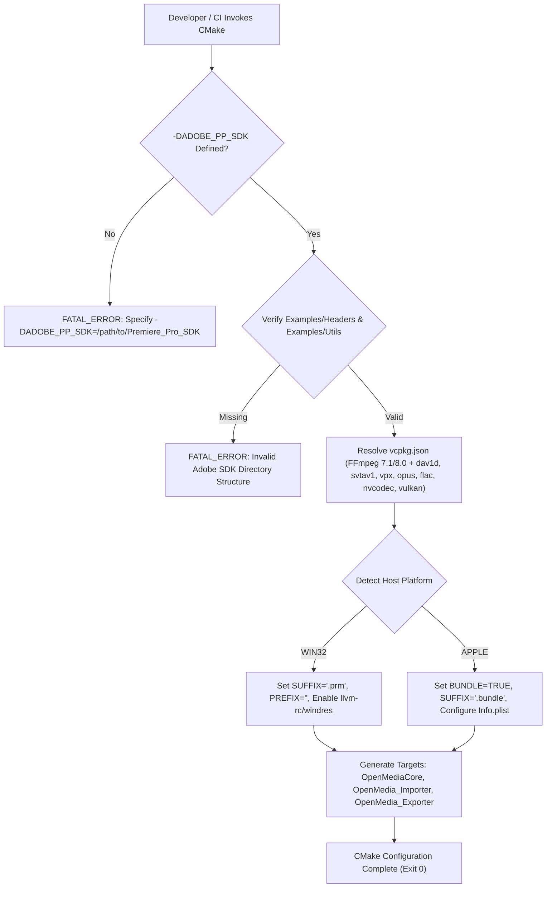

# User Story `US-1.1.0`: Cross-Platform Build System & vcpkg Toolchain

- **Module**: `module-1-core-engine`
- **Story Branch**: `feat/us-1.1.0-build-system-vcpkg`
- **Field Profile**: `software` (`.agents/field-profile.json`)
- **Story Decomposition Score ($S_{\text{story}}$)**: `2.00` $\to$ **`3` Parallel Implementation Units (`unit-1..3`)**

---

## 1. Spec Kit Specifications

### 1.1 User Story Narrative
> **As an** open-source plugin engineer,  
> **I want** a standardized cross-platform CMake ($\ge 3.20$), LLVM/Clang resource compiler (`llvm-rc` / `windres`), and Microsoft `vcpkg` build infrastructure with external Adobe Premiere Pro SDK linking (`-DADOBE_PP_SDK=/path/to/sdk`),  
> **So that** developers and CI runners on Windows and macOS can build `libOpenMediaCore` (`.dll`/`.dylib`), `OpenMedia_Importer` (`.prm`/`.bundle`), and `OpenMedia_Exporter` (`.prm`/`.bundle`) reproducibly with all required FFmpeg 7.1/8.0 software and hardware codecs without committing proprietary Adobe SDK headers.

#### 1.1.1 Preconditions
- CMake $\ge 3.20$ and C++17 compiler (MSVC 2022 / Clang-CL on Windows; Apple Clang / LLVM on macOS) installed on `$PATH`.
- Resource compiler (`llvm-rc`, `windres`, or `rc.exe` on Windows; Xcode bundle tools on macOS) available.
- Microsoft `vcpkg` configured via `VCPKG_ROOT` or toolchain file.

#### 1.1.2 Postconditions
- `cmake -B build -S . -DCMAKE_TOOLCHAIN_FILE=$VCPKG_ROOT/scripts/buildsystems/vcpkg.cmake -DADOBE_PP_SDK=/path/to/sdk` configures cleanly.
- Pinned FFmpeg 7.1 LTS / 8.0 libraries (`avformat`, `avcodec`, `swscale`, `swresample`, `avutil`) and codec features (`dav1d`, `svtav1`, `vpx`, `opus`, `flac`, `nvcodec`, `vulkan`) are resolved via `vcpkg.json` manifest mode.
- Missing `-DADOBE_PP_SDK` triggers an immediate `FATAL_ERROR` protecting open-source license isolation.

### 1.2 Acceptance Criteria (Gherkin Scenarios)

```gherkin
Feature: Cross-Platform Build Toolchain, Complete vcpkg Codec Manifest, and External SDK Resolution

  Scenario: AC-1 — Successful CMake configuration with valid external SDK path
    Given a clean workspace with vcpkg manifest mode enabled
    And a valid path to Adobe Premiere Pro SDK passed via -DADOBE_PP_SDK
    When CMake configuration is executed with CMAKE_BUILD_TYPE=Release
    Then CMake discovers all required FFmpeg targets and codec libraries
    And verifies the existence of Adobe SDK "Examples/Headers" and "Examples/Utils" directories
    And configures targets for OpenMediaCore, OpenMedia_Importer, and OpenMedia_Exporter with .prm/.bundle suffixes

  Scenario: AC-2 — Missing Adobe SDK parameter rejection
    Given a developer running CMake configuration without -DADOBE_PP_SDK
    When CMake evaluates FindAdobeSDK.cmake
    Then CMake terminates immediately with FATAL_ERROR
    And prints instructions to specify -DADOBE_PP_SDK=/path/to/Premiere_Pro_SDK

  Scenario: AC-3 — Complete FFmpeg 7.1/8.0 codec feature pinning in vcpkg.json
    Given the vcpkg manifest file vcpkg.json
    When dependencies are audited by test_vcpkg_manifest.py
    Then FFmpeg version is pinned to >= 7.1.0 with baseline commit SHA
    And explicitly enables features: avcodec, avformat, swscale, swresample, avutil, dav1d, svtav1, vpx, opus, flac, nvcodec, vulkan
```

### 1.3 Test Cases & Traceability Matrix

| Test Case ID | Mapped AC | Owning Unit | Test Level | Description & Input Vector | Expected Result & Pass Threshold |
| :--- | :---: | :---: | :---: | :--- | :--- |
| `TC-1.1.1` | `AC-1` | `unit-1` | Unit (CMake) | Run `ctest -R test_cmake_targets` with `mock_sdk` | Targets `OpenMediaCore`, `OpenMedia_Importer.prm`, `OpenMedia_Exporter.prm` configured; exit 0 |
| `TC-1.1.2` | `AC-3` | `unit-2` | Manifest Audit | Run `python3 tests/build/test_vcpkg_manifest.py` | All 12 required FFmpeg libraries & codec features verified; baseline SHA valid |
| `TC-1.1.3` | `AC-2` | `unit-3` | Negative / Unit | Run `ctest -R test_find_adobe_sdk` without `-DADOBE_PP_SDK` | `FATAL_ERROR` emitted cleanly; mock SDK headers pass when supplied |

---

## 2. Technical Implementation Plan

### 2.1 Domain Invariants & `vcpkg.json` Schema
- **License Isolation Invariant**: Zero Adobe proprietary headers (`PrSDK*.h`) may be tracked in Git outside of clean-room minimal test mocks in `tests/mocks/mock_sdk/`.
- **Binary Suffix Invariant**:
  - Windows (`WIN32`): `PREFIX ""`, `SUFFIX ".prm"`, compiles `.rc` resources via `llvm-rc` / `windres` / `rc.exe`.
  - macOS (`APPLE`): `BUNDLE TRUE`, `SUFFIX ".bundle"`, embeds `Info.plist` and `PkgInfo`.
- **Complete `vcpkg.json` Manifest**:
```json
{
  "$schema": "https://raw.githubusercontent.com/microsoft/vcpkg-tool/main/docs/vcpkg.schema.json",
  "name": "openmedia-premiere-plugin",
  "version-string": "1.0.0",
  "license": "MIT AND LGPL-2.1-or-later",
  "dependencies": [
    {
      "name": "ffmpeg",
      "version>=": "7.1.0",
      "default-features": false,
      "features": [
        "avcodec",
        "avformat",
        "swscale",
        "swresample",
        "avutil",
        "dav1d",
        "svtav1",
        "vpx",
        "opus",
        "flac",
        "nvcodec",
        "vulkan"
      ]
    }
  ],
  "builtin-baseline": "382a945938bf804c0ecdd61c94297b7b2de2dc3b"
}
```

### 2.2 Activity Diagram



---

## 3. Expected Folder Architecture

```text
AV1/
├── CMakeLists.txt                               # Owned by unit-1
├── vcpkg.json                                   # Owned by unit-2
├── vcpkg-configuration.json                     # Owned by unit-2
├── cmake/
│   ├── CompilerWarnings.cmake                   # Owned by unit-1
│   └── FindAdobeSDK.cmake                       # Owned by unit-3
└── tests/
    ├── build/
    │   ├── test_cmake_targets.cmake             # Owned by unit-1
    │   ├── test_vcpkg_manifest.py               # Owned by unit-2
    │   └── test_find_adobe_sdk.cmake            # Owned by unit-3
    └── mocks/
        └── mock_sdk/                            # Owned by unit-3
            └── Examples/
                ├── Headers/
                │   ├── PrSDKTypes.h
                │   ├── PrSDKPixelFormat.h
                │   ├── PrSDKImport.h
                │   ├── PrSDKExport.h
                │   ├── PrSDKPPixSuite.h
                │   ├── PrSDKPPixCreatorSuite.h
                │   ├── PrSDKPPixCacheSuite.h
                │   ├── PrSDKAudioSuite.h
                │   ├── PrSDKSequenceRenderSuite.h
                │   ├── PrSDKSequenceAudioSuite.h
                │   ├── PrSDKExporterUtilitySuite.h
                │   ├── PrSDKExportParamSuite.h
                │   ├── PrSDKExportStdParamSuite.h
                │   ├── PrSDKExportProgressSuite.h
                │   ├── PrSDKCaptioningSuite.h
                │   ├── PrSDKErrorSuite.h
                │   └── PrSDKMemorySuite.h
                └── Utils/
                    └── PrSDKEntry.h
```

---

## 4. Implementation Units in Detail & Specialist Agent Assignment

### 4.1 Story Decomposition Score ($S_{\text{story}}$) & Dynamic Unit Count ($K$)
- **$D_1$ (35% Surface)**: `2` (3 CMake/vcpkg build subsystems)
- **$D_2$ (25% Volume)**: `2` (~500 LOC CMake scripts, manifests, and clean-room mock headers)
- **$D_3$ (20% Complexity)**: `2` (Cross-platform `.prm`/`.bundle` properties, `llvm-rc`/`windres` resource compilation)
- **$D_4$ (20% Boundaries)**: `2` (3 orthogonal file groups)
- **Calculated Score**: $S_{\text{story}} = 0.35(2) + 0.25(2) + 0.20(2) + 0.20(2) = \mathbf{2.00} \to \mathbf{3\text{ Parallel Units}}$

### 4.2 Detailed Unit Specifications (`unit-1..3`)

#### `unit-1` (`feat/us-1.1.0/unit-1-cmake-core-targets`)
- **Deliverable Scope**: Root `CMakeLists.txt` defining C++17 standard, `cmake/CompilerWarnings.cmake`, shared library target `OpenMediaCore`, and plugin targets `OpenMedia_Importer` and `OpenMedia_Exporter` with OS-specific `.prm`/`.bundle` properties and `llvm-rc`/`windres` resource compilation rules, plus `tests/build/test_cmake_targets.cmake`.
- **Owned Files**: `CMakeLists.txt`, `cmake/CompilerWarnings.cmake`, `tests/build/test_cmake_targets.cmake`.
- **Target Complexity**: $CC \le 4$, nesting $\le 2$.

#### `unit-2` (`feat/us-1.1.0/unit-2-vcpkg-manifest-deps`)
- **Deliverable Scope**: `vcpkg.json` and `vcpkg-configuration.json` pinning FFmpeg $\ge 7.1.0$ with all 12 required sub-libraries and codec/hardware features (`avcodec`, `avformat`, `swscale`, `swresample`, `avutil`, `dav1d`, `svtav1`, `vpx`, `opus`, `flac`, `nvcodec`, `vulkan`), plus automated validator `tests/build/test_vcpkg_manifest.py`.
- **Owned Files**: `vcpkg.json`, `vcpkg-configuration.json`, `tests/build/test_vcpkg_manifest.py`.
- **Target Complexity**: $CC \le 4$, strict JSON schema compliance.

#### `unit-3` (`feat/us-1.1.0/unit-3-adobe-sdk-resolver`)
- **Deliverable Scope**: `cmake/FindAdobeSDK.cmake` validating `-DADOBE_PP_SDK`, verifying `Examples/Headers` and `Examples/Utils`, exporting `AdobeSDK::Headers` and `AdobeSDK::Utils`, clean-room CI mock headers in `tests/mocks/mock_sdk/`, and `tests/build/test_find_adobe_sdk.cmake`.
- **Owned Files**: `cmake/FindAdobeSDK.cmake`, `tests/mocks/mock_sdk/Examples/Headers/*`, `tests/mocks/mock_sdk/Examples/Utils/PrSDKEntry.h`, `tests/build/test_find_adobe_sdk.cmake`.
- **Target Complexity**: $CC \le 4$, nesting $\le 2$.

### 4.3 Best-Fit Specialist Agents per Unit

| Unit ID | Branch Name | Primary Implementer Agent | Reviewing Council Agents | Mandatory Skills Enforced |
| :--- | :--- | :--- | :--- | :--- |
| `unit-1` | `feat/us-1.1.0/unit-1-cmake-core-targets` | `developer-tooling-engineer` | `code-reviewer`, `devops-automator` | `code-review-council`, `cyclomatic-complexity` |
| `unit-2` | `feat/us-1.1.0/unit-2-vcpkg-manifest-deps` | `devops-automator` | `code-reviewer`, `security-architect` | `code-review-council`, `security-audit` |
| `unit-3` | `feat/us-1.1.0/unit-3-adobe-sdk-resolver` | `backend-architect` | `code-reviewer`, `test-automation-engineer` | `code-review-council`, `security-audit` |
| **Patch** | `patch/us-1.1.0-<scope>` | `patch-implementer` | `code-reviewer-council-president` | Full Gate Verification |

---

## 5. Security Gateway (`security-audit`)

| Threat ID | STRIDE | ASVS / CWE | Attack Scenario | Impact | Mitigation Control |
| :--- | :---: | :---: | :--- | :---: | :--- |
| `TM-1.1` | **T**ampering | CWE-494 | Compromised upstream dependency tarball | Critical | `vcpkg` `builtin-baseline` commit SHA pinning and SHA-512 tarball verification |
| `TM-1.2` | **I**nformation Disclosure | CWE-200 | Proprietary Adobe SDK headers accidentally committed | High | Mandatory external `-DADOBE_PP_SDK` check and `.gitignore` rules blocking real SDK directories |
| `TM-1.3` | **E**levation of Privilege | CWE-22 | Path traversal in `ADOBE_PP_SDK` CMake variable | Medium | `get_filename_component(... REALPATH)` canonicalization in `FindAdobeSDK.cmake` |

---

## 6. Validation Gates & Acceptance Sign-Off

| Gate | Gate Name | Pass Criteria | Verification Evidence | Status |
| :--- | :--- | :--- | :--- | :---: |
| **Gate G0** | Build & Lint | CMake configures cleanly on Windows and macOS | `cmake -B build -S . -DADOBE_PP_SDK=tests/mocks/mock_sdk` exit 0 | `[ ]` |
| **Gate G1** | Tests & Traceability | `TC-1.1.1`, `TC-1.1.2`, `TC-1.1.3` pass 100% | `ctest --test-dir build --output-on-failure` | `[ ]` |
| **Gate G2** | Security Gateway | Clean vcpkg dependency audit, 0 CVEs | `security-audit` report on PR | `[ ]` |
| **Gate G-Complexity** | Complexity | All scripts/tests $CC \le 6$, nesting $\le 2$ | Complexity table on PR | `[ ]` |
| **Gate G-Docs** | Documentation | Complete build and toolchain documentation | Doxygen / CMake docs | `[ ]` |
| **Gate G-Review** | Review Sign-Off | Independent Reviewing Council Approval | `gh pr comment` sign-off | `[ ]` |

---

## 7. Influx-v2 Architecture Upgrades (`US-1.1.0`)

- **Dual-PRM Target Generation (`unit-1`)**: `CMakeLists.txt` defines `OpenMedia_Importer` (Normal Priority `0x00`) and `OpenMedia_ImporterHP` (High-Priority Override `0x01` compiled with `OPENMEDIA_HIGH_PRIORITY_SHIM=1` and linked with `resources/importer_hp_resources.rc` on Windows and `resources/Info_ImporterHP.plist.in` on macOS).
- **Release LTCG, AVX2 SIMD & PE Security Hardening (`unit-1`)**: `cmake/CompilerWarnings.cmake` configures `openmedia_apply_release_hardening()` enabling Link-Time Code Generation (`CMAKE_INTERPROCEDURAL_OPTIMIZATION`), `AVX2`/`SSE4.1` instructions, and Windows PE security flags (`/DYNAMICBASE`, `/NXCOMPAT`, `/HIGHENTROPYVA`).
- **Verification**: `tests/build/test_cmake_targets.cmake` verifies both `OpenMedia_Importer` and `OpenMedia_ImporterHP` targets and hardening macros.
