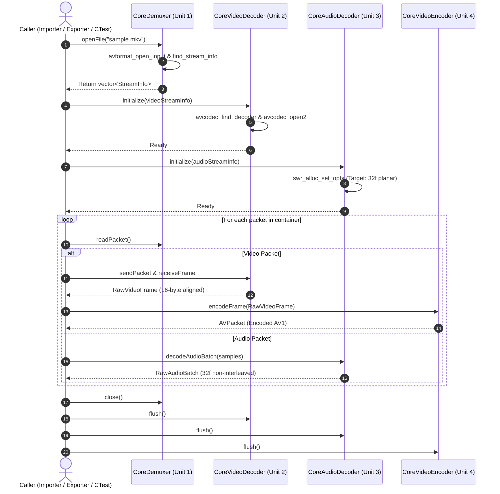

# User Story `US-1.2.0`: Unified OpenMediaCore Media Abstraction Engine

- **Module**: `module-1-core-engine`
- **Story Branch**: `feat/us-1.2.0-core-media-library`
- **Field Profile**: `software` (`.agents/field-profile.json`)
- **Story Decomposition Score ($S_{\text{story}}$)**: `2.65` $\to$ **`5` Parallel Implementation Units (`unit-1..5`)**

---

## 1. Spec Kit Specifications

### 1.1 User Story Narrative
> **As an** internal plugin developer,  
> **I want** a unified C++17 shared core library (`libOpenMediaCore`) abstracting FFmpeg demuxing, decoding, audio resampling, and encoding,  
> **So that** both the Importer and Exporter plugin connectors interact through a clean, memory-safe, thread-safe interface with zero direct leaks of FFmpeg internal structs into Adobe headers.

#### 1.1.1 Preconditions
- Module 1 build toolchain (`US-1.1.0`) configured and linking FFmpeg 7.1/8.0.
- Base contracts in `include/openmedia/core_types.hpp` seeded on story branch.

#### 1.1.2 Postconditions
- `libOpenMediaCore` exports thread-safe C++ classes: `CoreDemuxer`, `CoreVideoDecoder`, `CoreAudioDecoder`, `CoreVideoEncoder`.
- Standalone test `test_core_pipeline` passes without linking or launching Adobe Premiere Pro.
- Memory management guarantees RAII cleanup for all `AVFormatContext`, `AVCodecContext`, `AVPacket`, and `AVFrame` pointers.

### 1.2 Acceptance Criteria (Gherkin Scenarios)

```gherkin
Feature: Unified Media Engine Abstraction

  Scenario: AC-1 — Demuxing and Stream Discovery of MKV and WebM Containers
    Given a local media file in MKV or WebM format containing AV1 video and Opus audio
    When CoreDemuxer::openFile() is called
    Then all contained video and audio streams are enumerated with exact rational timebases
    And pixel formats, dimensions, and channel layouts are accurately populated

  Scenario: AC-2 — AV1 and VP9 Video Frame Decoding into Planar/Packed Memory
    Given an initialized CoreVideoDecoder with AV1 stream metadata
    When packets are sent and decodeNextFrame() is invoked
    Then a valid RawVideoFrame is returned with pts matching container timeline
    And internal buffer aligns rows to 16-byte boundaries

  Scenario: AC-3 — Multi-channel Audio Decoding and Resampling to 32-bit Float Planar
    Given an Opus or FLAC audio stream in 5.1 surround configuration
    When CoreAudioDecoder::decodeAudioBatch() is invoked requesting N samples
    Then audio is resampled via libswresample to 32-bit floating point non-interleaved format
    And channel layout matches PrAudioChannelLabel standard without clipping

  Scenario: AC-4 — In-Memory Video Encoding to AV1 / VP9
    Given an initialized CoreVideoEncoder configured for AV1 (libsvtav1 or nvenc)
    When raw video frames are pushed
    Then encoded AVPacket objects are emitted and written to an in-memory AVIO container
    And base_q_index / CRF settings are applied correctly

  Scenario: AC-5 — Resource Lifecycle and Memory Leak Prevention
    Given repeated open/close cycles on 100 consecutive media files
    When the demuxer and decoders are destroyed
    Then zero memory leaks or dangling AVCodecContext references occur (verified by Valgrind/ASan)
```

### 1.3 Test Cases & Traceability Matrix

| Test Case ID | Mapped AC | Owning Unit | Test Level | Input Vector | Expected Result & Pass Threshold |
| :--- | :---: | :---: | :---: | :--- | :--- |
| `TC-1.2.1` | `AC-1` | `unit-1` | Unit | MKV file with 2 audio tracks | Stream count == 3; valid rational timebases |
| `TC-1.2.2` | `AC-2` | `unit-2` | Unit | 1080p AV1 sample video | 60 frames decoded; 0 decode errors |
| `TC-1.2.3` | `AC-3` | `unit-3` | Unit | 48kHz 5.1 Opus audio stream | 32-bit float planar buffers; 6 channels |
| `TC-1.2.4` | `AC-4` | `unit-4` | Unit | Synthetic raw gradient frames | Valid WebM/AV1 container generated |
| `TC-1.2.5` | `AC-5` | `unit-5` | Integration (CTest) | Transcode pipeline test loop under ASan | Exit 0; AddressSanitizer reports 0 leaks |

---

## 2. Technical Implementation Plan

### 2.1 Domain Invariants & Storage Schema
- **RAII Lifecycle Wrappers**:
  - `AVFormatContextWrapper`: Custom deleter calling `avformat_close_input()`.
  - `AVCodecContextWrapper`: Custom deleter calling `avcodec_free_context()`.
  - `AVFrameWrapper`: Custom deleter calling `av_frame_free()`.
  - `AVPacketWrapper`: Custom deleter calling `av_packet_free()`.
- **Thread Safety**: Each decoder and encoder instance owns dedicated contexts; no shared state between concurrent streams.

### 2.2 Sequence Diagram



---

## 3. Expected Folder Architecture at the Project

```text
d:\AV1\
├── include/
│   └── openmedia/
│       ├── core_types.hpp                       # Base Contract (Pre-seeded)
│       ├── demuxer.hpp                          # Owned by unit-1
│       ├── video_decoder.hpp                    # Owned by unit-2
│       ├── audio_decoder.hpp                    # Owned by unit-3
│       └── video_encoder.hpp                    # Owned by unit-4
├── src/
│   └── core/
│       ├── demuxer.cpp                          # Owned by unit-1
│       ├── video_decoder.cpp                    # Owned by unit-2
│       ├── audio_decoder.cpp                    # Owned by unit-3
│       └── video_encoder.cpp                    # Owned by unit-4
└── tests/
    └── core/
        └── test_core_pipeline.cpp               # Owned by unit-5
```

---

## 4. Implementation Units in Detail & Specialist Agent Assignment

### 4.1 Story Decomposition Score ($S_{\text{story}}$) & Dynamic Unit Count ($K$)
- **$D_1$ (35% Surface)**: `2` (4 core subsystems + 1 test suite)
- **$D_2$ (25% Volume)**: `3` (~800 LOC C++)
- **$D_3$ (20% Complexity)**: `3` (AVFrame memory management, planar audio resampling, thread-safety)
- **$D_4$ (20% Boundaries)**: `3` (5 independent files)
- **Calculated Score**: $S_{\text{story}} = 0.35(2) + 0.25(3) + 0.20(3) + 0.20(3) = \mathbf{2.65} \to \mathbf{5\text{ Parallel Units}}$

### 4.2 Detailed Unit Specifications (`unit-1..5`)

#### `unit-1` (`feat/us-1.2.0/unit-1-core-demuxer`)
- **Deliverable Scope**: `CoreDemuxer` class implementing `ICoreDemuxer`. Handles container opening via `avformat_open_input`, stream probing via `avformat_find_stream_info`, rational timebase extraction, and packet dispatching.
- **Owned Files**: `include/openmedia/demuxer.hpp`, `src/core/demuxer.cpp`.
- **Target Complexity**: $CC \le 6$, nesting $\le 2$.

#### `unit-2` (`feat/us-1.2.0/unit-2-video-decoder`)
- **Deliverable Scope**: `CoreVideoDecoder` class implementing `ICoreVideoDecoder`. Integrates `dav1d`, `libvpx-vp9`, and FFmpeg decoders. Translates native codec frames into `RawVideoFrame` with 16-byte alignment.
- **Owned Files**: `include/openmedia/video_decoder.hpp`, `src/core/video_decoder.cpp`.
- **Target Complexity**: $CC \le 6$, nesting $\le 2$.

#### `unit-3` (`feat/us-1.2.0/unit-3-audio-decoder`)
- **Deliverable Scope**: `CoreAudioDecoder` class implementing `ICoreAudioDecoder`. Decodes Opus, FLAC, and Vorbis packets and transforms arbitrary sample formats to `AV_SAMPLE_FMT_FLTP` (32-bit float planar) via `libswresample`.
- **Owned Files**: `include/openmedia/audio_decoder.hpp`, `src/core/audio_decoder.cpp`.
- **Target Complexity**: $CC \le 6$, nesting $\le 2$.

#### `unit-4` (`feat/us-1.2.0/unit-4-video-encoder`)
- **Deliverable Scope**: `CoreVideoEncoder` class providing encoding abstraction for AV1 (`libsvtav1`) and VP9 (`libvpx-vp9`). Configures bitrate, GOP length, and CRF quality parameters.
- **Owned Files**: `include/openmedia/video_encoder.hpp`, `src/core/video_encoder.cpp`.
- **Target Complexity**: $CC \le 6$, nesting $\le 2$.

#### `unit-5` (`feat/us-1.2.0/unit-5-pipeline-test-harness`)
- **Deliverable Scope**: Standalone executable CTest test suite (`tests/core/test_core_pipeline.cpp`) verifying demuxing, decoding, resampling, and encoding in an end-to-end memory transcode loop without external dependencies.
- **Owned Files**: `tests/core/test_core_pipeline.cpp`.
- **Target Complexity**: $CC \le 6$, nesting $\le 2$.

### 4.3 Best-Fit Specialist Agents per Unit

| Unit ID | Branch Name | Primary Implementer Agent | Reviewing Council Agents | Mandatory Skills Enforced |
| :--- | :--- | :--- | :--- | :--- |
| `unit-1` | `feat/us-1.2.0/unit-1-core-demuxer` | `backend-architect` | `code-reviewer`, `security-architect` | `code-review-council`, `security-audit` |
| `unit-2` | `feat/us-1.2.0/unit-2-video-decoder` | `video-streaming-engineer` | `code-reviewer`, `performance-benchmarker` | `code-review-council`, `cyclomatic-complexity` |
| `unit-3` | `feat/us-1.2.0/unit-3-audio-decoder` | `voice-ai-integration-engineer` | `code-reviewer`, `api-tester` | `code-review-council`, `cyclomatic-complexity` |
| `unit-4` | `feat/us-1.2.0/unit-4-video-encoder` | `video-streaming-engineer` | `code-reviewer`, `security-architect` | `code-review-council`, `security-audit` |
| `unit-5` | `feat/us-1.2.0/unit-5-pipeline-test-harness` | `test-automation-engineer` | `code-reviewer`, `reality-checker` | `code-review-council`, `cyclomatic-complexity` |
| **Patch** | `patch/us-1.2.0-<scope>` | `patch-implementer` | `code-reviewer-council-president` | Full Gate Verification |

### 4.4 Parallel Execution & Zero-Blocking Contract Seeding Plan
1. **Base Contract Seeding**: `include/openmedia/core_types.hpp` committed to `feat/us-1.2.0-core-media-library`.
2. **Concurrent Worktrees**: Provision `.worktrees/feat-us-1.2.0-unit-1` through `unit-5`.
3. **Cascading Merge Sequence**: `unit-1` $\to$ `unit-2` $\to$ `unit-3` $\to$ `unit-4` $\to$ `unit-5` into `feat/us-1.2.0-core-media-library` via `gh pr merge <PR> --merge`.

---

## 5. Security Gateway (Powered by `security-audit` Skill)

### 5.1 Trust Boundaries & Security Actors
- **Security Actors**: Untrusted video file sources (MKV, WebM), external audio bitstreams.
- **Trust Boundaries**: File parser (`avformat_open_input`), media packet deserialization (`avcodec_send_packet`).

### 5.2 Threat Modeling & Abuse Matrix (STRIDE / OWASP ASVS)

| Threat ID | STRIDE | ASVS / CWE | Attack Scenario | Impact | Mitigation Control |
| :--- | :---: | :---: | :--- | :---: | :--- |
| `TM-2.1` | **T**ampering | CWE-119 / CWE-120 | Malformed MKV header causing buffer overflow in packet buffer | Critical | AddressSanitizer in CI, strict length checks on all FFmpeg packet reads |
| `TM-2.2` | **D**enial of Service | CWE-400 | Decompression bomb / infinite loop in VP9/AV1 parsing | High | Timeout limits and frame allocation size caps ($W \times H \le 8192 \times 4320$) |
| `TM-2.3` | **I**nformation Disclosure | CWE-416 | Use-after-free on AVFrame across decode loops | Critical | RAII smart pointers with custom deleters; zero manual pointer reuse |

### 5.3 Cryptography & Global Data Protection Controls
1. **Memory Safety**: No raw pointers escaped without ownership tracking; AddressSanitizer and UndefinedBehaviorSanitizer enabled on CTest runs.
2. **Deterministic Error Handling**: Typed exceptions and return codes (`imBadFile`, `imBadStreamIndex`); zero panic crashes on corrupted input streams.

### 5.4 Automated Security Verification Checklist
- [ ] AddressSanitizer (`-fsanitize=address,undefined`) clean on `test_core_pipeline`.
- [ ] No unbounded memory allocations based on file header dimensions.
- [ ] Safe math used for stride calculations (`width * bytes_per_pixel`).

### 5.5 Security Gateway (Gate G2) Sign-Off Checklist
- [ ] 0 memory leaks or buffer overflows reported.
- [ ] Clean scan reported by `security-audit`.
- [ ] Security reviewer sign-off posted to PR conversation.

---

## 6. Validation Gates & Acceptance Sign-Off

| Gate | Gate Name | Pass Criteria | Verification Evidence | Status |
| :--- | :--- | :--- | :--- | :---: |
| **Gate G0** | Build & Lint | 0 compiler warnings under `-Wall -Wextra -Werror` | `ninja -C build` exit 0 | `[ ]` |
| **Gate G1** | Tests & Traceability | `TC-1.2.1` through `TC-1.2.5` pass 100% | `ctest --output-on-failure` exit 0 | `[ ]` |
| **Gate G2** | Security Gateway | ASan / Valgrind clean, 0 CVE vulnerabilities | `security-audit` report on PR | `[ ]` |
| **Gate G-Complexity** | Complexity | Every function $CC \le 6$ (cap $\le 10$, nesting $\le 2$) | Complexity table on PR | `[ ]` |
| **Gate G-Docs** | Documentation | Complete Doxygen documentation for all core classes | Doxygen build exit 0 | `[ ]` |
| **Gate G-Review** | Review Sign-Off | Independent Reviewing Council Approval | `gh pr comment` sign-off | `[ ]` |
