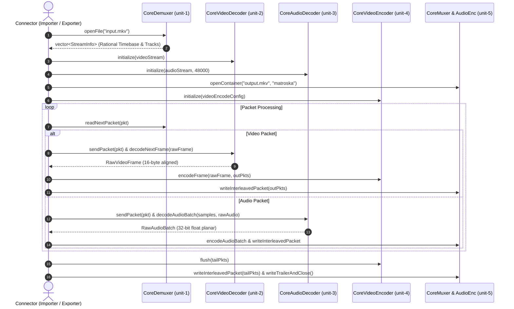

# User Story `US-1.2.0`: Unified OpenMediaCore Media Abstraction Engine

- **Module**: `module-1-core-engine`
- **Story Branch**: `feat/us-1.2.0-core-media-library`
- **Field Profile**: `software` (`.agents/field-profile.json`)
- **Story Decomposition Score ($S_{\text{story}}$)**: `2.65` $\to$ **`5` Parallel Implementation Units (`unit-1..5`)**

---

## 1. Spec Kit Specifications

### 1.1 User Story Narrative
> **As an** internal plugin developer working on the Importer and Exporter connectors,  
> **I want** a unified C++17 shared core library (`libOpenMediaCore`) abstracting FFmpeg demuxing (`CoreDemuxer`), video decoding (`CoreVideoDecoder`), 32-bit float planar audio decoding/resampling (`CoreAudioDecoder`), video encoding (`CoreVideoEncoder`), and container muxing + audio encoding (`CoreMuxer`),  
> **So that** both `OpenMedia_Importer.prm` and `OpenMedia_Exporter.prm` interact through a thread-safe, RAII-managed C++ ABI with zero direct leakage of FFmpeg headers or LGPL/GPL symbols into the Adobe connector layer.

#### 1.1.1 Preconditions
- Module 1 build toolchain (`US-1.1.0`) configured and linking FFmpeg 7.1/8.0.
- Base contracts in `include/openmedia/core_types.hpp` pre-seeded on `feat/us-1.2.0-core-media-library`.

#### 1.1.2 Postconditions
- `libOpenMediaCore` exports thread-safe concrete implementations for all 6 core interfaces: `CoreDemuxer`, `CoreVideoDecoder`, `CoreAudioDecoder`, `CoreVideoEncoder`, `CoreAudioEncoder`, and `CoreMuxer`.
- Every unit `unit-1..5` delivers both production C++ source/header files and its own standalone CTest executable (100% compliance with **Invariant A**).
- RAII custom deleters guarantee zero memory leaks for `AVFormatContext`, `AVCodecContext`, `SwsContext`, `SwrContext`, `AVFrame`, and `AVPacket`.

### 1.2 Acceptance Criteria (Gherkin Scenarios)

```gherkin
Feature: Unified OpenMediaCore Media Engine Abstraction

  Scenario: AC-1 — Container Demuxing, Multi-Stream Discovery, and Quiet File Release
    Given a media file in MKV, WebM, MP4, MOV, OGG, or AVI format containing AV1/VP9 video and Opus/FLAC audio
    When CoreDemuxer::openFile() is invoked
    Then all contained video, audio, and subtitle streams are enumerated with exact rational timebases (num/den)
    And calling CoreDemuxer::quietFile() releases OS file handles while preserving stream index metadata for rapid reopen

  Scenario: AC-2 — AV1 and VP9 Video Frame Decoding with 16-Byte Stride Alignment
    Given an initialized CoreVideoDecoder with 8-bit, 10-bit, or 12-bit AV1 / VP9 stream metadata
    When packets are fed via sendPacket() and decodeNextFrame() is invoked
    Then a valid RawVideoFrame is returned with exact PTS and keyframe flag
    And each plane rowBytes stride is strictly aligned to a 16-byte boundary

  Scenario: AC-3 — Multi-Channel Audio Decoding to 32-Bit Floating Point Planar PCM
    Given an Opus, FLAC, or Vorbis audio stream (Mono, Stereo, 5.1, or up to 32 channels)
    When CoreAudioDecoder::decodeAudioBatch() is invoked
    Then audio is decoded and converted via libswresample to AV_SAMPLE_FMT_FLTP (32-bit float planar, 0 dB = +/- 1.0f)
    And integer-to-float conversion honors Sample_32f = Sample_16i / 32767.0 without clipping

  Scenario: AC-4 — Video Encoding with Normalized Quantization (SVT-AV1 / VP9 / Hardware)
    Given an initialized CoreVideoEncoder configured for AV1 or VP9 (8/10/12-bit, 4:2:0/4:2:2/4:4:4)
    When RawVideoFrame instances are pushed to encodeFrame() and flushed via flush()
    Then valid EncodedPacket bitstreams are produced with normalized quantization (base_q_index 0..255 for AV1; CRF 0..63 for VP9)

  Scenario: AC-5 — Container Multiplexing (MKV / WebM / MP4) and Audio Encoding (Opus / FLAC)
    Given an initialized CoreMuxer and CoreAudioEncoder
    When encoded video packets, Opus/FLAC audio packets, and SRT/WebVTT subtitle packets are written via writeInterleavedPacket()
    And writeTrailerAndClose() is called
    Then a spec-compliant MKV or WebM container with valid Cues/SeekHead index is produced with zero ASan memory leaks
```

### 1.3 Test Cases & Traceability Matrix

| Test Case ID | Mapped AC | Owning Unit | Test Level | Input Vector | Expected Result & Pass Threshold |
| :--- | :---: | :---: | :---: | :--- | :--- |
| `TC-1.2.1` | `AC-1` | `unit-1` | Unit | MKV fixture with 1 video + 4 audio tracks | `getStreams().size() == 5`; exact rational FPS; `quietFile()` closes FD cleanly |
| `TC-1.2.2` | `AC-2` | `unit-2` | Unit | 8-bit & 10-bit AV1/VP9 packets | Decodes frames with `rowBytes[i] % 16 == 0`; 0 decode errors |
| `TC-1.2.3` | `AC-3` | `unit-3` | Unit | 48kHz 5.1 Opus & 16-bit PCM packets | Outputs 6 planar `float*` buffers in `[-1.0f, 1.0f]`; SNR $> 96\text{ dB}$ |
| `TC-1.2.4` | `AC-4` | `unit-4` | Unit | Synthetic 10-bit test pattern frames | Emits valid AV1/VP9 keyframes and inter-frames; `flush()` drains delayed GOP |
| `TC-1.2.5` | `AC-5` | `unit-5` | Unit & Pipeline | Video + Opus/FLAC + SRT packets into `CoreMuxer` | Valid MKV/WebM container written and verified via round-trip `CoreDemuxer`; ASan 0 leaks |

---

## 2. Technical Implementation Plan

### 2.1 Domain Invariants & RAII Wrappers
- **RAII Smart Pointers**:
  - `std::unique_ptr<AVFormatContext, AVFormatInputDeleter>` (`avformat_close_input`)
  - `std::unique_ptr<AVFormatContext, AVFormatOutputDeleter>` (`avformat_free_context`)
  - `std::unique_ptr<AVCodecContext, AVCodecContextDeleter>` (`avcodec_free_context`)
  - `std::unique_ptr<SwsContext, SwsContextDeleter>` (`sws_freeContext`)
  - `std::unique_ptr<SwrContext, SwrContextDeleter>` (`swr_free`)
- **16-Byte Alignment Formula**:
$$\text{RowStride}_{\text{aligned}} = \left\lceil \frac{\text{Width} \times \text{BytesPerPixel}}{16} \right\rceil \times 16$$

### 2.2 Sequence Diagram



---

## 3. Expected Folder Architecture

```text
AV1/
├── include/
│   └── openmedia/
│       ├── core_types.hpp                       # Base Contract (Pre-seeded)
│       ├── demuxer.hpp                          # Owned by unit-1
│       ├── video_decoder.hpp                    # Owned by unit-2
│       ├── audio_decoder.hpp                    # Owned by unit-3
│       ├── video_encoder.hpp                    # Owned by unit-4
│       └── muxer.hpp                            # Owned by unit-5
├── src/
│   └── core/
│       ├── demuxer.cpp                          # Owned by unit-1
│       ├── video_decoder.cpp                    # Owned by unit-2
│       ├── audio_decoder.cpp                    # Owned by unit-3
│       ├── video_encoder.cpp                    # Owned by unit-4
│       └── muxer.cpp                            # Owned by unit-5
└── tests/
    └── core/
        ├── test_demuxer.cpp                     # Owned by unit-1
        ├── test_video_decoder.cpp               # Owned by unit-2
        ├── test_audio_decoder.cpp               # Owned by unit-3
        ├── test_video_encoder.cpp               # Owned by unit-4
        └── test_muxer_pipeline.cpp              # Owned by unit-5
```

---

## 4. Implementation Units in Detail & Specialist Agent Assignment

### 4.1 Story Decomposition Score ($S_{\text{story}}$) & Dynamic Unit Count ($K$)
- **$D_1$ (35% Surface)**: `2` (5 core media subsystems: Demuxer, VideoDecoder, AudioDecoder, VideoEncoder, Muxer+AudioEncoder)
- **$D_2$ (25% Volume)**: `3` (~900 LOC C++17 production + test code)
- **$D_3$ (20% Complexity)**: `3` (RAII FFmpeg context management, 16-byte plane alignment, planar audio resampling, interleaved muxing)
- **$D_4$ (20% Boundaries)**: `3` (5 completely disjoint header/source/test triplets)
- **Calculated Score**: $S_{\text{story}} = 0.35(2) + 0.25(3) + 0.20(3) + 0.20(3) = \mathbf{2.65} \to \mathbf{5\text{ Parallel Units}}$

### 4.2 Detailed Unit Specifications (`unit-1..5`)

#### `unit-1` (`feat/us-1.2.0/unit-1-core-demuxer`)
- **Deliverable Scope**: `CoreDemuxer` implementing `ICoreDemuxer`. Wraps `avformat_open_input`, `avformat_find_stream_info`, rational timebase extraction (`avg_frame_rate` / `r_frame_rate`), keyframe-accurate `av_seek_frame`, and `quietFile()` descriptor release. Includes unit test `tests/core/test_demuxer.cpp`.
- **Owned Files**: `include/openmedia/demuxer.hpp`, `src/core/demuxer.cpp`, `tests/core/test_demuxer.cpp`.
- **Target Complexity**: $CC \le 6$, nesting $\le 2$.

#### `unit-2` (`feat/us-1.2.0/unit-2-video-decoder`)
- **Deliverable Scope**: `CoreVideoDecoder` implementing `ICoreVideoDecoder`. Integrates `libdav1d`, `libvpx-vp9`, and FFmpeg hardware/software decoders, outputting 8/10/12-bit `RawVideoFrame` buffers with strict 16-byte row alignment. Includes unit test `tests/core/test_video_decoder.cpp`.
- **Owned Files**: `include/openmedia/video_decoder.hpp`, `src/core/video_decoder.cpp`, `tests/core/test_video_decoder.cpp`.
- **Target Complexity**: $CC \le 6$, nesting $\le 2$.

#### `unit-3` (`feat/us-1.2.0/unit-3-audio-decoder`)
- **Deliverable Scope**: `CoreAudioDecoder` implementing `ICoreAudioDecoder`. Decodes Opus, FLAC, Vorbis, and PCM packets and converts arbitrary formats to `AV_SAMPLE_FMT_FLTP` (32-bit float planar) via `libswresample`. Includes unit test `tests/core/test_audio_decoder.cpp`.
- **Owned Files**: `include/openmedia/audio_decoder.hpp`, `src/core/audio_decoder.cpp`, `tests/core/test_audio_decoder.cpp`.
- **Target Complexity**: $CC \le 6$, nesting $\le 2$.

#### `unit-4` (`feat/us-1.2.0/unit-4-video-encoder`)
- **Deliverable Scope**: `CoreVideoEncoder` implementing `ICoreVideoEncoder`. Provides encoding for AV1 (`libsvtav1` / `av1_nvenc`) and VP9 (`libvpx-vp9`), mapping normalized CRF (`0..63`) to `base_q_index` (`0..255`) or `cq` (`0..51`) and draining delayed GOP frames on `flush()`. Includes unit test `tests/core/test_video_encoder.cpp`.
- **Owned Files**: `include/openmedia/video_encoder.hpp`, `src/core/video_encoder.cpp`, `tests/core/test_video_encoder.cpp`.
- **Target Complexity**: $CC \le 6$, nesting $\le 2$.

#### `unit-5` (`feat/us-1.2.0/unit-5-core-muxer-audio-enc`)
- **Deliverable Scope**: `CoreMuxer` (implementing `ICoreMuxer`) and `CoreAudioEncoder` (implementing `ICoreAudioEncoder` for `libopus` and `libflac`). Manages `avformat_alloc_output_context2` for `.mkv`, `.webm`, and `.mp4`, stream creation, `av_interleaved_write_frame`, and Matroska Cues trailer finalization, plus `tests/core/test_muxer_pipeline.cpp`.
- **Owned Files**: `include/openmedia/muxer.hpp`, `src/core/muxer.cpp`, `tests/core/test_muxer_pipeline.cpp`.
- **Target Complexity**: $CC \le 6$, nesting $\le 2$.

### 4.3 Best-Fit Specialist Agents per Unit

| Unit ID | Branch Name | Primary Implementer Agent | Reviewing Council Agents | Mandatory Skills Enforced |
| :--- | :--- | :--- | :--- | :--- |
| `unit-1` | `feat/us-1.2.0/unit-1-core-demuxer` | `backend-architect` | `code-reviewer`, `security-architect` | `code-review-council`, `security-audit` |
| `unit-2` | `feat/us-1.2.0/unit-2-video-decoder` | `video-streaming-engineer` | `code-reviewer`, `performance-benchmarker` | `code-review-council`, `cyclomatic-complexity` |
| `unit-3` | `feat/us-1.2.0/unit-3-audio-decoder` | `audio-processing-specialist` | `code-reviewer`, `test-automation-engineer` | `code-review-council`, `cyclomatic-complexity` |
| `unit-4` | `feat/us-1.2.0/unit-4-video-encoder` | `video-streaming-engineer` | `code-reviewer`, `security-architect` | `code-review-council`, `security-audit` |
| `unit-5` | `feat/us-1.2.0/unit-5-core-muxer-audio-enc` | `backend-architect` | `code-reviewer`, `reality-checker` | `code-review-council`, `security-audit` |
| **Patch** | `patch/us-1.2.0-<scope>` | `patch-implementer` | `code-reviewer-council-president` | Full Gate Verification |

---

## 5. Security Gateway (`security-audit`)

| Threat ID | STRIDE | ASVS / CWE | Attack Scenario | Impact | Mitigation Control |
| :--- | :---: | :---: | :--- | :---: | :--- |
| `TM-1.2.1` | **D**enial of Service | CWE-401 | Memory leak across repeated open/close or transcode loops | High | Strict RAII custom deleters for all FFmpeg structs; verified under ASan |
| `TM-1.2.2` | **T**ampering | CWE-787 | Heap buffer overflow on unaligned video plane allocation | Critical | Allocate plane buffers via `av_frame_get_buffer(frame, 16)` enforcing 16-byte alignment |
| `TM-1.2.3` | **D**enial of Service | CWE-369 | Division-by-zero on malformed container `time_base.den == 0` | High | Sanitize all `RationalTime` denominators (`den <= 0 ? 1 : den`) before arithmetic |

---

## 6. Validation Gates & Acceptance Sign-Off

| Gate | Gate Name | Pass Criteria | Verification Evidence | Status |
| :--- | :--- | :--- | :--- | :---: |
| **Gate G0** | Build & Lint | `libOpenMediaCore` compiles with 0 warnings | `cmake --build build` exit 0 | `[ ]` |
| **Gate G1** | Tests & Traceability | `TC-1.2.1` .. `TC-1.2.5` pass 100% ($\ge 90\%$ coverage) | `ctest -R test_demuxer|test_video_decoder|test_audio_decoder|test_video_encoder|test_muxer_pipeline` | `[ ]` |
| **Gate G2** | Security Gateway | ASan & UBSan report 0 leaks and 0 buffer overflows | `security-audit` report on PR | `[ ]` |
| **Gate G-Complexity** | Complexity | All functions $CC \le 6$ (max ceiling $CC \le 10$, nesting $\le 2$) | Complexity table on PR | `[ ]` |
| **Gate G-Docs** | Documentation | 100% public classes in `include/openmedia/*.hpp` documented | Doxygen verification | `[ ]` |
| **Gate G-Review** | Review Sign-Off | Independent Reviewing Council Approval | `gh pr comment` sign-off | `[ ]` |
