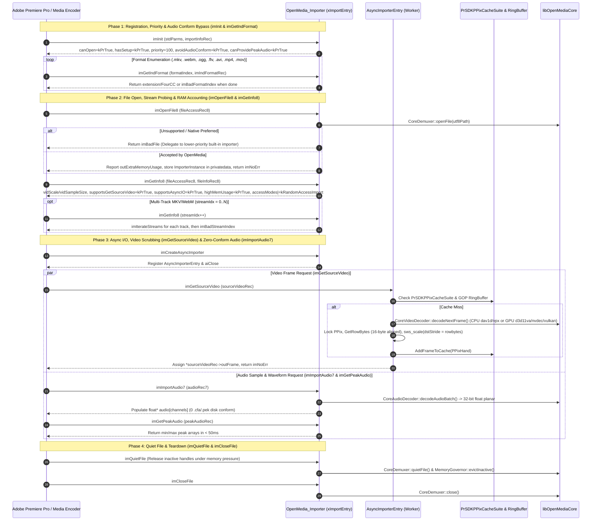

# Module 2: MediaCore Importer Plugin (`OpenMedia_Importer.prm`)

- **Module Identifier**: `module-2-importer-plugin`
- **Module Branch**: `feat/module-2-importer-plugin`
- **Field Profile**: `software` (`.agents/field-profile.json`)
- **Primary Deliverables**:
  1. Native Premiere Pro & Media Encoder Importer connector binary (`OpenMedia_Importer.prm` on Windows, `OpenMedia_Importer.bundle` on macOS) implementing `xImportEntry` (Open-source replacement for **Autokroma Influx**).
  2. `IMPT` and `PiPL` binary resource definitions with priority $\ge 100$ overriding built-in importers for `.mkv`, `.webm`, `.mp4`, `.mov`, `.ogg`, `.avi`, `.flv`, with automatic `imBadFile` fallback when native handling is preferred.
  3. 8-bit, 10-bit, and 12-bit HDR + Alpha video decoding pipeline (`imGetSourceVideo`) honoring `PrSDKPPixSuite` 16-byte `rowbytes` stride alignment.
  4. High-speed scrubbing engine via `imCreateAsyncImporter` (`AsyncImporterEntry` / `aiClose`), `PrSDKPPixCacheSuite` frame/thumbnail caching, GOP keyframe indexing + Ring Buffer (5%–20% scrub speedup), `imQuietFile` + 50% dynamic RAM governor (`outExtraMemoryUsage` / `highMemUsage`), and GPU decoding (`d3d11va`, `nvdec`, `vulkan`).
  5. Zero-conform 32-bit floating point planar audio pipeline (`imImportAudio7`) with `avoidAudioConform = kPrTrue` (`imInit`) + `kRandomAccessImport` (`imGetInfo8`), instant waveform peak delivery (`imGetPeakAudio`), and up to 32-channel surround routing (`imGetAudioChannelLayout`).

---

## 1. Module Overview & Selectors Lifecycle

The Importer Plugin translates Adobe Premiere Pro’s SweetPea selector calls into `libOpenMediaCore` invocations across the complete `xImportEntry` and `AsyncImporterEntry` lifecycles:



---

## 2. User Story Index & Dynamic Unit Sizing

| Story ID | Branch | Title | Score ($S_{\text{story}}$) | Unit Count ($K$) | Status |
| :--- | :--- | :--- | :---: | :---: | :---: |
| **`US-2.1.0`** | `feat/us-2.1.0-importer-registration-stream-discovery` | Importer Entry, Resource Registration & Stream Probing | **2.20** | **4 Units** | `Ready` |
| **`US-2.2.0`** | `feat/us-2.2.0-video-decoding-pixel-alignment` | Video Frame Decoding, Color Spaces & 16-Byte Stride | **3.00** | **5 Units** | `Ready` |
| **`US-2.3.0`** | `feat/us-2.3.0-async-caching-memory-governor` | Async I/O Importer, PPix Cache, GOP Index & RAM Governor | **3.20** | **6 Units** | `Ready` |
| **`US-2.4.0`** | `feat/us-2.4.0-zero-conform-audio-pipeline` | Zero-Conform 32-bit Planar Audio & Multi-Channel Pipeline | **2.80** | **5 Units** | `Ready` |

---

## 3. Base Contract Seeding for Module 2 (`include/importer/importer_types.hpp`)

To maintain **Invariant B (Zero Inter-Unit Blocking)** across all 4 stories and 20 units in Module 2, the unified base contract is committed to `feat/module-2-importer-plugin` before branching:

```cpp
// include/importer/importer_types.hpp
#pragma once
#include <openmedia/core_types.hpp>
#include <chrono>
#include <cstdint>
#include <memory>
#include <string>
#include <vector>

namespace openmedia::importer {

using prPluginID = int32_t;
using prSelector = int32_t;
using prReturnCode = int32_t;
using PPixHand = void*;

// Forbidden After Effects FourCC that must never be used for Premiere Importers
constexpr uint32_t kForbiddenAfterEffectsFourCC = 0x4D4F6F76; // 'MOov'
constexpr uint32_t kOpenMediaImporterFourCC     = 0x4F4D4950; // 'OMIP'
constexpr int32_t  kOpenMediaHighPriority       = 100;

struct KeyframeIndexEntry {
    int64_t frameNumber{0};
    int64_t pts{0};
    int64_t byteOffset{0};
    uint32_t packetSize{0};
    bool isKeyframe{false};
};

struct CachedPPixEntry {
    int64_t pts{0};
    int64_t frameIndex{0};
    PPixHand ppixHandle{nullptr};
    size_t byteSize{0};
    std::chrono::steady_clock::time_point lastAccess{};
    bool isPinned{false};
};

struct PeakPyramidLevel {
    uint32_t decimationFactor{256};
    std::vector<float> minPeaks;
    std::vector<float> maxPeaks;
};

struct ImporterInstance {
    std::string utf8FilePath;
    std::shared_ptr<ICoreDemuxer> demuxer;
    std::shared_ptr<ICoreVideoDecoder> videoDecoder;
    std::vector<std::shared_ptr<ICoreAudioDecoder>> audioDecoders;
    StreamInfo activeVideoStream;
    std::vector<StreamInfo> activeAudioStreams;
    HardwareAccelBackend activeHwBackend{HardwareAccelBackend::None};
    int64_t currentPts{0};
    bool supportsGetSourceVideo{true};
    bool supportsAsyncIO{true};
    bool avoidAudioConform{true};
    bool canProvidePeakAudio{true};
    bool highMemUsage{true};
    bool isQuiet{false};
    size_t extraMemoryUsageBytes{0};
    size_t memoryCeilingBytes{0};
};

class IImporterSelectorHandler {
public:
    virtual ~IImporterSelectorHandler() = default;
    virtual prReturnCode handleSelector(
        prSelector selector,
        void* stdParms,
        void* param1,
        void* param2
    ) = 0;
};

} // namespace openmedia::importer
```

---

## 4. Cascading Merge & Validation Plan

1. **US-2.1.0**: Units `unit-1..4` merge cascadingly into `feat/us-2.1.0-importer-registration-stream-discovery` $\to$ Gate G0..G-Review $\to$ `feat/module-2-importer-plugin`.
2. **US-2.2.0**: Units `unit-1..5` merge cascadingly into `feat/us-2.2.0-video-decoding-pixel-alignment` $\to$ Gate G0..G-Review $\to$ `feat/module-2-importer-plugin`.
3. **US-2.3.0**: Units `unit-1..6` merge cascadingly into `feat/us-2.3.0-async-caching-memory-governor` $\to$ Gate G0..G-Review $\to$ `feat/module-2-importer-plugin`.
4. **US-2.4.0**: Units `unit-1..5` merge cascadingly into `feat/us-2.4.0-zero-conform-audio-pipeline` $\to$ Gate G0..G-Review $\to$ `feat/module-2-importer-plugin`.
5. **Module 2 Promotion**: Module Leader runs all 20 importer unit tests under ASan/TSan and merges `feat/module-2-importer-plugin` into `main`.

---

## 5. Influx-v2 Architecture Upgrades Implemented in Module 2

1. **Dual-PRM Shims & PiPL Trailing-Space Trick (`US-2.1.0`)**:
   - `OpenMedia_Importer.prm` (`isHighPriority = false`, priority `100`, PiPL `'OpenMedia Importer'`) and `OpenMedia_ImporterHP.prm` (`isHighPriority = true`, priority `200`, PiPL `'OpenMedia Importer '` with trailing space) both route through `xOpenMediaImportEntry()`.
   - `FileProbe` includes `OpenMediaConfig` (`Config.toml` parser), `FilenameModifiers` (`!w=`, `!h=`, `!vs=`, `!as=`, `!pf=`, `!fr=24000d1001`, `!cr=full|limited`, `!accurate_duration`, `!rft=1`), and `ErrorDeduplicator` (`reduceWarnings`).
2. **Direct GPU/SIMD `NV12`/`P010LE` Conversion & Extended Camera Color Spaces (`US-2.2.0`)**:
   - `PixelFormatHdrEngine` and `FrameScaler` provide direct `NV12` and `P010LE` to `BGRA8`/`RGB444_10U` conversion and support `sRGB`, `BT.601`, `BT.709`, `BT.2020`, `BT.2100_HLG`, `BT.2100_PQ`, `DCDM_XYZ`, `Sony_SGamut_SLog2`, `Sony_SGamut3_SLog3`, and `Sony_Cine_SLog3`.
3. **Smart GPU Decode Policy Engine (`evaluateDecodePolicy`), 4-Stream Cap & SQLite `STRICT` Thumbnail Cache (`US-2.3.0`)**:
   - `D3D11VaNvdecDecoder::evaluateDecodePolicy()` routes clips `< 2560x1600` (`4,096,000` px) to CPU and clips `>= 2560x1600` to GPU up to `kMaxConcurrentGpuDecoders = 4` active GPU streams (routing the 5th+ stream to CPU), with `drainBeforeFallback()` on hardware error.
   - `PPixCacheBridge` persists Media Browser thumbnails in SQLite 3 `STRICT` tables (`tableVersion` and `thumbnails`).
   - `KeyframeRingBuffer` performs exact-frame open-GOP / Long-GOP seeking.
4. **Fault-Tolerant Audio & 5/6/24/32-Channel Routing (`US-2.4.0`)**:
   - `AudioExtractor` substitutes `0.0f` planar silence on damaged packets and immediately releases file descriptors on fatal init error; `MultiChannelRouter` supports 5/6-channel MOV PCM and up to 24/32 discrete channels.
