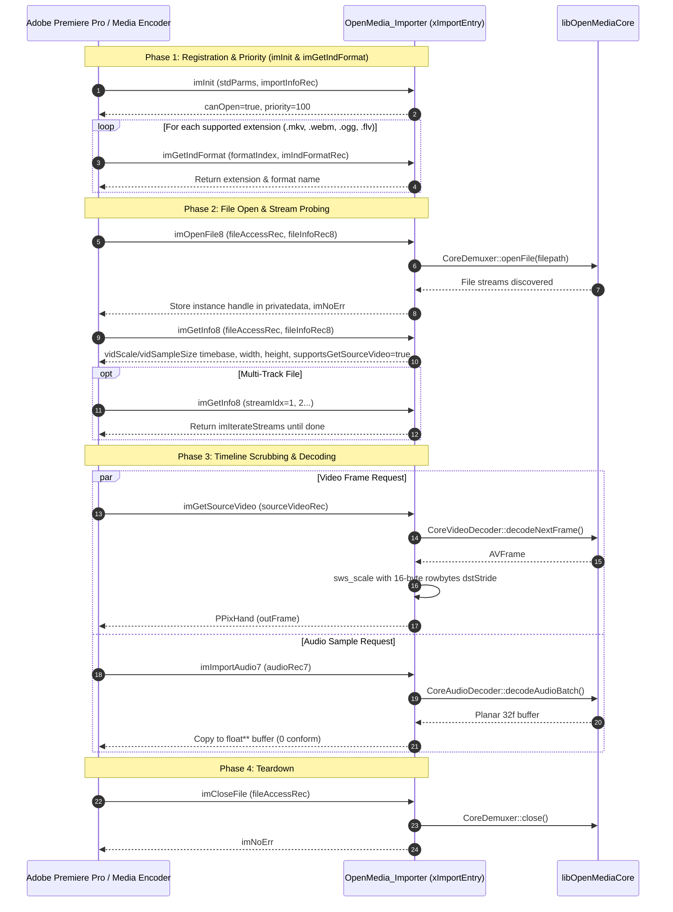

# Module 2: MediaCore Importer Plugin (`OpenMedia_Importer.prm`)

- **Module Identifier**: `module-2-importer-plugin`
- **Module Branch**: `feat/module-2-importer-plugin`
- **Field Profile**: `software` (`.agents/field-profile.json`)
- **Primary Deliverables**:
  1. Native Premiere Pro Importer connector binary (`OpenMedia_Importer.prm` on Windows, `.bundle` on macOS) implementing `xImportEntry`.
  2. IMPT and PiPL resource integration with high priority ($\ge 100$) overriding defective built-in importers.
  3. 8-bit, 10-bit, and 12-bit HDR video decoding pipeline (`imGetSourceVideo`) honoring 16-byte rowbytes stride alignment.
  4. High-efficiency scrubbing and playback engine via async I/O (`imCreateAsyncImporter`), PPix frame/seek caching, and a 50% dynamic RAM limiter.
  5. Zero-conform 32-bit floating point planar audio pipeline (`imImportAudio7`) with instant waveform peak delivery (`imGetPeakAudio`) and 5.1/32-channel surround sound support.

---

## 1. Module Overview & Selectors Lifecycle

The Importer Plugin operates as an active bridge translating Adobe Premiere Pro’s timeline and file operations into calls against `libOpenMediaCore`. It follows the standard `xImportEntry` selectors lifecycle:



---

## 2. User Story Index & Dynamic Unit Sizing

| Story ID | Branch | Title | Score ($S_{\text{story}}$) | Unit Count ($K$) | Status |
| :--- | :--- | :--- | :---: | :---: | :---: |
| **`US-2.1.0`** | `feat/us-2.1.0-importer-registration-stream-discovery` | Importer Entry, Resource Registration & Stream Probing | 2.20 | **4 Units** | `Todo` |
| **`US-2.2.0`** | `feat/us-2.2.0-video-decoding-pixel-alignment` | Video Frame Decoding, Color Spaces & 16-Byte Stride | 3.00 | **5 Units** | `Todo` |
| **`US-2.3.0`** | `feat/us-2.3.0-async-caching-memory-governor` | Async I/O Importer, PPix Cache & RAM Governor | 3.20 | **6 Units** | `Todo` |
| **`US-2.4.0`** | `feat/us-2.4.0-zero-conform-audio-pipeline` | Zero-Conform 32-bit Planar Audio & Multi-Channel Pipeline | 2.80 | **5 Units** | `Todo` |

---

## 3. Base Contract Seeding for Module 2

To maintain **Invariant B (Zero Inter-Unit Blocking)** across all 4 stories and 20 units, the following interface declarations and selector mapping stubs are committed to `feat/module-2-importer-plugin`:

```cpp
// include/importer/importer_types.hpp
#pragma once
#include <openmedia/core_types.hpp>
#include <vector>
#include <memory>

namespace openmedia::importer {

// Forward declarations of Adobe SDK types to isolate connector compilation
using prPluginID = int32_t;
using prSelector = int32_t;
using prReturnCode = int32_t;

struct ImporterInstance {
    std::shared_ptr<ICoreDemuxer> demuxer;
    std::shared_ptr<ICoreVideoDecoder> videoDecoder;
    std::shared_ptr<ICoreAudioDecoder> audioDecoder;
    StreamInfo activeVideoStream;
    std::vector<StreamInfo> activeAudioStreams;
    int64_t currentPts{0};
    bool supportsAsyncIO{true};
    size_t memoryLimitBytes{0};
};

class IImporterSelectorDispatcher {
public:
    virtual ~IImporterSelectorDispatcher() = default;
    virtual prReturnCode dispatch(prSelector selector, void* stdParms, void* param1, void* param2) = 0;
};

} // namespace openmedia::importer
```

---

## 4. Cascading Merge & Validation Plan

1. **US-2.1.0**: Units 1..4 execute $\to$ merge cascadingly into `feat/us-2.1.0-importer-registration-stream-discovery` $\to$ Review Gate G0..G-Review $\to$ merge into `feat/module-2-importer-plugin`.
2. **US-2.2.0**: Units 1..5 execute $\to$ merge cascadingly into `feat/us-2.2.0-video-decoding-pixel-alignment` $\to$ Review Gate G0..G-Review $\to$ merge into `feat/module-2-importer-plugin`.
3. **US-2.3.0**: Units 1..6 execute $\to$ merge cascadingly into `feat/us-2.3.0-async-caching-memory-governor` $\to$ Review Gate G0..G-Review $\to$ merge into `feat/module-2-importer-plugin`.
4. **US-2.4.0**: Units 1..5 execute $\to$ merge cascadingly into `feat/us-2.4.0-zero-conform-audio-pipeline` $\to$ Review Gate G0..G-Review $\to$ merge into `feat/module-2-importer-plugin`.
5. **Module Leader Integration**: Module Leader verifies the complete importer binary against Premiere Pro test footage, verifies zero regressions, and merges `feat/module-2-importer-plugin` into `main`.
