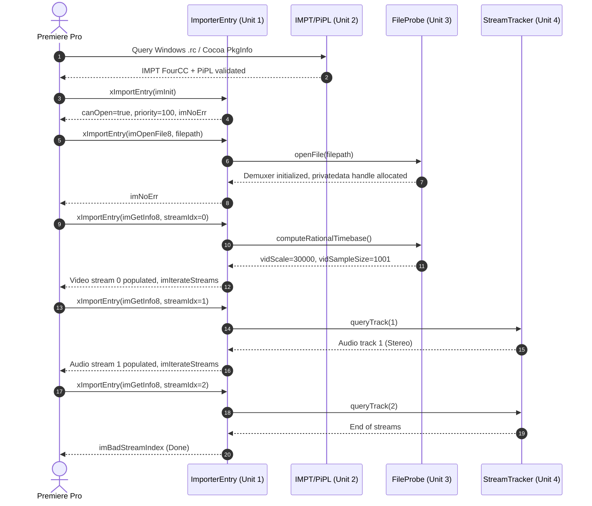

# User Story `US-2.1.0`: Importer Entry, Resource Registration & Stream Probing

- **Module**: `module-2-importer-plugin`
- **Story Branch**: `feat/us-2.1.0-importer-registration-stream-discovery`
- **Field Profile**: `software` (`.agents/field-profile.json`)
- **Story Decomposition Score ($S_{\text{story}}$)**: `2.20` $\to$ **`4` Parallel Implementation Units (`unit-1..4`)**

---

## 1. Spec Kit Specifications

### 1.1 User Story Narrative
> **As an** editor importing complex MKV or WebM screen recordings into Adobe Premiere Pro,  
> **I want** the custom importer to intercept and open the files with high priority (priority 100), extract precise rational frame rate timebases, and enumerate all contained audio/video tracks,  
> **So that** multi-track recordings (such as OBS multi-channel audio) import with all tracks available without falling back to buggy legacy importers or failing with "unsupported format".

#### 1.1.1 Preconditions
- Adobe Premiere Pro SDK headers available via `-DADOBE_PP_SDK`.
- `libOpenMediaCore` demuxer service linked and accessible.

#### 1.1.2 Postconditions
- `OpenMedia_Importer.prm` exports `xImportEntry` and embeds valid IMPT and PiPL binary resources.
- `imInit` registers `priority = 100` and `canOpen = kPrTrue`.
- `imGetIndFormat` registers `.mkv`, `.webm`, `.ogg`, `.flv`, `.mp4`.
- `imGetInfo8` computes exact `vidScale` and `vidSampleSize` from FFmpeg stream rational timebase (e.g., 30000/1001 for 29.97 fps NTSC) and returns `imIterateStreams` for additional tracks.

### 1.2 Acceptance Criteria (Gherkin Scenarios)

```gherkin
Feature: Importer Registration, Priority Override, and Stream Enumeration

  Scenario: AC-1 — Selector Dispatching and Priority Registration
    Given Adobe Premiere Pro initializing installed plugins at startup
    When xImportEntry is invoked with selector imInit
    Then importInfoRec.canOpen is set to kPrTrue
    And importInfoRec.priority is set to 100
    And subsequent imGetIndFormat selectors return mkv, webm, ogg, and flv extensions

  Scenario: AC-2 — Resource Definition and FourCC Validation
    Given the compiled Windows binary OpenMedia_Importer.prm
    When inspected for embedded resource tables
    Then a valid IMPT resource and PiPL resource are detected
    And the FourCC identifier does not collide with After Effects reserved 0x4D4F6F76

  Scenario: AC-3 — Rational Timebase Calculation for Variable and Fractional Frame Rates
    Given an MKV file containing a 29.970 fps video stream (NTSC)
    When imGetInfo8 selector is dispatched
    Then vidScale is set to 30000 and vidSampleSize is set to 1001
    And duration is calculated in exact ticks without floating point drift

  Scenario: AC-4 — Multi-Track Audio and Video Stream Iteration
    Given an OBS Studio MKV recording containing 1 video stream and 4 independent audio tracks
    When imGetInfo8 is called repeatedly with incrementing streamIdx (0 to 4)
    Then the importer returns imIterateStreams for streams 0 through 3
    And returns imBadStreamIndex on stream 4, exposing all tracks to the Project panel
```

### 1.3 Test Cases & Traceability Matrix

| Test Case ID | Mapped AC | Owning Unit | Test Level | Input Vector | Expected Result & Pass Threshold |
| :--- | :---: | :---: | :---: | :--- | :--- |
| `TC-2.1.1` | `AC-1` | `unit-1` | Unit | Invoke `xImportEntry(imInit, ...)` | `priority == 100`; returns `imNoErr` |
| `TC-2.1.2` | `AC-2` | `unit-2` | Resource Audit | Run `llvm-readobj --coff-resources` | IMPT and PiPL present; FourCC valid |
| `TC-2.1.3` | `AC-3` | `unit-3` | Math / Unit | Input FFmpeg `avg_frame_rate = 30000/1001` | `vidScale=30000, vidSampleSize=1001` |
| `TC-2.1.4` | `AC-4` | `unit-4` | Integration | Probing 4-track MKV fixture | 4 audio tracks enumerated; 0 lost streams |

---

## 2. Technical Implementation Plan

### 2.1 Domain Invariants & Storage Schema
- **Priority Invariant**: `imImportInfoRec.priority = 100`. This ensures Adobe Premiere Pro offers MKV/WebM files to `OpenMedia_Importer` before checking built-in quicktime/avi importers.
- **Rational Timebase Calculation Formula**:
$$\text{vidScale} = \text{AVStream.r\_frame\_rate.num}, \quad \text{vidSampleSize} = \text{AVStream.r\_frame\_rate.den}$$
$$\text{For NTSC 29.97 fps}: \quad \frac{\text{vidScale}}{\text{vidSampleSize}} = \frac{30000}{1001}$$

### 2.2 Sequence Diagram



---

## 3. Expected Folder Architecture at the Project

```text
d:\AV1\
├── include/
│   └── importer/
│       ├── importer_entry.hpp                   # Owned by unit-1
│       ├── file_probe.hpp                       # Owned by unit-3
│       └── stream_tracker.hpp                   # Owned by unit-4
├── src/
│   └── importer/
│       ├── importer_entry.cpp                   # Owned by unit-1
│       ├── file_probe.cpp                       # Owned by unit-3
│       └── stream_tracker.cpp                   # Owned by unit-4
├── resources/
│   ├── importer_resources.rc                    # Owned by unit-2
│   └── importer_pipl.r                          # Owned by unit-2
└── tests/
    └── importer/
        └── test_importer_registration.cpp       # Owned by unit-1
```

---

## 4. Implementation Units in Detail & Specialist Agent Assignment

### 4.1 Story Decomposition Score ($S_{\text{story}}$) & Dynamic Unit Count ($K$)
- **$D_1$ (35% Surface)**: `2` (4 selectors/resource components)
- **$D_2$ (25% Volume)**: `2` (~600 LOC C++/RC)
- **$D_3$ (20% Complexity)**: `3` (Adobe selector dispatching, priority overriding, rational timebase math)
- **$D_4$ (20% Boundaries)**: `2` (3 source files + 1 resource script)
- **Calculated Score**: $S_{\text{story}} = 0.35(2) + 0.25(2) + 0.20(3) + 0.20(2) = \mathbf{2.20} \to \mathbf{4\text{ Parallel Units}}$

### 4.2 Detailed Unit Specifications (`unit-1..4`)

#### `unit-1` (`feat/us-2.1.0/unit-1-importer-entry-dispatch`)
- **Deliverable Scope**: Exported C-linkage function `xImportEntry()`. Implements `imInit`, `imGetIndFormat`, and `imShutdown`. Configures priority 100 and format index tables.
- **Owned Files**: `include/importer/importer_entry.hpp`, `src/importer/importer_entry.cpp`, `tests/importer/test_importer_registration.cpp`.
- **Target Complexity**: $CC \le 6$, nesting $\le 2$.

#### `unit-2` (`feat/us-2.1.0/unit-2-impt-pipl-resources`)
- **Deliverable Scope**: Windows resource script `importer_resources.rc` and macOS property list `importer_pipl.r`. Compiles `IMPT` resource with unique FourCC (avoiding `0x4D4F6F76`) and `PiPL` definition.
- **Owned Files**: `resources/importer_resources.rc`, `resources/importer_pipl.r`.
- **Target Complexity**: 100% RC compiler standard compliance.

#### `unit-3` (`feat/us-2.1.0/unit-3-file-probe-timebase`)
- **Deliverable Scope**: `FileProbe` service for `imOpenFile8` and `imGetInfo8`. Converts UTF-16 filepaths to system encoding, invokes `CoreDemuxer`, and computes `vidScale` / `vidSampleSize`.
- **Owned Files**: `include/importer/file_probe.hpp`, `src/importer/file_probe.cpp`.
- **Target Complexity**: $CC \le 5$, nesting $\le 2$.

#### `unit-4` (`feat/us-2.1.0/unit-4-multi-stream-tracker`)
- **Deliverable Scope**: `StreamTracker` component handling multi-track stream iteration (`imIterateStreams`) for files containing multiple audio/video streams.
- **Owned Files**: `include/importer/stream_tracker.hpp`, `src/importer/stream_tracker.cpp`.
- **Target Complexity**: $CC \le 5$, nesting $\le 2$.

### 4.3 Best-Fit Specialist Agents per Unit

| Unit ID | Branch Name | Primary Implementer Agent | Reviewing Council Agents | Mandatory Skills Enforced |
| :--- | :--- | :--- | :--- | :--- |
| `unit-1` | `feat/us-2.1.0/unit-1-importer-entry-dispatch` | `desktop-app-engineer` | `code-reviewer`, `security-architect` | `code-review-council`, `security-audit` |
| `unit-2` | `feat/us-2.1.0/unit-2-impt-pipl-resources` | `developer-tooling-engineer` | `code-reviewer`, `devops-automator` | `code-review-council`, `cyclomatic-complexity` |
| `unit-3` | `feat/us-2.1.0/unit-3-file-probe-timebase` | `backend-architect` | `code-reviewer`, `api-tester` | `code-review-council`, `cyclomatic-complexity` |
| `unit-4` | `feat/us-2.1.0/unit-4-multi-stream-tracker` | `backend-architect` | `code-reviewer`, `reality-checker` | `code-review-council`, `security-audit` |
| **Patch** | `patch/us-2.1.0-<scope>` | `patch-implementer` | `code-reviewer-council-president` | Full Gate Verification |

### 4.4 Parallel Execution & Zero-Blocking Contract Seeding Plan
1. **Base Contract Seeding**: `include/importer/importer_types.hpp` committed to `feat/us-2.1.0-importer-registration-stream-discovery`.
2. **Concurrent Worktrees**: Provision `.worktrees/feat-us-2.1.0-unit-1` through `unit-4`.
3. **Cascading Merge Sequence**: `unit-1` $\to$ `unit-2` $\to$ `unit-3` $\to$ `unit-4` into `feat/us-2.1.0-importer-registration-stream-discovery` via `gh pr merge <PR> --merge`.

---

## 5. Security Gateway (Powered by `security-audit` Skill)

### 5.1 Trust Boundaries & Security Actors
- **Security Actors**: Untrusted media files passed via Adobe Premiere Pro UI (`imOpenFile8`).
- **Trust Boundaries**: File path validation, FFmpeg container demuxer initialization.

### 5.2 Threat Modeling & Abuse Matrix (STRIDE / OWASP ASVS)

| Threat ID | STRIDE | ASVS / CWE | Attack Scenario | Impact | Mitigation Control |
| :--- | :---: | :---: | :--- | :---: | :--- |
| `TM-2.1.1` | **T**ampering | CWE-22 | Path traversal in UTF-16 filepath | High | Safe string conversion and path canonicalization before file opening |
| `TM-2.1.2` | **D**enial of Service | CWE-400 | Specially crafted MKV file with 10,000 dummy audio tracks | Medium | Cap maximum enumerated streams to 64; reject excess with `imBadStreamIndex` |
| `TM-2.1.3` | **S**poofing | CWE-345 | Impersonating After Effects plugin ID causing host crash | High | Enforce unique FourCC check verifying no collision with `0x4D4F6F76` |

### 5.3 Cryptography & Global Data Protection Controls
1. **Memory Integrity**: Safe allocation of private data handles via Adobe Memory Suite (`PrSDKMemorySuite`); zero direct `malloc()` without tracking.
2. **Path Encoding**: Full UTF-16 to UTF-8 conversion preserving multi-byte international file paths (CJK, Arabic, Cyrillic) without truncation.

### 5.4 Automated Security Verification Checklist
- [ ] UTF-16 string conversion checked for buffer overflow.
- [ ] Maximum stream iteration loop bound enforced ($N \le 64$).
- [ ] Clean compilation with zero memory leaks in mock tests.

### 5.5 Security Gateway (Gate G2) Sign-Off Checklist
- [ ] 0 security findings in `security-audit` scan.
- [ ] Path canonicalization verified.
- [ ] Security reviewer approval on PR.

---

## 6. Validation Gates & Acceptance Sign-Off

| Gate | Gate Name | Pass Criteria | Verification Evidence | Status |
| :--- | :--- | :--- | :--- | :---: |
| **Gate G0** | Build & Lint | 0 compiler warnings, clang-format clean | Build output clean | `[ ]` |
| **Gate G1** | Tests & Traceability | `TC-2.1.1` through `TC-2.1.4` pass 100% | `test_importer_registration` exit 0 | `[ ]` |
| **Gate G2** | Security Gateway | ASan clean, 0 memory leaks | `security-audit` report on PR | `[ ]` |
| **Gate G-Complexity** | Complexity | Every function $CC \le 6$ (nesting $\le 2$) | Complexity table on PR | `[ ]` |
| **Gate G-Docs** | Documentation | Complete selector lifecycle documentation | Doxygen build clean | `[ ]` |
| **Gate G-Review** | Review Sign-Off | Independent Reviewing Council Approval | `gh pr comment` sign-off | `[ ]` |
