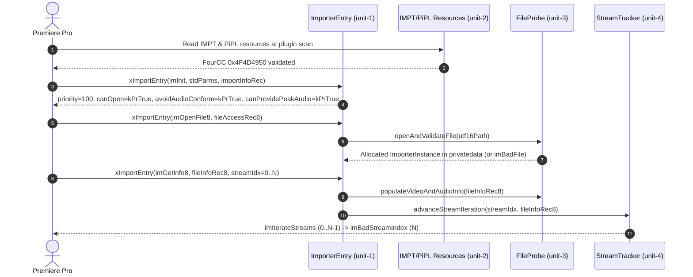

# User Story `US-2.1.0`: Importer Entry, Resource Registration & Stream Probing

- **Module**: `module-2-importer-plugin`
- **Story Branch**: `feat/us-2.1.0-importer-registration-stream-discovery`
- **Field Profile**: `software` (`.agents/field-profile.json`)
- **Story Decomposition Score ($S_{\text{story}}$)**: `2.20` $\to$ **`4` Parallel Implementation Units (`unit-1..4`)**

---

## 1. Spec Kit Specifications

### 1.1 User Story Narrative
> **As an** editor importing MKV, WebM, MP4, MOV, OGG, AVI, or FLV recordings into Adobe Premiere Pro,  
> **I want** `OpenMedia_Importer.prm` to register `IMPT` and `PiPL` binary resources, claim priority `100` in `imInit` (alongside `avoidAudioConform = kPrTrue` and `canProvidePeakAudio = kPrTrue`), fall back via `imBadFile` if native Adobe importers are preferred, compute exact rational timebases (`vidScale` / `vidSampleSize`), and iterate multi-track audio/video streams via `imIterateStreams`,  
> **So that** files containing AV1, VP9, Alpha channels, or OBS multi-track Opus/FLAC audio open reliably on the first attempt without failing with "unsupported format".

#### 1.1.1 Preconditions
- Adobe Premiere Pro SDK headers resolved via `-DADOBE_PP_SDK`.
- `libOpenMediaCore` (`ICoreDemuxer`) linked and `include/importer/importer_types.hpp` pre-seeded.

#### 1.1.2 Postconditions
- `OpenMedia_Importer.prm` / `.bundle` exports `xImportEntry` and embeds valid `IMPT` and `PiPL` resources with FourCC `0x4F4D4950` (`'OMIP'`, strictly avoiding After Effects reserved `0x4D4F6F76`).
- `imInit` sets `canOpen = kPrTrue`, `hasSetup = kPrTrue`, `priority = 100`, `avoidAudioConform = kPrTrue`, and `canProvidePeakAudio = kPrTrue`.
- `imGetIndFormat` registers `.mkv`, `.webm`, `.ogg`, `.flv`, `.avi`, `.mp4`, `.mov` and terminates with `imBadFormatIndex`.
- `imOpenFile8` and `imGetInfo8` convert UTF-16 paths (`imFileAccessRec8.filepath`) to UTF-8, return `imBadFile` when native delegation is warranted, set `supportsGetSourceVideo = kPrTrue`, `supportsAsyncIO = kPrTrue`, `accessModes |= kRandomAccessImport`, compute exact `vidScale` / `vidSampleSize`, and iterate multi-track streams via `imIterateStreams` / `imBadStreamIndex`.

### 1.2 Acceptance Criteria (Gherkin Scenarios)

```gherkin
Feature: Importer Entry Registration, Priority Override, Native Fallback, and Multi-Stream Probing

  Scenario: AC-1 — Selector Dispatching, Priority 100 Override, and Format Enumeration
    Given Adobe Premiere Pro scanning MediaCore plugins at startup
    When xImportEntry is invoked with selector imInit
    Then importInfoRec.canOpen is kPrTrue, hasSetup is kPrTrue, and priority is 100
    And importInfoRec.avoidAudioConform is kPrTrue and canProvidePeakAudio is kPrTrue
    And subsequent imGetIndFormat calls return mkv, webm, ogg, flv, avi, mp4, mov before returning imBadFormatIndex

  Scenario: AC-2 — IMPT and PiPL Binary Resource Validation and FourCC Safety
    Given the compiled plugin binary OpenMedia_Importer.prm or .bundle
    When inspected for embedded IMPT and PiPL resource tables
    Then both IMPT and PiPL resources are present and valid
    And the FourCC identifier is 0x4F4D4950 and strictly does not equal 0x4D4F6F76

  Scenario: AC-3 — UTF-16 File Opening, imBadFile Delegation, and Rational Timebase Calculation
    Given an MKV or MP4 file passed via imOpenFile8 with a UTF-16 filepath
    When FileProbe inspects the container streams via CoreDemuxer
    Then if the file contains standard H.264 without AV1/VP9/Opus/FLAC, it returns imBadFile so Adobe's native importer handles it
    And if accepted (e.g. 29.97 fps NTSC AV1), imGetInfo8 sets vidScale=30000, vidSampleSize=1001, supportsGetSourceVideo=kPrTrue, supportsAsyncIO=kPrTrue

  Scenario: AC-4 — Multi-Track Audio and Video Stream Iteration (OBS MKV)
    Given an MKV recording containing 1 video stream and 4 independent Opus audio tracks
    When imGetInfo8 is invoked with incrementing streamIdx (0 to 4)
    Then StreamTracker populates stream metadata and returns imIterateStreams for indices 0..3
    And returns imBadStreamIndex at index 4 when all streams are exhausted
```

### 1.3 Test Cases & Traceability Matrix

| Test Case ID | Mapped AC | Owning Unit | Test Level | Input Vector | Expected Result & Pass Threshold |
| :--- | :---: | :---: | :---: | :--- | :--- |
| `TC-2.1.1` | `AC-1` | `unit-1` | Unit | `xImportEntry(imInit)` & `imGetIndFormat` loop | `priority == 100`, `avoidAudioConform == kPrTrue`; 7 formats enumerated |
| `TC-2.1.2` | `AC-2` | `unit-2` | Resource Audit | Parse compiled `.rc` / `.r` resource structures | Valid `IMPT` & `PiPL` headers; `FourCC != 0x4D4F6F76` |
| `TC-2.1.3` | `AC-3` | `unit-3` | Unit | UTF-16 Arabic/CJK path + `30000/1001` stream + native H.264 MP4 | `vidScale=30000, vidSampleSize=1001`; returns `imBadFile` on native MP4 |
| `TC-2.1.4` | `AC-4` | `unit-4` | Unit | 5-stream MKV fixture (`streamIdx` 0..5) | Returns `imIterateStreams` for 0..3, `imBadStreamIndex` at 4 |

---

## 2. Technical Implementation Plan

### 2.1 Domain Invariants & Mathematical Formulas
- **Entry Point Signature**:
```cpp
extern "C" DllExport PREMPLUGENTRY xImportEntry(
    csSDK_int32 selector,
    imStdParms* stdParms,
    void* param1,
    void* param2
);
```
- **Rational Frame Rate Formula**:
$$\text{Frame Rate (FPS)} = \frac{\text{vidScale}}{\text{vidSampleSize}} = \frac{\text{AVStream.avg\_frame\_rate.num}}{\text{AVStream.avg\_frame\_rate.den}}$$
For $29.97\text{ fps}$ NTSC: $\text{vidScale} = 30000, \text{vidSampleSize} = 1001$.

### 2.2 Sequence Diagram



---

## 3. Expected Folder Architecture

```text
AV1/
├── include/
│   └── importer/
│       ├── importer_types.hpp                   # Base Contract (Pre-seeded)
│       ├── importer_entry.hpp                   # Owned by unit-1
│       ├── file_probe.hpp                       # Owned by unit-3
│       └── stream_tracker.hpp                   # Owned by unit-4
├── src/
│   └── importer/
│       ├── importer_entry.cpp                   # Owned by unit-1
│       ├── file_probe.cpp                       # Owned by unit-3
│       └── stream_tracker.cpp                   # Owned by unit-4
├── resources/
│   ├── importer_resources.rc                    # Owned by unit-2
│   ├── importer_pipl.r                          # Owned by unit-2
│   └── Info_Importer.plist.in                   # Owned by unit-2
└── tests/
    └── importer/
        ├── test_importer_registration.cpp       # Owned by unit-1
        ├── test_importer_resources.cpp          # Owned by unit-2
        ├── test_file_probe_timebase.cpp         # Owned by unit-3
        └── test_stream_tracker.cpp              # Owned by unit-4
```

---

## 4. Implementation Units in Detail & Specialist Agent Assignment

### 4.1 Story Decomposition Score ($S_{\text{story}}$) & Dynamic Unit Count ($K$)
- **$D_1$ (35% Surface)**: `2` (4 registration, resource, probing, and stream iteration components)
- **$D_2$ (25% Volume)**: `2` (~650 LOC C++17 & resource definitions)
- **$D_3$ (20% Complexity)**: `3` (Priority override, `imBadFile` native fallback, UTF-16 conversion, rational timebase math)
- **$D_4$ (20% Boundaries)**: `2` (4 disjoint file groups)
- **Calculated Score**: $S_{\text{story}} = 0.35(2) + 0.25(2) + 0.20(3) + 0.20(2) = \mathbf{2.20} \to \mathbf{4\text{ Parallel Units}}$

### 4.2 Detailed Unit Specifications (`unit-1..4`)

#### `unit-1` (`feat/us-2.1.0/unit-1-importer-entry-dispatch`)
- **Deliverable Scope**: `xImportEntry` C-linkage entry point and selector router (`imInit`, `imGetIndFormat`, `imCloseFile`, `imShutdown`). Configures `priority = 100`, `canOpen = kPrTrue`, `hasSetup = kPrTrue`, `avoidAudioConform = kPrTrue`, and `canProvidePeakAudio = kPrTrue`. Includes `tests/importer/test_importer_registration.cpp`.
- **Owned Files**: `include/importer/importer_entry.hpp`, `src/importer/importer_entry.cpp`, `tests/importer/test_importer_registration.cpp`.
- **Target Complexity**: $CC \le 6$, nesting $\le 2$.

#### `unit-2` (`feat/us-2.1.0/unit-2-impt-pipl-resources`)
- **Deliverable Scope**: Windows `resources/importer_resources.rc` (`IMPT` and `PiPL` binary structures compiled via `llvm-rc` / `windres`), macOS `resources/importer_pipl.r` and `resources/Info_Importer.plist.in` with FourCC `0x4F4D4950`, plus `tests/importer/test_importer_resources.cpp`.
- **Owned Files**: `resources/importer_resources.rc`, `resources/importer_pipl.r`, `resources/Info_Importer.plist.in`, `tests/importer/test_importer_resources.cpp`.
- **Target Complexity**: $CC \le 4$, 100% resource compiler compliance.

#### `unit-3` (`feat/us-2.1.0/unit-3-file-probe-timebase`)
- **Deliverable Scope**: `FileProbe` handling `imOpenFile8` and `imGetInfo8`. Converts UTF-16 `filepath` to UTF-8, returns `imBadFile` if the container holds only legacy codecs better handled natively by Adobe, allocates `ImporterInstance` via `PrSDKMemorySuite`, sets `supportsGetSourceVideo = kPrTrue`, `supportsAsyncIO = kPrTrue`, `accessModes |= kRandomAccessImport`, and computes `vidScale` / `vidSampleSize`. Includes `tests/importer/test_file_probe_timebase.cpp`.
- **Owned Files**: `include/importer/file_probe.hpp`, `src/importer/file_probe.cpp`, `tests/importer/test_file_probe_timebase.cpp`.
- **Target Complexity**: $CC \le 6$, nesting $\le 2$.

#### `unit-4` (`feat/us-2.1.0/unit-4-multi-stream-tracker`)
- **Deliverable Scope**: `StreamTracker` managing multi-track video/audio stream enumeration across repeated `imGetInfo8` calls (`streamIdx = 0..N`), returning `imIterateStreams` for each active track up to 64 max streams and `imBadStreamIndex` at completion. Includes `tests/importer/test_stream_tracker.cpp`.
- **Owned Files**: `include/importer/stream_tracker.hpp`, `src/importer/stream_tracker.cpp`, `tests/importer/test_stream_tracker.cpp`.
- **Target Complexity**: $CC \le 5$, nesting $\le 2$.

### 4.3 Best-Fit Specialist Agents per Unit

| Unit ID | Branch Name | Primary Implementer Agent | Reviewing Council Agents | Mandatory Skills Enforced |
| :--- | :--- | :--- | :--- | :--- |
| `unit-1` | `feat/us-2.1.0/unit-1-importer-entry-dispatch` | `desktop-app-engineer` | `code-reviewer`, `security-architect` | `code-review-council`, `security-audit` |
| `unit-2` | `feat/us-2.1.0/unit-2-impt-pipl-resources` | `developer-tooling-engineer` | `code-reviewer`, `devops-automator` | `code-review-council`, `cyclomatic-complexity` |
| `unit-3` | `feat/us-2.1.0/unit-3-file-probe-timebase` | `backend-architect` | `code-reviewer`, `api-tester` | `code-review-council`, `cyclomatic-complexity` |
| `unit-4` | `feat/us-2.1.0/unit-4-multi-stream-tracker` | `backend-architect` | `code-reviewer`, `reality-checker` | `code-review-council`, `security-audit` |
| **Patch** | `patch/us-2.1.0-<scope>` | `patch-implementer` | `code-reviewer-council-president` | Full Gate Verification |

---

## 5. Security Gateway (`security-audit`)

| Threat ID | STRIDE | ASVS / CWE | Attack Scenario | Impact | Mitigation Control |
| :--- | :---: | :---: | :--- | :---: | :--- |
| `TM-2.1.1` | **T**ampering | CWE-22 | Malformed UTF-16 surrogate pairs or path traversal in `imOpenFile8` | High | Strict UTF-16 to UTF-8 validation and path canonicalization |
| `TM-2.1.2` | **D**enial of Service | CWE-400 | Malicious MKV containing 10,000 dummy streams | Medium | Cap maximum enumerated streams at 64; return `imBadStreamIndex` beyond cap |
| `TM-2.1.3` | **S**poofing | CWE-345 | FourCC collision with After Effects `0x4D4F6F76` causing startup crash | High | Compile-time `static_assert(kOpenMediaImporterFourCC != 0x4D4F6F76)` |

---

## 6. Validation Gates & Acceptance Sign-Off

| Gate | Gate Name | Pass Criteria | Verification Evidence | Status |
| :--- | :--- | :--- | :--- | :---: |
| **Gate G0** | Build & Lint | 0 compiler warnings, `clang-format` clean | `cmake --build build` exit 0 | `[ ]` |
| **Gate G1** | Tests & Traceability | `TC-2.1.1` .. `TC-2.1.4` pass 100% | `ctest -R test_importer_registration|test_importer_resources|test_file_probe_timebase|test_stream_tracker` | `[ ]` |
| **Gate G2** | Security Gateway | ASan clean, 0 leaks, UTF-16 fuzzing clean | `security-audit` report on PR | `[ ]` |
| **Gate G-Complexity** | Complexity | Every function $CC \le 6$, nesting $\le 2$ | Complexity table on PR | `[ ]` |
| **Gate G-Docs** | Documentation | Complete selector lifecycle Doxygen docs | Doxygen build clean | `[ ]` |
| **Gate G-Review** | Review Sign-Off | Independent Reviewing Council Approval | `gh pr comment` sign-off | `[ ]` |

---

## 7. Influx-v2 Architecture Upgrades (`US-2.1.0`)

- **Dual-PRM Dispatcher & PiPL Trailing-Space Registration (`unit-1` & `unit-2`)**:
  - `xOpenMediaImportEntry(selector, stdParms, param1, param2, isHighPriority)` dispatches both `OpenMedia_Importer.prm` (`kStandardImporterPriority = 100`, PiPL `'OpenMedia Importer'`) and `OpenMedia_ImporterHP.prm` (`kHighImporterPriority = 200`, PiPL `'OpenMedia Importer '` in `resources/importer_hp_resources.rc`, `resources/importer_hp_pipl.r`, and `resources/Info_ImporterHP.plist.in`).
- **`Config.toml` Parser, `!` Filename Modifiers & Warning Deduplication (`unit-3` — `file_probe.hpp/.cpp`)**:
  - `OpenMediaConfig::parseConfigToml()` parses `disable`, `overrideAdobe`, `overrideExtensions` (case-insensitive, `.mkv` or `MKV`), `disableAutomaticOverride`, `reduceWarnings`, `gpuDecodeMode` (`recommended`, `available`, `disabled`), `maxFrameCacheSizeMB` (`400`), `maxPercentUsageAvailableMemory` (`50`), `disableSeekingTable`, `disableThumbnailCache`, `thumbnailTimecode`, and `durationCalculation`.
  - `FilenameModifiers::parseFilenameModifiers()` parses options after the last `!` before the extension (including `.influx` / `.openmedia`): `!w=`, `!h=` (with `resolveAspectRatio()`), `!vs=`, `!as=`, `!pf=` / `!pixel_format=`, `!fr=` / `!frame_rate=` (supporting `<num>d<den>`), `!cr=full|limited`, `!accurate_duration`, and `!rft=1`.
  - `ErrorDeduplicator` suppresses duplicate per-frame warnings for the same file instance.
- **Verification**: Tested in `tests/importer/test_influx_config_modifiers.cpp` and `tests/importer/test_importer_registration.cpp`.
