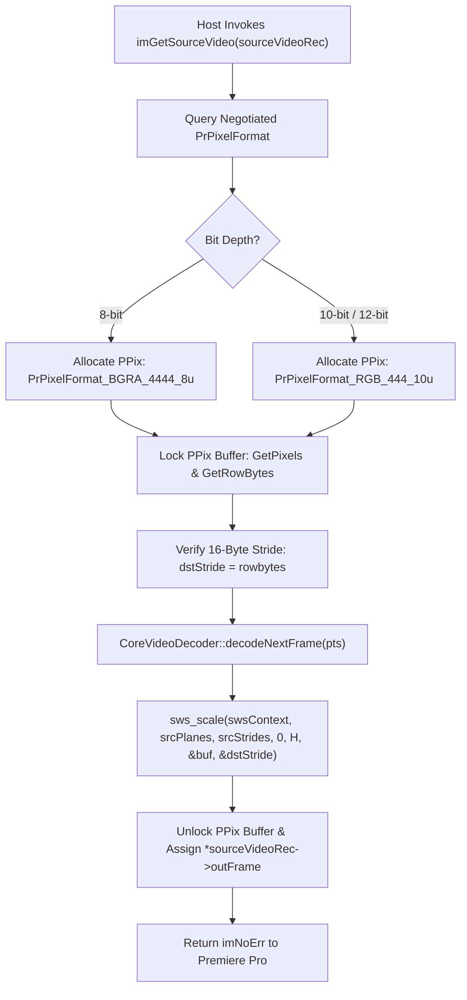

# User Story `US-2.2.0`: Video Frame Decoding, Color Spaces & 16-Byte Stride Alignment

- **Module**: `module-2-importer-plugin`
- **Story Branch**: `feat/us-2.2.0-video-decoding-pixel-alignment`
- **Field Profile**: `software` (`.agents/field-profile.json`)
- **Story Decomposition Score ($S_{\text{story}}$)**: `3.00` $\to$ **`5` Parallel Implementation Units (`unit-1..5`)**

---

## 1. Spec Kit Specifications

### 1.1 User Story Narrative
> **As an** editor scrubbing high-fidelity AV1 and VP9 video in Adobe Premiere Pro,  
> **I want** the importer to decode frames via `imGetSourceVideo`, negotiate 8-bit and 10/12-bit HDR pixel formats, and compute accurate 16-byte aligned `rowbytes` strides for `sws_scale`,  
> **So that** video frames render with 100% color accuracy without memory corruption, diagonal shearing, or visual tearing caused by row padding mismatches.

#### 1.1.1 Preconditions
- `US-2.1.0` stream probing active and reporting `supportsGetSourceVideo = kPrTrue`.
- `libOpenMediaCore` video decoder initialized for target stream.

#### 1.1.2 Postconditions
- `imGetSourceVideo` allocates Premiere Pro `PPixHand` buffers via `PrSDKPPixCreatorSuite`.
- Pixel format negotiation in `imGetIndPixelFormat` prioritizes `PrPixelFormat_BGRA_4444_8u`, `PrPixelFormat_RGB_444_10u`, and `PrPixelFormat_UYVY_422_32f`.
- Row stride calculation guarantees 16-byte alignment compliance: `dstStride` passed to `sws_scale` matches `GetRowBytes()` exactly.

### 1.2 Acceptance Criteria (Gherkin Scenarios)

```gherkin
Feature: Video Frame Decoding, Pixel Format Negotiation, and 16-Byte Stride Alignment

  Scenario: AC-1 — Standard 8-bit Video Decoding into BGRA Buffer
    Given an AV1 or VP9 video stream with 8-bit depth
    When imGetSourceVideo is invoked for frame N
    Then a PPix buffer is allocated with PrPixelFormat_BGRA_4444_8u
    And libswscale converts the decoded AVFrame into the PPix buffer
    And rowbytes padding is respected with zero buffer overrun

  Scenario: AC-2 — 10-bit and 12-bit HDR Pixel Format Negotiation
    Given an AV1 Profile 2 or VP9 Profile 2 video stream with 10-bit color depth
    When imGetIndPixelFormat queries supported pixel formats
    Then the importer announces PrPixelFormat_RGB_444_10u and PrPixelFormat_UYVY_422_32f
    And delivers 10-bit deep color without quantization down to 8-bit

  Scenario: AC-3 — Strict 16-Byte Alignment and Stride Invariant Enforcement
    Given a non-standard video dimension (e.g., 1921x1080) where width * 4 is not a multiple of 16
    When GetRowBytes returns a padded stride value (e.g., 7696 instead of 7684)
    Then sws_scale uses the exact GetRowBytes value as dstStride[0]
    And no image skewing, jagged diagonal artifacts, or memory corruption occurs

  Scenario: AC-4 — Exact Timestamp Matching (PTS to Timeline Time)
    Given timeline cursor positioned at frame 150
    When imGetSourceVideo requests the frame at timestamp T
    Then the decoded AVFrame PTS is verified against T within rational timebase tolerance
    And the exact corresponding frame is returned to the Premiere timeline monitor
```

### 1.3 Test Cases & Traceability Matrix

| Test Case ID | Mapped AC | Owning Unit | Test Level | Input Vector | Expected Result & Pass Threshold |
| :--- | :---: | :---: | :---: | :--- | :--- |
| `TC-2.2.1` | `AC-1` | `unit-1` | Unit | 8-bit 1920x1080 AV1 frame request | Valid `PPixHand` returned; BGRA format |
| `TC-2.2.2` | `AC-2` | `unit-3` | Unit | 10-bit AV1 HDR sample frame | Negotiates `PrPixelFormat_RGB_444_10u` |
| `TC-2.2.3` | `AC-3` | `unit-4` | Unit / Property | Frame dimensions: `1921x1080` | `dstStride % 16 == 0`; 0 visual distortion |
| `TC-2.2.4` | `AC-4` | `unit-5` | Integration | Scrub sequence: frames 0, 30, 60, 90 | PTS matches requested frame indices |

---

## 2. Technical Implementation Plan

### 2.1 Domain Invariants & Storage Schema
- **16-Byte Alignment Invariant**:
  Premiere Pro guarantees pixel row alignment on 16-byte boundaries. Never assume `rowbytes = width * bytes_per_pixel`.
$$\text{dstStride}[0] = \text{GetRowBytes}(* \text{sourceVideoRec->outFrame})$$
$$\text{sws\_scale}(\text{swsContext}, \text{srcPlanes}, \text{srcStrides}, 0, \text{height}, \text{dstPlanes}, \text{dstStrides})$$
- **Supported Pixel Formats Priority**:
  1. `PrPixelFormat_BGRA_4444_8u` (Standard 8-bit fast path)
  2. `PrPixelFormat_RGB_444_10u` (High-bit-depth 10-bit planar RGB)
  3. `PrPixelFormat_UYVY_422_32f` (Floating-point wide gamut)
  4. `PrPixelFormat_BGRA_4444_32f_Linear` (Linear HDR)

### 2.2 Activity Diagram



---

## 3. Expected Folder Architecture at the Project

```text
d:\AV1\
├── include/
│   └── importer/
│       ├── source_video.hpp                     # Owned by unit-1
│       ├── pixel_format_8u.hpp                  # Owned by unit-2
│       ├── pixel_format_hdr.hpp                 # Owned by unit-3
│       ├── stride_align.hpp                     # Owned by unit-4
│       └── frame_scaler.hpp                     # Owned by unit-5
├── src/
│   └── importer/
│       ├── source_video.cpp                     # Owned by unit-1
│       ├── pixel_format_8u.cpp                  # Owned by unit-2
│       ├── pixel_format_hdr.cpp                 # Owned by unit-3
│       ├── stride_align.cpp                     # Owned by unit-4
│       └── frame_scaler.cpp                     # Owned by unit-5
└── tests/
    └── importer/
        └── test_video_decoding_stride.cpp       # Owned by unit-4
```

---

## 4. Implementation Units in Detail & Specialist Agent Assignment

### 4.1 Story Decomposition Score ($S_{\text{story}}$) & Dynamic Unit Count ($K$)
- **$D_1$ (35% Surface)**: `3` (5 pixel format & scaling components)
- **$D_2$ (25% Volume)**: `3` (~900 LOC C++)
- **$D_3$ (20% Complexity)**: `3` (Color space transforms, 16-byte alignment, PPix buffer lifetime)
- **$D_4$ (20% Boundaries)**: `3` (5 independent files)
- **Calculated Score**: $S_{\text{story}} = 0.35(3) + 0.25(3) + 0.20(3) + 0.20(3) = \mathbf{3.00} \to \mathbf{5\text{ Parallel Units}}$

### 4.2 Detailed Unit Specifications (`unit-1..5`)

#### `unit-1` (`feat/us-2.2.0/unit-1-source-video-handler`)
- **Deliverable Scope**: `imGetSourceVideo` selector handler. Coordinates PPix buffer allocation via `PrSDKPPixCreatorSuite`, invokes `CoreVideoDecoder`, and returns valid `PPixHand` references.
- **Owned Files**: `include/importer/source_video.hpp`, `src/importer/source_video.cpp`.
- **Target Complexity**: $CC \le 6$, nesting $\le 2$.

#### `unit-2` (`feat/us-2.2.0/unit-2-pixel-format-8u`)
- **Deliverable Scope**: 8-bit pixel format negotiator. Registers `PrPixelFormat_BGRA_4444_8u` in `imGetIndPixelFormat` and manages 8-bit YUV420P to BGRA conversion.
- **Owned Files**: `include/importer/pixel_format_8u.hpp`, `src/importer/pixel_format_8u.cpp`.
- **Target Complexity**: $CC \le 5$, nesting $\le 2$.

#### `unit-3` (`feat/us-2.2.0/unit-3-pixel-format-hdr`)
- **Deliverable Scope**: High-bit-depth HDR pixel format engine. Manages `PrPixelFormat_RGB_444_10u` and `PrPixelFormat_UYVY_422_32f` for 10-bit and 12-bit AV1/VP9 video streams.
- **Owned Files**: `include/importer/pixel_format_hdr.hpp`, `src/importer/pixel_format_hdr.cpp`.
- **Target Complexity**: $CC \le 6$, nesting $\le 2$.

#### `unit-4` (`feat/us-2.2.0/unit-4-stride-alignment-engine`)
- **Deliverable Scope**: 16-byte rowbytes stride computation and alignment validator. Ensures non-standard video resolutions (e.g. 1921x1080) never cause memory overruns or shearing.
- **Owned Files**: `include/importer/stride_align.hpp`, `src/importer/stride_align.cpp`, `tests/importer/test_video_decoding_stride.cpp`.
- **Target Complexity**: $CC \le 5$, nesting $\le 2$.

#### `unit-5` (`feat/us-2.2.0/unit-5-sws-frame-scaler`)
- **Deliverable Scope**: Color conversion pipeline wrapping `libswscale`. Reuses `SwsContext` across frames of identical geometry to minimize per-frame allocation overhead.
- **Owned Files**: `include/importer/frame_scaler.hpp`, `src/importer/frame_scaler.cpp`.
- **Target Complexity**: $CC \le 6$, nesting $\le 2$.

### 4.3 Best-Fit Specialist Agents per Unit

| Unit ID | Branch Name | Primary Implementer Agent | Reviewing Council Agents | Mandatory Skills Enforced |
| :--- | :--- | :--- | :--- | :--- |
| `unit-1` | `feat/us-2.2.0/unit-1-source-video-handler` | `desktop-app-engineer` | `code-reviewer`, `security-architect` | `code-review-council`, `security-audit` |
| `unit-2` | `feat/us-2.2.0/unit-2-pixel-format-8u` | `video-streaming-engineer` | `code-reviewer`, `performance-benchmarker` | `code-review-council`, `cyclomatic-complexity` |
| `unit-3` | `feat/us-2.2.0/unit-3-pixel-format-hdr` | `video-streaming-engineer` | `code-reviewer`, `reality-checker` | `code-review-council`, `cyclomatic-complexity` |
| `unit-4` | `feat/us-2.2.0/unit-4-stride-alignment-engine` | `backend-architect` | `code-reviewer`, `security-architect` | `code-review-council`, `security-audit` |
| `unit-5` | `feat/us-2.2.0/unit-5-sws-frame-scaler` | `video-streaming-engineer` | `code-reviewer`, `test-automation-engineer` | `code-review-council`, `cyclomatic-complexity` |
| **Patch** | `patch/us-2.2.0-<scope>` | `patch-implementer` | `code-reviewer-council-president` | Full Gate Verification |

### 4.4 Parallel Execution & Zero-Blocking Contract Seeding Plan
1. **Base Contract Seeding**: `RawVideoFrame` and `PixelFormat` pre-seeded on `feat/us-2.2.0-video-decoding-pixel-alignment`.
2. **Concurrent Worktrees**: Provision `.worktrees/feat-us-2.2.0-unit-1` through `unit-5`.
3. **Cascading Merge Sequence**: `unit-1` $\to$ `unit-2` $\to$ `unit-3` $\to$ `unit-4` $\to$ `unit-5` into `feat/us-2.2.0-video-decoding-pixel-alignment` via `gh pr merge <PR> --merge`.

---

## 5. Security Gateway (Powered by `security-audit` Skill)

### 5.1 Trust Boundaries & Security Actors
- **Security Actors**: Decoded uncompressed video buffers crossing into Adobe Premiere Pro host memory.
- **Trust Boundaries**: `PPix` memory pointer access via `GetPixels()`.

### 5.2 Threat Modeling & Abuse Matrix (STRIDE / OWASP ASVS)

| Threat ID | STRIDE | ASVS / CWE | Attack Scenario | Impact | Mitigation Control |
| :--- | :---: | :---: | :--- | :---: | :--- |
| `TM-2.2.1` | **T**ampering | CWE-787 / CWE-121 | Stride buffer overflow writing outside PPix rowbytes allocation | Critical | Validate `rowbytes >= width * bytes_per_pixel`; clamp `sws_scale` output bounds |
| `TM-2.2.2` | **D**enial of Service | CWE-400 | Massive resolution (16K) allocation exhausting host RAM | High | Hard dimension bounds check ($W \le 8192, H \le 4320$) before allocating PPix |
| `TM-2.2.3` | **I**nformation Disclosure | CWE-457 | Uninitialized padding bytes leaking memory contents in row padding | Low | Explicit zero-initialization of padding bytes in `PPix` buffers |

### 5.3 Cryptography & Global Data Protection Controls
1. **Memory Bounds**: All memory offsets calculated using `size_t` with explicit overflow checks before calling `sws_scale`.
2. **Zero Leaks**: All `PPixHand` pointers allocated are paired with release semantics or returned to host ownership.

### 5.4 Automated Security Verification Checklist
- [ ] Stride calculation unit test verified with odd widths (`1921`, `721`, `3839`).
- [ ] AddressSanitizer clean on 1000 frame decoding run.
- [ ] Zero uninitialized reads in `sws_scale` output buffer.

### 5.5 Security Gateway (Gate G2) Sign-Off Checklist
- [ ] 0 memory corruption vulnerabilities.
- [ ] 16-byte alignment invariant mathematically verified.
- [ ] Security reviewer approval posted on PR.

---

## 6. Validation Gates & Acceptance Sign-Off

| Gate | Gate Name | Pass Criteria | Verification Evidence | Status |
| :--- | :--- | :--- | :--- | :---: |
| **Gate G0** | Build & Lint | 0 compiler warnings, clang-format clean | Build log clean | `[ ]` |
| **Gate G1** | Tests & Traceability | `TC-2.2.1` through `TC-2.2.4` pass 100% | Test execution report | `[ ]` |
| **Gate G2** | Security Gateway | ASan clean, 0 buffer overruns | `security-audit` report on PR | `[ ]` |
| **Gate G-Complexity** | Complexity | Every function $CC \le 6$ (nesting $\le 2$) | Complexity table on PR | `[ ]` |
| **Gate G-Docs** | Documentation | Complete pixel format documentation | Doxygen build clean | `[ ]` |
| **Gate G-Review** | Review Sign-Off | Independent Reviewing Council Approval | `gh pr comment` sign-off | `[ ]` |
