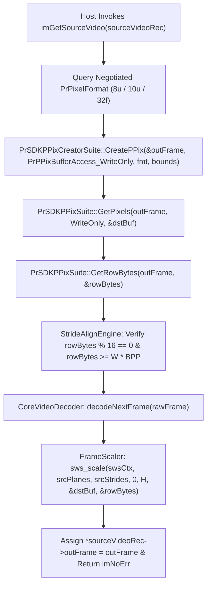

# User Story `US-2.2.0`: Video Frame Decoding, Color Spaces & 16-Byte Stride Alignment

- **Module**: `module-2-importer-plugin`
- **Story Branch**: `feat/us-2.2.0-video-decoding-pixel-alignment`
- **Field Profile**: `software` (`.agents/field-profile.json`)
- **Story Decomposition Score ($S_{\text{story}}$)**: `3.00` $\to$ **`5` Parallel Implementation Units (`unit-1..5`)**

---

## 1. Spec Kit Specifications

### 1.1 User Story Narrative
> **As an** editor and colorist working with 8-bit, 10-bit, and 12-bit HDR AV1/VP9 footage (including WebM Alpha channels) in Adobe Premiere Pro,  
> **I want** the importer to handle `imGetSourceVideo` (enabled via `supportsGetSourceVideo = kPrTrue`), negotiate standard and high-bit-depth pixel formats (`PrPixelFormat_BGRA_4444_8u`, `PrPixelFormat_YUV_420_MPEG4_FIELD_PICTURE_PLANAR_8u_709`, `PrPixelFormat_RGB_444_10u`, `PrPixelFormat_UYVY_422_32f`, `PrPixelFormat_BGRA_4444_32f_Linear`) via `imGetIndPixelFormat`, allocate `PPixHand` frames via `PrSDKPPixCreatorSuite`, and pass the exact 16-byte aligned `GetRowBytes` stride as `dstStride` to `sws_scale`,  
> **So that** frames render at native resolution with full bit depth and alpha transparency without diagonal shearing or buffer overruns.

#### 1.1.1 Preconditions
- `US-2.1.0` active and reporting `imImageInfoRec.supportsGetSourceVideo = kPrTrue`.
- `PrSDKPPixCreatorSuite` and `PrSDKPPixSuite` acquired via SweetPea `getSPBasicSuite`.

#### 1.1.2 Postconditions
- `imGetIndPixelFormat` advertises supported `PrPixelFormat` types ordered by stream bit depth and chroma subsampling.
- `imGetSourceVideo` allocates `*sourceVideoRec->outFrame` using `PrSDKPPixCreatorSuite`, locks pixels via `GetPixels(..., PrPPixBufferAccess_WriteOnly, &buf)`, queries `GetRowBytes`, and executes `sws_scale` using `rowbytes` as `dstStride[0]`.
- Odd-width videos (e.g., `1921x1080`) render with zero diagonal tearing or heap corruption.

### 1.2 Acceptance Criteria (Gherkin Scenarios)

```gherkin
Feature: Native-Resolution Video Frame Decoding (imGetSourceVideo), HDR/Alpha Pixel Formats, and 16-Byte Stride Alignment

  Scenario: AC-1 — Native-Resolution Decoding via imGetSourceVideo and PPix Allocation
    Given an open video stream with supportsGetSourceVideo = kPrTrue
    When Premiere Pro invokes imGetSourceVideo with imSourceVideoRec
    Then SourceVideoHandler allocates a PPixHand buffer via PrSDKPPixCreatorSuite
    And locks the write-only pixel pointer via PrSDKPPixSuite::GetPixels
    And assigns the populated handle to *sourceVideoRec->outFrame

  Scenario: AC-2 — 8-Bit Standard and Alpha Channel Pixel Format Negotiation
    Given an 8-bit AV1 or VP9 stream (with or without WebM YUVA420P alpha channel)
    When imGetIndPixelFormat queries supported formats
    Then PixelFormat8uEngine announces PrPixelFormat_BGRA_4444_8u and YUV_420_MPEG4_FIELD_PICTURE_PLANAR_8u_709
    And preserves full 8-bit alpha channel transparency when present

  Scenario: AC-3 — 10-Bit and 12-Bit HDR Wide-Gamut Pixel Format Negotiation
    Given a 10-bit or 12-bit AV1 Profile 0/2 or VP9 Profile 2/3 HDR stream
    When imGetIndPixelFormat queries supported formats
    Then PixelFormatHdrEngine announces PrPixelFormat_RGB_444_10u, PrPixelFormat_UYVY_422_32f, and PrPixelFormat_BGRA_4444_32f_Linear
    And converts high-bit-depth YUV planes without 8-bit truncation

  Scenario: AC-4 — Strict 16-Byte Row Stride Alignment Invariant
    Given a video with odd width (e.g. 1921x1080) where width * 4 = 7684 bytes (not divisible by 16)
    When PrSDKPPixSuite::GetRowBytes returns the 16-byte aligned stride of 7696 bytes
    Then StrideAlignmentEngine passes 7696 directly as dstStride[0] to sws_scale
    And prevents diagonal image skewing or out-of-bounds memory writes

  Scenario: AC-5 — Reusable SwsContext Color Space Conversion Pipeline
    Given consecutive frame decode requests with identical dimensions and pixel formats
    When FrameScaler converts AVFrame planes into the locked PPix buffer
    Then SwsContext is cached and reused across frames with Rec.709 / Rec.2020 color matrix coefficients
```

### 1.3 Test Cases & Traceability Matrix

| Test Case ID | Mapped AC | Owning Unit | Test Level | Input Vector | Expected Result & Pass Threshold |
| :--- | :---: | :---: | :---: | :--- | :--- |
| `TC-2.2.1` | `AC-1` | `unit-1` | Unit | `imGetSourceVideo` call on 1080p stream | Valid `*outFrame` allocated and unlocked; returns `imNoErr` |
| `TC-2.2.2` | `AC-2` | `unit-2` | Unit | 8-bit VP9 + Alpha stream (`YUVA420P`) | Negotiates `PrPixelFormat_BGRA_4444_8u` with intact alpha channel |
| `TC-2.2.3` | `AC-3` | `unit-3` | Unit | 10-bit & 12-bit AV1 HDR frames | Negotiates `RGB_444_10u` and `BGRA_4444_32f_Linear` without bit loss |
| `TC-2.2.4` | `AC-4` | `unit-4` | Property / Unit | Widths `1921`, `721`, `3839` | `rowBytes == ceil((W * BPP) / 16.0) * 16`; 0 shearing or ASan overflow |
| `TC-2.2.5` | `AC-5` | `unit-5` | Unit | 100 consecutive frames through `FrameScaler` | Single `sws_getCachedContext` allocation; exact color matrix applied |

---

## 2. Technical Implementation Plan

### 2.1 Domain Invariants & 16-Byte Row Alignment Formula
Premiere Pro aligns every `PPixHand` scanline on a **16-byte boundary**:
$$\text{RowStride}_{\text{aligned}} = \left\lceil \frac{\text{Width} \times \text{BytesPerPixel}}{16} \right\rceil \times 16$$
`GetRowBytes(*sourceVideoRec->outFrame, &rowBytes)` MUST be queried and passed directly as `dstStride[0]` to `sws_scale()`.

### 2.2 Activity Diagram



---

## 3. Expected Folder Architecture

```text
AV1/
├── include/
│   └── importer/
│       ├── source_video.hpp                     # Owned by unit-1
│       ├── pixel_format_8u.hpp                  # Owned by unit-2
│       ├── pixel_format_hdr.hpp                 # Owned by unit-3
│       ├── stride_align.hpp                     # Owned by unit-4
│       └── frame_scaler.hpp                     # Owned by unit-5
├── src/
│   └── importer/
│       ├── source_video.cpp                     # Owned by unit-1
│       ├── pixel_format_8u.cpp                  # Owned by unit-2
│       ├── pixel_format_hdr.cpp                 # Owned by unit-3
│       ├── stride_align.cpp                     # Owned by unit-4
│       └── frame_scaler.cpp                     # Owned by unit-5
└── tests/
    └── importer/
        ├── test_source_video.cpp                # Owned by unit-1
        ├── test_pixel_format_8u.cpp             # Owned by unit-2
        ├── test_pixel_format_hdr.cpp            # Owned by unit-3
        ├── test_video_decoding_stride.cpp       # Owned by unit-4
        └── test_frame_scaler.cpp                # Owned by unit-5
```

---

## 4. Implementation Units in Detail & Specialist Agent Assignment

### 4.1 Story Decomposition Score ($S_{\text{story}}$) & Dynamic Unit Count ($K$)
- **$D_1$ (35% Surface)**: `3` (5 video decoding, pixel format, stride, and scaling components)
- **$D_2$ (25% Volume)**: `3` (~900 LOC C++17)
- **$D_3$ (20% Complexity)**: `3` (10/12-bit HDR packing, WebM alpha merging, 16-byte stride math, `SwsContext` caching)
- **$D_4$ (20% Boundaries)**: `3` (5 disjoint header/source/test triplets)
- **Calculated Score**: $S_{\text{story}} = 0.35(3) + 0.25(3) + 0.20(3) + 0.20(3) = \mathbf{3.00} \to \mathbf{5\text{ Parallel Units}}$

### 4.2 Detailed Unit Specifications (`unit-1..5`)

#### `unit-1` (`feat/us-2.2.0/unit-1-source-video-handler`)
- **Deliverable Scope**: `SourceVideoHandler` implementing `imGetSourceVideo`. Coordinates `PPixHand` creation via `PrSDKPPixCreatorSuite`, pixel locking via `PrSDKPPixSuite::GetPixels`, PTS-to-frame timestamp resolution, and `*sourceVideoRec->outFrame` assignment. Includes `tests/importer/test_source_video.cpp`.
- **Owned Files**: `include/importer/source_video.hpp`, `src/importer/source_video.cpp`, `tests/importer/test_source_video.cpp`.
- **Target Complexity**: $CC \le 6$, nesting $\le 2$.

#### `unit-2` (`feat/us-2.2.0/unit-2-pixel-format-8u`)
- **Deliverable Scope**: `PixelFormat8uEngine` handling `imGetIndPixelFormat` for 8-bit streams (`PrPixelFormat_BGRA_4444_8u` and `PrPixelFormat_YUV_420_MPEG4_FIELD_PICTURE_PLANAR_8u_709`) and WebM VP8/VP9/AV1 alpha channel (`YUVA420P` $\to$ `BGRA_4444_8u`) composition. Includes `tests/importer/test_pixel_format_8u.cpp`.
- **Owned Files**: `include/importer/pixel_format_8u.hpp`, `src/importer/pixel_format_8u.cpp`, `tests/importer/test_pixel_format_8u.cpp`.
- **Target Complexity**: $CC \le 5$, nesting $\le 2$.

#### `unit-3` (`feat/us-2.2.0/unit-3-pixel-format-hdr`)
- **Deliverable Scope**: `PixelFormatHdrEngine` handling 10-bit and 12-bit HDR pixel format negotiation and packing (`PrPixelFormat_RGB_444_10u`, `PrPixelFormat_UYVY_422_32f`, and `PrPixelFormat_BGRA_4444_32f_Linear` following the `fnordware/openexrPremiere` model). Includes `tests/importer/test_pixel_format_hdr.cpp`.
- **Owned Files**: `include/importer/pixel_format_hdr.hpp`, `src/importer/pixel_format_hdr.cpp`, `tests/importer/test_pixel_format_hdr.cpp`.
- **Target Complexity**: $CC \le 6$, nesting $\le 2$.

#### `unit-4` (`feat/us-2.2.0/unit-4-stride-alignment-engine`)
- **Deliverable Scope**: `StrideAlignmentEngine` computing and validating 16-byte aligned row strides (`GetRowBytes`), zero-initializing padding bytes, and guarding against buffer overflows on arbitrary/odd video dimensions. Includes `tests/importer/test_video_decoding_stride.cpp`.
- **Owned Files**: `include/importer/stride_align.hpp`, `src/importer/stride_align.cpp`, `tests/importer/test_video_decoding_stride.cpp`.
- **Target Complexity**: $CC \le 5$, nesting $\le 2$.

#### `unit-5` (`feat/us-2.2.0/unit-5-sws-frame-scaler`)
- **Deliverable Scope**: `FrameScaler` wrapping `libswscale` (`sws_getCachedContext`, `sws_setColorspaceDetails`, `sws_scale`) with Rec.601, Rec.709, and Rec.2020 matrix support. Includes `tests/importer/test_frame_scaler.cpp`.
- **Owned Files**: `include/importer/frame_scaler.hpp`, `src/importer/frame_scaler.cpp`, `tests/importer/test_frame_scaler.cpp`.
- **Target Complexity**: $CC \le 6$, nesting $\le 2$.

### 4.3 Best-Fit Specialist Agents per Unit

| Unit ID | Branch Name | Primary Implementer Agent | Reviewing Council Agents | Mandatory Skills Enforced |
| :--- | :--- | :--- | :--- | :--- |
| `unit-1` | `feat/us-2.2.0/unit-1-source-video-handler` | `desktop-app-engineer` | `code-reviewer`, `security-architect` | `code-review-council`, `security-audit` |
| `unit-2` | `feat/us-2.2.0/unit-2-pixel-format-8u` | `video-streaming-engineer` | `code-reviewer`, `performance-benchmarker` | `code-review-council`, `cyclomatic-complexity` |
| `unit-3` | `feat/us-2.2.0/unit-3-pixel-format-hdr` | `video-streaming-engineer` | `code-reviewer`, `reality-checker` | `code-review-council`, `cyclomatic-complexity` |
| `unit-4` | `feat/us-2.2.0/unit-4-stride-alignment-engine` | `backend-architect` | `code-reviewer`, `security-architect` | `code-review-council`, `security-audit` |
| `unit-5` | `feat/us-2.2.0/unit-5-sws-frame-scaler` | `video-streaming-engineer` | `code-reviewer`, `test-automation-engineer` | `code-review-council`, `cyclomatic-complexity` |
| **Patch** | `patch/us-2.2.0-<scope>` | `patch-implementer` | `code-reviewer-council-president` | Full Gate Verification |

---

## 5. Security Gateway (`security-audit`)

| Threat ID | STRIDE | ASVS / CWE | Attack Scenario | Impact | Mitigation Control |
| :--- | :---: | :---: | :--- | :---: | :--- |
| `TM-2.2.1` | **T**ampering | CWE-787 | Stride mismatch writing past `PPixHand` row allocation | Critical | Enforce `dstStride = GetRowBytes()` and verify `rowBytes >= width * bytesPerPixel` |
| `TM-2.2.2` | **D**enial of Service | CWE-400 | Crafted header claiming $65536 \times 65536$ resolution exhausting RAM | High | Validate dimensions ($16 \le W, H \le 16384$) before allocating `PPixHand` |
| `TM-2.2.3` | **I**nformation Disclosure | CWE-457 | Uninitialized 16-byte row padding bytes leaking heap contents | Low | Zero-initialize row padding bytes in `StrideAlignmentEngine` |

---

## 6. Validation Gates & Acceptance Sign-Off

| Gate | Gate Name | Pass Criteria | Verification Evidence | Status |
| :--- | :--- | :--- | :--- | :---: |
| **Gate G0** | Build & Lint | 0 compiler warnings, `clang-format` clean | `cmake --build build` exit 0 | `[ ]` |
| **Gate G1** | Tests & Traceability | `TC-2.2.1` .. `TC-2.2.5` pass 100% | `ctest -R test_source_video|test_pixel_format_8u|test_pixel_format_hdr|test_video_decoding_stride|test_frame_scaler` | `[ ]` |
| **Gate G2** | Security Gateway | ASan clean, 0 buffer overruns on odd widths | `security-audit` report on PR | `[ ]` |
| **Gate G-Complexity** | Complexity | Every function $CC \le 6$, nesting $\le 2$ | Complexity table on PR | `[ ]` |
| **Gate G-Docs** | Documentation | Complete Doxygen docs for all 5 headers | Doxygen build clean | `[ ]` |
| **Gate G-Review** | Review Sign-Off | Independent Reviewing Council Approval | `gh pr comment` sign-off | `[ ]` |

---

## 7. Influx-v2 Architecture Upgrades (`US-2.2.0`)

- **Direct GPU/SIMD `NV12` & `P010LE` to `BGRA8` / `RGB444_10U` Fast-Path (`unit-3` & `unit-5`)**:
  - `PixelFormatHdrEngine::convertNv12ToBgra8()`, `convertP010ToBgra8()`, and `convertP010ToRgb444_10u()` (alongside `FrameScaler`) perform direct 16-byte aligned color conversion modeling Influx v2's `cuda_bgra_nv12` and `cuda_bgra_p010` pipeline.
- **Extended Cinema & HDR Transfer/Gamut Support (`unit-3` & `unit-5`)**:
  - Adds `ExtendedColorSpace` / transfer support for `sRGB`, `BT.601`, `BT.709`, `BT.2020`, `BT.2100_HLG`, `BT.2100_PQ`, `DCDM_XYZ`, `Sony_SGamut_SLog2`, `Sony_SGamut3_SLog3`, and `Sony_Cine_SLog3`.

---

## 7. `v3.0.0` Remediation: Frame-Accurate Timeline Scrubbing & Hardware Surface Conversion

- **Exact Frame Seeking in `handleImGetSourceVideo`**:
  - Computes target frame index and PTS from `ImSourceVideoRecExt::inFrameTime`, queries `KeyframeRingBuffer` for buffered frames, and seeks `CoreDemuxer` when jumping across non-contiguous timeline positions.
- **SIMD & GPU Surface Transfer (`D3D11VA` / `NVDEC` / `Vulkan`)**:
  - Transfers decoded `NV12` / `P010LE` surfaces with 16-byte row alignment and color space conversion (`BT.601`, `BT.709`, `BT.2020`, `BT.2100 PQ/HLG`, `Sony S-Log3`).
