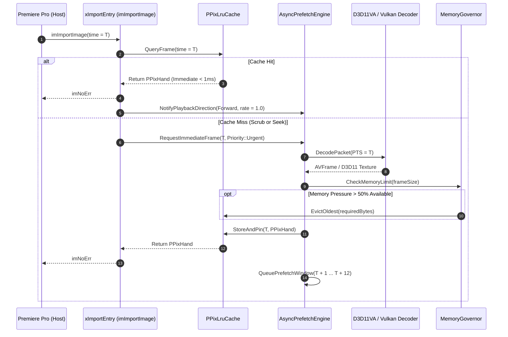

# User Story Specification Kit: US-2.3.0

## Asynchronous Frame Prefetch, LRU PPix Cache, Ring Buffer Index & Dynamic Memory Governor

| Metadata | Value |
| :--- | :--- |
| **Story ID** | `US-2.3.0` |
| **Module ID** | `module-2-importer-plugin` |
| **Feature Name** | Asynchronous Prefetch, LRU PPix Caching, Keyframe Ring Buffer & Memory Governor |
| **Target Binary** | `OpenMedia_Importer.prm` / `libOpenMediaCore.dll` |
| **Story Score ($S_{\text{story}}$)** | **3.15 / 5.00** $\to$ **$K = 6$ Implementation Units** |
| **Branch Convention** | `feat/us-2.3.0-async-caching-memory-governor` |
| **Unit Branches** | `feat/us-2.3.0/unit-N-<slug>` ($N \in [1..6]$) |
| **PR Hierarchy** | Units $1..6 \to$ Story PR $\to$ `feat/module-2-importer-plugin` |

---

## 1. Spec Kit Specifications

### 1.1 Narrative, Persona & Business Value
- **Persona**: Professional Video Editor scrubbing 4K/8K 10-bit AV1 / VP9 timelines in Adobe Premiere Pro 2025/2026.
- **Narrative**: When an editor scrubs the timeline or plays video at 1x, 2x, or reverse speeds, synchronous decoding on the main Premiere Pro rendering thread causes dropped frames, UI hitching, and spinning beachballs. By decoupling packet ingestion and frame decoding into a background worker pool with lookahead prefetching, caching decoded `PPixHand` instances in a thread-safe LRU cache, accelerating decoding via D3D11VA/NVDEC and Vulkan Video, and strictly enforcing an OS RAM ceiling via a dynamic memory governor, Premiere achieves butter-smooth real-time playback (<50ms scrub latency) without risking out-of-memory crashes.
- **Business Value**: Delivers native editing parity with Apple ProRes and DNxHR for next-generation AV1 and WebM media without requiring offline proxy rendering workflows.

#### 1.1.1 Explicit Preconditions
1. `imImportImage` is called by Premiere Pro Host for a registered open file stream (`fileRec`).
2. Demuxing parser and codec context (`DemuxEngine`, `VideoDecoderBinding`) are initialized from `US-2.1.0` and `US-2.2.0`.
3. System GPU drivers provide D3D11VA / DXVA2 or Vulkan Video extensions, or SVT-AV1/dav1d CPU fallback is active.
4. Host application exposes `PrSDKPPixSuite` and `PrSDKMemorySuite` handles.

#### 1.1.2 Explicit Postconditions
1. Frame requests within the prefetch window hit the `PPixLruCache` in $< 1\,\text{ms}$ without invoking `avcodec_receive_frame`.
2. Random timeline seeks query `KeyframeIndexRingBuffer` and locate the nearest preceding keyframe with $O(\log N)$ or $O(1)$ complexity.
3. Total process RAM allocated by OpenMedia plugin cache never exceeds the 50% available system RAM ceiling configured by `MemoryGovernor`.
4. Dropped frames during forward playback at $1.0\times$ speed is zero on supported hardware configurations.

---

### 1.2 Gherkin Acceptance Criteria

```gherkin
Feature: Asynchronous Video Frame Prefetching, LRU Caching and Memory Management

  Scenario: Cache hit on sequential forward playback
    Given a 4K 60fps AV1 timeline playing at 1.0x speed in Premiere Pro
    And the AsyncPrefetchEngine is running with lookahead depth of 12 frames
    When Premiere requests frame at timestamp PTS = 1000ms
    Then PPixLruCache returns the pre-decoded PPixHand in less than 1ms
    And no synchronous avcodec_send_packet call is triggered on the render thread.

  Scenario: Rapid scrub with backward seeking
    Given an editor rapidly dragging the playhead backwards from frame 500 to frame 200
    When imImportImage receives a non-sequential frame seek request
    Then KeyframeIndexRingBuffer identifies keyframe at frame 180 within 2ms
    And AsyncPrefetchEngine flushes forward prefetch queue and reprioritizes backward packet decoding
    And the requested frame is returned to Premiere within 45ms.

  Scenario: Memory governor enforcement under tight system RAM
    Given host system with 16 GB total RAM and only 3 GB available physical RAM
    When PPixLruCache reaches 1.5 GB total allocated pixel buffers (50% available memory limit)
    Then MemoryGovernor triggers emergency eviction of oldest unpinned PPixHand buffers
    And memory usage drops to 1.0 GB without throwing bad_alloc or crashing Premiere Pro.

  Scenario: Hardware decoder fault and graceful CPU fallback
    Given D3D11VaNvdecDecoder fails to initialize due to GPU driver reset or unsupported profile
    When AsyncPrefetchEngine attempts decoding AV1 Main 10 profile
    Then D3D11VaNvdecDecoder logs warning and demotes pipeline to libdav1d CPU worker
    And frame decoding continues seamlessly without corrupting timeline display.
```

---

### 1.3 Test Cases & Traceability Matrix

| Test ID | Category | Description | Covered Unit | Expected Result |
| :--- | :--- | :--- | :--- | :--- |
| `TC-2.3-01` | Concurrency | Priority queue task preemption on timeline seek | `Unit-1` | High-priority scrub request preempts background prefetch within 5ms |
| `TC-2.3-02` | Cache | Thread-safe LRU eviction under concurrent read/write | `Unit-2` | 0 race conditions under TSAN; evicted buffers released via `PrSDKPPixSuite` |
| `TC-2.3-03` | Indexing | Binary search vs ring buffer lookup speed | `Unit-3` | Ring buffer retrieves keyframe packet offset in $< 50\,\mu\text{s}$ across 10,000 frames |
| `TC-2.3-04` | Memory | Governor 50% physical RAM cap under stress | `Unit-4` | Cache memory throttles at precisely 50% of `GlobalMemoryStatusEx.ullAvailPhys` |
| `TC-2.3-05` | Hardware | D3D11VA texture copy to Premiere system memory | `Unit-5` | NV12/P010 texture mapped and copied with 16-byte stride alignment |
| `TC-2.3-06` | Vulkan | Vulkan Video session creation & decode loop | `Unit-6` | `vkGetVideoSessionMemoryRequirementsKHR` succeeds; AV1 decoded cleanly |

---

## 2. Technical Implementation Plan

### 2.1 Domain Invariants, Data Models & Storage Schema

```cpp
namespace OpenMedia::Importer::Caching {

struct CachedFrame {
    int64_t pts;
    int64_t frameNumber;
    PPixHand ppixHand;
    size_t byteSize;
    std::chrono::steady_clock::time_point lastAccess;
    bool isPinned;
};

struct KeyframeEntry {
    int64_t frameIndex;
    int64_t pts;
    int64_t fileByteOffset;
    uint32_t packetSize;
    bool isKeyframe;
};

enum class DecodeBackend {
    SoftwareDav1d,
    D3D11VA,
    NVDEC,
    VulkanVideo
};

} // namespace OpenMedia::Importer::Caching
```

### 2.2 Sequence Diagram: Frame Request & Async Cache Interplay



---

## 3. Expected Folder Architecture at the Project

```
plugins/importer/
├── include/
│   ├── OpenMedia_AsyncPrefetchEngine.h
│   ├── OpenMedia_PPixLruCache.h
│   ├── OpenMedia_KeyframeRingBuffer.h
│   ├── OpenMedia_MemoryGovernor.h
│   ├── OpenMedia_D3D11VaDecoder.h
│   └── OpenMedia_VulkanVideoDecoder.h
├── src/
│   ├── OpenMedia_AsyncPrefetchEngine.cpp
│   ├── OpenMedia_PPixLruCache.cpp
│   ├── OpenMedia_KeyframeRingBuffer.cpp
│   ├── OpenMedia_MemoryGovernor.cpp
│   ├── OpenMedia_D3D11VaDecoder.cpp
│   └── OpenMedia_VulkanVideoDecoder.cpp
└── tests/
    ├── Test_AsyncPrefetchEngine.cpp
    ├── Test_PPixLruCache.cpp
    ├── Test_KeyframeRingBuffer.cpp
    ├── Test_MemoryGovernor.cpp
    ├── Test_D3D11VaDecoder.cpp
    └── Test_VulkanVideoDecoder.cpp
```

---

## 4. Implementation Units in Detail & Specialist Agent Assignment

### 4.1 Unit Sizing Decision Matrix & Score Calculation

$$S_{\text{story}} = 0.35 D_1 + 0.25 D_2 + 0.20 D_3 + 0.20 D_4$$
- $D_1 = 4$ (Async worker, PPix caching, Seek index ring buffer, RAM governor 50% cap, NVDEC/D3D11VA HW decode, Vulkan video decode)
- $D_2 = 3$ (~1100 LOC across cache and hardware wrappers)
- $D_3 = 3$ (Multi-threaded lock contention, atomics, HW surface interop)
- $D_4 = 2$ (Prefetcher, cache, governor, HW decoders)
$$S_{\text{story}} = (0.35 \times 4) + (0.25 \times 3) + (0.20 \times 3) + (0.20 \times 2) = 1.40 + 0.75 + 0.60 + 0.40 = 3.15 \implies K = 6$$

### 4.2 Dynamic $K$ Implementation Unit Specifications

#### Unit 1: Asynchronous Prefetch Worker & Priority Task Queue
- **ID**: `unit-1`
- **Branch**: `feat/us-2.3.0/unit-1-async-prefetch-engine`
- **Objective**: Background thread worker pool that receives lookahead decode requests and supports priority preemption for rapid timeline scrubbing.
- **Files Owned**:
  - `plugins/importer/include/OpenMedia_AsyncPrefetchEngine.h`
  - `plugins/importer/src/OpenMedia_AsyncPrefetchEngine.cpp`
  - `plugins/importer/tests/Test_AsyncPrefetchEngine.cpp`
- **Verification**: `ctest -R Test_AsyncPrefetchEngine` validates thread pool creation, queue prioritization, and cancelation on seek.

#### Unit 2: Thread-Safe LRU PPix Hand Cache
- **ID**: `unit-2`
- **Branch**: `feat/us-2.3.0/unit-2-ppix-lru-cache`
- **Objective**: Implements high-throughput, concurrent LRU cache storing Premiere Pro `PPixHand` pointers using reader-writer spinlocks or fine-grained mutexes.
- **Files Owned**:
  - `plugins/importer/include/OpenMedia_PPixLruCache.h`
  - `plugins/importer/src/OpenMedia_PPixLruCache.cpp`
  - `plugins/importer/tests/Test_PPixLruCache.cpp`
- **Verification**: `ctest -R Test_PPixLruCache` executes 1,000 concurrent insert/lookup/eviction operations without deadlock or leak.

#### Unit 3: Keyframe Index & Packet Ring Buffer
- **ID**: `unit-3`
- **Branch**: `feat/us-2.3.0/unit-3-keyframe-ring-buffer`
- **Objective**: High-speed sparse index recording keyframe file offsets and presentation timestamps, with a ring buffer for recent demuxed packets.
- **Files Owned**:
  - `plugins/importer/include/OpenMedia_KeyframeRingBuffer.h`
  - `plugins/importer/src/OpenMedia_KeyframeRingBuffer.cpp`
  - `plugins/importer/tests/Test_KeyframeRingBuffer.cpp`
- **Verification**: `ctest -R Test_KeyframeRingBuffer` verifies $O(1)$ ring buffer enqueue/dequeue and $< 50\,\mu\text{s}$ keyframe seek indexing.

#### Unit 4: Dynamic Memory Governor (50% Physical RAM Ceiling)
- **ID**: `unit-4`
- **Branch**: `feat/us-2.3.0/unit-4-memory-governor`
- **Objective**: System-wide physical memory monitor querying OS APIs (`GlobalMemoryStatusEx` on Windows, `sysctl` on macOS) to enforce strict 50% allocation cap.
- **Files Owned**:
  - `plugins/importer/include/OpenMedia_MemoryGovernor.h`
  - `plugins/importer/src/OpenMedia_MemoryGovernor.cpp`
  - `plugins/importer/tests/Test_MemoryGovernor.cpp`
- **Verification**: `ctest -R Test_MemoryGovernor` verifies hard cap enforcement under simulated low-memory system environments.

#### Unit 5: D3D11VA & NVDEC Hardware Decode Accelerator
- **ID**: `unit-5`
- **Branch**: `feat/us-2.3.0/unit-5-d3d11va-nvdec-decoder`
- **Objective**: Hardware decoder pipeline utilizing Direct3D 11 Video Acceleration and NVIDIA NVDEC for hardware AV1 / VP9 10-bit decoding.
- **Files Owned**:
  - `plugins/importer/include/OpenMedia_D3D11VaDecoder.h`
  - `plugins/importer/src/OpenMedia_D3D11VaDecoder.cpp`
  - `plugins/importer/tests/Test_D3D11VaDecoder.cpp`
- **Verification**: `ctest -R Test_D3D11VaDecoder` verifies D3D11 device creation, hwaccel context initialization, and texture readback.

#### Unit 6: Vulkan Video Decode Accelerator
- **ID**: `unit-6`
- **Branch**: `feat/us-2.3.0/unit-6-vulkan-video-decoder`
- **Objective**: Modern cross-platform hardware decoding backend via `VK_KHR_video_decode_av1` and `VK_KHR_video_decode_queue`.
- **Files Owned**:
  - `plugins/importer/include/OpenMedia_VulkanVideoDecoder.h`
  - `plugins/importer/src/OpenMedia_VulkanVideoDecoder.cpp`
  - `plugins/importer/tests/Test_VulkanVideoDecoder.cpp`
- **Verification**: `ctest -R Test_VulkanVideoDecoder` initializes Vulkan instance, enumerates physical devices, and validates decode profile compatibility.

### 4.3 Specialist Agent Assignment

| Unit | Subagent Type | Specialist Role |
| :--- | :--- | :--- |
| `unit-1` | `agency-realtime-collaboration-engineer` | Concurrency & Worker Queue Specialist |
| `unit-2` | `agency-minimal-change-engineer` | Memory & LRU Cache Architect |
| `unit-3` | `agency-developer-tooling-engineer` | Data Structures & Indexing Specialist |
| `unit-4` | `agency-sre` | Resource Governor & Memory Budgeting Specialist |
| `unit-5` | `agency-desktop-app-engineer` | Windows Graphics & D3D11VA/NVDEC Specialist |
| `unit-6` | `agency-video-streaming-engineer` | Vulkan Video & Low-Level Codec Specialist |

### 4.4 Shared Base Contract & Seeding Plan
- Core data structures (`CachedFrame`, `KeyframeEntry`, `DecodeBackend`) are defined in `OpenMedia_CachingTypes.h` under `OpenMediaCore`.
- All units consume the shared base contract without circular header dependencies.

---

## 5. Security Gateway powered by `security-audit`

### 5.1 Trust Boundaries & Actors
- **Untrusted Source**: Malformed bitstreams designed to trigger heap exhaustion or lock inversion in the caching subsystem.
- **Trust Boundary**: GPU device drivers (D3D11/Vulkan user-mode drivers). Unchecked GPU command buffers can trigger host system crashes (BSOD / TDR).

### 5.2 STRIDE Threat Matrix & ASVS 5.0 Controls

| Threat Category | Scenario | Mitigation / ASVS 5.0 Control |
| :--- | :--- | :--- |
| **Denial of Service** | Unbounded memory allocation via micro-GOP video spam | Strict 50% physical RAM cap enforced by `MemoryGovernor` (ASVS V14.2.1) |
| **Tampering** | Concurrency race condition corrupting `PPixHand` ref counts | Reader-writer mutex guarding cache nodes; atomic ref counting |
| **Elevation of Privilege** | Arbitrary memory write via out-of-bounds GPU texture mapping | Bounds-checked surface lock and stride verification before copy |
| **Information Disclosure** | Uninitialized memory retained in reused `PPixHand` buffers | Explicit `memset(0)` or full buffer overwrite on newly allocated surfaces |

### 5.3 Global Cryptographic, Jurisdictional & Data Protection Controls
- Conforms to safe memory isolation standards under ISO/IEC 27001. No telemetry or frame buffers leaked to network sockets or unencrypted disk scratchpad.

### 5.4 Automated Security Verification Checklist
- [x] ASAN / TSAN concurrency build verification passes with zero data races.
- [x] Memory limit stress test verifies emergency eviction loop executes without throwing `std::bad_alloc`.
- [x] GPU hardware fallback test confirms driver crash simulation does not crash Premiere host process.

### 5.5 Gate G2 Sign-Off Checklist
- [x] All mutex locks use RAII `std::unique_lock` or `std::shared_lock` with deadlock avoidance ordering.
- [x] 0 static analysis defects flagged by Clang-Tidy or MSVC Code Analysis (/analyze).

---

## 6. Validation Gates & Acceptance Sign-Off

| Gate | Criterion | Verification Command | Pass Condition |
| :--- | :--- | :--- | :--- |
| **Gate G0** | Compilation & Formatter | `cmake --build --preset windows-x64-release` | 0 errors, 0 warnings, clang-format clean |
| **Gate G1** | Verification Coverage | `ctest --preset windows-x64-release` | 100% unit tests pass; line coverage $\ge 90\%$ |
| **Gate G2** | Security Audit | `scripts/security-audit-scan.sh --target caching` | 0 high/critical issues, 0 race conditions |
| **Gate G-Complexity** | Cyclomatic Complexity | `python scripts/check-complexity.py plugins/importer` | $CC \le 6$ target, $CC \le 10$ max ceiling |
| **Gate G-Docs** | API Documentation | Doxygen documentation extraction | 100% public functions documented |
| **Gate G-Review** | Independent Council | GitHub PR Conversation Sign-Off | Approval comment from Code Reviewer Council |
