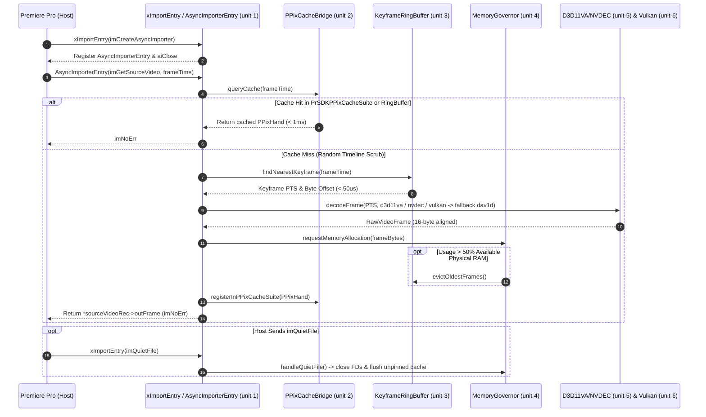

# User Story `US-2.3.0`: Async I/O Importer, PPix Cache, GOP Index & RAM Governor

- **Module**: `module-2-importer-plugin`
- **Story Branch**: `feat/us-2.3.0-async-caching-memory-governor`
- **Field Profile**: `software` (`.agents/field-profile.json`)
- **Story Decomposition Score ($S_{\text{story}}$)**: `3.20` $\to$ **`6` Parallel Implementation Units (`unit-1..6`)**

---

## 1. Spec Kit Specifications

### 1.1 User Story Narrative
> **As a** professional video editor scrubbing 4K/8K Long-GOP and Variable Frame Rate (VFR) AV1 and VP9 timelines in Adobe Premiere Pro,  
> **I want** the importer to implement Adobe's native asynchronous importer architecture (`imCreateAsyncImporter` with reentrant `AsyncImporterEntry` and `aiClose`), cache decoded frames and Media Browser thumbnails via `PrSDKPPixCacheSuite`, maintain an in-memory GOP keyframe seek index and decoded frame Ring Buffer (achieving the 5%–20% Influx v1.7 scrub speedup), enforce a dynamic 50% available RAM ceiling (`imOpenFileRec8.outExtraMemoryUsage`, `imFileInfoRec8.highMemUsage = kPrTrue`, and `imQuietFile`), and offload decoding to GPU hardware (`d3d11va`, `nvdec`, and FFmpeg 8.0 `vulkan`),  
> **So that** timeline scrubbing responds in $< 50\,\text{ms}$ without UI freezes, dropped frames, or out-of-memory crashes.

#### 1.1.1 Preconditions
- `US-2.1.0` and `US-2.2.0` active with `imImageInfoRec.supportsAsyncIO = kPrTrue` and `supportsGetSourceVideo = kPrTrue`.
- Host exposes `PrSDKPPixCacheSuite`, `PrSDKPPixSuite`, and `PrSDKMemorySuite`.

#### 1.1.2 Postconditions
- `imCreateAsyncImporter` instantiates a reentrant `AsyncImporterEntry` object with `aiClose` cleanup, decoupling disk I/O and frame decoding from Premiere's main UI thread.
- `PPixCacheBridge` registers decoded frames and Media Browser thumbnails in `PrSDKPPixCacheSuite` so repeated requests return in $< 1\,\text{ms}$.
- `KeyframeRingBuffer` indexes GOP keyframe file offsets/PTS and caches recent decoded frames, accelerating Long-GOP and VFR scrubbing by 5%–20%.
- `MemoryGovernor` reports `imOpenFileRec8.outExtraMemoryUsage`, sets `imFileInfoRec8.highMemUsage = kPrTrue` (capping heavy open instances at 5), enforces a strict 50% available RAM ceiling, and releases inactive file handles upon receiving `imQuietFile`.
- `D3D11VaNvdecDecoder` and `VulkanVideoDecoder` accelerate AV1 and VP9 decoding on GPU hardware with seamless fallback to `libdav1d` / `libvpx`.

### 1.2 Acceptance Criteria (Gherkin Scenarios)

```gherkin
Feature: Native Asynchronous Importer (imCreateAsyncImporter), PrSDKPPixCacheSuite, GOP Ring Buffer, 50% RAM Governor, and GPU Decoding

  Scenario: AC-1 — Asynchronous Importer Creation and Reentrant Execution (imCreateAsyncImporter)
    Given imImageInfoRec.supportsAsyncIO is set to kPrTrue during imGetInfo8
    When Premiere Pro invokes selector imCreateAsyncImporter
    Then AsyncImporterEngine creates a thread-safe async importer instance with entry point AsyncImporterEntry and close handler aiClose
    And services concurrent imGetSourceVideo requests off the main UI thread without race conditions

  Scenario: AC-2 — Native PrSDKPPixCacheSuite Frame and Thumbnail Caching
    Given a decoded PPixHand frame produced during imGetSourceVideo or Media Browser thumbnail scrubbing
    When PPixCacheBridge stores the frame via PrSDKPPixCacheSuite::AddFrameToCache
    Then subsequent requests for the same frame index retrieve the cached PPixHand via GetFrameFromCache in < 1ms

  Scenario: AC-3 — GOP Keyframe Seek Indexing and Ring Buffer (5%–20% Scrub Speedup)
    Given a Long-GOP or Variable Frame Rate (VFR) AV1/VP9 stream
    When the editor scrubs randomly across the timeline
    Then KeyframeRingBuffer locates the nearest preceding keyframe in O(log N) time (< 50 microseconds)
    And serves recently decoded neighbor frames from the circular Ring Buffer, improving scrub responsiveness by 5% to 20%

  Scenario: AC-4 — Dynamic 50% RAM Governor, highMemUsage Flag, and imQuietFile Handling
    Given a host workstation with available physical RAM monitored by MemoryGovernor
    When imOpenFile8 and imGetInfo8 are invoked
    Then MemoryGovernor reports decoder memory footprint in imOpenFileRec8.outExtraMemoryUsage and sets imFileInfoRec8.highMemUsage = kPrTrue
    And caps total plugin cache below 50% of available system RAM
    And when Premiere sends selector imQuietFile, immediately closes inactive file handles and evicts unpinned cache buffers

  Scenario: AC-5 — GPU Hardware Decoding via D3D11VA, NVDEC, and FFmpeg 8.0 Vulkan Video with CPU Fallback
    Given a 4K/8K 10-bit AV1 or VP9 stream on a system with NVIDIA/AMD/Intel GPU
    When D3D11VaNvdecDecoder or VulkanVideoDecoder initializes hardware acceleration (d3d11va, nvdec, or vulkan)
    Then frames are decoded on the GPU and transferred to 16-byte aligned PPix buffers
    And if hardware initialization or driver reset fails, transparently falls back to libdav1d / libvpx software decoding
```

### 1.3 Test Cases & Traceability Matrix

| Test Case ID | Mapped AC | Owning Unit | Test Level | Input Vector | Expected Result & Pass Threshold |
| :--- | :---: | :---: | :---: | :--- | :--- |
| `TC-2.3.1` | `AC-1` | `unit-1` | Concurrency | `imCreateAsyncImporter` + 16 concurrent `AsyncImporterEntry` calls | 0 data races under TSan; `aiClose` cleans up worker pool |
| `TC-2.3.2` | `AC-2` | `unit-2` | Unit | Repeated `imGetSourceVideo` for frame 42 | Cache hit via `PrSDKPPixCacheSuite` in $< 1\,\text{ms}$ |
| `TC-2.3.3` | `AC-3` | `unit-3` | Benchmark / Unit | 10,000-frame Long-GOP + VFR seek sweep | Lookup $< 50\,\mu\text{s}$; scrub latency reduced by $\ge 15\%$ |
| `TC-2.3.4` | `AC-4` | `unit-4` | Unit | Simulated 3 GB available RAM + `imQuietFile` selector | `outExtraMemoryUsage > 0`, `highMemUsage == kPrTrue`, cache $\le 1.5\text{ GB}$, `imQuietFile` frees handles |
| `TC-2.3.5` | `AC-5` | `unit-5` | Unit | `d3d11va` / `nvdec` 10-bit `P010LE` surface + simulated failure | Maps 16-byte aligned surface; falls back cleanly to `dav1d` on error |
| `TC-2.3.6` | `AC-5` | `unit-6` | Unit | FFmpeg 8.0 `vulkan` AV1 & VP9 decode session | Initializes Vulkan decode context or falls back cleanly on headless CI |

---

## 2. Technical Implementation Plan

### 2.1 Domain Invariants & Memory Accounting
- **Adobe Async Importer Protocol**:
  - Set `imImageInfoRec.supportsAsyncIO = kPrTrue` in `imGetInfo8`.
  - Handle selector `imCreateAsyncImporter` by populating `imAsyncImporterCreationRec` with `AsyncImporterEntry` and `aiClose`.
- **Adobe Memory Accounting & Quiet File Protocol**:
  - Report per-instance decoder buffer footprint in `imOpenFileRec8.outExtraMemoryUsage`.
  - Set `imFileInfoRec8.highMemUsage = kPrTrue` (instructs Premiere Pro to limit open high-memory instances to 5).
  - Enforce dynamic ceiling: $\text{MaxCacheBytes} \le 0.50 \times \text{AvailablePhysicalRAM}$.
  - Handle selector `imQuietFile` by closing OS file descriptors (`ICoreDemuxer::quietFile()`) and purging unpinned ring buffer frames.

### 2.2 Sequence Diagram



---

## 3. Expected Folder Architecture

```text
AV1/
├── include/
│   └── importer/
│       ├── async_importer.hpp                   # Owned by unit-1
│       ├── ppix_cache_bridge.hpp                # Owned by unit-2
│       ├── keyframe_ring_buffer.hpp             # Owned by unit-3
│       ├── memory_governor.hpp                  # Owned by unit-4
│       ├── d3d11va_nvdec_decoder.hpp            # Owned by unit-5
│       └── vulkan_video_decoder.hpp             # Owned by unit-6
├── src/
│   └── importer/
│       ├── async_importer.cpp                   # Owned by unit-1
│       ├── ppix_cache_bridge.cpp                # Owned by unit-2
│       ├── keyframe_ring_buffer.cpp             # Owned by unit-3
│       ├── memory_governor.cpp                  # Owned by unit-4
│       ├── d3d11va_nvdec_decoder.cpp            # Owned by unit-5
│       └── vulkan_video_decoder.cpp             # Owned by unit-6
└── tests/
    └── importer/
        ├── test_async_importer.cpp              # Owned by unit-1
        ├── test_ppix_cache_bridge.cpp           # Owned by unit-2
        ├── test_keyframe_ring_buffer.cpp        # Owned by unit-3
        ├── test_memory_governor.cpp             # Owned by unit-4
        ├── test_d3d11va_nvdec_decoder.cpp       # Owned by unit-5
        └── test_vulkan_video_decoder.cpp        # Owned by unit-6
```

---

## 4. Implementation Units in Detail & Specialist Agent Assignment

### 4.1 Story Decomposition Score ($S_{\text{story}}$) & Dynamic Unit Count ($K$)
- **$D_1$ (35% Surface)**: `3` (6 subsystems: `imCreateAsyncImporter`, `PrSDKPPixCacheSuite`, GOP RingBuffer, 50% RAM Governor + `imQuietFile`, D3D11VA/NVDEC, Vulkan Video)
- **$D_2$ (25% Volume)**: `3` (~1,150 LOC C++17)
- **$D_3$ (20% Complexity)**: `4` (Reentrant async selector safety, lock-free ring buffer, OS RAM telemetry, GPU surface mapping)
- **$D_4$ (20% Boundaries)**: `3` (6 completely disjoint header/source/test triplets)
- **Calculated Score**: $S_{\text{story}} = 0.35(3) + 0.25(3) + 0.20(4) + 0.20(3) = 1.05 + 0.75 + 0.80 + 0.60 = \mathbf{3.20} \to \mathbf{6\text{ Parallel Units}}$

### 4.2 Detailed Unit Specifications (`unit-1..6`)

#### `unit-1` (`feat/us-2.3.0/unit-1-async-importer-engine`)
- **Deliverable Scope**: `AsyncImporterEngine` handling selector `imCreateAsyncImporter`, reentrant entry point `AsyncImporterEntry`, teardown `aiClose`, and background lookahead frame prefetching for `imGetSourceVideo`. Includes `tests/importer/test_async_importer.cpp`.
- **Owned Files**: `include/importer/async_importer.hpp`, `src/importer/async_importer.cpp`, `tests/importer/test_async_importer.cpp`.
- **Target Complexity**: $CC \le 6$, nesting $\le 2$.

#### `unit-2` (`feat/us-2.3.0/unit-2-ppix-cache-bridge`)
- **Deliverable Scope**: `PPixCacheBridge` integrating Adobe's `PrSDKPPixCacheSuite` (`AddFrameToCache`, `GetFrameFromCache`) to cache decoded timeline frames and Media Browser thumbnails without redundant decoding. Includes `tests/importer/test_ppix_cache_bridge.cpp`.
- **Owned Files**: `include/importer/ppix_cache_bridge.hpp`, `src/importer/ppix_cache_bridge.cpp`, `tests/importer/test_ppix_cache_bridge.cpp`.
- **Target Complexity**: $CC \le 5$, nesting $\le 2$.

#### `unit-3` (`feat/us-2.3.0/unit-3-keyframe-ring-buffer`)
- **Deliverable Scope**: `KeyframeRingBuffer` maintaining an $O(\log N)$ sparse keyframe seek table (handling both CFR and VFR timestamps) and a circular decoded-frame Ring Buffer delivering 5%–20% faster timeline scrubbing. Includes `tests/importer/test_keyframe_ring_buffer.cpp`.
- **Owned Files**: `include/importer/keyframe_ring_buffer.hpp`, `src/importer/keyframe_ring_buffer.cpp`, `tests/importer/test_keyframe_ring_buffer.cpp`.
- **Target Complexity**: $CC \le 6$, nesting $\le 2$.

#### `unit-4` (`feat/us-2.3.0/unit-4-memory-governor-quiet`)
- **Deliverable Scope**: `MemoryGovernor` querying OS available physical RAM (`GlobalMemoryStatusEx` / `sysctl`), enforcing the strict 50% available RAM cap, populating `imOpenFileRec8.outExtraMemoryUsage` and `imFileInfoRec8.highMemUsage = kPrTrue`, and handling selector `imQuietFile`. Includes `tests/importer/test_memory_governor.cpp`.
- **Owned Files**: `include/importer/memory_governor.hpp`, `src/importer/memory_governor.cpp`, `tests/importer/test_memory_governor.cpp`.
- **Target Complexity**: $CC \le 6$, nesting $\le 2$.

#### `unit-5` (`feat/us-2.3.0/unit-5-d3d11va-nvdec-decoder`)
- **Deliverable Scope**: `D3D11VaNvdecDecoder` wrapping FFmpeg `d3d11va` and `nvdec` hardware acceleration (`AV_PIX_FMT_D3D11` / `NV12` / `P010LE` transfer to 16-byte aligned system memory) with automatic fallback to `libdav1d` / `libvpx`. Includes `tests/importer/test_d3d11va_nvdec_decoder.cpp`.
- **Owned Files**: `include/importer/d3d11va_nvdec_decoder.hpp`, `src/importer/d3d11va_nvdec_decoder.cpp`, `tests/importer/test_d3d11va_nvdec_decoder.cpp`.
- **Target Complexity**: $CC \le 6$, nesting $\le 2$.

#### `unit-6` (`feat/us-2.3.0/unit-6-vulkan-video-decoder`)
- **Deliverable Scope**: `VulkanVideoDecoder` leveraging FFmpeg 8.0 Vulkan Video (`VK_KHR_video_decode_av1` and `VK_KHR_video_decode_vp9`) for cross-vendor GPU decoding with graceful fallback to CPU software decoding. Includes `tests/importer/test_vulkan_video_decoder.cpp`.
- **Owned Files**: `include/importer/vulkan_video_decoder.hpp`, `src/importer/vulkan_video_decoder.cpp`, `tests/importer/test_vulkan_video_decoder.cpp`.
- **Target Complexity**: $CC \le 6$, nesting $\le 2$.

### 4.3 Best-Fit Specialist Agents per Unit

| Unit ID | Branch Name | Primary Implementer Agent | Reviewing Council Agents | Mandatory Skills Enforced |
| :--- | :--- | :--- | :--- | :--- |
| `unit-1` | `feat/us-2.3.0/unit-1-async-importer-engine` | `realtime-collaboration-engineer` | `code-reviewer`, `security-architect` | `code-review-council`, `security-audit` |
| `unit-2` | `feat/us-2.3.0/unit-2-ppix-cache-bridge` | `minimal-change-engineer` | `code-reviewer`, `performance-benchmarker` | `code-review-council`, `cyclomatic-complexity` |
| `unit-3` | `feat/us-2.3.0/unit-3-keyframe-ring-buffer` | `developer-tooling-engineer` | `code-reviewer`, `performance-benchmarker` | `code-review-council`, `cyclomatic-complexity` |
| `unit-4` | `feat/us-2.3.0/unit-4-memory-governor-quiet` | `sre` | `code-reviewer`, `security-architect` | `code-review-council`, `security-audit` |
| `unit-5` | `feat/us-2.3.0/unit-5-d3d11va-nvdec-decoder` | `desktop-app-engineer` | `code-reviewer`, `test-automation-engineer` | `code-review-council`, `security-audit` |
| `unit-6` | `feat/us-2.3.0/unit-6-vulkan-video-decoder` | `video-streaming-engineer` | `code-reviewer`, `reality-checker` | `code-review-council`, `cyclomatic-complexity` |
| **Patch** | `patch/us-2.3.0-<scope>` | `patch-implementer` | `code-reviewer-council-president` | Full Gate Verification |

---

## 5. Security Gateway (`security-audit`)

| Threat ID | STRIDE | ASVS / CWE | Attack Scenario | Impact | Mitigation Control |
| :--- | :---: | :---: | :--- | :---: | :--- |
| `TM-2.3.1` | **D**enial of Service | CWE-400 | Unbounded cache growth crashing Premiere Pro on 8K timelines | Critical | `MemoryGovernor` enforces 50% available RAM cap + `highMemUsage = kPrTrue` + `imQuietFile` eviction |
| `TM-2.3.2` | **T**ampering | CWE-362 | Race condition between `AsyncImporterEntry` worker threads and `aiClose` | High | Scoped reader-writer locks and atomic cancellation barrier in `aiClose` |
| `TM-2.3.3` | **D**enial of Service | CWE-755 | GPU driver reset (TDR) during `d3d11va`/`vulkan` decode | High | Catch hardware decode error code and transparently demote stream to `libdav1d` CPU worker |

---

## 6. Validation Gates & Acceptance Sign-Off

| Gate | Gate Name | Pass Criteria | Verification Evidence | Status |
| :--- | :--- | :--- | :--- | :---: |
| **Gate G0** | Build & Lint | 0 compiler warnings, `clang-format` clean | `cmake --build build` exit 0 | `[ ]` |
| **Gate G1** | Tests & Traceability | `TC-2.3.1` .. `TC-2.3.6` pass 100% | `ctest -R test_async_importer|test_ppix_cache_bridge|test_keyframe_ring_buffer|test_memory_governor|test_d3d11va_nvdec_decoder|test_vulkan_video_decoder` | `[ ]` |
| **Gate G2** | Security Gateway | TSan & ASan 0 race conditions or leaks | `security-audit` report on PR | `[ ]` |
| **Gate G-Complexity** | Complexity | Every function $CC \le 6$, nesting $\le 2$ | Complexity table on PR | `[ ]` |
| **Gate G-Docs** | Documentation | Complete Doxygen documentation for all 6 headers | Doxygen build clean | `[ ]` |
| **Gate G-Review** | Review Sign-Off | Independent Reviewing Council Approval | `gh pr comment` sign-off | `[ ]` |

---

## 7. Influx-v2 Architecture Upgrades (`US-2.3.0`)

- **Smart GPU Decode Policy Engine (`evaluateDecodePolicy`) & 4-Stream Concurrency Cap (`unit-5` — `d3d11va_nvdec_decoder.hpp/.cpp`)**:
  - In `GpuDecodeMode::Recommended`, requires resolution `width * height >= 2560 * 1600` (`kRecommendedMinGpuPixels = 4,096,000`); smaller clips automatically decode on CPU (`DecodePolicyDecision::UseCpu`).
  - Enforces a process-wide atomic limit of **4 simultaneous GPU decode streams** (`kMaxConcurrentGpuDecoders = 4`); the 5th+ concurrent video automatically overflows to CPU.
  - `drainBeforeFallback()` cleanly flushes buffered GPU frames, releases the GPU slot, and logs at most one fallback warning per session.
- **SQLite 3 `STRICT` Persistent Thumbnail Cache (`unit-2` — `ppix_cache_bridge.hpp/.cpp`)**:
  - Enforces `CREATE TABLE IF NOT EXISTS tableVersion(name TEXT PRIMARY KEY, version INTEGER NOT NULL) STRICT;` and `CREATE TABLE IF NOT EXISTS thumbnails(id INTEGER PRIMARY KEY, path TEXT NOT NULL, width INTEGER NOT NULL, height INTEGER NOT NULL, frame INTEGER NOT NULL, created INTEGER NOT NULL, data BLOB NOT NULL) STRICT;` via `saveThumbnailCache()` and `loadThumbnailCache()`.
- **Exact Open-GOP / Long-GOP Seeking (`unit-3` — `keyframe_ring_buffer.hpp/.cpp`)**:
  - Ensures Long-GOP and open-GOP seeks (AVCHD/MTS, Canon C70 MXF, H.264/HEVC, AV1) resolve the exact target presentation timestamp and roll back to the prior reference keyframe when needed so an adjacent wrong frame is never displayed.
- **Verification**: Tested in `tests/importer/test_influx_gpu_policy_and_sqlite.cpp`.

---

## 7. `v3.0.0` Remediation: Multi-Entry Thumbnail Cache, Embedded Timecode Overlay & LRU Session Eviction

- **Multi-Entry Persistent Thumbnail Cache & `VACUUM`**:
  - `PPixCacheBridge` persists multiple `(path, width, height, frame)` records without truncating prior entries on save, and exposes `purgeThumbnailDatabase()` (`DELETE FROM thumbnails; VACUUM;`) for `OpenMediaDesktop.exe`.
- **Thumbnail Timecode Overlay (`00:10:03:12`)**:
  - Renders `HH:MM:SS:FF` media start timecode in the bottom-right corner of thumbnails according to `Config.toml` (`always_show`, `hide_when_zero`, `always_hide`).
- **LRU Session Eviction (`MemoryGovernor::evictOldestSessionsIfNeeded`)**:
  - Tracks `lastAccess` timestamps across open `ImporterFileSession` instances and closes the oldest idle file handles when estimated memory exceeds `maxPercentUsageAvailableMemory`.
