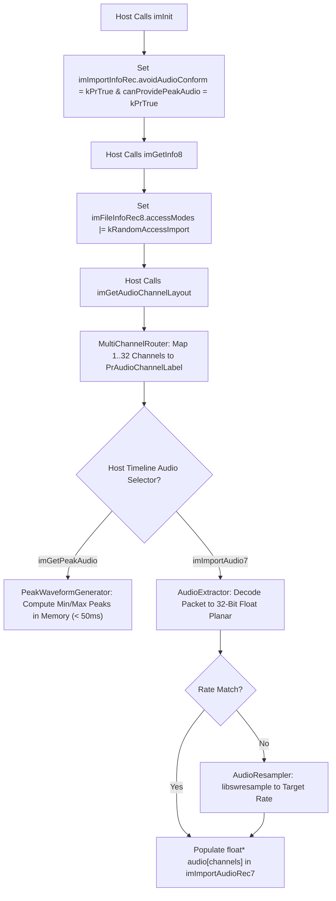

# User Story `US-2.4.0`: Zero-Conform 32-bit Planar Audio & Multi-Channel Pipeline

- **Module**: `module-2-importer-plugin`
- **Story Branch**: `feat/us-2.4.0-zero-conform-audio-pipeline`
- **Field Profile**: `software` (`.agents/field-profile.json`)
- **Story Decomposition Score ($S_{\text{story}}$)**: `2.80` $\to$ **`5` Parallel Implementation Units (`unit-1..5`)**

---

## 1. Spec Kit Specifications

### 1.1 User Story Narrative
> **As an** audio engineer and video editor importing multi-track MKV/WebM files containing Opus, FLAC, Vorbis, or PCM audio into Adobe Premiere Pro,  
> **I want** the importer to bypass Premiere's slow `.cfa`/`.pek` disk conforming (`imImportInfoRec.avoidAudioConform = kPrTrue` in `imInit` paired with `imFileInfoRec8.accessModes |= kRandomAccessImport` in `imGetInfo8`), deliver 32-bit floating point uninterleaved (planar) audio via `imImportAudio7` (`float* audio[channels]`, $0\text{ dB} = \pm 1.0$), generate instant waveform peaks via `imGetPeakAudio` (`canProvidePeakAudio = kPrTrue`), and map up to 32 surround/discrete channels via `imGetAudioChannelLayout`,  
> **So that** multi-hour recordings play immediately on the timeline with visible waveforms and zero gigabytes wasted on `.cfa` cache files.

#### 1.1.1 Preconditions
- `US-2.1.0` demuxer enumerates audio streams and `include/importer/importer_types.hpp` is pre-seeded.
- Host exposes `PrSDKAudioSuite` via SweetPea.

#### 1.1.2 Postconditions
- `imInit` sets `imImportInfoRec.avoidAudioConform = kPrTrue` and `imImportInfoRec.canProvidePeakAudio = kPrTrue`; `imGetInfo8` sets `imFileInfoRec8.accessModes |= kRandomAccessImport`.
- Premiere Pro generates zero `.cfa` or `.pek` conform files on disk upon importing Opus/FLAC/Vorbis media.
- `imImportAudio7` populates `float* audio[channels]` with 32-bit float planar samples normalized to $[-1.0, +1.0]$.
- `imGetPeakAudio` synthesizes min/max waveform peaks directly in memory in $< 50\,\text{ms}$.
- `imGetAudioChannelLayout` maps Mono, Stereo, 5.1, 7.1, and up to 32 channels to `PrAudioChannelLabel` constants.

### 1.2 Acceptance Criteria (Gherkin Scenarios)

```gherkin
Feature: Zero-Conform 32-Bit Float Planar Audio (imImportAudio7), Instant Waveform Peaks (imGetPeakAudio), and 32-Channel Routing

  Scenario: AC-1 — 32-Bit Floating Point Planar Audio Delivery via imImportAudio7
    Given an imported MKV or WebM file containing Opus, FLAC, Vorbis, or 16-bit PCM audio
    When Premiere Pro invokes selector imImportAudio7 with imImportAudioRec7
    Then AudioExtractor decodes the requested sample range into uninterleaved float* audio[channels] buffers
    And 16-bit integer samples follow Sample_32bitFloat[n] = Sample_16bitInt[n] / 32767.0 where 0 dB = +/- 1.0

  Scenario: AC-2 — Zero-Conform Protocol Enforcement (imInit + imGetInfo8)
    Given Premiere Pro initializing the plugin and probing a compressed Opus/FLAC audio stream
    When imInit and imGetInfo8 are executed
    Then AudioConformBypass sets imImportInfoRec.avoidAudioConform = kPrTrue and canProvidePeakAudio = kPrTrue in imInit
    And sets imFileInfoRec8.accessModes |= kRandomAccessImport in imGetInfo8
    And prevents Premiere Pro from writing .cfa or .pek conform files to disk

  Scenario: AC-3 — Direct In-Memory Waveform Peak Generation (imGetPeakAudio)
    Given Premiere Pro rendering audio waveforms on the timeline
    When selector imGetPeakAudio is invoked with sample range and decimation factor
    Then PeakWaveformGenerator computes min/max amplitude arrays directly from cached/demuxed audio packets in < 50ms

  Scenario: AC-4 — Surround and Multi-Channel Layout Mapping (imGetAudioChannelLayout)
    Given an audio stream with Mono, Stereo, 5.1 Surround, or up to 32 discrete channels in Premiere CC
    When selector imGetAudioChannelLayout is invoked
    Then MultiChannelRouter maps FFmpeg channel masks to exact PrAudioChannelLabel identifiers without channel swapping

  Scenario: AC-5 — High-Precision Sinc Resampling via libswresample
    Given a 44.1kHz or 96kHz audio stream placed on a 48kHz Premiere Pro sequence
    When imImportAudio7 requests samples at the sequence sample rate
    Then AudioResampler converts sample rates seamlessly with SNR > 96 dB and zero phase drift
```

### 1.3 Test Cases & Traceability Matrix

| Test Case ID | Mapped AC | Owning Unit | Test Level | Input Vector | Expected Result & Pass Threshold |
| :--- | :---: | :---: | :---: | :--- | :--- |
| `TC-2.4.1` | `AC-1` | `unit-1` | Unit | `imImportAudio7` request on Opus/FLAC/PCM16 stream | Planar `float* audio[channels]` populated; $\pm 32767 \to \pm 1.0\text{f}$ |
| `TC-2.4.2` | `AC-2` | `unit-2` | Unit | `imInit` + `imGetInfo8` structs inspection | `avoidAudioConform == kPrTrue` in `imInit`; `kRandomAccessImport` set in `imGetInfo8` |
| `TC-2.4.3` | `AC-3` | `unit-3` | Unit | `imGetPeakAudio` on 60-min audio stream | Accurate min/max peak pyramid returned in $< 50\,\text{ms}$ |
| `TC-2.4.4` | `AC-4` | `unit-4` | Unit | `imGetAudioChannelLayout` for 2ch, 6ch (5.1), and 32ch | Exact `PrAudioChannelLabel` mapping (`kPrAudioChannelLabel_FrontLeft`, etc.) |
| `TC-2.4.5` | `AC-5` | `unit-5` | Unit | 44.1kHz $\to$ 48kHz sine wave resampling | SNR $> 96\text{ dB}$; 0 sample count drift across 4 hours |

---

## 2. Technical Implementation Plan

### 2.1 Domain Invariants & Mathematical Formulas
- **32-Bit Float Uninterleaved Conversion Formula**:
$$\text{Sample}_{\text{32bitFloat}}[n] = \frac{\text{Sample}_{\text{16bitInt}}[n]}{32767.0}, \quad 0\text{ dB} \equiv \pm 1.0\text{f}$$
- **Zero-Conform Dual-Selector Invariant**:
```cpp
// In imInit (imImportInfoRec):
importInfoRec->avoidAudioConform   = kPrTrue;
importInfoRec->canProvidePeakAudio = kPrTrue;

// In imGetInfo8 (imFileInfoRec8):
fileInfoRec8->accessModes |= kRandomAccessImport;
```

### 2.2 Activity Diagram



---

## 3. Expected Folder Architecture

```text
AV1/
├── include/
│   └── importer/
│       ├── audio_extractor.hpp                  # Owned by unit-1
│       ├── audio_conform_bypass.hpp             # Owned by unit-2
│       ├── peak_waveform_generator.hpp          # Owned by unit-3
│       ├── multi_channel_router.hpp             # Owned by unit-4
│       └── audio_resampler.hpp                  # Owned by unit-5
├── src/
│   └── importer/
│       ├── audio_extractor.cpp                  # Owned by unit-1
│       ├── audio_conform_bypass.cpp             # Owned by unit-2
│       ├── peak_waveform_generator.cpp          # Owned by unit-3
│       ├── multi_channel_router.cpp             # Owned by unit-4
│       └── audio_resampler.cpp                  # Owned by unit-5
└── tests/
    └── importer/
        ├── test_audio_extractor.cpp             # Owned by unit-1
        ├── test_audio_conform_bypass.cpp        # Owned by unit-2
        ├── test_peak_waveform_generator.cpp     # Owned by unit-3
        ├── test_multi_channel_router.cpp        # Owned by unit-4
        └── test_audio_resampler.cpp             # Owned by unit-5
```

---

## 4. Implementation Units in Detail & Specialist Agent Assignment

### 4.1 Story Decomposition Score ($S_{\text{story}}$) & Dynamic Unit Count ($K$)
- **$D_1$ (35% Surface)**: `3` (`imImportAudio7`, `avoidAudioConform`/`kRandomAccessImport`, `imGetPeakAudio`, `imGetAudioChannelLayout`, `libswresample`)
- **$D_2$ (25% Volume)**: `3` (~850 LOC C++17)
- **$D_3$ (20% Complexity)**: `2` (Planar float sample conversion, peak decimation pyramids, 32-channel mapping)
- **$D_4$ (20% Boundaries)**: `3` (5 disjoint header/source/test triplets)
- **Calculated Score**: $S_{\text{story}} = 0.35(3) + 0.25(3) + 0.20(2) + 0.20(3) = 1.05 + 0.75 + 0.40 + 0.60 = \mathbf{2.80} \to \mathbf{5\text{ Parallel Units}}$

### 4.2 Detailed Unit Specifications (`unit-1..5`)

#### `unit-1` (`feat/us-2.4.0/unit-1-audio-import7-extractor`)
- **Deliverable Scope**: `AudioExtractor` implementing selector `imImportAudio7` (`imImportAudioRec7`). Decodes Opus, FLAC, Vorbis, and PCM packets into uninterleaved 32-bit float planar arrays (`float* audio[channels]`) using `libswresample` and `PrSDKAudioSuite`. Includes `tests/importer/test_audio_extractor.cpp`.
- **Owned Files**: `include/importer/audio_extractor.hpp`, `src/importer/audio_extractor.cpp`, `tests/importer/test_audio_extractor.cpp`.
- **Target Complexity**: $CC \le 6$, nesting $\le 2$.

#### `unit-2` (`feat/us-2.4.0/unit-2-audio-conform-bypass`)
- **Deliverable Scope**: `AudioConformBypass` configuring `imImportInfoRec.avoidAudioConform = kPrTrue` and `canProvidePeakAudio = kPrTrue` during `imInit`, and `imFileInfoRec8.accessModes |= kRandomAccessImport` during `imGetInfo8`, plus random-access sample seek indexing. Includes `tests/importer/test_audio_conform_bypass.cpp`.
- **Owned Files**: `include/importer/audio_conform_bypass.hpp`, `src/importer/audio_conform_bypass.cpp`, `tests/importer/test_audio_conform_bypass.cpp`.
- **Target Complexity**: $CC \le 5$, nesting $\le 2$.

#### `unit-3` (`feat/us-2.4.0/unit-3-peak-waveform-generator`)
- **Deliverable Scope**: `PeakWaveformGenerator` implementing selector `imGetPeakAudio` (`imPeakAudioRec`). Computes multi-resolution min/max waveform peaks directly in memory in $< 50\,\text{ms}$. Includes `tests/importer/test_peak_waveform_generator.cpp`.
- **Owned Files**: `include/importer/peak_waveform_generator.hpp`, `src/importer/peak_waveform_generator.cpp`, `tests/importer/test_peak_waveform_generator.cpp`.
- **Target Complexity**: $CC \le 6$, nesting $\le 2$.

#### `unit-4` (`feat/us-2.4.0/unit-4-multi-channel-router`)
- **Deliverable Scope**: `MultiChannelRouter` implementing selector `imGetAudioChannelLayout`. Maps Mono, Stereo, 5.1, 7.1, and up to 32 discrete channels to Adobe `PrAudioChannelLabel` constants. Includes `tests/importer/test_multi_channel_router.cpp`.
- **Owned Files**: `include/importer/multi_channel_router.hpp`, `src/importer/multi_channel_router.cpp`, `tests/importer/test_multi_channel_router.cpp`.
- **Target Complexity**: $CC \le 5$, nesting $\le 2$.

#### `unit-5` (`feat/us-2.4.0/unit-5-audio-resampler`)
- **Deliverable Scope**: `AudioResampler` wrapping `libswresample` polyphase sinc resampling for arbitrary source sample rates ($44.1\text{ kHz}, 88.2\text{ kHz}, 96\text{ kHz} \to 48\text{ kHz}$) with zero clock skew. Includes `tests/importer/test_audio_resampler.cpp`.
- **Owned Files**: `include/importer/audio_resampler.hpp`, `src/importer/audio_resampler.cpp`, `tests/importer/test_audio_resampler.cpp`.
- **Target Complexity**: $CC \le 6$, nesting $\le 2$.

### 4.3 Best-Fit Specialist Agents per Unit

| Unit ID | Branch Name | Primary Implementer Agent | Reviewing Council Agents | Mandatory Skills Enforced |
| :--- | :--- | :--- | :--- | :--- |
| `unit-1` | `feat/us-2.4.0/unit-1-audio-import7-extractor` | `audio-processing-specialist` | `code-reviewer`, `security-architect` | `code-review-council`, `security-audit` |
| `unit-2` | `feat/us-2.4.0/unit-2-audio-conform-bypass` | `minimal-change-engineer` | `code-reviewer`, `api-tester` | `code-review-council`, `cyclomatic-complexity` |
| `unit-3` | `feat/us-2.4.0/unit-3-peak-waveform-generator` | `data-visualization-engineer` | `code-reviewer`, `performance-benchmarker` | `code-review-council`, `cyclomatic-complexity` |
| `unit-4` | `feat/us-2.4.0/unit-4-multi-channel-router` | `backend-architect` | `code-reviewer`, `test-automation-engineer` | `code-review-council`, `security-audit` |
| `unit-5` | `feat/us-2.4.0/unit-5-audio-resampler` | `audio-processing-specialist` | `code-reviewer`, `reality-checker` | `code-review-council`, `cyclomatic-complexity` |
| **Patch** | `patch/us-2.4.0-<scope>` | `patch-implementer` | `code-reviewer-council-president` | Full Gate Verification |

---

## 5. Security Gateway (`security-audit`)

| Threat ID | STRIDE | ASVS / CWE | Attack Scenario | Impact | Mitigation Control |
| :--- | :---: | :---: | :--- | :---: | :--- |
| `TM-2.4.1` | **D**enial of Service | CWE-400 | Corrupted audio header requesting $10^9$ samples per `imImportAudio7` call | High | Clamp maximum batch request to $65,536$ samples per invocation |
| `TM-2.4.2` | **T**ampering | CWE-190 | Integer overflow in `channels * numSamples * sizeof(float)` | High | Checked `size_t` multiplication with explicit channel bound ($1 \le \text{channels} \le 32$) |
| `TM-2.4.3` | **I**nformation Disclosure | CWE-125 | Audio buffer underrun at EOF reading uninitialized heap | Medium | Zero-fill trailing samples with `0.0f` silence when decoded count $<$ requested count |

---

## 6. Validation Gates & Acceptance Sign-Off

| Gate | Gate Name | Pass Criteria | Verification Evidence | Status |
| :--- | :--- | :--- | :--- | :---: |
| **Gate G0** | Build & Lint | 0 compiler warnings, `clang-format` clean | `cmake --build build` exit 0 | `[ ]` |
| **Gate G1** | Tests & Traceability | `TC-2.4.1` .. `TC-2.4.5` pass 100% | `ctest -R test_audio_extractor|test_audio_conform_bypass|test_peak_waveform_generator|test_multi_channel_router|test_audio_resampler` | `[ ]` |
| **Gate G2** | Security Gateway | ASan clean, 0 out-of-bounds reads/writes across 32 channels | `security-audit` report on PR | `[ ]` |
| **Gate G-Complexity** | Complexity | Every function $CC \le 6$, nesting $\le 2$ | Complexity table on PR | `[ ]` |
| **Gate G-Docs** | Documentation | Complete Doxygen documentation for all 5 audio headers | Doxygen build clean | `[ ]` |
| **Gate G-Review** | Review Sign-Off | Independent Reviewing Council Approval | `gh pr comment` sign-off | `[ ]` |

### 1.4 Influx v1.7.1 / v2.0.0 Beta 1 Fault-Tolerant Audio & MOV Multi-Channel PCM
- **`unit-1` (`AudioExtractor`)**: Supports `xHE-AAC`, `AAC`, `MP3`, `AC3`, `DTS`, `Opus`, `FLAC`, `Vorbis`, and `PCM`; replaces isolated damaged audio packets with planar float silence (`0.0f`) instead of aborting the file import; imports declared audio streams that contain no audio packets as silence; and immediately closes the OS file handle if audio initialization fails so the file is never locked on Windows.
- **`unit-4` (`MultiChannelRouter`)**: Adds support for 5-channel and 6-channel PCM audio in MOV containers (e.g., ARRI AMIRA ProRes clips) alongside 5.1, 7.1, Ambisonics, and up to 24/32 discrete channels.
