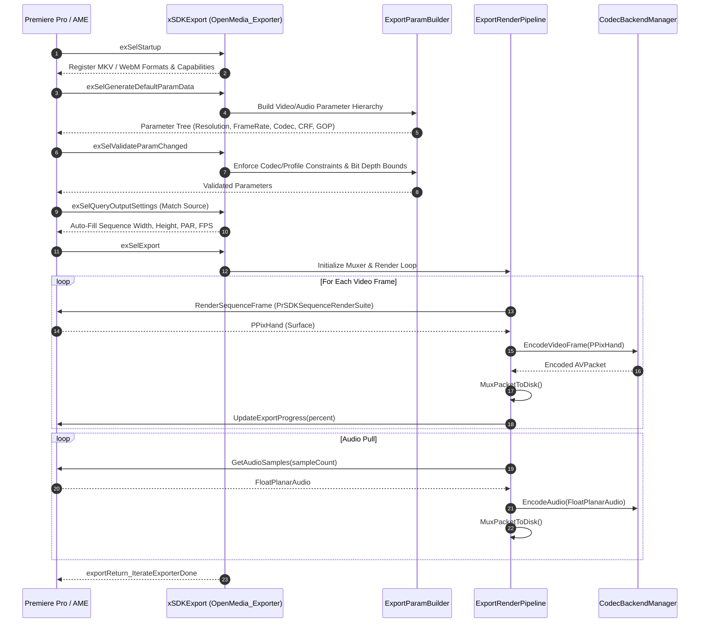

# Module 3: Exporter Plugin (`OpenMedia_Exporter.prm`)

## 1. Module Overview & Architectural Role

Module 3 delivers the dedicated **MediaCore Exporter Plugin** for Adobe Premiere Pro and Adobe Media Encoder (AME), packaged as a standalone binary:
$$\mathbf{OpenMedia\_Exporter.prm}$$

Linking dynamically against the shared `libOpenMediaCore.dll`, this plugin integrates directly into the Premiere Pro **Export Settings** dialog and the Adobe Media Encoder batch queue. It enables content creators and post-production studios to render master timelines directly into modern MKV and WebM containers encoded with AV1 (SVT-AV1, NVENC, AMF, QSV), VP9 (libvpx-vp9), Opus, and FLAC without intermediate transcode steps.

---

## 2. MediaCore Exporter Lifecycle & Single Entry Point

The plugin conforms strictly to the Adobe MediaCore Exporter SDK specification, exposing the single exported entry point:
```cpp
extern "C" DllExport PREMPRGM_API PrBool xSDKExport(
    csSDK_int32      selector,
    exportStdParms   *stdParms,
    void             *param1,
    void             *param2
);
```

### Complete Exporter Selector Pipeline



---

## 3. User Story Specifications in this Module

| Story ID | Story Title | Sizing Score | Dynamic $K$ Units | Branch Name | Spec Kit Path |
| :--- | :--- | :---: | :---: | :--- | :--- |
| **`US-3.1.0`** | Exporter Registration, Parameter UI & Match Source Automation | **3.00** | **$K = 5$** | `feat/us-3.1.0-exporter-registration-params-ui` | [`us-3.1.0-exporter-registration-params-ui.md`](./us-3.1.0-exporter-registration-params-ui.md) |
| **`US-3.2.0`** | Multi-Pass Sequence Render Pipeline & Audio Pull Orchestration | **2.65** | **$K = 5$** | `feat/us-3.2.0-export-render-engine` | [`us-3.2.0-export-render-engine.md`](./us-3.2.0-export-render-engine.md) |
| **`US-3.3.0`** | Modern Codec Backends, Hardware Transcoding & Graceful Fallback | **3.20** | **$K = 6$** | `feat/us-3.3.0-codecs-hardware-fallback` | [`us-3.3.0-codecs-hardware-fallback.md`](./us-3.3.0-codecs-hardware-fallback.md) |

---

## 4. Key Architectural Invariants

1. **Independent Binary Isolation**: `OpenMedia_Exporter.prm` has zero static dependencies on `OpenMedia_Importer.prm`. Both communicate exclusively via `libOpenMediaCore.dll` or OS-level file interfaces.
2. **Preset Compatibility**: Custom export settings are serialized into Adobe Preset files (`.epr`) compatible with Adobe Media Encoder batch queue automation.
3. **Hardware-to-Software Graceful Degradation**: If NVENC, AMF, or QSV hardware encoders fail during timeline rendering (e.g. driver TDR or VRAM exhaustion), the render pipeline immediately flushes the active GOP and falls back to CPU encoding (SVT-AV1 / libvpx-vp9) without failing the export job.
4. **GOP-Tail Flush Guarantee**: Upon user abort or timeline completion, all buffered B-frames and delayed encoder packets are flushed to the muxer before finalizing the container trailer.

---

## 5. Base Contract & Seeding Plan

Before parallel unit implementers are spawned for Module 3 stories, the following base contract headers are seeded into `plugins/exporter/include/`:
- `OpenMedia_ExporterTypes.h`: Definitions for `ExportSettings`, `VideoEncodeParams`, `AudioEncodeParams`, `ColorProfileInfo`.
- `OpenMedia_ExportContext.h`: Context object passed across `exSelBeginInstance`, `exSelExport`, and `exSelEndInstance`.
