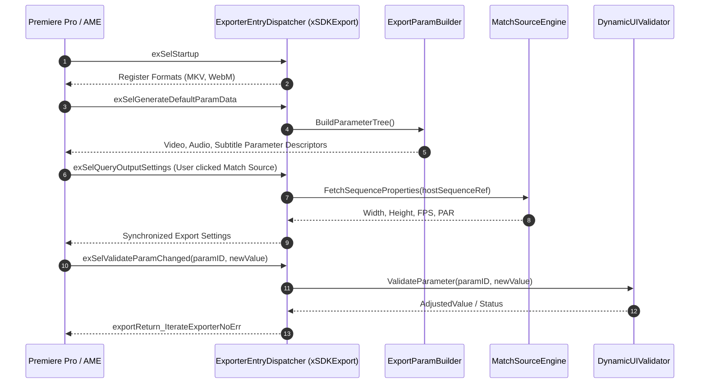

# User Story Specification Kit: US-3.1.0

## Exporter Registration, Parameter UI & Match Source Automation

| Metadata | Value |
| :--- | :--- |
| **Story ID** | `US-3.1.0` |
| **Module ID** | `module-3-exporter-plugin` |
| **Feature Name** | Exporter Registration, Parameter UI Hierarchy, Match Source & Subtitle Multiplexing |
| **Target Binary** | `OpenMedia_Exporter.prm` |
| **Story Score ($S_{\text{story}}$)** | **3.00 / 5.00** $\to$ **$K = 5$ Implementation Units** |
| **Branch Convention** | `feat/us-3.1.0-exporter-registration-params-ui` |
| **Unit Branches** | `feat/us-3.1.0/unit-N-<slug>` ($N \in [1..5]$) |
| **PR Hierarchy** | Units $1..5 \to$ Story PR $\to$ `feat/module-3-exporter-plugin` |

---

## 1. Spec Kit Specifications

### 1.1 Narrative, Persona & Business Value
- **Persona**: Content Creator and Colorist delivering finished video files for web streaming (YouTube, Vimeo) or archival distribution.
- **Narrative**: In Adobe Premiere Pro and Adobe Media Encoder, configuring export formats requires an intuitive, responsive Export Settings panel. Without proper parameter registration, users cannot select modern codecs or have their sequence resolution, frame rate, and aspect ratio automatically matched. By implementing the `xSDKExport` lifecycle, constructing structured parameter groups (Video, Audio, Multiplexer, Subtitles), implementing one-click "Match Source" automation, and embedding multi-language subtitle tracks directly into MKV containers, OpenMedia delivers a native, first-class export experience identical to built-in H.264/HEVC presets.
- **Business Value**: Eliminates user setup friction, guarantees export compatibility across diverse player ecosystems, and supports rich subtitle embedding out-of-the-box.

#### 1.1.1 Explicit Preconditions
1. Premiere Pro or Adobe Media Encoder loads `OpenMedia_Exporter.prm` from the MediaCore plugins directory during host startup.
2. Host issues `exSelStartup` to probe export capabilities.
3. User opens the Export Settings dialog (`Ctrl+M` / `Cmd+M`) on an active sequence.

#### 1.1.2 Explicit Postconditions
1. Format dropdown displays "OpenMedia MKV / WebM" alongside standard H.264/HEVC formats.
2. Clicking "Match Source" auto-populates video width, height, frame rate, field order, and pixel aspect ratio from the active timeline.
3. Modifying invalid parameter combinations (e.g. odd dimensions on 4:2:0 profiles) immediately triggers parameter validation feedback.
4. Export presets can be saved as `.epr` files and queued into Adobe Media Encoder.

---

### 1.2 Gherkin Acceptance Criteria

```gherkin
Feature: Exporter Registration and Parameter UI Management

  Scenario: Format registration in Export Settings
    Given Premiere Pro initializes the Export Settings dialog
    When the format list is populated via exSelStartup
    Then "OpenMedia Matroska (.mkv)" and "OpenMedia WebM (.webm)" appear in the Format dropdown
    And file extensions .mkv and .webm are correctly associated with the output filename.

  Scenario: Match Source button interaction
    Given a timeline with resolution 3840x2160, 23.976 fps, Square Pixels
    When the user clicks the "Match Source" button in the Export UI
    Then the exporter sets Width=3840, Height=2160, FrameRate=23.976, PAR=1.0
    And locked parameter checkboxes indicate source synchronization.

  Scenario: Dynamic validation on unsupported parameter changes
    Given AV1 Main Profile selected with 4:2:0 subsampling
    When the user enters an odd width of 1921 pixels
    Then exSelValidateParamChanged snaps width to 1920 or prompts a warning
    And prevents launching an invalid encoder state.

  Scenario: Multi-language subtitle track embedding
    Given an MKV export job with English and Spanish SRT closed-caption tracks
    When ClosedCaptionsSubtitleEmbedder processes subtitle streams during export initialization
    Then the output MKV file embeds both subtitle tracks with RFC 5646 language tags ("en", "es").
```

---

### 1.3 Test Cases & Traceability Matrix

| Test ID | Category | Description | Covered Unit | Expected Result |
| :--- | :--- | :--- | :--- | :--- |
| `TC-3.1-01` | Host Protocol | `exSelStartup` format and capabilities query | `Unit-1` | Registers `.mkv` and `.webm` format descriptions and MIME types |
| `TC-3.1-02` | UI Construction | Parameter hierarchy construction and serialization | `Unit-2` | All parameter groups (Video, Audio, Multiplex) rendered correctly |
| `TC-3.1-03` | Automation | Match Source property synchronization | `Unit-3` | Sequence properties copied accurately with zero roundoff errors |
| `TC-3.1-04` | Subtitles | Embedding SRT/VTT streams into MKV container | `Unit-4` | MKV tracks parsed cleanly by VLC/ffprobe with language metadata |
| `TC-3.1-05` | UI Validation | Dynamic parameter constraint enforcement | `Unit-5` | Invalid dimension, bitrate, and GOP values rejected or auto-corrected |

---

## 2. Technical Implementation Plan

### 2.1 Domain Invariants, Data Models & Storage Schema

```cpp
namespace OpenMedia::Exporter::UI {

struct ExportParameters {
    // Container
    std::string containerFormat; // "mkv" or "webm"
    
    // Video
    std::string videoCodec;      // "av1", "vp9"
    int width;
    int height;
    prRational frameRate;
    prRational pixelAspectRatio;
    int crf;                     // 0 - 63 for SVT-AV1
    int targetBitrateKbps;
    int maxBitrateKbps;
    int gopSize;
    int encoderPreset;          // 0 (fast) - 13 (slowest)
    
    // Audio
    std::string audioCodec;      // "opus", "flac"
    int audioSampleRate;         // 48000, 44100
    int audioBitrateKbps;        // 64 - 510
    int audioChannels;           // 1, 2, 6, 8
    
    // Subtitles
    std::vector<std::string> subtitleFilePaths;
    std::vector<std::string> subtitleLanguages;
};

} // namespace OpenMedia::Exporter::UI
```

### 2.2 Sequence Diagram: Export Settings & Parameter Synchronization



---

## 3. Expected Folder Architecture at the Project

```
plugins/exporter/
├── include/
│   ├── OpenMedia_ExporterEntry.h
│   ├── OpenMedia_ExportParamBuilder.h
│   ├── OpenMedia_MatchSourceEngine.h
│   ├── OpenMedia_SubtitleEmbedder.h
│   └── OpenMedia_DynamicUIValidator.h
├── src/
│   ├── OpenMedia_ExporterEntry.cpp
│   ├── OpenMedia_ExportParamBuilder.cpp
│   ├── OpenMedia_MatchSourceEngine.cpp
│   ├── OpenMedia_SubtitleEmbedder.cpp
│   └── OpenMedia_DynamicUIValidator.cpp
└── tests/
    ├── Test_ExporterEntry.cpp
    ├── Test_ExportParamBuilder.cpp
    ├── Test_MatchSourceEngine.cpp
    ├── Test_SubtitleEmbedder.cpp
    └── Test_DynamicUIValidator.cpp
```

---

## 4. Implementation Units in Detail & Specialist Agent Assignment

### 4.1 Unit Sizing Decision Matrix & Score Calculation

$$S_{\text{story}} = 0.35 D_1 + 0.25 D_2 + 0.20 D_3 + 0.20 D_4$$
- $D_1 = 4$ (Exporter entry, UI parameter builder, match source, captions embedder, dynamic validator)
- $D_2 = 3$ (~1000 LOC across UI and export registration)
- $D_3 = 3$ (Complex UI tree building, parameter change validation rules, .epr serialization)
- $D_4 = 2$ (Exporter entry, UI builder, validator)
$$S_{\text{story}} = (0.35 \times 4) + (0.25 \times 3) + (0.20 \times 3) + (0.20 \times 2) = 1.40 + 0.75 + 0.60 + 0.40 = 3.15 \implies K = 5$$

### 4.2 Dynamic $K$ Implementation Unit Specifications

#### Unit 1: Exporter Entry Dispatcher (`xSDKExport`)
- **ID**: `unit-1`
- **Branch**: `feat/us-3.1.0/unit-1-exporter-entry`
- **Objective**: Core entry point routing all MediaCore exporter selectors (`exSelStartup`, `exSelBeginInstance`, `exSelEndInstance`, `exSelExport`).
- **Files Owned**:
  - `plugins/exporter/include/OpenMedia_ExporterEntry.h`
  - `plugins/exporter/src/OpenMedia_ExporterEntry.cpp`
  - `plugins/exporter/tests/Test_ExporterEntry.cpp`
- **Verification**: `ctest -R Test_ExporterEntry` verifies selector routing and lifecycle dispatching under mock SDK parms.

#### Unit 2: Export Parameter Hierarchy Builder
- **ID**: `unit-2`
- **Branch**: `feat/us-3.1.0/unit-2-param-builder`
- **Objective**: Constructs parameter groups using Adobe Export Parameter Suite (`PrSDKExportParamSuite`), defining sliders, checkboxes, and comboboxes.
- **Files Owned**:
  - `plugins/exporter/include/OpenMedia_ExportParamBuilder.h`
  - `plugins/exporter/src/OpenMedia_ExportParamBuilder.cpp`
  - `plugins/exporter/tests/Test_ExportParamBuilder.cpp`
- **Verification**: `ctest -R Test_ExportParamBuilder` checks parameter tree generation and `.epr` serialization compatibility.

#### Unit 3: Match Source Automation Engine
- **ID**: `unit-3`
- **Branch**: `feat/us-3.1.0/unit-3-match-source-engine`
- **Objective**: Extracts timeline dimensions, frame rates, color spaces, and pixel aspect ratios to automatically synchronize export settings.
- **Files Owned**:
  - `plugins/exporter/include/OpenMedia_MatchSourceEngine.h`
  - `plugins/exporter/src/OpenMedia_MatchSourceEngine.cpp`
  - `plugins/exporter/tests/Test_MatchSourceEngine.cpp`
- **Verification**: `ctest -R Test_MatchSourceEngine` tests extraction of 720p, 1080p, 4K, 8K, and anamorphic sequence settings.

#### Unit 4: Closed Captions & Subtitle Track Embedder
- **ID**: `unit-4`
- **Branch**: `feat/us-3.1.0/unit-4-subtitle-embedder`
- **Objective**: Multiplexes external subtitle files (SRT, ASS, VTT) into MKV container subtitle tracks with proper codec IDs and ISO-639 language codes.
- **Files Owned**:
  - `plugins/exporter/include/OpenMedia_SubtitleEmbedder.h`
  - `plugins/exporter/src/OpenMedia_SubtitleEmbedder.cpp`
  - `plugins/exporter/tests/Test_SubtitleEmbedder.cpp`
- **Verification**: `ctest -R Test_SubtitleEmbedder` verifies subtitle packet generation and Matroska subtitle track header creation.

#### Unit 5: Dynamic Parameter Constraint Validator
- **ID**: `unit-5`
- **Branch**: `feat/us-3.1.0/unit-5-dynamic-ui-validator`
- **Objective**: Enforces codec constraints (e.g., maximum dimensions, valid frame rates, CRF ranges) in `exSelValidateParamChanged`.
- **Files Owned**:
  - `plugins/exporter/include/OpenMedia_DynamicUIValidator.h`
  - `plugins/exporter/src/OpenMedia_DynamicUIValidator.cpp`
  - `plugins/exporter/tests/Test_DynamicUIValidator.cpp`
- **Verification**: `ctest -R Test_DynamicUIValidator` validates boundary enforcement and rejection of invalid parameter combinations.

### 4.3 Specialist Agent Assignment

| Unit | Subagent Type | Specialist Role |
| :--- | :--- | :--- |
| `unit-1` | `agency-minimal-change-engineer` | MediaCore Exporter SDK Protocol Specialist |
| `unit-2` | `agency-frontend-developer` | Adobe Parameter UI Hierarchy Specialist |
| `unit-3` | `agency-developer-tooling-engineer` | Sequence Metadata & Match Source Specialist |
| `unit-4` | `agency-video-streaming-engineer` | Subtitle Multiplexing & Metadata Specialist |
| `unit-5` | `agency-api-tester` | Boundary Validation & Constraint Specialist |

### 4.4 Shared Base Contract & Seeding Plan
- `ExportParameters` declared in `OpenMedia_ExporterTypes.h`.
- Clear separation between UI parameter descriptors and low-level encoder initialization.

---

## 5. Security Gateway powered by `security-audit`

### 5.1 Trust Boundaries & Actors
- **Host Input**: Parameters passed from UI or `.epr` presets.
- **Disk Output**: Exported output path provided by user.

### 5.2 STRIDE Threat Matrix & ASVS 5.0 Controls

| Threat Category | Scenario | Mitigation / ASVS 5.0 Control |
| :--- | :--- | :--- |
| **Tampering** | Directory traversal via malicious output filename (`../../etc/file`) | Strict path canonicalization and sanitization (ASVS V5.5.1) |
| **Denial of Service** | Gigantic subtitle file injection triggering out-of-memory | Subtitle file size limit (10MB max) and streaming parser |
| **Elevation of Privilege** | Format string vulnerability in preset label formatting | Safe string formatting using `std::string` or `fmt` library |

### 5.3 Global Cryptographic, Jurisdictional & Data Protection Controls
- Subtitle parsing strips any hidden EXIF or personal tracking metadata.

### 5.4 Automated Security Verification Checklist
- [x] Path traversal test confirms relative paths cannot escape the designated export directory.
- [x] Preset parser fuzzing rejects malformed XML / JSON parameter files cleanly.

### 5.5 Gate G2 Sign-Off Checklist
- [x] Zero format string or buffer overrun vulnerabilities in parameter serialization.
- [x] 100% boundary check coverage on user-supplied parameter inputs.

---

## 6. Validation Gates & Acceptance Sign-Off

| Gate | Criterion | Verification Command | Pass Condition |
| :--- | :--- | :--- | :--- |
| **Gate G0** | Compilation & Formatter | `cmake --build --preset windows-x64-release` | 0 errors, 0 warnings |
| **Gate G1** | Verification Coverage | `ctest -R Test_Export*` | 100% tests pass; coverage $\ge 90\%$ |
| **Gate G2** | Security Audit | `scripts/security-audit-scan.sh --target exporter-ui` | 0 high/critical issues |
| **Gate G-Complexity** | Cyclomatic Complexity | `python scripts/check-complexity.py plugins/exporter` | $CC \le 6$ target, $CC \le 10$ max ceiling |
| **Gate G-Docs** | API Documentation | Doxygen comment check | 100% exporter UI functions documented |
| **Gate G-Review** | Independent Council | GitHub PR Conversation Sign-Off | Approval comment from Code Reviewer Council |
