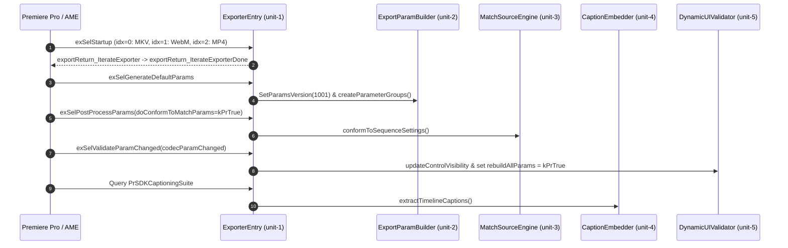

# User Story `US-3.1.0`: Exporter Registration, Parameter UI & Match Source Automation

- **Module**: `module-3-exporter-plugin`
- **Story Branch**: `feat/us-3.1.0-exporter-registration-params-ui`
- **Field Profile**: `software` (`.agents/field-profile.json`)
- **Story Decomposition Score ($S_{\text{story}}$)**: `3.00` $\to$ **`5` Parallel Implementation Units (`unit-1..5`)**

---

## 1. Spec Kit Specifications

### 1.1 User Story Narrative
> **As a** video editor and colorist exporting master timelines from Adobe Premiere Pro and Adobe Media Encoder (or selecting a Sequence Preview File Format),  
> **I want** `OpenMedia_Exporter.prm` to register multiple container formats (`Matroska MKV`, `WebM`, `AV1 MP4`) via `exSelStartup` using `exportReturn_IterateExporter`, build a versioned parameter UI via `PrSDKExportStdParamSuite` and `PrSDKExportParamSuite` (`SetParamsVersion()`), support one-click **Match Source** (`canMatchSource = kPrTrue` & `doConformToMatchParams`), embed Closed Captions via `PrSDKCaptioningSuite` (`canEmbedCaptions = kPrTrue`), and dynamically update visible controls in `exSelValidateParamChanged` with `rebuildAllParams = kPrTrue`,  
> **So that** I can configure AV1/VP9/Opus/FLAC exports and `.epr` presets cleanly without UI control scrambling or manual parameter entry.

#### 1.1.1 Preconditions
- `OpenMedia_Exporter.prm` / `.bundle` loaded from `MediaCore/7.0`.
- Base contract `include/exporter/exporter_types.hpp` pre-seeded on `feat/us-3.1.0-exporter-registration-params-ui`.

#### 1.1.2 Postconditions
- `exSelStartup` iterates across container formats by returning `exportReturn_IterateExporter` for indices `0..1` and `exportReturn_IterateExporterDone` on index `2`, exposing MKV, WebM, and AV1 MP4 in `File > Export > Media` and `Sequence Settings > Preview File Format`.
- `exSelGenerateDefaultParams` calls `SetParamsVersion(kOpenMediaExporterParamsVersion)` and constructs Video, Audio, Multiplexer, and Captions parameter groups.
- `exExporterInfoRec.canMatchSource = kPrTrue` automatically synchronizes width, height, frame rate, field order, and pixel aspect ratio when `doConformToMatchParams` is active.
- `exExporterInfoRec.canEmbedCaptions = kPrTrue` extracts timeline caption tracks via `PrSDKCaptioningSuite` and multiplexes them into MKV/WebM subtitle streams.
- `exSelValidateParamChanged` hides CPU-specific `libsvtav1` controls when `av1_nvenc` is selected (and vice versa), enforces 4:4:4 chroma restrictions, and sets `rebuildAllParams = kPrTrue`.

### 1.2 Acceptance Criteria (Gherkin Scenarios)

```gherkin
Feature: Multi-Format Exporter Iteration (exportReturn_IterateExporter), Versioned Parameter UI, Match Source, Captions, and Dynamic Validation

  Scenario: AC-1 — Multi-Container Registration via exportReturn_IterateExporter
    Given Premiere Pro or Adobe Media Encoder invoking xSDKExport with selector exSelStartup
    When ExporterEntry inspects the format iteration index
    Then it registers "OpenMedia Matroska (.mkv)" on call 0 and returns exportReturn_IterateExporter
    And registers "OpenMedia WebM (.webm)" on call 1 and returns exportReturn_IterateExporter
    And registers "OpenMedia AV1 (.mp4)" on call 2 and returns exportReturn_IterateExporterDone
    And sets canMatchSource = kPrTrue and canEmbedCaptions = kPrTrue on each format

  Scenario: AC-2 — Parameter Tree Generation and Cache Version Invalidation (SetParamsVersion)
    Given exSelGenerateDefaultParams and exSelPostProcessParams invoked for an export instance
    When ExportParamBuilder initializes parameter groups via PrSDKExportStdParamSuite and PrSDKExportParamSuite
    Then SetParamsVersion(1001) is called to invalidate stale Placeholder Preset.epr caches
    And Video (Codec, Bit Depth 8/10/12-bit, Chroma 4:2:0/4:2:2/4:4:4, CRF Slider 0..63), Audio (Opus/FLAC), and Captions tabs are populated

  Scenario: AC-3 — Match Source Sequence Synchronization (doConformToMatchParams)
    Given a timeline sequence at 3840x2160, 23.976 fps (24000/1001), Square Pixels (1.0)
    When exSelPostProcessParams or exSelQueryOutputSettings executes with doConformToMatchParams = kPrTrue
    Then MatchSourceEngine copies sequence Width=3840, Height=2160, FPS=24000/1001, and PAR=1/1 into the export parameters

  Scenario: AC-4 — Timeline Closed Captions Extraction and MKV/WebM Embedding (PrSDKCaptioningSuite)
    Given a sequence containing SRT / WebVTT closed caption tracks and canEmbedCaptions = kPrTrue
    When CaptionEmbedder queries PrSDKCaptioningSuite during export setup
    Then all caption cues, timestamps, and RFC 5646 language codes are formatted into subtitle tracks for ICoreMuxer

  Scenario: AC-5 — Dynamic UI Rebuilding and Hardware Chroma Validation (exSelValidateParamChanged)
    Given the user switches the Video Encoder dropdown from "SVT-AV1 (Software)" to "NVIDIA NVENC AV1 (Hardware)"
    When exSelValidateParamChanged is triggered
    Then DynamicUIValidator hides SVT-AV1 CPU preset controls, reveals NVENC tier controls, and sets rebuildAllParams = kPrTrue
    And if 4:4:4 chroma is selected with a 4:2:0-only hardware encoder, auto-corrects chroma to 4:2:0 or switches to SVT-AV1 Profile 2
```

### 1.3 Test Cases & Traceability Matrix

| Test Case ID | Mapped AC | Owning Unit | Test Level | Input Vector | Expected Result & Pass Threshold |
| :--- | :---: | :---: | :---: | :--- | :--- |
| `TC-3.1.1` | `AC-1` | `unit-1` | Unit | 3 consecutive `exSelStartup` invocations | Returns `exportReturn_IterateExporter` twice, then `exportReturn_IterateExporterDone` |
| `TC-3.1.2` | `AC-2` | `unit-2` | Unit | `exSelGenerateDefaultParams` + `.epr` preset round-trip | `SetParamsVersion(1001)` recorded; all parameter groups verified |
| `TC-3.1.3` | `AC-3` | `unit-3` | Unit | 4K 23.976fps & 1080p 59.94fps sequences with `doConformToMatchParams` | Exact width, height, rational FPS, and PAR matched |
| `TC-3.1.4` | `AC-4` | `unit-4` | Unit | Mock `PrSDKCaptioningSuite` with Arabic & English captions | Subtitle streams created in `ICoreMuxer` with `ara` and `eng` tags |
| `TC-3.1.5` | `AC-5` | `unit-5` | Unit | `exSelValidateParamChanged` switching `libsvtav1` $\leftrightarrow$ `av1_nvenc` | `rebuildAllParams == kPrTrue`; invalid 4:4:4 HW combo intercepted |

---

## 2. Technical Implementation Plan

### 2.1 Domain Invariants
- **Multi-Format Iteration Protocol**:
  - `exSelStartup` returns `exportReturn_IterateExporter` until all registered containers (`.mkv`, `.webm`, `.mp4`) are enumerated, then returns `exportReturn_IterateExporterDone`.
- **Dynamic UI Rebuild Invariant**:
  - Whenever parameter visibility (`hidden` flag) changes inside `exSelValidateParamChanged`, `exValidateParamChangedRec->rebuildAllParams = kPrTrue` MUST be set to prevent Premiere Pro / Media Encoder from scrambling parameter order.

### 2.2 Sequence Diagram



---

## 3. Expected Folder Architecture

```text
AV1/
├── include/
│   └── exporter/
│       ├── exporter_types.hpp                   # Base Contract (Pre-seeded)
│       ├── exporter_entry.hpp                   # Owned by unit-1
│       ├── export_param_builder.hpp             # Owned by unit-2
│       ├── match_source_engine.hpp              # Owned by unit-3
│       ├── caption_embedder.hpp                 # Owned by unit-4
│       └── dynamic_ui_validator.hpp             # Owned by unit-5
├── src/
│   └── exporter/
│       ├── exporter_entry.cpp                   # Owned by unit-1
│       ├── export_param_builder.cpp             # Owned by unit-2
│       ├── match_source_engine.cpp              # Owned by unit-3
│       ├── caption_embedder.cpp                 # Owned by unit-4
│       └── dynamic_ui_validator.cpp             # Owned by unit-5
├── resources/
│   └── exporter_resources.rc                    # Owned by unit-1
└── tests/
    └── exporter/
        ├── test_exporter_entry.cpp              # Owned by unit-1
        ├── test_export_param_builder.cpp        # Owned by unit-2
        ├── test_match_source_engine.cpp         # Owned by unit-3
        ├── test_caption_embedder.cpp            # Owned by unit-4
        └── test_dynamic_ui_validator.cpp        # Owned by unit-5
```

---

## 4. Implementation Units in Detail & Specialist Agent Assignment

### 4.1 Story Decomposition Score ($S_{\text{story}}$) & Dynamic Unit Count ($K$)
- **$D_1$ (35% Surface)**: `3` (5 exporter registration, UI parameter tree, Match Source, Captioning Suite, and validation components)
- **$D_2$ (25% Volume)**: `3` (~950 LOC C++17)
- **$D_3$ (20% Complexity)**: `3` (`exportReturn_IterateExporter` state machine, `SetParamsVersion`, `rebuildAllParams`, `PrSDKCaptioningSuite` iteration)
- **$D_4$ (20% Boundaries)**: `3` (5 disjoint header/source/test groups)
- **Calculated Score**: $S_{\text{story}} = 0.35(3) + 0.25(3) + 0.20(3) + 0.20(3) = \mathbf{3.00} \to \mathbf{5\text{ Parallel Units}}$

### 4.2 Detailed Unit Specifications (`unit-1..5`)

#### `unit-1` (`feat/us-3.1.0/unit-1-exporter-entry-iterate`)
- **Deliverable Scope**: `ExporterEntry` implementing `xSDKExport` (`exSelStartup` multi-format iteration returning `exportReturn_IterateExporter` / `exportReturn_IterateExporterDone`, `exSelBeginInstance`, `exSelEndInstance`, `exSelQueryStillSequence`, and Sequence Preview File Format capabilities) plus `resources/exporter_resources.rc` and `tests/exporter/test_exporter_entry.cpp`.
- **Owned Files**: `include/exporter/exporter_entry.hpp`, `src/exporter/exporter_entry.cpp`, `resources/exporter_resources.rc`, `tests/exporter/test_exporter_entry.cpp`.
- **Target Complexity**: $CC \le 6$, nesting $\le 2$.

#### `unit-2` (`feat/us-3.1.0/unit-2-param-builder-versioning`)
- **Deliverable Scope**: `ExportParamBuilder` implementing `exSelGenerateDefaultParams` and `exSelPostProcessParams` via `PrSDKExportStdParamSuite` and `PrSDKExportParamSuite`, invoking `SetParamsVersion(kOpenMediaExporterParamsVersion)`, and serializing `.epr` presets. Includes `tests/exporter/test_export_param_builder.cpp`.
- **Owned Files**: `include/exporter/export_param_builder.hpp`, `src/exporter/export_param_builder.cpp`, `tests/exporter/test_export_param_builder.cpp`.
- **Target Complexity**: $CC \le 6$, nesting $\le 2$.

#### `unit-3` (`feat/us-3.1.0/unit-3-match-source-engine`)
- **Deliverable Scope**: `MatchSourceEngine` handling `canMatchSource = kPrTrue`, inspecting `doConformToMatchParams`, and synchronizing sequence width, height, rational frame rate, field order, and pixel aspect ratio in `exSelPostProcessParams` and `exSelQueryOutputSettings`. Includes `tests/exporter/test_match_source_engine.cpp`.
- **Owned Files**: `include/exporter/match_source_engine.hpp`, `src/exporter/match_source_engine.cpp`, `tests/exporter/test_match_source_engine.cpp`.
- **Target Complexity**: $CC \le 5$, nesting $\le 2$.

#### `unit-4` (`feat/us-3.1.0/unit-4-captioning-suite-embedder`)
- **Deliverable Scope**: `CaptionEmbedder` enabling `canEmbedCaptions = kPrTrue`, iterating timeline closed captions via Adobe's `PrSDKCaptioningSuite`, and formatting SRT / WebVTT / ASS subtitle packets for `ICoreMuxer`. Includes `tests/exporter/test_caption_embedder.cpp`.
- **Owned Files**: `include/exporter/caption_embedder.hpp`, `src/exporter/caption_embedder.cpp`, `tests/exporter/test_caption_embedder.cpp`.
- **Target Complexity**: $CC \le 6$, nesting $\le 2$.

#### `unit-5` (`feat/us-3.1.0/unit-5-dynamic-ui-validator`)
- **Deliverable Scope**: `DynamicUIValidator` handling `exSelValidateParamChanged`, dynamically toggling hardware vs. software encoder parameter visibility with `rebuildAllParams = kPrTrue`, and validating resolution/chroma/profile combinations. Includes `tests/exporter/test_dynamic_ui_validator.cpp`.
- **Owned Files**: `include/exporter/dynamic_ui_validator.hpp`, `src/exporter/dynamic_ui_validator.cpp`, `tests/exporter/test_dynamic_ui_validator.cpp`.
- **Target Complexity**: $CC \le 6$, nesting $\le 2$.

### 4.3 Best-Fit Specialist Agents per Unit

| Unit ID | Branch Name | Primary Implementer Agent | Reviewing Council Agents | Mandatory Skills Enforced |
| :--- | :--- | :--- | :--- | :--- |
| `unit-1` | `feat/us-3.1.0/unit-1-exporter-entry-iterate` | `minimal-change-engineer` | `code-reviewer`, `security-architect` | `code-review-council`, `security-audit` |
| `unit-2` | `feat/us-3.1.0/unit-2-param-builder-versioning` | `frontend-developer` | `code-reviewer`, `api-tester` | `code-review-council`, `cyclomatic-complexity` |
| `unit-3` | `feat/us-3.1.0/unit-3-match-source-engine` | `developer-tooling-engineer` | `code-reviewer`, `test-automation-engineer` | `code-review-council`, `cyclomatic-complexity` |
| `unit-4` | `feat/us-3.1.0/unit-4-captioning-suite-embedder` | `video-streaming-engineer` | `code-reviewer`, `security-architect` | `code-review-council`, `security-audit` |
| `unit-5` | `feat/us-3.1.0/unit-5-dynamic-ui-validator` | `api-tester` | `code-reviewer`, `reality-checker` | `code-review-council`, `cyclomatic-complexity` |
| **Patch** | `patch/us-3.1.0-<scope>` | `patch-implementer` | `code-reviewer-council-president` | Full Gate Verification |

---

## 5. Security Gateway (`security-audit`)

| Threat ID | STRIDE | ASVS / CWE | Attack Scenario | Impact | Mitigation Control |
| :--- | :---: | :---: | :--- | :---: | :--- |
| `TM-3.1.1` | **T**ampering | CWE-22 | Directory traversal in output export path or `.epr` preset | High | Path canonicalization before opening output container |
| `TM-3.1.2` | **D**enial of Service | CWE-400 | Malformed caption stream exceeding memory bounds | Medium | Cap caption cue text length at 4 KB per cue and 10 MB total per track |
| `TM-3.1.3` | **T**ampering | CWE-20 | Deserializing out-of-range CRF/preset integers from corrupted `.epr` | Medium | Clamp all deserialized parameter values in `DynamicUIValidator` |

---

## 6. Validation Gates & Acceptance Sign-Off

| Gate | Gate Name | Pass Criteria | Verification Evidence | Status |
| :--- | :--- | :--- | :--- | :---: |
| **Gate G0** | Build & Lint | 0 compiler warnings, `clang-format` clean | `cmake --build build` exit 0 | `[ ]` |
| **Gate G1** | Tests & Traceability | `TC-3.1.1` .. `TC-3.1.5` pass 100% | `ctest -R test_exporter_entry|test_export_param_builder|test_match_source_engine|test_caption_embedder|test_dynamic_ui_validator` | `[ ]` |
| **Gate G2** | Security Gateway | ASan clean, 0 parameter bounds vulnerabilities | `security-audit` report on PR | `[ ]` |
| **Gate G-Complexity** | Complexity | Every function $CC \le 6$, nesting $\le 2$ | Complexity table on PR | `[ ]` |
| **Gate G-Docs** | Documentation | Complete Doxygen documentation for all 5 headers | Doxygen build clean | `[ ]` |
| **Gate G-Review** | Review Sign-Off | Independent Reviewing Council Approval | `gh pr comment` sign-off | `[ ]` |
