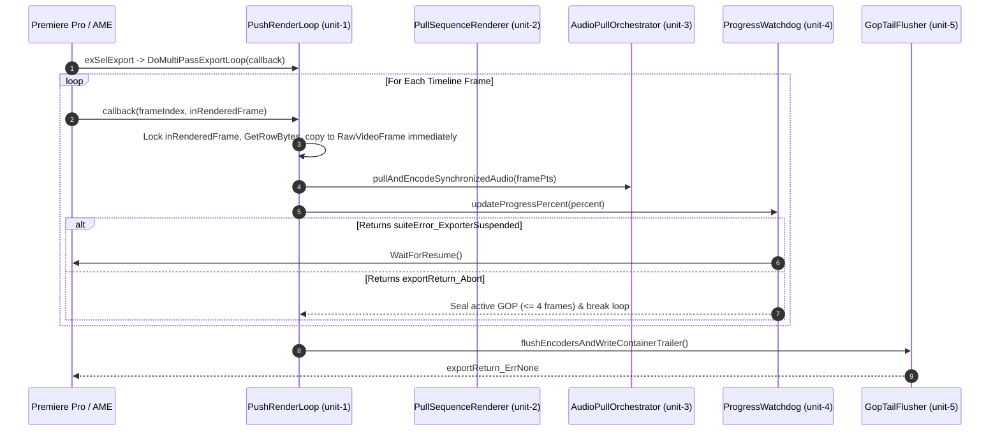

# User Story `US-3.2.0`: Dual Push/Pull Export Render Loops & Progress Watchdog

- **Module**: `module-3-exporter-plugin`
- **Story Branch**: `feat/us-3.2.0-export-render-engine`
- **Field Profile**: `software` (`.agents/field-profile.json`)
- **Story Decomposition Score ($S_{\text{story}}$)**: `2.65` $\to$ **`5` Parallel Implementation Units (`unit-1..5`)**

---

## 1. Spec Kit Specifications

### 1.1 User Story Narrative
> **As a** post-production editor exporting a timeline in Adobe Premiere Pro or queuing batch renders in Adobe Media Encoder,  
> **I want** `exSelExport` to support both the modern Push Model (`PrSDKExporterUtilitySuite::DoMultiPassExportLoop` with a thread-safe callback that immediately copies/converts `PPixHand inRenderedFrame` before returning) and the Pull Model (`PrSDKSequenceRenderSuite::RenderVideoFrameAndConformToPixelFormat` + `PrSDKSequenceAudioSuite`), update progress via `UpdateProgressPercent`, pause cleanly on `suiteError_ExporterSuspended` via `WaitForResume`, allow a few closing frames on `exportReturn_Abort` to seal the active GOP and MKV/WebM trailer, and flush delayed B-frames at EOF,  
> **So that** exports never hang, corrupt containers on pause/cancel, or access invalidated `inRenderedFrame` memory.

#### 1.1.1 Preconditions
- `US-3.1.0` parameter configuration completed and `exSelExport` invoked by the host.
- Host provides `PrSDKExporterUtilitySuite`, `PrSDKSequenceRenderSuite`, `PrSDKSequenceAudioSuite`, `PrSDKExportProgressSuite`, and `PrSDKPPixSuite`.

#### 1.1.2 Postconditions
- In Push Model (`DoMultiPassExportLoop`), the registered callback receives `PPixHand inRenderedFrame` and immediately copies/scales its pixels into a 16-byte aligned `RawVideoFrame` / `AVFrame` before returning from the callback (since Premiere invalidates `inRenderedFrame` upon callback exit).
- In Pull Model, frames are pulled via `RenderVideoFrameAndConformToPixelFormat` and audio blocks via `PrSDKSequenceAudioSuite`.
- When `UpdateProgressPercent` returns `suiteError_ExporterSuspended`, `ProgressWatchdog` calls `WaitForResume` until resumed; when it returns `exportReturn_Abort`, `ProgressWatchdog` permits a bounded number of closing frames (`abortClosingFramesRemaining`) to close the GOP and write the MKV/WebM trailer cleanly.
- At sequence end, `GopTailFlusher` drains all delayed encoder packets (`avcodec_send_frame(ctx, nullptr)`) and finalizes Matroska Cues/SeekHead via `ICoreMuxer::writeTrailerAndClose()`.

### 1.2 Acceptance Criteria (Gherkin Scenarios)

```gherkin
Feature: Push Model (DoMultiPassExportLoop), Pull Model (RenderVideoFrameAndConformToPixelFormat), Audio Interleaving, Suspend/Resume, and GOP Flushing

  Scenario: AC-1 — Modern Push Model via DoMultiPassExportLoop and Immediate Frame Copy
    Given an export job started via exSelExport using PrSDKExporterUtilitySuite
    When PushRenderLoop invokes DoMultiPassExportLoop with a thread-safe callback
    Then each delivered PPixHand inRenderedFrame is immediately copied/converted to a 16-byte aligned RawVideoFrame before the callback returns
    And supports 1-pass and 2-pass VBR encoding passes seamlessly

  Scenario: AC-2 — Pull Model via RenderVideoFrameAndConformToPixelFormat
    Given an export job or sequence configuration requiring Pull Model rendering
    When PullSequenceRenderer requests timeline frames via PrSDKSequenceRenderSuite
    Then RenderVideoFrameAndConformToPixelFormat renders and conforms each frame directly to the negotiated PrPixelFormat

  Scenario: AC-3 — Synchronized 32-Bit Float Planar Audio Pull and Interleaving
    Given timeline audio tracks active during export
    When AudioPullOrchestrator pulls audio chunks via PrSDKSequenceAudioSuite
    Then 32-bit float planar audio samples are encoded (Opus / FLAC) and interleaved with video packets in ICoreMuxer with <= 1 sample drift

  Scenario: AC-4 — Progress Reporting, Exporter Suspension (WaitForResume), and GOP-Safe Abort
    Given an active export calling PrSDKExportProgressSuite::UpdateProgressPercent
    When UpdateProgressPercent returns suiteError_ExporterSuspended
    Then ProgressWatchdog invokes WaitForResume() and pauses encoding without dropping frames
    And when UpdateProgressPercent returns exportReturn_Abort, ProgressWatchdog allows up to 4 closing frames to seal the GOP and writes a valid MKV/WebM trailer

  Scenario: AC-5 — End-of-Sequence Delayed GOP B-Frame Flush and Matroska Cues Finalization
    Given an AV1 or VP9 encoder holding delayed lookahead/B-frames at the end of the timeline
    When GopTailFlusher executes after the final timeline frame
    Then it flushes all remaining packets from ICoreVideoEncoder and ICoreAudioEncoder
    And calls ICoreMuxer::writeTrailerAndClose() to write Matroska Cues and SeekHead
```

### 1.3 Test Cases & Traceability Matrix

| Test Case ID | Mapped AC | Owning Unit | Test Level | Input Vector | Expected Result & Pass Threshold |
| :--- | :---: | :---: | :---: | :--- | :--- |
| `TC-3.2.1` | `AC-1` | `unit-1` | Unit | Mock `DoMultiPassExportLoop` pushing 120 frames (1-pass & 2-pass) | `inRenderedFrame` copied inside callback scope; 0 dangling pointer reads under ASan |
| `TC-3.2.2` | `AC-2` | `unit-2` | Unit | Mock `RenderVideoFrameAndConformToPixelFormat` for 60 frames | All 60 frames pulled at exact rational ticks and encoded |
| `TC-3.2.3` | `AC-3` | `unit-3` | Unit | 48kHz 5.1 audio + 29.97fps video interleaving | Monotonic PTS/DTS ordering; audio-video skew $\le 1$ sample |
| `TC-3.2.4` | `AC-4` | `unit-4` | Unit | Inject `suiteError_ExporterSuspended` at 30% & `exportReturn_Abort` at 60% | Calls `WaitForResume()` at 30%; closes GOP and writes valid trailer at 60% |
| `TC-3.2.5` | `AC-5` | `unit-5` | Unit | Encoder with 12 buffered lookahead frames at EOF | Drains all 12 trailing packets; container seekable in `CoreDemuxer` |

---

## 2. Technical Implementation Plan

### 2.1 Domain Invariants
- **`inRenderedFrame` Callback Lifetime Invariant**:
  In `PrSDKExporterUtilitySuite::DoMultiPassExportLoop`, the `PPixHand inRenderedFrame` passed to the callback is owned by Premiere Pro and is NOT guaranteed to survive after the callback returns. `PushRenderLoop` MUST lock pixels, read `GetRowBytes`, and copy/convert into an owned `RawVideoFrame` before exiting the callback function.
- **Suspend & Abort Protocol**:
  - `suiteError_ExporterSuspended` $\implies$ call `PrSDKExportProgressSuite::WaitForResume`.
  - `exportReturn_Abort` $\implies$ finish up to $N_{\text{close}} \le 4$ frames to close the open GOP, flush encoders, and write the MKV/WebM trailer so the partial export file remains playable or is cleanly finalized.

### 2.2 Sequence Diagram



---

## 3. Expected Folder Architecture

```text
AV1/
├── include/
│   └── exporter/
│       ├── push_render_loop.hpp                 # Owned by unit-1
│       ├── pull_sequence_renderer.hpp           # Owned by unit-2
│       ├── audio_pull_orchestrator.hpp          # Owned by unit-3
│       ├── progress_watchdog.hpp                # Owned by unit-4
│       └── gop_tail_flusher.hpp                 # Owned by unit-5
├── src/
│   └── exporter/
│       ├── push_render_loop.cpp                 # Owned by unit-1
│       ├── pull_sequence_renderer.cpp           # Owned by unit-2
│       ├── audio_pull_orchestrator.cpp          # Owned by unit-3
│       ├── progress_watchdog.cpp                # Owned by unit-4
│       └── gop_tail_flusher.cpp                 # Owned by unit-5
└── tests/
    └── exporter/
        ├── test_push_render_loop.cpp            # Owned by unit-1
        ├── test_pull_sequence_renderer.cpp      # Owned by unit-2
        ├── test_audio_pull_orchestrator.cpp     # Owned by unit-3
        ├── test_progress_watchdog.cpp           # Owned by unit-4
        └── test_gop_tail_flusher.cpp            # Owned by unit-5
```

---

## 4. Implementation Units in Detail & Specialist Agent Assignment

### 4.1 Story Decomposition Score ($S_{\text{story}}$) & Dynamic Unit Count ($K$)
- **$D_1$ (35% Surface)**: `2` (Push loop, Pull renderer, Audio puller, Progress/Suspend watchdog, GOP flusher)
- **$D_2$ (25% Volume)**: `3` (~880 LOC C++17)
- **$D_3$ (20% Complexity)**: `3` (Thread-safe `DoMultiPassExportLoop` callback lifetime, 2-pass state, `WaitForResume`, A/V interleaving)
- **$D_4$ (20% Boundaries)**: `3` (5 disjoint header/source/test triplets)
- **Calculated Score**: $S_{\text{story}} = 0.35(2) + 0.25(3) + 0.20(3) + 0.20(3) = 0.70 + 0.75 + 0.60 + 0.60 = \mathbf{2.65} \to \mathbf{5\text{ Parallel Units}}$

### 4.2 Detailed Unit Specifications (`unit-1..5`)

#### `unit-1` (`feat/us-3.2.0/unit-1-push-multipass-loop`)
- **Deliverable Scope**: `PushRenderLoop` invoking `PrSDKExporterUtilitySuite::DoMultiPassExportLoop` with a thread-safe callback that immediately copies/converts `PPixHand inRenderedFrame` into a 16-byte aligned `RawVideoFrame` before returning, supporting 1-pass and 2-pass VBR loops. Includes `tests/exporter/test_push_render_loop.cpp`.
- **Owned Files**: `include/exporter/push_render_loop.hpp`, `src/exporter/push_render_loop.cpp`, `tests/exporter/test_push_render_loop.cpp`.
- **Target Complexity**: $CC \le 6$, nesting $\le 2$.

#### `unit-2` (`feat/us-3.2.0/unit-2-pull-sequence-renderer`)
- **Deliverable Scope**: `PullSequenceRenderer` implementing the Pull Model via `PrSDKSequenceRenderSuite::RenderVideoFrameAndConformToPixelFormat` for manual frame extraction and pixel format conforming. Includes `tests/exporter/test_pull_sequence_renderer.cpp`.
- **Owned Files**: `include/exporter/pull_sequence_renderer.hpp`, `src/exporter/pull_sequence_renderer.cpp`, `tests/exporter/test_pull_sequence_renderer.cpp`.
- **Target Complexity**: $CC \le 6$, nesting $\le 2$.

#### `unit-3` (`feat/us-3.2.0/unit-3-audio-pull-orchestrator`)
- **Deliverable Scope**: `AudioPullOrchestrator` pulling 32-bit float planar audio via `PrSDKSequenceAudioSuite::GetAudio`, feeding `ICoreAudioEncoder`, and interleaving audio/video packets in `ICoreMuxer`. Includes `tests/exporter/test_audio_pull_orchestrator.cpp`.
- **Owned Files**: `include/exporter/audio_pull_orchestrator.hpp`, `src/exporter/audio_pull_orchestrator.cpp`, `tests/exporter/test_audio_pull_orchestrator.cpp`.
- **Target Complexity**: $CC \le 6$, nesting $\le 2$.

#### `unit-4` (`feat/us-3.2.0/unit-4-progress-suspend-watchdog`)
- **Deliverable Scope**: `ProgressWatchdog` managing `PrSDKExportProgressSuite::UpdateProgressPercent`, handling `suiteError_ExporterSuspended` via `WaitForResume`, and managing `exportReturn_Abort` with bounded GOP-closing frame allowance. Includes `tests/exporter/test_progress_watchdog.cpp`.
- **Owned Files**: `include/exporter/progress_watchdog.hpp`, `src/exporter/progress_watchdog.cpp`, `tests/exporter/test_progress_watchdog.cpp`.
- **Target Complexity**: $CC \le 6$, nesting $\le 2$.

#### `unit-5` (`feat/us-3.2.0/unit-5-gop-tail-flusher`)
- **Deliverable Scope**: `GopTailFlusher` draining delayed lookahead/B-frames from `ICoreVideoEncoder` and `ICoreAudioEncoder` and finalizing Matroska Cues, SeekHead, and duration via `ICoreMuxer::writeTrailerAndClose()`. Includes `tests/exporter/test_gop_tail_flusher.cpp`.
- **Owned Files**: `include/exporter/gop_tail_flusher.hpp`, `src/exporter/gop_tail_flusher.cpp`, `tests/exporter/test_gop_tail_flusher.cpp`.
- **Target Complexity**: $CC \le 5$, nesting $\le 2$.

### 4.3 Best-Fit Specialist Agents per Unit

| Unit ID | Branch Name | Primary Implementer Agent | Reviewing Council Agents | Mandatory Skills Enforced |
| :--- | :--- | :--- | :--- | :--- |
| `unit-1` | `feat/us-3.2.0/unit-1-push-multipass-loop` | `minimal-change-engineer` | `code-reviewer`, `security-architect` | `code-review-council`, `security-audit` |
| `unit-2` | `feat/us-3.2.0/unit-2-pull-sequence-renderer` | `desktop-app-engineer` | `code-reviewer`, `performance-benchmarker` | `code-review-council`, `cyclomatic-complexity` |
| `unit-3` | `feat/us-3.2.0/unit-3-audio-pull-orchestrator` | `audio-processing-specialist` | `code-reviewer`, `test-automation-engineer` | `code-review-council`, `cyclomatic-complexity` |
| `unit-4` | `feat/us-3.2.0/unit-4-progress-suspend-watchdog` | `developer-tooling-engineer` | `code-reviewer`, `api-tester` | `code-review-council`, `security-audit` |
| `unit-5` | `feat/us-3.2.0/unit-5-gop-tail-flusher` | `video-streaming-engineer` | `code-reviewer`, `reality-checker` | `code-review-council`, `security-audit` |
| **Patch** | `patch/us-3.2.0-<scope>` | `patch-implementer` | `code-reviewer-council-president` | Full Gate Verification |

---

## 5. Security Gateway (`security-audit`)

| Threat ID | STRIDE | ASVS / CWE | Attack Scenario | Impact | Mitigation Control |
| :--- | :---: | :---: | :--- | :---: | :--- |
| `TM-3.2.1` | **T**ampering | CWE-416 | Use-after-free accessing `PPixHand inRenderedFrame` after callback returns | Critical | Deep-copy/scale `inRenderedFrame` synchronously inside callback scope before return |
| `TM-3.2.2` | **D**enial of Service | CWE-835 | Infinite loop if `WaitForResume` or frame iteration hangs | High | Enforce cancellation check and bounded closing-frame counter ($N \le 4$) on abort |
| `TM-3.2.3` | **E**levation of Privilege | CWE-476 | Null function pointer dereference on optional SweetPea suite | High | Validate all suite pointers at `exSelBeginInstance` before entering render loop |

---

## 6. Validation Gates & Acceptance Sign-Off

| Gate | Gate Name | Pass Criteria | Verification Evidence | Status |
| :--- | :--- | :--- | :--- | :---: |
| **Gate G0** | Build & Lint | 0 compiler warnings, `clang-format` clean | `cmake --build build` exit 0 | `[ ]` |
| **Gate G1** | Tests & Traceability | `TC-3.2.1` .. `TC-3.2.5` pass 100% | `ctest -R test_push_render_loop|test_pull_sequence_renderer|test_audio_pull_orchestrator|test_progress_watchdog|test_gop_tail_flusher` | `[ ]` |
| **Gate G2** | Security Gateway | ASan & TSan report 0 use-after-free or race conditions | `security-audit` report on PR | `[ ]` |
| **Gate G-Complexity** | Complexity | Every function $CC \le 6$, nesting $\le 2$ | Complexity table on PR | `[ ]` |
| **Gate G-Docs** | Documentation | Complete Doxygen documentation for all 5 headers | Doxygen build clean | `[ ]` |
| **Gate G-Review** | Review Sign-Off | Independent Reviewing Council Approval | `gh pr comment` sign-off | `[ ]` |
