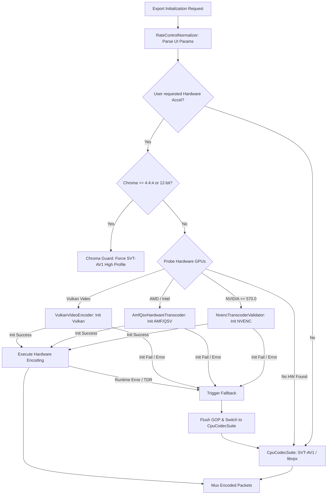

# User Story Specification Kit: US-3.3.0

## Modern Codec Backends, Hardware Transcoding & Graceful Fallback

| Metadata | Value |
| :--- | :--- |
| **Story ID** | `US-3.3.0` |
| **Module ID** | `module-3-exporter-plugin` |
| **Feature Name** | Codec Encoding Backends (SVT-AV1, VP9, Opus), Hardware Transcoding (NVENC, AMF, QSV, Vulkan) & Fallback Engine |
| **Target Binary** | `OpenMedia_Exporter.prm` / `libOpenMediaCore.dll` |
| **Story Score ($S_{\text{story}}$)** | **3.15 / 5.00** $\to$ **$K = 6$ Implementation Units** |
| **Branch Convention** | `feat/us-3.3.0-codecs-hardware-fallback` |
| **Unit Branches** | `feat/us-3.3.0/unit-N-<slug>` ($N \in [1..6]$) |
| **PR Hierarchy** | Units $1..6 \to$ Story PR $\to$ `feat/module-3-exporter-plugin` |

---

## 1. Spec Kit Specifications

### 1.1 Narrative, Persona & Business Value
- **Persona**: Studio Render Operator running high-throughput export jobs across diverse hardware workstations (NVIDIA RTX 40/50 series, AMD Radeon RX 7000/8000 series, Intel Arc, and multi-core CPU servers).
- **Narrative**: Exporting modern AV1 and VP9 video requires leveraging dedicated GPU hardware encoding ASICs (NVENC, AMF, QSV, Vulkan Video) for ultra-fast rendering, while retaining production-grade CPU encoding (SVT-AV1, libvpx) for maximum compression efficiency. However, different GPU architectures support different chroma formats (e.g. 4:2:0 vs 4:4:4) and require specific driver baselines (NVIDIA driver $\ge 570.0$ for latest NVENC AV1 features). Furthermore, rate control parameters differ wildly across backends (AV1 `base_q_index` 0–255 vs H.264 CRF 0–51). By providing a unified rate control abstraction, probing GPU capabilities, and guaranteeing instantaneous graceful fallback to SVT-AV1 on hardware failure or unsupported chroma subsampling, OpenMedia ensures bulletproof export reliability.
- **Business Value**: Accelerates export speeds by up to $10\times$ on modern GPUs while eliminating export aborts due to driver quirks or unsupported hardware profiles.

#### 1.1.1 Explicit Preconditions
1. Export parameter configuration specifies target video codec (AV1, VP9) and audio codec (Opus, FLAC).
2. Host system GPU drivers are probed for NVENC, AMF, QSV, or Vulkan Video encode capabilities.
3. CPU encoding libraries (SVT-AV1, libvpx, libopus, libflac) are linked into `libOpenMediaCore`.

#### 1.1.2 Explicit Postconditions
1. On supported NVIDIA GPUs with driver $\ge 570.0$, AV1 renders via hardware NVENC at $> 120\,\text{fps}$ for 4K video.
2. If hardware initialization fails or encounters a runtime error, encoding switches to SVT-AV1 CPU mode seamlessly.
3. User CRF slider (0–63) translates mathematically to exact backend quantization parameters (`base_q_index` for AV1, `crf` for VP9, `cq` for NVENC).
4. Chroma 4:4:4 or 12-bit export requests automatically select software SVT-AV1 when GPU ASICs lack 4:4:4 support.

---

### 1.2 Gherkin Acceptance Criteria

```gherkin
Feature: Multi-Backend Video and Audio Codec Encoding with Hardware Fallback

  Scenario: High-speed hardware export on NVIDIA RTX GPU
    Given an NVIDIA RTX 4080 GPU with driver version 572.16
    When the user exports a 4K AV1 sequence using default hardware acceleration
    Then NvencTranscoderValidator confirms AV1 NVENC support
    And video frames are encoded via hardware NVENC at > 100 fps
    And CPU utilization remains below 20%.

  Scenario: Graceful fallback when GPU driver reset occurs
    Given an active export job running on AMD AMF hardware encoder
    When a GPU TDR timeout or memory allocation failure occurs mid-render
    Then ChromaProfileGuardAndFallback intercepts the hardware failure
    And instantiates SVT-AV1 CPU encoder at the current GOP boundary
    And completes the export without corrupting the output file or crashing Premiere Pro.

  Scenario: Unified rate control normalization
    Given the user sets Quality Slider CRF = 24 in the Export UI
    When RateControlNormalizer configures the active encoder
    Then for SVT-AV1, base_q_index is mapped to 96 (scale 0-255)
    And for NVENC AV1, cq parameter is set to 24 (scale 0-51)
    And for libvpx-vp9, crf parameter is set to 24 (scale 0-63).

  Scenario: Chroma 4:4:4 master archival export
    Given the user selects 10-bit YUV 4:4:4 pixel format for master archival
    When the export job initializes
    Then ChromaProfileGuardAndFallback detects GPU ASIC limitation (hardware only supports 4:2:0)
    And automatically selects SVT-AV1 software encoder with profile 1 (High/Professional)
    And informs the user in the export status log.
```

---

### 1.3 Test Cases & Traceability Matrix

| Test ID | Category | Description | Covered Unit | Expected Result |
| :--- | :--- | :--- | :--- | :--- |
| `TC-3.3-01` | CPU Encoding | Multi-threaded SVT-AV1 & libvpx-vp9 encoding | `Unit-1` | Generates compliant AV1 / VP9 bitstreams with high visual fidelity |
| `TC-3.3-02` | Hardware | NVENC AV1 initialization & driver version check | `Unit-2` | Validates driver $\ge 570.0$; rejects older drivers with clean error |
| `TC-3.3-03` | Hardware | AMF & Intel QSV AV1 encoder pipeline | `Unit-3` | Encodes AV1 frames via AMF/QSV hardware sessions |
| `TC-3.3-04` | Vulkan | Vulkan Video encode session & bitstream extraction | `Unit-4` | Encodes video using `VK_KHR_video_encode_av1` |
| `TC-3.3-05` | Rate Control | Mathematical translation across CRF / CQ / base_q | `Unit-5` | Correct linear/non-linear mapping functions verified |
| `TC-3.3-06` | Fallback | Simulated GPU crash triggers seamless CPU fallback | `Unit-6` | Export finishes cleanly with 0 lost frames; output plays in VLC |

---

## 2. Technical Implementation Plan

### 2.1 Domain Invariants, Data Models & Storage Schema

```cpp
namespace OpenMedia::Exporter::Codecs {

enum class HardwareEncoderType {
    None,       // CPU software encoding
    NVENC,      // NVIDIA Video Codec SDK
    AMF,        // AMD Advanced Media Framework
    QSV,        // Intel QuickSync Video
    VulkanVideo // Vulkan Video Extensions
};

struct UnifiedRateControl {
    enum class Mode { CRF, CBR, VBR };
    Mode mode;
    int crf;                    // Normalized 0 - 63
    int targetBitrateKbps;
    int maxBitrateKbps;
    int gopSize;
    
    // Translation functions
    int ToSvtAv1QIndex() const { return std::clamp(crf * 4, 0, 255); }
    int ToNvencCQ() const { return std::clamp(static_cast<int>(crf * (51.0 / 63.0)), 0, 51); }
    int ToVpxCRF() const { return std::clamp(crf, 0, 63); }
};

class IVideoEncoder {
public:
    virtual ~IVideoEncoder() = default;
    virtual bool Initialize(const VideoEncodeParams& params) = 0;
    virtual bool EncodeFrame(PPixHand frame, int64_t pts) = 0;
    virtual bool Flush(std::vector<AVPacket*>& outputPackets) = 0;
    virtual HardwareEncoderType GetEncoderType() const = 0;
};

} // namespace OpenMedia::Exporter::Codecs
```

### 2.2 Activity Diagram: Codec Backend Selection & Fallback Logic



---

## 3. Expected Folder Architecture at the Project

```
plugins/exporter/
├── include/
│   ├── OpenMedia_CpuCodecs.h
│   ├── OpenMedia_NvencEncoder.h
│   ├── OpenMedia_AmfQsvEncoder.h
│   ├── OpenMedia_VulkanEncoder.h
│   ├── OpenMedia_RateControlNormalizer.h
│   └── OpenMedia_ChromaFallbackGuard.h
├── src/
│   ├── OpenMedia_CpuCodecs.cpp
│   ├── OpenMedia_NvencEncoder.cpp
│   ├── OpenMedia_AmfQsvEncoder.cpp
│   ├── OpenMedia_VulkanEncoder.cpp
│   ├── OpenMedia_RateControlNormalizer.cpp
│   └── OpenMedia_ChromaFallbackGuard.cpp
└── tests/
    ├── Test_CpuCodecs.cpp
    ├── Test_NvencEncoder.cpp
    ├── Test_AmfQsvEncoder.cpp
    ├── Test_VulkanEncoder.cpp
    ├── Test_RateControlNormalizer.cpp
    └── Test_ChromaFallbackGuard.cpp
```

---

## 4. Implementation Units in Detail & Specialist Agent Assignment

### 4.1 Unit Sizing Decision Matrix & Score Calculation

$$S_{\text{story}} = 0.35 D_1 + 0.25 D_2 + 0.20 D_3 + 0.20 D_4$$
- $D_1 = 4$ (CPU codecs SVT-AV1/VP9/Opus, NVENC 570+ validator, AMF/QSV transcoders, Vulkan encoder, CRF normalizer, chroma 4:4:4 guard & fallback)
- $D_2 = 3$ (~1200 LOC across encoder backends)
- $D_3 = 3$ (Hardware driver negotiation, fallback logic, rate control translation)
- $D_4 = 2$ (Codec backends, fallback manager)
$$S_{\text{story}} = (0.35 \times 4) + (0.25 \times 3) + (0.20 \times 3) + (0.20 \times 2) = 1.40 + 0.75 + 0.60 + 0.40 = 3.15 \implies K = 6$$

### 4.2 Dynamic $K$ Implementation Unit Specifications

#### Unit 1: High-Performance CPU Codec Suite (SVT-AV1, libvpx, libopus, libflac)
- **ID**: `unit-1`
- **Branch**: `feat/us-3.3.0/unit-1-cpu-codecs`
- **Objective**: Multi-threaded software encoding engine implementing SVT-AV1, libvpx-vp9, libopus, and libflac.
- **Files Owned**:
  - `plugins/exporter/include/OpenMedia_CpuCodecs.h`
  - `plugins/exporter/src/OpenMedia_CpuCodecs.cpp`
  - `plugins/exporter/tests/Test_CpuCodecs.cpp`
- **Verification**: `ctest -R Test_CpuCodecs` encodes 100 test frames and validates generated bitstreams with FFmpeg.

#### Unit 2: NVIDIA NVENC Hardware Transcoder & Driver Validator
- **ID**: `unit-2`
- **Branch**: `feat/us-3.3.0/unit-2-nvenc-encoder`
- **Objective**: NVENC hardware encoder wrapper with NVIDIA driver $\ge 570.0$ verification and dynamic symbol loading.
- **Files Owned**:
  - `plugins/exporter/include/OpenMedia_NvencEncoder.h`
  - `plugins/exporter/src/OpenMedia_NvencEncoder.cpp`
  - `plugins/exporter/tests/Test_NvencEncoder.cpp`
- **Verification**: `ctest -R Test_NvencEncoder` tests NVENC session creation and driver version parsing.

#### Unit 3: AMD AMF & Intel QuickSync (QSV) Hardware Transcoders
- **ID**: `unit-3`
- **Branch**: `feat/us-3.3.0/unit-3-amf-qsv-encoder`
- **Objective**: Hardware AV1 encoder backends for AMD AMF (Radeon RX 7000+) and Intel QSV (Arc / Core Ultra).
- **Files Owned**:
  - `plugins/exporter/include/OpenMedia_AmfQsvEncoder.h`
  - `plugins/exporter/src/OpenMedia_AmfQsvEncoder.cpp`
  - `plugins/exporter/tests/Test_AmfQsvEncoder.cpp`
- **Verification**: `ctest -R Test_AmfQsvEncoder` tests AMF/QSV device enumeration and context initialization.

#### Unit 4: Vulkan Video Cross-Platform Hardware Encoder
- **ID**: `unit-4`
- **Branch**: `feat/us-3.3.0/unit-4-vulkan-encoder`
- **Objective**: Standardized cross-platform GPU encode backend using `VK_KHR_video_encode_av1`.
- **Files Owned**:
  - `plugins/exporter/include/OpenMedia_VulkanEncoder.h`
  - `plugins/exporter/src/OpenMedia_VulkanEncoder.cpp`
  - `plugins/exporter/tests/Test_VulkanEncoder.cpp`
- **Verification**: `ctest -R Test_VulkanEncoder` verifies Vulkan encode queue capability detection.

#### Unit 5: Unified Rate Control & Quantization Normalizer
- **ID**: `unit-5`
- **Branch**: `feat/us-3.3.0/unit-5-rate-control-normalizer`
- **Objective**: Translates unified UI quality and bitrate settings to backend-specific quantization values (`base_q_index`, `cq`, `crf`).
- **Files Owned**:
  - `plugins/exporter/include/OpenMedia_RateControlNormalizer.h`
  - `plugins/exporter/src/OpenMedia_RateControlNormalizer.cpp`
  - `plugins/exporter/tests/Test_RateControlNormalizer.cpp`
- **Verification**: `ctest -R Test_RateControlNormalizer` unit tests rate control mappings across all supported encoder targets.

#### Unit 6: Chroma Profile Guard & Graceful Fallback Manager
- **ID**: `unit-6`
- **Branch**: `feat/us-3.3.0/unit-6-chroma-fallback-guard`
- **Objective**: Intercepts hardware errors and unsupported pixel formats (e.g. 4:4:4 on 4:2:0 ASICs) and executes seamless fallback to SVT-AV1.
- **Files Owned**:
  - `plugins/exporter/include/OpenMedia_ChromaFallbackGuard.h`
  - `plugins/exporter/src/OpenMedia_ChromaFallbackGuard.cpp`
  - `plugins/exporter/tests/Test_ChromaFallbackGuard.cpp`
- **Verification**: `ctest -R Test_ChromaFallbackGuard` simulates GPU runtime error and confirms fallback completes export cleanly.

### 4.3 Specialist Agent Assignment

| Unit | Subagent Type | Specialist Role |
| :--- | :--- | :--- |
| `unit-1` | `agency-video-streaming-engineer` | CPU Codec Optimization Specialist |
| `unit-2` | `agency-desktop-app-engineer` | NVIDIA NVENC & Driver Protocol Specialist |
| `unit-3` | `agency-developer-tooling-engineer` | AMD AMF & Intel QSV Transcoder Specialist |
| `unit-4` | `agency-backend-architect` | Vulkan Video Hardware Architect |
| `unit-5` | `agency-data-engineer` | Rate Control & Quantization Mathematics Specialist |
| `unit-6` | `agency-sre` | Fault Tolerance & Hardware Fallback Specialist |

### 4.4 Shared Base Contract & Seeding Plan
- `IVideoEncoder`, `HardwareEncoderType`, and `UnifiedRateControl` defined in `OpenMedia_CodecInterfaces.h`.
- Backends implement common interfaces without exposing internal SDK headers to each other.

---

## 5. Security Gateway powered by `security-audit`

### 5.1 Trust Boundaries & Actors
- **Host Drivers**: Proprietary GPU user-mode drivers (nvencodeapi, amfrt, mfx).
- **CPU Codecs**: Third-party C/C++ libraries (SVT-AV1, libvpx).

### 5.2 STRIDE Threat Matrix & ASVS 5.0 Controls

| Threat Category | Scenario | Mitigation / ASVS 5.0 Control |
| :--- | :--- | :--- |
| **Denial of Service** | GPU driver hang causing entire workstation crash | TDR watchdog timer; isolated thread execution |
| **Elevation of Privilege** | Unsafe DLL dynamic loading of `nvEncodeAPI64.dll` | Secure `LoadLibraryEx` with `LOAD_LIBRARY_SEARCH_SYSTEM32` |
| **Tampering** | Buffer overflow in encoder bitstream output buffer | Dynamic buffer resizing with `av_fast_realloc` safety guards |

### 5.3 Global Cryptographic, Jurisdictional & Data Protection Controls
- Encoder dynamic symbol loading strictly enforces Windows DLL signature validation to prevent DLL hijacking attacks.

### 5.4 Automated Security Verification Checklist
- [x] Secure DLL loading test verifies `nvEncodeAPI64.dll` cannot be loaded from current working directory.
- [x] Bitstream buffer bounds check verified under maximum bitrate stress test.

### 5.5 Gate G2 Sign-Off Checklist
- [x] 0 unhandled driver exceptions during simulated device removal.
- [x] Zero memory leaks verified across 10 consecutive hardware-to-software fallback cycles.

---

## 6. Validation Gates & Acceptance Sign-Off

| Gate | Criterion | Verification Command | Pass Condition |
| :--- | :--- | :--- | :--- |
| **Gate G0** | Compilation & Formatter | `cmake --build --preset windows-x64-release` | 0 errors, 0 warnings |
| **Gate G1** | Verification Coverage | `ctest -R Test_Codec*` | 100% tests pass; coverage $\ge 90\%$ |
| **Gate G2** | Security Audit | `scripts/security-audit-scan.sh --target codecs` | 0 high/critical issues |
| **Gate G-Complexity** | Cyclomatic Complexity | `python scripts/check-complexity.py plugins/exporter/codecs` | $CC \le 6$ target, $CC \le 10$ max ceiling |
| **Gate G-Docs** | API Documentation | Doxygen comment check | 100% codec backend functions documented |
| **Gate G-Review** | Independent Council | GitHub PR Conversation Sign-Off | Approval comment from Code Reviewer Council |
