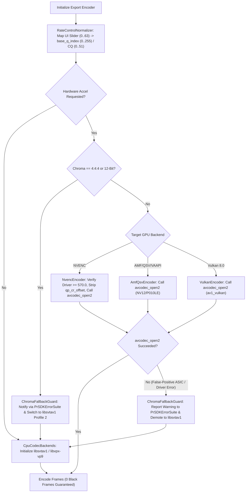

# User Story `US-3.3.0`: Modern Codec Backends, CRF Normalizer & Graceful Fallback

- **Module**: `module-3-exporter-plugin`
- **Story Branch**: `feat/us-3.3.0-codecs-hardware-fallback`
- **Field Profile**: `software` (`.agents/field-profile.json`)
- **Story Decomposition Score ($S_{\text{story}}$)**: `3.20` $\to$ **`6` Parallel Implementation Units (`unit-1..6`)**

---

## 1. Spec Kit Specifications

### 1.1 User Story Narrative
> **As a** colorist and post-production engineer exporting 8-bit, 10-bit, and 12-bit master timelines (with 4:2:0, 4:2:2, and 4:4:4 chroma subsampling) in Adobe Premiere Pro and Media Encoder,  
> **I want** `OpenMedia_Exporter.prm` to integrate CPU encoders (`libsvtav1`, `libaom`, `libvpx-vp9`, `libopus`, `libflac`) and GPU hardware encoders (NVIDIA `av1_nvenc`/`hevc_nvenc` verifying driver $\ge 570.0$ and ignoring `qp_cr_offset`, AMD `amf`, Intel `qsv`/`vaapi`, and FFmpeg 8.0 `vulkan` AV1), normalize the UI quality slider across different quantization scales (AV1 `base_q_index` `0..255` vs H.264/HEVC/NVENC `0..51` vs VP9 `0..63`), enforce AV1 Professional Profile 2 for 4:4:4 exports, and gracefully fall back to software encoding via `PrSDKErrorSuite` if `avcodec_open2` fails on hardware lacking physical AV1 ASICs,  
> **So that** exports run at maximum hardware speed when supported and never produce black frames or corrupted files when hardware limitations are encountered.

#### 1.1.1 Preconditions
- `US-3.1.0` and `US-3.2.0` configured and `libOpenMediaCore` linked with FFmpeg 7.1/8.0.
- Host exposes `PrSDKErrorSuite` for non-fatal status/warning notifications.

#### 1.1.2 Postconditions
- Software (`libsvtav1`, `libvpx-vp9`, `libopus`, `libflac`) and hardware (`av1_nvenc`, `hevc_nvenc`, `av1_amf`, `av1_qsv`, `av1_vaapi`, `av1_vulkan`) backends support 8-bit, 10-bit, and 12-bit pipelines.
- `NvencEncoder` verifies NVIDIA driver $\ge 570.0$, loads `libnvidia-encode` securely (`LOAD_LIBRARY_SEARCH_SYSTEM32` on Windows), and omits `qp_cr_offset` for `av1_nvenc`.
- `RateControlNormalizer` maps the UI quality slider (`0..63`) accurately to `base_q_index` (`0..255`) for AV1, `CRF/QP/CQ` (`0..51`) for H.264/HEVC/NVENC, and `CRF` (`0..63`) for VP9.
- `ChromaFallbackGuard` intercepts 4:4:4 chroma requests (which require **AV1 Professional Profile 2** unsupported on `NV12`-only hardware encoders like VA-API/NVENC) and routes them to `libsvtav1` / `libvpx-vp9`, and if `avcodec_open2` fails on a false-positive hardware encoder returned by `avcodec_find_encoder_by_name`, reports a clear message via `PrSDKErrorSuite` and automatically falls back to CPU encoding.

### 1.2 Acceptance Criteria (Gherkin Scenarios)

```gherkin
Feature: Multi-Codec CPU/GPU Encoding (8/10/12-Bit, 4:2:0/4:2:2/4:4:4), Quantization Normalization, and Hardware Fallback

  Scenario: AC-1 — High-Bit-Depth CPU Encoding (libsvtav1, libvpx-vp9, libopus, libflac)
    Given a timeline configured for 8-bit, 10-bit, or 12-bit AV1 or VP9 software export with Opus or FLAC audio
    When CpuCodecBackends encodes video and audio frames
    Then compliant AV1 (Main/High/Professional profiles) and VP9 (Profiles 0/2/3) bitstreams are emitted

  Scenario: AC-2 — NVIDIA NVENC AV1/HEVC Driver >= 570.0 Verification and qp_cr_offset Handling
    Given the user selects av1_nvenc or hevc_nvenc on an NVIDIA workstation
    When NvencEncoder probes the installed driver and libnvidia-encode
    Then it verifies NVIDIA driver version >= 570.0 and loads nvEncodeAPI64.dll via LOAD_LIBRARY_SEARCH_SYSTEM32
    And omits unsupported qp_cr_offset parameter when configuring av1_nvenc

  Scenario: AC-3 — AMD AMF, Intel QSV/VA-API, and FFmpeg 8.0 Vulkan Video AV1 Encoding
    Given a workstation with AMD Radeon, Intel Arc, or Vulkan Video (VK_KHR_video_encode_av1) support
    When AmfQsvEncoder or VulkanEncoder initializes hardware AV1 encoding
    Then frames are encoded via hardware surfaces (NV12 / P010LE) with full GOP control

  Scenario: AC-4 — Mathematical Normalization of Quantization Scales (0..255 vs 0..51 vs 0..63)
    Given the user sets Quality Slider = 24 (on a 0..63 UI scale)
    When RateControlNormalizer translates the setting for the selected backend
    Then AV1 base_q_index is set to 96 (scale 0..255)
    And NVENC / H.264 / HEVC CQ/QP is set to 19 (scale 0..51: round(24 * 51 / 63))
    And VP9 CRF is set to 24 (scale 0..63)

  Scenario: AC-5 — AV1 Professional Profile 2 (4:4:4) Guard and Graceful avcodec_open2 Fallback
    Given a hardware encoder returned by avcodec_find_encoder_by_name on a GPU lacking physical AV1 ASIC support (or a 4:4:4 chroma request on NV12-only hardware)
    When avcodec_open2 fails or ChromaFallbackGuard detects 4:4:4 on a 4:2:0-only hardware encoder
    Then ChromaFallbackGuard logs a clear notification via PrSDKErrorSuite
    And seamlessly demotes the session to libsvtav1 (Profile 2 for 4:4:4) without outputting black frames or aborting the export
```

### 1.3 Test Cases & Traceability Matrix

| Test Case ID | Mapped AC | Owning Unit | Test Level | Input Vector | Expected Result & Pass Threshold |
| :--- | :---: | :---: | :---: | :--- | :--- |
| `TC-3.3.1` | `AC-1` | `unit-1` | Unit | 8/10/12-bit YUV420/422/444 frames into `CpuCodecBackends` | Valid `libsvtav1` / `libvpx-vp9` + `libopus` / `libflac` packets emitted |
| `TC-3.3.2` | `AC-2` | `unit-2` | Unit | Mock NVIDIA drivers `565.90` vs `572.16` + `av1_nvenc` options | Rejects `565.90` cleanly; accepts `572.16` and strips `qp_cr_offset` |
| `TC-3.3.3` | `AC-3` | `unit-3` | Unit | AMF & QSV/VA-API `NV12`/`P010LE` session initialization | Configures hardware context cleanly |
| `TC-3.3.4` | `AC-3` | `unit-4` | Unit | FFmpeg 8.0 `av1_vulkan` session initialization | Configures `VK_KHR_video_encode_av1` context or reports clean fallback |
| `TC-3.3.5` | `AC-4` | `unit-5` | Unit / Math | UI CRF values `0, 18, 24, 32, 63` | Exact mapping to `0..255` (`base_q_index`), `0..51` (`CQ`), and `0..63` (`CRF`) |
| `TC-3.3.6` | `AC-5` | `unit-6` | Unit | Simulated `avcodec_open2` failure + 4:4:4 request on VA-API/NVENC | Invokes `PrSDKErrorSuite`; falls back to `libsvtav1` with 0 black/dropped frames |

---

## 2. Technical Implementation Plan

### 2.1 Domain Invariants & Quantization Mapping Formulas
- **Quantization Scale Normalization**:
$$\text{AV1 } \mathtt{base\_q\_index} \in [0, 255] = \text{clamp}\left(\text{round}\left(\text{UI\_CRF} \times \frac{255.0}{63.0}\right), 0, 255\right)$$
$$\text{NVENC / H.264 / HEVC } \mathtt{cq} \in [0, 51] = \text{clamp}\left(\text{round}\left(\text{UI\_CRF} \times \frac{51.0}{63.0}\right), 0, 51\right)$$
$$\text{VP9 } \mathtt{crf} \in [0, 63] = \text{clamp}(\text{UI\_CRF}, 0, 63)$$
- **Chroma 4:4:4 & Hardware Fallback Invariant**:
  - AV1 4:4:4 requires **AV1 Professional Profile 2** (`seq_profile = 2`). Hardware encoders restricting input to `NV12` / `P010LE` (4:2:0) cannot encode 4:4:4.
  - Because `avcodec_find_encoder_by_name("av1_nvenc")` returns non-null whenever compiled into FFmpeg even on GPUs without an AV1 hardware encoder, `ChromaFallbackGuard` MUST verify `avcodec_open2` success at `exSelExport` initialization and automatically demote to `libsvtav1` via `PrSDKErrorSuite` on failure.

### 2.2 Activity Diagram



---

## 3. Expected Folder Architecture

```text
AV1/
├── include/
│   └── exporter/
│       ├── cpu_codecs.hpp                       # Owned by unit-1
│       ├── nvenc_encoder.hpp                    # Owned by unit-2
│       ├── amf_qsv_encoder.hpp                  # Owned by unit-3
│       ├── vulkan_encoder.hpp                   # Owned by unit-4
│       ├── rate_control_normalizer.hpp          # Owned by unit-5
│       └── chroma_fallback_guard.hpp            # Owned by unit-6
├── src/
│   └── exporter/
│       ├── cpu_codecs.cpp                       # Owned by unit-1
│       ├── nvenc_encoder.cpp                    # Owned by unit-2
│       ├── amf_qsv_encoder.cpp                  # Owned by unit-3
│       ├── vulkan_encoder.cpp                   # Owned by unit-4
│       ├── rate_control_normalizer.cpp          # Owned by unit-5
│       └── chroma_fallback_guard.cpp            # Owned by unit-6
└── tests/
    └── exporter/
        ├── test_cpu_codecs.cpp                  # Owned by unit-1
        ├── test_nvenc_encoder.cpp               # Owned by unit-2
        ├── test_amf_qsv_encoder.cpp             # Owned by unit-3
        ├── test_vulkan_encoder.cpp              # Owned by unit-4
        ├── test_rate_control_normalizer.cpp     # Owned by unit-5
        └── test_chroma_fallback_guard.cpp       # Owned by unit-6
```

---

## 4. Implementation Units in Detail & Specialist Agent Assignment

### 4.1 Story Decomposition Score ($S_{\text{story}}$) & Dynamic Unit Count ($K$)
- **$D_1$ (35% Surface)**: `3` (6 subsystems: CPU codecs, NVENC $\ge 570.0$, AMF/QSV/VA-API, Vulkan AV1, Rate Control Normalizer, Chroma 4:4:4 & Fallback Guard)
- **$D_2$ (25% Volume)**: `3` (~1,200 LOC C++17)
- **$D_3$ (20% Complexity)**: `4` (Multi-vendor GPU surface interop, driver version verification, `avcodec_open2` fallback state machine, quantization math)
- **$D_4$ (20% Boundaries)**: `3` (6 disjoint header/source/test triplets)
- **Calculated Score**: $S_{\text{story}} = 0.35(3) + 0.25(3) + 0.20(4) + 0.20(3) = 1.05 + 0.75 + 0.80 + 0.60 = \mathbf{3.20} \to \mathbf{6\text{ Parallel Units}}$

### 4.2 Detailed Unit Specifications (`unit-1..6`)

#### `unit-1` (`feat/us-3.3.0/unit-1-cpu-codec-backends`)
- **Deliverable Scope**: `CpuCodecBackends` implementing software video encoding (`libsvtav1`, `libaom-av1`, `libvpx-vp9` across 8/10/12-bit and 4:2:0/4:2:2/4:4:4) and software audio encoding (`libopus`, `libflac`). Includes `tests/exporter/test_cpu_codecs.cpp`.
- **Owned Files**: `include/exporter/cpu_codecs.hpp`, `src/exporter/cpu_codecs.cpp`, `tests/exporter/test_cpu_codecs.cpp`.
- **Target Complexity**: $CC \le 6$, nesting $\le 2$.

#### `unit-2` (`feat/us-3.3.0/unit-2-nvenc-570-encoder`)
- **Deliverable Scope**: `NvencEncoder` wrapping `av1_nvenc` and `hevc_nvenc`, enforcing NVIDIA driver $\ge 570.0$, loading `nvEncodeAPI64.dll` / `libnvidia-encode.so` securely, and filtering out unsupported `qp_cr_offset` on `av1_nvenc`. Includes `tests/exporter/test_nvenc_encoder.cpp`.
- **Owned Files**: `include/exporter/nvenc_encoder.hpp`, `src/exporter/nvenc_encoder.cpp`, `tests/exporter/test_nvenc_encoder.cpp`.
- **Target Complexity**: $CC \le 6$, nesting $\le 2$.

#### `unit-3` (`feat/us-3.3.0/unit-3-amf-qsv-vaapi-encoder`)
- **Deliverable Scope**: `AmfQsvEncoder` wrapping AMD `av1_amf` and Intel `av1_qsv` / `av1_vaapi` hardware encoders (`NV12` 8-bit and `P010LE` 10-bit surfaces). Includes `tests/exporter/test_amf_qsv_encoder.cpp`.
- **Owned Files**: `include/exporter/amf_qsv_encoder.hpp`, `src/exporter/amf_qsv_encoder.cpp`, `tests/exporter/test_amf_qsv_encoder.cpp`.
- **Target Complexity**: $CC \le 6$, nesting $\le 2$.

#### `unit-4` (`feat/us-3.3.0/unit-4-vulkan-av1-encoder`)
- **Deliverable Scope**: `VulkanEncoder` wrapping FFmpeg 8.0 Vulkan Video `av1_vulkan` (`VK_KHR_video_encode_av1`) for vendor-neutral GPU encoding. Includes `tests/exporter/test_vulkan_encoder.cpp`.
- **Owned Files**: `include/exporter/vulkan_encoder.hpp`, `src/exporter/vulkan_encoder.cpp`, `tests/exporter/test_vulkan_encoder.cpp`.
- **Target Complexity**: $CC \le 6$, nesting $\le 2$.

#### `unit-5` (`feat/us-3.3.0/unit-5-rate-control-normalizer`)
- **Deliverable Scope**: `RateControlNormalizer` translating unified UI quality (`0..63`) and VBR/CBR bitrates into AV1 `base_q_index` (`0..255`), NVENC/H.264/HEVC `cq`/`qp` (`0..51`), and VP9 `crf` (`0..63`). Includes `tests/exporter/test_rate_control_normalizer.cpp`.
- **Owned Files**: `include/exporter/rate_control_normalizer.hpp`, `src/exporter/rate_control_normalizer.cpp`, `tests/exporter/test_rate_control_normalizer.cpp`.
- **Target Complexity**: $CC \le 5$, nesting $\le 2$.

#### `unit-6` (`feat/us-3.3.0/unit-6-chroma-guard-fallback`)
- **Deliverable Scope**: `ChromaFallbackGuard` enforcing AV1 Professional Profile 2 for 4:4:4 exports, catching `avcodec_open2` failures on false-positive hardware encoders, notifying the user via `PrSDKErrorSuite`, and switching cleanly to `libsvtav1` / `libvpx-vp9`. Includes `tests/exporter/test_chroma_fallback_guard.cpp`.
- **Owned Files**: `include/exporter/chroma_fallback_guard.hpp`, `src/exporter/chroma_fallback_guard.cpp`, `tests/exporter/test_chroma_fallback_guard.cpp`.
- **Target Complexity**: $CC \le 6$, nesting $\le 2$.

### 4.3 Best-Fit Specialist Agents per Unit

| Unit ID | Branch Name | Primary Implementer Agent | Reviewing Council Agents | Mandatory Skills Enforced |
| :--- | :--- | :--- | :--- | :--- |
| `unit-1` | `feat/us-3.3.0/unit-1-cpu-codec-backends` | `video-streaming-engineer` | `code-reviewer`, `performance-benchmarker` | `code-review-council`, `cyclomatic-complexity` |
| `unit-2` | `feat/us-3.3.0/unit-2-nvenc-570-encoder` | `desktop-app-engineer` | `code-reviewer`, `security-architect` | `code-review-council`, `security-audit` |
| `unit-3` | `feat/us-3.3.0/unit-3-amf-qsv-vaapi-encoder` | `developer-tooling-engineer` | `code-reviewer`, `test-automation-engineer` | `code-review-council`, `cyclomatic-complexity` |
| `unit-4` | `feat/us-3.3.0/unit-4-vulkan-av1-encoder` | `backend-architect` | `code-reviewer`, `reality-checker` | `code-review-council`, `cyclomatic-complexity` |
| `unit-5` | `feat/us-3.3.0/unit-5-rate-control-normalizer` | `data-engineer` | `code-reviewer`, `api-tester` | `code-review-council`, `cyclomatic-complexity` |
| `unit-6` | `feat/us-3.3.0/unit-6-chroma-guard-fallback` | `sre` | `code-reviewer`, `security-architect` | `code-review-council`, `security-audit` |
| **Patch** | `patch/us-3.3.0-<scope>` | `patch-implementer` | `code-reviewer-council-president` | Full Gate Verification |

---

## 5. Security Gateway (`security-audit`)

| Threat ID | STRIDE | ASVS / CWE | Attack Scenario | Impact | Mitigation Control |
| :--- | :---: | :---: | :--- | :---: | :--- |
| `TM-3.3.1` | **E**levation of Privilege | CWE-427 | DLL hijacking when loading `nvEncodeAPI64.dll` or `amfrt64.dll` | Critical | Use `LoadLibraryExW(..., LOAD_LIBRARY_SEARCH_SYSTEM32)` exclusively on Windows |
| `TM-3.3.2` | **D**enial of Service | CWE-755 | Unhandled `avcodec_open2` failure producing empty/black output file | High | `ChromaFallbackGuard` catches error, reports via `PrSDKErrorSuite`, and switches to `libsvtav1` |
| `TM-3.3.3` | **T**ampering | CWE-682 | Out-of-bounds quantization index passed to encoder | Medium | Strict `std::clamp` bounds (`0..255` for `base_q_index`, `0..51` for `cq`) |

---

## 6. Validation Gates & Acceptance Sign-Off

| Gate | Gate Name | Pass Criteria | Verification Evidence | Status |
| :--- | :--- | :--- | :--- | :---: |
| **Gate G0** | Build & Lint | 0 compiler warnings, `clang-format` clean | `cmake --build build` exit 0 | `[ ]` |
| **Gate G1** | Tests & Traceability | `TC-3.3.1` .. `TC-3.3.6` pass 100% | `ctest -R test_cpu_codecs|test_nvenc_encoder|test_amf_qsv_encoder|test_vulkan_encoder|test_rate_control_normalizer|test_chroma_fallback_guard` | `[ ]` |
| **Gate G2** | Security Gateway | Secure DLL loading verified, ASan clean | `security-audit` report on PR | `[ ]` |
| **Gate G-Complexity** | Complexity | Every function $CC \le 6$, nesting $\le 2$ | Complexity table on PR | `[ ]` |
| **Gate G-Docs** | Documentation | Complete Doxygen documentation for all 6 headers | Doxygen build clean | `[ ]` |
| **Gate G-Review** | Review Sign-Off | Independent Reviewing Council Approval | `gh pr comment` sign-off | `[ ]` |

---

## 7. Influx-v2 Architecture Upgrades (`US-3.3.0`)

- **Graceful Hardware `drainBeforeFallback()` & Warning Deduplication (`unit-2` & `unit-6` — `nvenc_encoder.hpp/.cpp` & `chroma_fallback_guard.hpp/.cpp`)**:
  - `ChromaFallbackGuard::drainBeforeFallback()` transfers all pending `RawVideoFrame` items into `outFlushedFrames` before switching from failed hardware encoders (`av1_nvenc`, `av1_amf`, `av1_qsv`, `av1_vulkan`) to CPU (`libsvtav1` / `libvpx-vp9`).
  - Tracks `FallbackSessionState` (`warningEmitted`, `warningsSuppressed`) so `PrSDKErrorSuite` is notified at most once per session when `reduceWarnings = true`.

---

## 7. `v3.0.0` Integration with `Module 5` (`OpenMediaDesktop.exe` Bilingual Control Center)

- **`PopupIpcBridge` Bidirectional Connection to `OpenMediaDesktop.exe`**:
  - `OpenMedia_Exporter.prm` invokes `OpenMediaDesktop.exe --popup --owner <HWND>` for out-of-process settings and `GPU Status` visualization in English (LTR) or Arabic (RTL).
- **Unified Hardware Session Telemetry**:
  - Active `NVENC`, `AMF`, `QSV`, and `Vulkan` export sessions publish telemetry entries to `gpu_status_telemetry.json` alongside Importer decode sessions.
