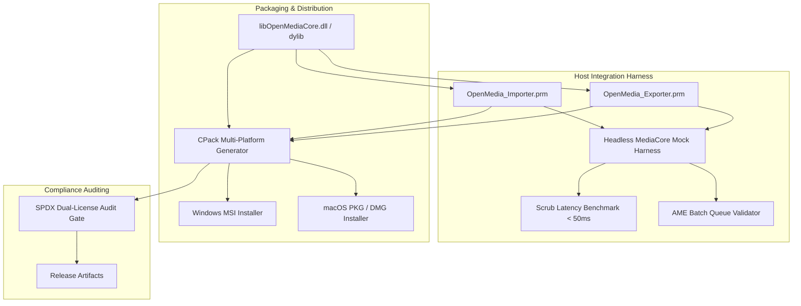

# Module 4: Integration, Packaging & QA (`module-4-integration-qa`)

## 1. Module Overview & Architectural Role

Module 4 provides the end-to-end integration, performance benchmarking, packaging, and regulatory licensing compliance infrastructure for the entire OpenMedia project.

While Modules 1, 2, and 3 build the shared core library, importer plugin, and exporter plugin respectively, Module 4 guarantees that:
1. Both plugins deploy and function seamlessly inside real Adobe Premiere Pro and Adobe Media Encoder runtime environments.
2. Timeline scrub latency achieves the critical benchmark of $< 50\,\text{ms}$ per frame across 4K/8K 10-bit AV1 assets.
3. Multi-platform installer packages (Windows MSI/EXE and macOS PKG/DMG) are generated automatically with silent installation switches for enterprise studio rollouts.
4. Open-source licensing boundaries (GPL/LGPL for FFmpeg and SVT-AV1, MIT/Apache-2.0 for plugin wrappers, zero proprietary Adobe SDK headers committed) are audited automatically in CI/CD pipelines.

---

## 2. Integration & Deployment Topology

---

## 3. User Story Specifications in this Module

| Story ID | Story Title | Sizing Score | Dynamic $K$ Units | Branch Name | Spec Kit Path |
| :--- | :--- | :---: | :---: | :--- | :--- |
| **`US-4.1.0`** | MediaCore Host Integration & Real-Time Timeline Scrubbing Benchmark Harness | **2.00** | **$K = 3$** | `feat/us-4.1.0-mediacore-host-integration-harness` | [`us-4.1.0-mediacore-host-integration-harness.md`](./us-4.1.0-mediacore-host-integration-harness.md) |
| **`US-4.2.0`** | Cross-Platform CPack Distribution, Dual-License Compliance & CI/CD Packaging | **2.00** | **$K = 3$** | `feat/us-4.2.0-cpack-distribution-packaging` | [`us-4.2.0-cpack-distribution-packaging.md`](./us-4.2.0-cpack-distribution-packaging.md) |

---

## 4. Key Architectural Invariants

1. **Adobe MediaCore Install Targets**:
   - Windows: `C:\Program Files\Adobe\Common\Plug-ins\7.0\MediaCore\`
   - macOS: `/Library/Application Support/Adobe/Common/Plug-ins/7.0/MediaCore/`
2. **Deterministic Benchmark Scenarios**: Latency benchmark tests evaluate sequential playback, random seek jumps ($\pm 1,000$ frames), and reverse scrub sweeps at $2\times$ speed.
3. **Zero Proprietary Header Distribution**: Built binaries never distribute proprietary Adobe SDK headers. Installer bundles only compiled binary plugins and necessary open-source runtime DLLs.
4. **SPDX License Clear**: All distributed files carry explicit SPDX license identifiers (`GPL-3.0-or-later`, `LGPL-3.0-or-later`, or `Apache-2.0`).

---

## 5. Base Contract & Test Fixtures Seeding Plan

Before parallel unit implementers are spawned, the following synthetic media fixtures and mock headers are placed in `tests/fixtures/`:
- `test_av1_10bit_4k.mkv`: 10-second synthetic AV1 10-bit YUV 4:2:0 sample video.
- `test_vp9_opus.webm`: 10-second synthetic VP9 video with Opus stereo audio.
- `MockPremiereHostSuites.h`: Mock implementations of `PrSDKPPixSuite`, `PrSDKMemorySuite`, `PrSDKSequenceRenderSuite`, and `PrSDKExportProgressSuite`.
