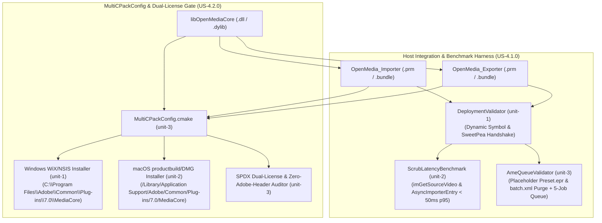

# Module 4: System Integration, Host Harness & Packaging (`module-4-integration-qa`)

- **Module Identifier**: `module-4-integration-qa`
- **Module Branch**: `feat/module-4-integration-qa`
- **Field Profile**: `software` (`.agents/field-profile.json`)
- **Primary Deliverables**:
  1. Headless MediaCore Host Mock Harness simulating `xImportEntry` (`imGetSourceVideo`, `imCreateAsyncImporter`, `imImportAudio7`) and `xSDKExport` (`exSelStartup`, `DoMultiPassExportLoop`) selector lifecycles.
  2. Real-time timeline scrubbing latency benchmark verifying $< 50\,\text{ms}$ p95 frame delivery and 5%–20% GOP RingBuffer speedup.
  3. Adobe Media Encoder (AME) test harness workflow with automated purging of `Placeholder Preset.epr` and `batch.xml` upon parameter schema updates.
  4. Cross-platform `MultiCPackConfig.cmake` installer pipeline generating Windows `.msi`/`.exe` (`C:\Program Files\Adobe\Common\Plug-ins\7.0\MediaCore`) and macOS `.pkg`/`.dmg` (`/Library/Application Support/Adobe/Common/Plug-ins/7.0/MediaCore`) with automated SPDX dual-license compliance auditing.

---

## 1. Module Overview & Integration Topology



---

## 2. User Story Index & Dynamic Unit Sizing

| Story ID | Branch | Title | Score ($S_{\text{story}}$) | Unit Count ($K$) | Status |
| :--- | :--- | :--- | :---: | :---: | :---: |
| **`US-4.1.0`** | `feat/us-4.1.0-mediacore-host-integration-harness` | MediaCore Host Verification, AME Harness & Scrub Benchmarks | **2.00** | **3 Units** | `Ready` |
| **`US-4.2.0`** | `feat/us-4.2.0-cpack-distribution-packaging` | Cross-Platform MultiCPackConfig Packaging & License Audit | **2.00** | **3 Units** | `Ready` |

---

## 3. Base Contract Seeding for Module 4 (`tests/integration/include/mock_premiere_suites.hpp`)

To maintain **Invariant B (Zero Inter-Unit Blocking)** across all 6 units in Module 4, the mock SweetPea host suites contract is pre-seeded on `feat/module-4-integration-qa`:

```cpp
// tests/integration/include/mock_premiere_suites.hpp
#pragma once
#include <openmedia/core_types.hpp>
#include <importer/importer_types.hpp>
#include <exporter/exporter_types.hpp>
#include <cstdint>
#include <string>
#include <vector>

namespace openmedia::qa {

struct ScrubBenchmarkReport {
    double minLatencyMs{0.0};
    double p50LatencyMs{0.0};
    double p95LatencyMs{0.0};
    double p99LatencyMs{0.0};
    double ringBufferSpeedupPercent{0.0};
    uint32_t totalFramesQueried{0};
    uint32_t ppixCacheHits{0};
    uint32_t ringBufferHits{0};
};

struct AmeBatchJobResult {
    std::string jobName;
    std::string outputPath;
    bool presetCachePurged{false};
    bool exportSucceeded{false};
    bool containerValid{false};
    size_t memoryDeltaBytes{0};
};

class IMockSweetPeaHost {
public:
    virtual ~IMockSweetPeaHost() = default;
    virtual void* getSPBasicSuite() = 0;
    virtual bool purgeAmePresetCache(const std::string& ameAppDataDir) = 0;
};

} // namespace openmedia::qa
```

---

## 4. Cascading Merge & Validation Plan

1. **US-4.1.0**: Units `unit-1..3` merge cascadingly into `feat/us-4.1.0-mediacore-host-integration-harness` $\to$ Gate G0..G-Review $\to$ `feat/module-4-integration-qa`.
2. **US-4.2.0**: Units `unit-1..3` merge cascadingly into `feat/us-4.2.0-cpack-distribution-packaging` $\to$ Gate G0..G-Review $\to$ `feat/module-4-integration-qa`.
3. **Module 4 Promotion**: Module Leader runs the complete integration, benchmark, and CPack packaging verification suite and merges `feat/module-4-integration-qa` into `main`.

---

## 5. Influx v1.7.1 & v2.0.0 Beta 1 QA & Packaging Enhancements

1. **Dual-PRM (`OpenMedia_Importer.prm` + `OpenMedia_ImporterHP.prm`) & GPU Policy Verification (`US-4.1.0`)**:
   - Validates simultaneous loading of both normal (`0x00`) and high-priority (`0x01`) importer shims, verifies `evaluateDecodePolicy()` ($2560 \times 1600$ resolution threshold and 4-stream GPU concurrency cap), tests `!` filename modifiers, and verifies final-frame retention in WebM/AV1 clips.
2. **Dual-PRM + `Config.toml` Packaging & Visual C++ Redistributable Check (`US-4.2.0`)**:
   - Packages `OpenMedia_Importer.prm`, `OpenMedia_ImporterHP.prm`, `OpenMedia_Exporter.prm`, `OpenMediaCore.dll`/`.dylib`, and default `Config.toml` into the installers, and checks for `VCRUNTIME140.dll` / `VCRUNTIME140_1.dll` during installation on Windows.
