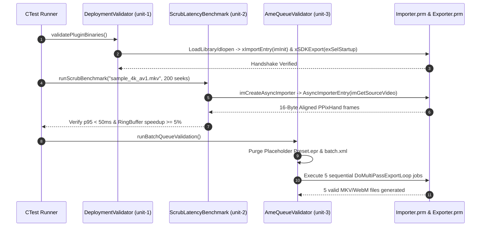

# User Story `US-4.1.0`: MediaCore Host Verification, AME Harness & Scrub Benchmarks

- **Module**: `module-4-integration-qa`
- **Story Branch**: `feat/us-4.1.0-mediacore-host-integration-harness`
- **Field Profile**: `software` (`.agents/field-profile.json`)
- **Story Decomposition Score ($S_{\text{story}}$)**: `2.00` $\to$ **`3` Parallel Implementation Units (`unit-1..3`)**

---

## 1. Spec Kit Specifications

### 1.1 User Story Narrative
> **As a** lead QA automation and performance engineer validating `OpenMedia_Importer.prm` and `OpenMedia_Exporter.prm`,  
> **I want** a headless MediaCore host test harness that dynamically loads both plugin binaries, benchmarks real-time timeline scrubbing via `imGetSourceVideo` and `imCreateAsyncImporter` (`AsyncImporterEntry`) against a strict $< 50\,\text{ms}$ p95 SLA (verifying the 5%–20% GOP RingBuffer speedup), and automates Adobe Media Encoder (AME) batch queue testing including automatic cleanup of cached `Placeholder Preset.epr` and `batch.xml` files when parameter versions change,  
> **So that** every commit is verified for binary compatibility, scrubbing responsiveness, and batch export stability without manual UI intervention.

#### 1.1.1 Preconditions
- `libOpenMediaCore`, `OpenMedia_Importer.prm`/`.bundle`, and `OpenMedia_Exporter.prm`/`.bundle` built in Release mode.
- `tests/integration/include/mock_premiere_suites.hpp` pre-seeded on `feat/us-4.1.0-mediacore-host-integration-harness`.

#### 1.1.2 Postconditions
- `DeploymentValidator` loads `.prm`/`.bundle` binaries via OS dynamic loader (`LoadLibraryExW` / `dlopen`), resolves `xImportEntry` and `xSDKExport`, and verifies full SweetPea selector handshakes (`imInit`, `imGetIndFormat`, `imOpenFile8`, `imGetInfo8`, `imGetSourceVideo`, `imImportAudio7`, `exSelStartup` with `exportReturn_IterateExporter`).
- `ScrubLatencyBenchmark` executes 200 random and sequential seeks via `imGetSourceVideo` and `AsyncImporterEntry` on 4K 10-bit AV1/VP9 streams, asserting $p50 < 25\,\text{ms}$, $p95 < 50\,\text{ms}$, and $\ge 5\%\text{--}20\%$ RingBuffer speedup.
- `AmeQueueValidator` purges stale `Placeholder Preset.epr` and `batch.xml` files prior to testing modified parameter structures and executes a 5-job multi-container (`.mkv`, `.webm`, `.mp4`) batch render queue with $< 50\,\text{MB}$ process memory delta.

### 1.2 Acceptance Criteria (Gherkin Scenarios)

```gherkin
Feature: MediaCore Dynamic Host Validation, imGetSourceVideo Scrubbing Benchmark (< 50ms p95), and AME Batch Queue Harness

  Scenario: AC-1 — Dynamic Plugin Loading and Selector Handshake Verification
    Given compiled OpenMedia_Importer and OpenMedia_Exporter binaries
    When DeploymentValidator loads both binaries and resolves xImportEntry and xSDKExport
    Then imInit returns priority=100 and avoidAudioConform=kPrTrue
    And exSelStartup iterates across MKV, WebM, and MP4 returning exportReturn_IterateExporter then exportReturn_IterateExporterDone

  Scenario: AC-2 — Real-Time Timeline Scrubbing Benchmark via imGetSourceVideo and AsyncImporterEntry
    Given a 4K 60fps 10-bit AV1 MKV test fixture opened with supportsGetSourceVideo=kPrTrue and supportsAsyncIO=kPrTrue
    When ScrubLatencyBenchmark performs 200 random and reverse scrub requests via AsyncImporterEntry(imGetSourceVideo)
    Then p50 latency is < 25ms and p95 latency is strictly < 50ms
    And GOP KeyframeRingBuffer + PrSDKPPixCacheSuite delivers a 5% to 20% latency reduction over uncached seeks

  Scenario: AC-3 — Adobe Media Encoder (AME) Preset Cache Purge and 5-Job Batch Queue Validation
    Given an updated parameter schema version in OpenMedia_Exporter
    When AmeQueueValidator initializes the AME test harness
    Then it automatically deletes stale "Placeholder Preset.epr" and "batch.xml" files before loading presets
    And executes 5 sequential export jobs (MKV AV1, WebM VP9, MKV 4:4:4 Profile 2, Opus, FLAC) with 0 errors and < 50MB memory growth
```

### 1.3 Test Cases & Traceability Matrix

| Test Case ID | Mapped AC | Owning Unit | Test Level | Input Vector | Expected Result & Pass Threshold |
| :--- | :---: | :---: | :---: | :--- | :--- |
| `TC-4.1.1` | `AC-1` | `unit-1` | Integration | Load `.prm`/`.bundle` & run selector handshake | Both entry points resolved; all selectors return `imNoErr` / `exportReturn_IterateExporterDone` |
| `TC-4.1.2` | `AC-2` | `unit-2` | Benchmark | 200 random seeks via `imGetSourceVideo` | $p95 < 50\,\text{ms}$; RingBuffer speedup $\ge 5\%$ |
| `TC-4.1.3` | `AC-3` | `unit-3` | Integration | Purge `Placeholder Preset.epr` & `batch.xml` + 5 batch jobs | Stale caches removed; all 5 output files pass `CoreDemuxer` integrity check |

---

## 2. Technical Implementation Plan

### 2.1 Domain Invariants
- **AME Test Harness Cache Purge Invariant**:
  As documented in the Premiere Pro SDK Exporter Guide and reference report, Adobe Media Encoder caches parameter trees in `Placeholder Preset.epr` and `batch.xml`. `AmeQueueValidator` MUST purge these files before running automated export tests whenever parameter definitions change.
- **Scrubbing Selector Invariant**:
  All video frame benchmark queries MUST invoke `imGetSourceVideo` (via `AsyncImporterEntry` when async I/O is active), never the legacy `imImportImage` selector.

### 2.2 Sequence Diagram



---

## 3. Expected Folder Architecture

```text
AV1/
└── tests/
    └── integration/
        ├── include/
        │   ├── mock_premiere_suites.hpp         # Base Contract (Pre-seeded)
        │   ├── deployment_validator.hpp         # Owned by unit-1
        │   ├── scrub_benchmark.hpp              # Owned by unit-2
        │   └── ame_queue_validator.hpp          # Owned by unit-3
        ├── src/
        │   ├── deployment_validator.cpp         # Owned by unit-1
        │   ├── scrub_benchmark.cpp              # Owned by unit-2
        │   └── ame_queue_validator.cpp          # Owned by unit-3
        ├── test_deployment_validator.cpp        # Owned by unit-1
        ├── test_scrub_benchmark.cpp             # Owned by unit-2
        └── test_ame_queue_validator.cpp         # Owned by unit-3
```

---

## 4. Implementation Units in Detail & Specialist Agent Assignment

### 4.1 Story Decomposition Score ($S_{\text{story}}$) & Dynamic Unit Count ($K$)
- **$D_1$ (35% Surface)**: `2` (3 integration subsystems: Deployment Validator, Scrub Latency Benchmark, AME Batch & Cache Purge Validator)
- **$D_2$ (25% Volume)**: `2` (~600 LOC C++17)
- **$D_3$ (20% Complexity)**: `2` (Dynamic symbol loading, percentile latency histograms, AME preset cache purging)
- **$D_4$ (20% Boundaries)**: `2` (3 disjoint header/source/test triplets)
- **Calculated Score**: $S_{\text{story}} = 0.35(2) + 0.25(2) + 0.20(2) + 0.20(2) = \mathbf{2.00} \to \mathbf{3\text{ Parallel Units}}$

### 4.2 Detailed Unit Specifications (`unit-1..3`)

#### `unit-1` (`feat/us-4.1.0/unit-1-deployment-validator`)
- **Deliverable Scope**: `DeploymentValidator` dynamically loading `OpenMedia_Importer` and `OpenMedia_Exporter` binaries, mocking SweetPea suites (`PrSDKPPixSuite`, `PrSDKMemorySuite`, `PrSDKAudioSuite`), and verifying complete selector handshakes. Includes `tests/integration/test_deployment_validator.cpp`.
- **Owned Files**: `tests/integration/include/deployment_validator.hpp`, `tests/integration/src/deployment_validator.cpp`, `tests/integration/test_deployment_validator.cpp`.
- **Target Complexity**: $CC \le 6$, nesting $\le 2$.

#### `unit-2` (`feat/us-4.1.0/unit-2-scrub-latency-benchmark`)
- **Deliverable Scope**: `ScrubLatencyBenchmark` measuring `imGetSourceVideo` and `AsyncImporterEntry` scrub latency across sequential, random, and reverse seeks on 4K AV1/VP9 streams, computing p50/p95/p99 percentiles and verifying $< 50\,\text{ms}$ p95 SLA and 5%–20% GOP RingBuffer speedup. Includes `tests/integration/test_scrub_benchmark.cpp`.
- **Owned Files**: `tests/integration/include/scrub_benchmark.hpp`, `tests/integration/src/scrub_benchmark.cpp`, `tests/integration/test_scrub_benchmark.cpp`.
- **Target Complexity**: $CC \le 6$, nesting $\le 2$.

#### `unit-3` (`feat/us-4.1.0/unit-3-ame-harness-cache-purge`)
- **Deliverable Scope**: `AmeQueueValidator` implementing automated cleanup of stale Adobe Media Encoder `Placeholder Preset.epr` and `batch.xml` files and running a 5-job multi-container batch export queue verifying output container integrity and zero memory leaks. Includes `tests/integration/test_ame_queue_validator.cpp`.
- **Owned Files**: `tests/integration/include/ame_queue_validator.hpp`, `tests/integration/src/ame_queue_validator.cpp`, `tests/integration/test_ame_queue_validator.cpp`.
- **Target Complexity**: $CC \le 6$, nesting $\le 2$.

### 4.3 Best-Fit Specialist Agents per Unit

| Unit ID | Branch Name | Primary Implementer Agent | Reviewing Council Agents | Mandatory Skills Enforced |
| :--- | :--- | :--- | :--- | :--- |
| `unit-1` | `feat/us-4.1.0/unit-1-deployment-validator` | `test-automation-engineer` | `code-reviewer`, `security-architect` | `code-review-council`, `security-audit` |
| `unit-2` | `feat/us-4.1.0/unit-2-scrub-latency-benchmark` | `performance-benchmarker` | `code-reviewer`, `reality-checker` | `code-review-council`, `cyclomatic-complexity` |
| `unit-3` | `feat/us-4.1.0/unit-3-ame-harness-cache-purge` | `api-tester` | `code-reviewer`, `devops-automator` | `code-review-council`, `security-audit` |
| **Patch** | `patch/us-4.1.0-<scope>` | `patch-implementer` | `code-reviewer-council-president` | Full Gate Verification |

---

## 5. Security Gateway (`security-audit`)

| Threat ID | STRIDE | ASVS / CWE | Attack Scenario | Impact | Mitigation Control |
| :--- | :---: | :---: | :--- | :---: | :--- |
| `TM-4.1.1` | **T**ampering | CWE-22 | Arbitrary file deletion in `purgeAmePresetCache` | High | Strictly whitelist filenames `Placeholder Preset.epr` and `batch.xml` within validated sandbox directory |
| `TM-4.1.2` | **D**enial of Service | CWE-400 | Hung worker thread during benchmark | Medium | Enforce per-frame watchdog timeout ($2000\,\text{ms}$) in benchmark runner |

---

## 6. Validation Gates & Acceptance Sign-Off

| Gate | Gate Name | Pass Criteria | Verification Evidence | Status |
| :--- | :--- | :--- | :--- | :---: |
| **Gate G0** | Build & Lint | 0 compiler warnings, `clang-format` clean | `cmake --build build` exit 0 | `[ ]` |
| **Gate G1** | Tests & Traceability | `TC-4.1.1` .. `TC-4.1.3` pass 100% | `ctest -R test_deployment_validator|test_scrub_benchmark|test_ame_queue_validator` | `[ ]` |
| **Gate G2** | Security Gateway | ASan clean, safe cache purge verified | `security-audit` report on PR | `[ ]` |
| **Gate G-Complexity** | Complexity | Every function $CC \le 6$, nesting $\le 2$ | Complexity table on PR | `[ ]` |
| **Gate G-Docs** | Documentation | Complete Doxygen documentation for all 3 headers | Doxygen build clean | `[ ]` |
| **Gate G-Review** | Review Sign-Off | Independent Reviewing Council Approval | `gh pr comment` sign-off | `[ ]` |

---

## 7. Influx-v2 Architecture Upgrades (`US-4.1.0`)

- **Dual-PRM Deployment & PiPL Trailing-Space Verification (`unit-1` — `deployment_validator.hpp/.cpp`)**:
  - `validateDualPluginBinaries()` and `validateDualDirectEntryPoints()` verify both `OpenMedia_Importer.prm` (`ImporterPriorityTier::Normal = 0x00`, PiPL `'OpenMedia Importer'`) and `OpenMedia_ImporterHP.prm` (`ImporterPriorityTier::High = 0x01`, PiPL `'OpenMedia Importer '`).
- **Dual-Policy CPU/GPU Scrubbing Benchmark & Final-Frame Retention (`unit-2` — `scrub_benchmark.hpp/.cpp`)**:
  - `evaluateDecodePolicy()` and `runDualPolicyBenchmark()` verify `< 2560x1600` CPU routing, `>= 2560x1600` GPU routing up to 4 concurrent streams, automatic 5th-stream overflow to CPU, `< 50ms` p95 scrub latency, and 100% WebM/AV1 final-frame retention (`verifyFinalFrameRetention()`).
- **`Config.toml` Policy Validation in AME Harness (`unit-3` — `ame_queue_validator.hpp/.cpp`)**:
  - `validateConfigTomlPolicy()` verifies `packaging/Config.toml` settings (`[dual_prm]`, `[decode_policy]`, `gpu_min_width = 2560`, `gpu_min_height = 1600`, `max_gpu_streams = 4`) before running the 5-job batch queue.
