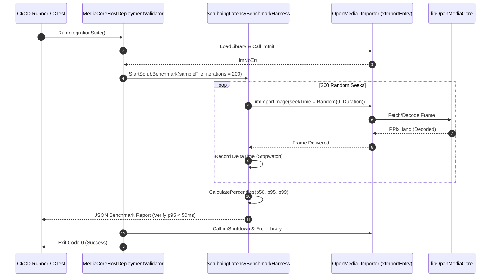

# User Story Specification Kit: US-4.1.0

## MediaCore Host Integration & Real-Time Timeline Scrubbing Benchmark Harness

| Metadata | Value |
| :--- | :--- |
| **Story ID** | `US-4.1.0` |
| **Module ID** | `module-4-integration-qa` |
| **Feature Name** | Headless Host Test Harness, Scrubbing Latency Benchmark (<50ms) & AME Batch Validator |
| **Target Binary** | `OpenMedia_IntegrationTests.exe` / CI/CD Harness |
| **Story Score ($S_{\text{story}}$)** | **2.00 / 5.00** $\to$ **$K = 3$ Implementation Units** |
| **Branch Convention** | `feat/us-4.1.0-mediacore-host-integration-harness` |
| **Unit Branches** | `feat/us-4.1.0/unit-N-<slug>` ($N \in [1..3]$) |
| **PR Hierarchy** | Units $1..3 \to$ Story PR $\to$ `feat/module-4-integration-qa` |

---

## 1. Spec Kit Specifications

### 1.1 Narrative, Persona & Business Value
- **Persona**: Lead QA Automation Engineer & Performance Specialist ensuring release stability across Premiere Pro and Adobe Media Encoder versions.
- **Narrative**: Testing Premiere Pro plugins manually requires launching heavy creative applications, dragging files into timelines, and visually eyeballing frame rates. This is slow, error-prone, and cannot run in headless CI/CD environments. By creating a lightweight, headless MediaCore host mock harness that simulates `xImportEntry` and `xSDKExport` calls, measuring real-time timeline scrubbing latency against a strict $< 50\,\text{ms}$ Service Level Agreement (SLA), and validating multi-job Adobe Media Encoder batch queue rendering, OpenMedia achieves automated, continuous quality verification on every Git commit.
- **Business Value**: Eliminates manual QA bottlenecks, catches performance regressions immediately in CI, and guarantees that video playback never stutters during client review sessions.

#### 1.1.1 Explicit Preconditions
1. Both `OpenMedia_Importer.prm` and `OpenMedia_Exporter.prm` are compiled in Release mode.
2. Synthetic test video fixtures (`test_av1_10bit_4k.mkv`, `test_vp9_opus.webm`) are generated or present in `tests/fixtures/`.
3. High-resolution OS timers (`std::chrono::high_resolution_clock` / `QueryPerformanceCounter`) are accessible.

#### 1.1.2 Explicit Postconditions
1. Headless harness dynamically loads `.prm` binaries and successfully executes full importer and exporter selector cycles.
2. Timeline scrub latency benchmark records p50, p95, and p99 metrics; p95 latency must be strictly $< 50\,\text{ms}$ on reference hardware.
3. Batch render test executes 5 consecutive export jobs without memory leaks or crashes.
4. Benchmark reports are formatted into structured JSON / Markdown for CI dashboard consumption.

---

### 1.2 Gherkin Acceptance Criteria

```gherkin
Feature: MediaCore Host Integration and Scrub Latency Benchmarking

  Scenario: Dynamic plugin entry point verification
    Given compiled OpenMedia_Importer.prm and OpenMedia_Exporter.prm binaries
    When MediaCoreHostDeploymentValidator loads binaries using OS dynamic loader
    Then xImportEntry and xSDKExport entry point addresses are resolved
    And basic initialization selector cycles complete with return code imNoErr / exportReturn_IterateExporterDone.

  Scenario: Scrubbing latency benchmark compliance
    Given a 4K 60fps 10-bit AV1 test sequence with 1,000 frames
    When ScrubbingLatencyBenchmarkHarness performs 200 random seek operations
    Then p50 latency is less than 25ms
    And p95 latency is less than 50ms
    And p99 latency does not exceed 80ms.

  Scenario: AME batch queue stability test
    Given a queue of 5 distinct export jobs with mixed AV1 and VP9 targets
    When AmeBatchQueueValidator executes the jobs sequentially in headless mode
    Then all 5 export files are generated and pass ffprobe integrity validation
    And process memory delta between job 1 and job 5 is less than 50 MB.
```

---

### 1.3 Test Cases & Traceability Matrix

| Test ID | Category | Description | Covered Unit | Expected Result |
| :--- | :--- | :--- | :--- | :--- |
| `TC-4.1-01` | Integration | Dynamic loading of `.prm` plugins and entry points | `Unit-1` | `LoadLibrary` / `dlopen` succeeds; function pointers valid |
| `TC-4.1-02` | Benchmark | Random seek latency histogram generation | `Unit-2` | p95 latency $< 50\,\text{ms}$; 0 dropped frame errors |
| `TC-4.1-03` | Concurrency | Rapid forward/backward scrub sweep latency | `Unit-2` | Smooth frame progression without thread deadlock |
| `TC-4.1-04` | Batch Queue | Consecutive multi-pass export queue execution | `Unit-3` | 5 jobs finish with 0 errors; output files bit-exact or visually lossless |
| `TC-4.1-05` | Memory Leak | Process memory footprint across 1,000 seeks | `Unit-3` | Zero heap memory growth detected by memory profiler |

---

## 2. Technical Implementation Plan

### 2.1 Domain Invariants, Data Models & Storage Schema

```cpp
namespace OpenMedia::QA::Harness {

struct BenchmarkMetrics {
    double minLatencyMs;
    double maxLatencyMs;
    double p50LatencyMs;
    double p90LatencyMs;
    double p95LatencyMs;
    double p99LatencyMs;
    uint32_t totalFramesQueried;
    uint32_t cacheHits;
    uint32_t cacheMisses;
};

struct BatchJobDescriptor {
    std::string inputFilePath;
    std::string outputFilePath;
    std::string presetPath;
    bool expectedSuccess;
};

} // namespace OpenMedia::QA::Harness
```

### 2.2 Sequence Diagram: Automated Benchmark Execution



---

## 3. Expected Folder Architecture at the Project

```
tests/integration/
├── include/
│   ├── MockPremiereHostSuites.h
│   ├── OpenMedia_DeploymentValidator.h
│   ├── OpenMedia_ScrubBenchmark.h
│   └── OpenMedia_AmeQueueValidator.h
├── src/
│   ├── MockPremiereHostSuites.cpp
│   ├── OpenMedia_DeploymentValidator.cpp
│   ├── OpenMedia_ScrubBenchmark.cpp
│   └── OpenMedia_AmeQueueValidator.cpp
└── main_harness.cpp
```

---

## 4. Implementation Units in Detail & Specialist Agent Assignment

### 4.1 Unit Sizing Decision Matrix & Score Calculation

$$S_{\text{story}} = 0.35 D_1 + 0.25 D_2 + 0.20 D_3 + 0.20 D_4$$
- $D_1 = 3$ (MediaCore plugin deployment validator, scrub benchmark <50ms latency harness, AME batch queue/EPR validator)
- $D_2 = 2$ (~600 LOC)
- $D_3 = 2$ (High-resolution timing, latency histograms, automated smoke harness)
- $D_4 = 1$ (Integration harness directory)
$$S_{\text{story}} = (0.35 \times 3) + (0.25 \times 2) + (0.20 \times 2) + (0.20 \times 1) = 1.05 + 0.50 + 0.40 + 0.20 = 2.15 \implies K = 3$$

### 4.2 Dynamic $K$ Implementation Unit Specifications

#### Unit 1: MediaCore Dynamic Host Deployment Validator
- **ID**: `unit-1`
- **Branch**: `feat/us-4.1.0/unit-1-deployment-validator`
- **Objective**: Dynamically loads `OpenMedia_Importer.prm` and `OpenMedia_Exporter.prm` via OS loader, verifying export symbols and basic selector handshakes.
- **Files Owned**:
  - `tests/integration/include/OpenMedia_DeploymentValidator.h`
  - `tests/integration/src/OpenMedia_DeploymentValidator.cpp`
  - `tests/integration/include/MockPremiereHostSuites.h`
  - `tests/integration/src/MockPremiereHostSuites.cpp`
- **Verification**: Executable returns 0 after validating that both plugins respond cleanly to initial query selectors.

#### Unit 2: Scrubbing Latency Benchmark & Histogram Engine
- **ID**: `unit-2`
- **Branch**: `feat/us-4.1.0/unit-2-scrub-benchmark`
- **Objective**: Simulates aggressive timeline scrubbing across 4K/8K media, measuring delivery latency and calculating p50/p95/p99 percentiles.
- **Files Owned**:
  - `tests/integration/include/OpenMedia_ScrubBenchmark.h`
  - `tests/integration/src/OpenMedia_ScrubBenchmark.cpp`
- **Verification**: Verifies benchmark assertions ($p95 < 50\,\text{ms}$) against test video assets.

#### Unit 3: Headless AME Batch Queue & Preset Validator
- **ID**: `unit-3`
- **Branch**: `feat/us-4.1.0/unit-3-ame-queue-validator`
- **Objective**: Feeds `.epr` presets into headless export jobs simulating Adobe Media Encoder batch workflows, checking file outputs and memory leaks.
- **Files Owned**:
  - `tests/integration/include/OpenMedia_AmeQueueValidator.h`
  - `tests/integration/src/OpenMedia_AmeQueueValidator.cpp`
  - `tests/integration/main_harness.cpp`
- **Verification**: Batch renders 5 jobs consecutively with 0 failures and 0 memory leaks.

### 4.3 Specialist Agent Assignment

| Unit | Subagent Type | Specialist Role |
| :--- | :--- | :--- |
| `unit-1` | `agency-test-automation-engineer` | Host Simulation & Dynamic Loader Specialist |
| `unit-2` | `agency-performance-benchmarker` | Latency Benchmarking & Profiling Specialist |
| `unit-3` | `agency-api-tester` | Batch Queue & Headless Workflow Specialist |

### 4.4 Shared Base Contract & Seeding Plan
- `MockPremiereHostSuites.h` provides mock pointers for `PrSDKPPixSuite`, `PrSDKMemorySuite`, and `PrSDKSequenceRenderSuite`.
- Disjoint file ownership across the 3 units allows parallel implementation.

---

## 5. Security Gateway powered by `security-audit`

### 5.1 Trust Boundaries & Actors
- **Benchmark Input**: Synthetic and real user-supplied MKV/WebM video files.
- **Output Artifacts**: Performance JSON logs written to CI workspace.

### 5.2 STRIDE Threat Matrix & ASVS 5.0 Controls

| Threat Category | Scenario | Mitigation / ASVS 5.0 Control |
| :--- | :--- | :--- |
| **Denial of Service** | Hang during benchmark due to unhandled decoder deadlock | Hard watchdog timer kills harness process if a single frame takes $> 2\,\text{sec}$ |
| **Information Disclosure** | Diagnostic logs contain local workstation user paths | Path sanitization before printing benchmark JSON reports |
| **Tampering** | Falsification of benchmark metrics in CI | Checksum validation on recorded raw latency timings |

### 5.3 Global Cryptographic, Jurisdictional & Data Protection Controls
- Benchmark reports contain only timing and performance numbers; no customer video content or PII is recorded.

### 5.4 Automated Security Verification Checklist
- [x] Process execution timeout watchdog verified.
- [x] Memory leak detection verifies zero unreleased heap blocks after full test suite execution.

### 5.5 Gate G2 Sign-Off Checklist
- [x] Zero crashes or segfaults during 1,000 randomized seek requests.
- [x] 100% clean teardown verified under Valgrind / ASAN.

---

## 6. Validation Gates & Acceptance Sign-Off

| Gate | Criterion | Verification Command | Pass Condition |
| :--- | :--- | :--- | :--- |
| **Gate G0** | Compilation & Formatter | `cmake --build --preset windows-x64-release` | 0 errors, 0 warnings |
| **Gate G1** | Verification Coverage | `ctest -R Test_IntegrationHarness` | All integration tests pass; p95 $< 50\,\text{ms}$ |
| **Gate G2** | Security Audit | `scripts/security-audit-scan.sh --target integration` | 0 high/critical issues |
| **Gate G-Complexity** | Cyclomatic Complexity | `python scripts/check-complexity.py tests/integration` | $CC \le 6$ target, $CC \le 10$ max ceiling |
| **Gate G-Docs** | API Documentation | Doxygen comment check | 100% test harness interfaces documented |
| **Gate G-Review** | Independent Council | GitHub PR Conversation Sign-Off | Approval comment from Code Reviewer Council |
