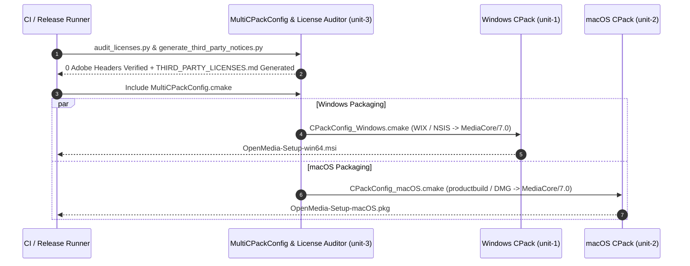

# User Story `US-4.2.0`: Cross-Platform MultiCPackConfig Packaging & License Audit

- **Module**: `module-4-integration-qa`
- **Story Branch**: `feat/us-4.2.0-cpack-distribution-packaging`
- **Field Profile**: `software` (`.agents/field-profile.json`)
- **Story Decomposition Score ($S_{\text{story}}$)**: `2.00` $\to$ **`3` Parallel Implementation Units (`unit-1..3`)**

---

## 1. Spec Kit Specifications

### 1.1 User Story Narrative
> **As a** release engineer and studio systems administrator deploying OpenMedia across Windows and macOS editing workstations,  
> **I want** a CMake/CPack packaging pipeline (`MultiCPackConfig.cmake` modeled on `SamuelMarks/premiere-pro-cmake-plugin`) that builds Windows `.msi`/`.exe` installers targeting `C:\Program Files\Adobe\Common\Plug-ins\7.0\MediaCore` and macOS `.pkg`/`.dmg` installers targeting `/Library/Application Support/Adobe/Common/Plug-ins/7.0/MediaCore`, paired with an automated SPDX dual-license compliance auditor verifying zero proprietary Adobe SDK headers and complete LGPLv2.1+/GPLv3 + MIT/Apache-2.0 notices,  
> **So that** end-users can install both Premiere Pro and Media Encoder plugins in one click with 100% open-source legal compliance.

#### 1.1.1 Preconditions
- Release binaries `OpenMedia_Importer.prm`/`.bundle`, `OpenMedia_Exporter.prm`/`.bundle`, and `libOpenMediaCore.dll`/`.dylib` compiled.
- CPack (`WIX`/`NSIS` on Windows; `productbuild`/`DragNDrop` on macOS) and Python 3 installed.

#### 1.1.2 Postconditions
- `CPackConfig_Windows.cmake` generates a Windows installer deploying `.prm` connectors and `libOpenMediaCore.dll` to `C:\Program Files\Adobe\Common\Plug-ins\7.0\MediaCore\`.
- `CPackConfig_macOS.cmake` generates a macOS installer deploying `.bundle` Cocoa bundles and `libOpenMediaCore.dylib` to `/Library/Application Support/Adobe/Common/Plug-ins/7.0/MediaCore/`.
- `MultiCPackConfig.cmake` and `audit_licenses.py` verify that 0 Adobe SDK header files (`PrSDK*.h`) exist in the repository or staging archive and generate `THIRD_PARTY_LICENSES.md` covering MIT/Apache-2.0 (Connectors) and LGPLv2.1+/GPLv3 (Core Engine & FFmpeg).

### 1.2 Acceptance Criteria (Gherkin Scenarios)

```gherkin
Feature: Cross-Platform MultiCPackConfig Installers (MediaCore/7.0) and Dual-License Compliance Auditing

  Scenario: AC-1 — Windows MSI/NSIS Installer Targeting MediaCore/7.0
    Given a Windows x64 Release build of OpenMedia_Importer.prm, OpenMedia_Exporter.prm, and libOpenMediaCore.dll
    When CPack executes with CPackConfig_Windows.cmake
    Then an installer package is produced targeting "C:\Program Files\Adobe\Common\Plug-ins\7.0\MediaCore\"
    And supports silent enterprise installation (/qn) and clean uninstallation

  Scenario: AC-2 — macOS PKG/DMG Installer Targeting MediaCore/7.0
    Given a macOS Release build of OpenMedia_Importer.bundle, OpenMedia_Exporter.bundle, and libOpenMediaCore.dylib
    When CPack executes with CPackConfig_macOS.cmake
    Then a .pkg / .dmg installer is produced targeting "/Library/Application Support/Adobe/Common/Plug-ins/7.0/MediaCore/"
    And preserves Cocoa bundle Info.plist, PkgInfo, and POSIX 755/644 permissions

  Scenario: AC-3 — MultiCPackConfig Orchestration and Automated Dual-License Compliance Audit
    Given the staged release directory and source tree
    When audit_licenses.py and generate_third_party_notices.py are executed
    Then the auditor confirms 0 proprietary Adobe SDK headers exist in the release package or tracked source tree
    And verifies dynamic linking separation between MIT/Apache-2.0 connectors and LGPLv2.1+/GPLv3 libOpenMediaCore
    And generates THIRD_PARTY_LICENSES.md with complete SPDX identifiers
```

### 1.3 Test Cases & Traceability Matrix

| Test Case ID | Mapped AC | Owning Unit | Test Level | Input Vector | Expected Result & Pass Threshold |
| :--- | :---: | :---: | :---: | :--- | :--- |
| `TC-4.2.1` | `AC-1` | `unit-1` | Packaging | Run `ctest -R test_windows_cpack` | Validates `CPackConfig_Windows.cmake` & `wix_patch.xml` install path `Adobe/Common/Plug-ins/7.0/MediaCore` |
| `TC-4.2.2` | `AC-2` | `unit-2` | Packaging | Run `ctest -R test_macos_cpack` | Validates `CPackConfig_macOS.cmake`, `distribution.xml`, and `postinstall.sh` |
| `TC-4.2.3` | `AC-3` | `unit-3` | Compliance | Run `pytest / python3 tests/packaging/test_license_audit.py` | 0 proprietary headers detected; `THIRD_PARTY_LICENSES.md` generated; exit 0 |

---

## 2. Technical Implementation Plan

### 2.1 Domain Invariants
- **Universal Creative Cloud `MediaCore/7.0` Target Path**:
  - Windows: `C:\Program Files\Adobe\Common\Plug-ins\7.0\MediaCore`
  - macOS: `/Library/Application Support/Adobe/Common/Plug-ins/7.0/MediaCore`
  (The `7.0` directory is the fixed shared MediaCore path across all modern Creative Cloud releases of Premiere Pro, Media Encoder, After Effects, and Audition.)

### 2.2 Sequence Diagram



---

## 3. Expected Folder Architecture

```text
AV1/
├── packaging/
│   ├── cpack/
│   │   ├── MultiCPackConfig.cmake               # Owned by unit-3
│   │   ├── CPackConfig_Windows.cmake            # Owned by unit-1
│   │   ├── CPackConfig_macOS.cmake              # Owned by unit-2
│   │   ├── windows/
│   │   │   └── wix_patch.xml                    # Owned by unit-1
│   │   └── macos/
│   │       ├── distribution.xml                 # Owned by unit-2
│   │       └── postinstall.sh                   # Owned by unit-2
│   └── scripts/
│       ├── audit_licenses.py                    # Owned by unit-3
│       └── generate_third_party_notices.py      # Owned by unit-3
└── tests/
    └── packaging/
        ├── test_windows_cpack.cmake             # Owned by unit-1
        ├── test_macos_cpack.cmake               # Owned by unit-2
        └── test_license_audit.py                # Owned by unit-3
```

---

## 4. Implementation Units in Detail & Specialist Agent Assignment

### 4.1 Story Decomposition Score ($S_{\text{story}}$) & Dynamic Unit Count ($K$)
- **$D_1$ (35% Surface)**: `2` (3 packaging subsystems: Windows MSI/NSIS config, macOS PKG/DMG config, `MultiCPackConfig` + SPDX License Auditor)
- **$D_2$ (25% Volume)**: `2` (~500 LOC CMake/CPack & Python scripts)
- **$D_3$ (20% Complexity)**: `2` (Cross-platform installer pathing, POSIX/ACL permissions, SPDX license boundary verification)
- **$D_4$ (20% Boundaries)**: `2` (3 disjoint file groups)
- **Calculated Score**: $S_{\text{story}} = 0.35(2) + 0.25(2) + 0.20(2) + 0.20(2) = \mathbf{2.00} \to \mathbf{3\text{ Parallel Units}}$

### 4.2 Detailed Unit Specifications (`unit-1..3`)

#### `unit-1` (`feat/us-4.2.0/unit-1-windows-msi-installer`)
- **Deliverable Scope**: `packaging/cpack/CPackConfig_Windows.cmake` and `packaging/cpack/windows/wix_patch.xml` packaging `OpenMedia_Importer.prm`, `OpenMedia_Exporter.prm`, and `libOpenMediaCore.dll` into `C:\Program Files\Adobe\Common\Plug-ins\7.0\MediaCore\`, plus `tests/packaging/test_windows_cpack.cmake`.
- **Owned Files**: `packaging/cpack/CPackConfig_Windows.cmake`, `packaging/cpack/windows/wix_patch.xml`, `tests/packaging/test_windows_cpack.cmake`.
- **Target Complexity**: $CC \le 4$, nesting $\le 2$.

#### `unit-2` (`feat/us-4.2.0/unit-2-macos-pkg-installer`)
- **Deliverable Scope**: `packaging/cpack/CPackConfig_macOS.cmake`, `packaging/cpack/macos/distribution.xml`, and `packaging/cpack/macos/postinstall.sh` packaging `.bundle` plugins and `libOpenMediaCore.dylib` into `/Library/Application Support/Adobe/Common/Plug-ins/7.0/MediaCore/`, plus `tests/packaging/test_macos_cpack.cmake`.
- **Owned Files**: `packaging/cpack/CPackConfig_macOS.cmake`, `packaging/cpack/macos/distribution.xml`, `packaging/cpack/macos/postinstall.sh`, `tests/packaging/test_macos_cpack.cmake`.
- **Target Complexity**: $CC \le 4$, nesting $\le 2$.

#### `unit-3` (`feat/us-4.2.0/unit-3-license-compliance-packager`)
- **Deliverable Scope**: `packaging/cpack/MultiCPackConfig.cmake`, `packaging/scripts/audit_licenses.py`, `packaging/scripts/generate_third_party_notices.py`, and `tests/packaging/test_license_audit.py` enforcing zero proprietary Adobe SDK header leakage and generating complete MIT/Apache-2.0 + LGPLv2.1+/GPLv3 legal notices.
- **Owned Files**: `packaging/cpack/MultiCPackConfig.cmake`, `packaging/scripts/audit_licenses.py`, `packaging/scripts/generate_third_party_notices.py`, `tests/packaging/test_license_audit.py`.
- **Target Complexity**: $CC \le 5$, nesting $\le 2$.

### 4.3 Best-Fit Specialist Agents per Unit

| Unit ID | Branch Name | Primary Implementer Agent | Reviewing Council Agents | Mandatory Skills Enforced |
| :--- | :--- | :--- | :--- | :--- |
| `unit-1` | `feat/us-4.2.0/unit-1-windows-msi-installer` | `devops-automator` | `code-reviewer`, `security-architect` | `code-review-council`, `security-audit` |
| `unit-2` | `feat/us-4.2.0/unit-2-macos-pkg-installer` | `mobile-release-engineer` | `code-reviewer`, `devops-automator` | `code-review-council`, `cyclomatic-complexity` |
| `unit-3` | `feat/us-4.2.0/unit-3-license-compliance-packager` | `compliance-auditor` | `code-reviewer`, `security-architect` | `code-review-council`, `security-audit` |
| **Patch** | `patch/us-4.2.0-<scope>` | `patch-implementer` | `code-reviewer-council-president` | Full Gate Verification |

---

## 5. Security Gateway (`security-audit`)

| Threat ID | STRIDE | ASVS / CWE | Attack Scenario | Impact | Mitigation Control |
| :--- | :---: | :---: | :--- | :---: | :--- |
| `TM-4.2.1` | **E**levation of Privilege | CWE-732 | World-writable permissions on installed `.prm`/`.bundle` in `MediaCore/7.0` | Critical | Enforce root/Administrator-only write permissions (`0755` / Windows ACLs) in installer scripts |
| `TM-4.2.2` | **T**ampering | CWE-78 | Shell injection in macOS `postinstall.sh` | High | `set -euo pipefail`, quoted static paths, zero `eval` statements |

---

## 6. Validation Gates & Acceptance Sign-Off

| Gate | Gate Name | Pass Criteria | Verification Evidence | Status |
| :--- | :--- | :--- | :--- | :---: |
| **Gate G0** | Build & Lint | CMake & Python scripts pass lint/format checks | `flake8` / `cmake --build build` exit 0 | `[ ]` |
| **Gate G1** | Tests & Traceability | `TC-4.2.1` .. `TC-4.2.3` pass 100% | `ctest -R test_windows_cpack|test_macos_cpack|test_license_audit` | `[ ]` |
| **Gate G2** | Security Gateway | 0 proprietary leaks, safe installer permissions | `security-audit` report on PR | `[ ]` |
| **Gate G-Complexity** | Complexity | Every function $CC \le 6$, nesting $\le 2$ | Complexity table on PR | `[ ]` |
| **Gate G-Docs** | Documentation | Complete packaging and licensing documentation | `THIRD_PARTY_LICENSES.md` verified | `[ ]` |
| **Gate G-Review** | Review Sign-Off | Independent Reviewing Council Approval | `gh pr comment` sign-off | `[ ]` |

---

## 7. Influx-v2 Architecture Upgrades (`US-4.2.0`)

- **Dual-PRM & `Config.toml` Distribution (`unit-1` & `unit-2` — `CPackConfig_Windows.cmake`, `CPackConfig_macOS.cmake`, `.github/workflows/release-build.yml`)**:
  - Installs both `OpenMedia_Importer.prm`/`.bundle` and `OpenMedia_ImporterHP.prm`/`.bundle`, `OpenMedia_Exporter.prm`/`.bundle`, `OpenMediaCore.dll`/`.dylib`, and `packaging/Config.toml` into `C:\Program Files\Adobe\Common\Plug-ins\7.0\MediaCore` (Windows) and `/Library/Application Support/Adobe/Common/Plug-ins/7.0/MediaCore` (macOS).
- **Visual C++ Redistributable (`VCRUNTIME140.dll`) Verification (`unit-1` — `wix_patch.xml` & `Install-MediaCore.ps1`)**:
  - Checks `System32` for `VCRUNTIME140.dll` and `VCRUNTIME140_1.dll` during installation and emits an actionable guidance message if Microsoft Visual C++ Redistributable (x64) is missing.

---

## 6. `v3.0.0` Integration & Packaging Additions (`OpenMediaDesktop.exe` + `60` CTest Targets)

1. **End-to-End Verification of Real Audio, Exact Scrubbing & `Module 5` Desktop App (`US-4.1.0`)**:
   - Verifies non-zero decoded audio samples in `imImportAudio7`, non-zero waveform peaks in `imGetPeakAudio`, frame-accurate non-sequential seeking in `imGetSourceVideo`, and `OpenMediaDesktop.exe --headless-self-test` / `--popup` execution across all **60 CTest targets**.
2. **Windows NSIS Installer & Portable Bundle with `OpenMediaDesktop.exe` (`US-4.2.0`)**:
   - Packages `OpenMediaDesktop.exe` into `C:\Program Files\Adobe\Common\Plug-ins\7.0\MediaCore` alongside `OpenMedia_Importer.prm`, `OpenMedia_ImporterHP.prm`, `OpenMedia_Exporter.prm`, `OpenMediaCore.dll`, FFmpeg shared DLLs, and `Config.toml`.
   - Creates Windows Start Menu and Desktop shortcuts (`OpenMedia Control Center`) and supports silent enterprise deployment (`Setup.exe /S` and `Uninstall-OpenMedia.exe /S -Uninstall_OpenMedia`).
