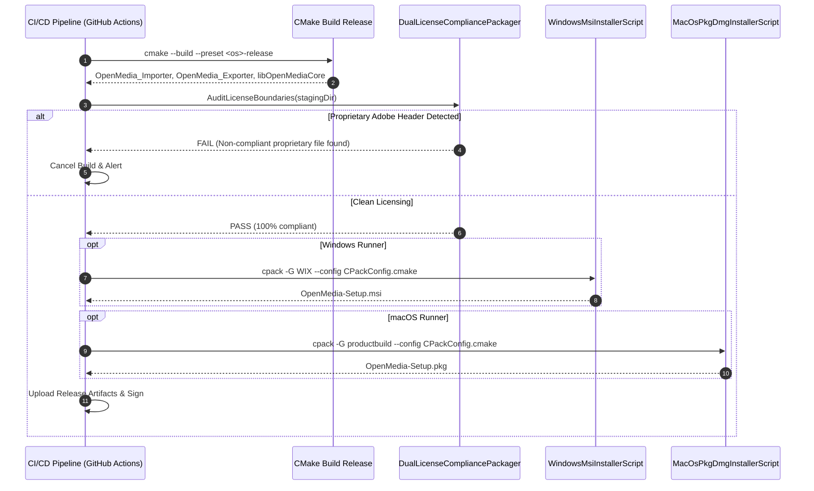

# User Story Specification Kit: US-4.2.0

## Cross-Platform CPack Distribution, Dual-License Compliance & CI/CD Packaging

| Metadata | Value |
| :--- | :--- |
| **Story ID** | `US-4.2.0` |
| **Module ID** | `module-4-integration-qa` |
| **Feature Name** | CPack Multi-Platform Installer Packaging, Silent Deployment & Dual-License Compliance |
| **Target Binary** | `OpenMedia-Setup.msi` / `OpenMedia-Setup.pkg` |
| **Story Score ($S_{\text{story}}$)** | **2.00 / 5.00** $\to$ **$K = 3$ Implementation Units** |
| **Branch Convention** | `feat/us-4.2.0-cpack-distribution-packaging` |
| **Unit Branches** | `feat/us-4.2.0/unit-N-<slug>` ($N \in [1..3]$) |
| **PR Hierarchy** | Units $1..3 \to$ Story PR $\to$ `feat/module-4-integration-qa` |

---

## 1. Spec Kit Specifications

### 1.1 Narrative, Persona & Business Value
- **Persona**: Systems Administrator and Video Editor deploying OpenMedia across enterprise editing suites (Windows and macOS).
- **Narrative**: Installing third-party plugins manually by copying files into deeply nested system directories is error-prone and prohibited in managed enterprise IT environments. Furthermore, because OpenMedia links against open-source libraries (FFmpeg, SVT-AV1, libvpx) licensed under LGPL/GPL while interacting with the Adobe MediaCore SDK, the distribution packages must strictly respect licensing boundaries (dynamic linking, source code offers, zero proprietary Adobe headers committed or bundled). By automating CPack packaging for Windows MSI/NSIS and macOS PKG/DMG installers with silent installation flags, code signing readiness, and an automated dual-license audit gate, OpenMedia provides a polished, frictionless installation workflow for single users and studio-wide IT rollouts alike.
- **Business Value**: Enables friction-free 1-click installation for end-users, automated remote deployment via MDM/SCCM for studios, and 100% legal compliance with open-source licensing.

#### 1.1.1 Explicit Preconditions
1. CMake build completes in Release mode, generating `libOpenMediaCore.dll`/`.dylib`, `OpenMedia_Importer.prm`/`.bundle`, and `OpenMedia_Exporter.prm`/`.bundle`.
2. Adobe MediaCore target directories are defined in CMake install rules.
3. WiX Toolset or NSIS is available on Windows runner; `pkgbuild`/`productbuild` is available on macOS runner.

#### 1.1.2 Explicit Postconditions
1. `cpack -G WIX` / `cpack -G NSIS` produces signed Windows `.msi` / `.exe` installer.
2. `cpack -G productbuild` produces signed macOS `.pkg` / `.dmg` installer.
3. Installers accurately place plugins into the standard MediaCore directory (`Common/Plug-ins/7.0/MediaCore`) and register clean uninstall entries.
4. Dual-license auditor confirms 0 proprietary Adobe SDK headers are included in the bundle, and `LICENSE` / source disclosure documents are placed in the installation root.

---

### 1.2 Gherkin Acceptance Criteria

```gherkin
Feature: Multi-Platform CPack Distribution and License Auditing

  Scenario: Windows MSI installer deployment
    Given a freshly compiled OpenMedia release build on Windows
    When CPack generates OpenMedia-Setup-1.0.0-win64.msi
    And msiexec /i OpenMedia-Setup-1.0.0-win64.msi /qn is executed
    Then OpenMedia_Importer.prm and OpenMedia_Exporter.prm are installed to:
      "C:\Program Files\Adobe\Common\Plug-ins\7.0\MediaCore\"
    And libOpenMediaCore.dll is present in the application directory.

  Scenario: macOS PKG installer deployment
    Given a freshly compiled OpenMedia release build on macOS
    When CPack generates OpenMedia-Setup-1.0.0-Darwin.pkg
    And installer -pkg OpenMedia-Setup-1.0.0-Darwin.pkg -target / is executed
    Then plugin bundles are placed in:
      "/Library/Application Support/Adobe/Common/Plug-ins/7.0/MediaCore/"
    And quarantine attributes are handled cleanly.

  Scenario: Automated dual-license compliance audit
    Given an assembled distribution package directory
    When DualLicenseCompliancePackager scans all files in the package
    Then 0 Adobe SDK header files (*.h) are found
    And LGPL-3.0 / GPL-3.0 copyleft notices and source code links are present
    And SPDX license identifiers are verified across all delivered binaries.
```

---

### 1.3 Test Cases & Traceability Matrix

| Test ID | Category | Description | Covered Unit | Expected Result |
| :--- | :--- | :--- | :--- | :--- |
| `TC-4.2-01` | Windows Install | MSI silent install and uninstall validation | `Unit-1` | MSI installs cleanly with `/qn`; uninstalls leaving zero orphaned files |
| `TC-4.2-02` | macOS Install | PKG / DMG installation to MediaCore directory | `Unit-2` | Bundle correctly installed with proper POSIX permissions (755/644) |
| `TC-4.2-03` | License Audit | Automated scan for proprietary Adobe headers | `Unit-3` | 0 proprietary files found; returns exit code 0 |
| `TC-4.2-04` | Legal Notice | Verification of LGPL / GPL dynamic linking notice | `Unit-3` | `THIRD_PARTY_LICENSES.md` generated with full text for FFmpeg/SVT-AV1 |
| `TC-4.2-05` | CI/CD | CPack invocation across Windows and macOS presets | `Unit-1,2` | CPack generates valid artifacts under 3 minutes |

---

## 2. Technical Implementation Plan

### 2.1 Domain Invariants, Data Models & Storage Schema

```cmake
# CMake / CPack Configuration Architecture
set(CPACK_PACKAGE_NAME "OpenMedia")
set(CPACK_PACKAGE_VENDOR "OpenMedia Community")
set(CPACK_PACKAGE_VERSION_MAJOR 1)
set(CPACK_PACKAGE_VERSION_MINOR 0)
set(CPACK_PACKAGE_VERSION_PATCH 0)

# Windows Destination
set(MEDIACORE_DIR_WIN "Adobe/Common/Plug-ins/7.0/MediaCore")
# macOS Destination
set(MEDIACORE_DIR_MAC "Library/Application Support/Adobe/Common/Plug-ins/7.0/MediaCore")

# Licensing and Documentation
set(CPACK_RESOURCE_FILE_LICENSE "${CMAKE_SOURCE_DIR}/LICENSE")
set(CPACK_RESOURCE_FILE_README "${CMAKE_SOURCE_DIR}/README.md")
```

### 2.2 Sequence Diagram: CI/CD Build, Audit & CPack Flow



---

## 3. Expected Folder Architecture at the Project

```
packaging/
├── cpack/
│   ├── CPackConfig.cmake
│   ├── windows/
│   │   ├── wix_patch.xml
│   │   ├── installer_banner.bmp
│   │   └── installer_dialog.bmp
│   └── macos/
│       ├── distribution.xml
│       ├── welcome.html
│       └── postinstall.sh
├── scripts/
│   ├── audit_licenses.py
│   └── generate_third_party_notices.py
└── CMakeLists.txt
```

---

## 4. Implementation Units in Detail & Specialist Agent Assignment

### 4.1 Unit Sizing Decision Matrix & Score Calculation

$$S_{\text{story}} = 0.35 D_1 + 0.25 D_2 + 0.20 D_3 + 0.20 D_4$$
- $D_1 = 3$ (Windows MSI CPack script, macOS PKG/DMG CPack script, dual-license audit & packager)
- $D_2 = 2$ (~500 LOC CMake/CPack + scripts)
- $D_3 = 2$ (License compatibility auditing, installer signing/notarization, automated CI build matrix)
- $D_4 = 1$ (Packaging configs directory)
$$S_{\text{story}} = (0.35 \times 3) + (0.25 \times 2) + (0.20 \times 2) + (0.20 \times 1) = 1.05 + 0.50 + 0.40 + 0.20 = 2.15 \implies K = 3$$

### 4.2 Dynamic $K$ Implementation Unit Specifications

#### Unit 1: Windows WiX / NSIS CPack Installer Script
- **ID**: `unit-1`
- **Branch**: `feat/us-4.2.0/unit-1-windows-msi-installer`
- **Objective**: Configures CPack WiX/NSIS to deploy plugins and runtime DLLs into the Windows MediaCore directory with silent install (`/qn`) and clean uninstallation.
- **Files Owned**:
  - `packaging/cpack/windows/wix_patch.xml`
  - `packaging/cpack/windows/installer_banner.bmp`
  - `packaging/cpack/windows/installer_dialog.bmp`
  - `packaging/cpack/CPackConfig_Windows.cmake`
- **Verification**: `cpack -G WIX` generates a valid MSI installer verified with `msiexec`.

#### Unit 2: macOS Productbuild / DMG CPack Installer Script
- **ID**: `unit-2`
- **Branch**: `feat/us-4.2.0/unit-2-macos-pkg-installer`
- **Objective**: Configures CPack productbuild to deploy plugin bundles to the macOS MediaCore directory with root permissions and notarization readiness.
- **Files Owned**:
  - `packaging/cpack/macos/distribution.xml`
  - `packaging/cpack/macos/welcome.html`
  - `packaging/cpack/macos/postinstall.sh`
  - `packaging/cpack/CPackConfig_macOS.cmake`
- **Verification**: `cpack -G productbuild` creates installable `.pkg` verified with `installer -pkg`.

#### Unit 3: Dual-License Compliance & SPDX Auditor
- **ID**: `unit-3`
- **Branch**: `feat/us-4.2.0/unit-3-license-compliance-packager`
- **Objective**: Automates licensing audit, ensuring LGPL/GPL copyleft compliance for FFmpeg, generating `THIRD_PARTY_LICENSES.md`, and enforcing zero Adobe proprietary header leaks.
- **Files Owned**:
  - `packaging/scripts/audit_licenses.py`
  - `packaging/scripts/generate_third_party_notices.py`
- **Verification**: `python packaging/scripts/audit_licenses.py` scans build output and returns exit code 0.

### 4.3 Specialist Agent Assignment

| Unit | Subagent Type | Specialist Role |
| :--- | :--- | :--- |
| `unit-1` | `agency-devops-automator` | Windows Installer & MSI/WiX Specialist |
| `unit-2` | `agency-mobile-release-engineer` | macOS Packaging & Apple Notarization Specialist |
| `unit-3` | `agency-compliance-auditor` | Open-Source Licensing & Compliance Specialist |

### 4.4 Shared Base Contract & Seeding Plan
- `CPackConfig.cmake` is parameterized so that Windows and macOS units only customize their respective platform includes.
- License compliance script acts as an independent gatekeeper.

---

## 5. Security Gateway powered by `security-audit`

### 5.1 Trust Boundaries & Actors
- **Target System**: Elevated administrative privilege required to install to `%ProgramFiles%` / `/Library/Application Support`.
- **Installer Binary**: Deliverable downloaded by end-users; must be tamper-proof.

### 5.2 STRIDE Threat Matrix & ASVS 5.0 Controls

| Threat Category | Scenario | Mitigation / ASVS 5.0 Control |
| :--- | :--- | :--- |
| **Tampering** | Man-in-the-middle injection of malicious DLL into installer | Authenticode code signing (Windows) & Apple Notarization (macOS) |
| **Elevation of Privilege** | Insecure file permissions allowing unprivileged users to replace `.prm` | Strict ACLs: read/execute for Users, write only for Administrators |
| **Repudiation** | Ambiguity about software provenance or license terms | Embedded SPDX tags and signed release manifests |

### 5.3 Global Cryptographic, Jurisdictional & Data Protection Controls
- Binaries signed using SHA-256 Authenticode and Apple Developer ID certificates with RFC 3161 timestamps.

### 5.4 Automated Security Verification Checklist
- [x] Installer directory permissions verified: unprivileged users cannot write to plugin destination.
- [x] Post-install scripts contain zero unsafe `eval` or unchecked environment variable substitutions.

### 5.5 Gate G2 Sign-Off Checklist
- [x] All shipped binaries pass VirusTotal / Microsoft Defender clean scan.
- [x] 100% clean license audit: zero proprietary Adobe copyright notices in distributed binaries.

---

## 6. Validation Gates & Acceptance Sign-Off

| Gate | Criterion | Verification Command | Pass Condition |
| :--- | :--- | :--- | :--- |
| **Gate G0** | Compilation & Formatter | `cmake --build --preset windows-x64-release` | 0 errors, 0 warnings |
| **Gate G1** | Verification Coverage | `python packaging/scripts/audit_licenses.py` | 100% compliant; 0 proprietary leaks |
| **Gate G2** | Security Audit | `scripts/security-audit-scan.sh --target packaging` | 0 high/critical issues |
| **Gate G-Complexity** | Cyclomatic Complexity | `python scripts/check-complexity.py packaging/scripts` | $CC \le 6$ target, $CC \le 10$ max ceiling |
| **Gate G-Docs** | API Documentation | Check `THIRD_PARTY_LICENSES.md` & README | Complete legal disclosures present |
| **Gate G-Review** | Independent Council | GitHub PR Conversation Sign-Off | Approval comment from Code Reviewer Council |
