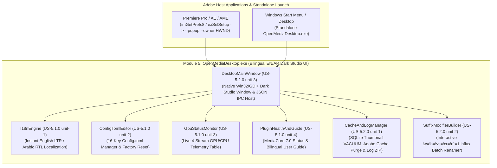

# Module 5: Bilingual Windows Desktop Control Center, Host Popup & Workflow Suite (`OpenMediaDesktop.exe`)

- **Module Identifier**: `module-5-desktop-control-center`
- **Module Branch**: `feat/module-5-desktop-control-center`
- **Field Profile**: `software` (`.agents/field-profile.json`)
- **Primary Deliverables**:
  1. Native Windows x64 Desktop & Host Popup executable (`OpenMediaDesktop.exe`) featuring an elegant Dark Studio UI with instant **English (LTR) / Arabic (RTL)** language switching (Open-source clean-room replacement and upgrade for **Autokroma `Influx.exe`**).
  2. Dual-Launch Runtime Mode: Standalone Windows desktop control center AND modal host popup invoked directly from Adobe Premiere Pro, Media Encoder, and After Effects via `imGetPrefs8` (`Source Settings…` / `Interpret Footage > More Options…` passing `--popup --owner <HWND>`).
  3. Complete 16-Key `Config.toml` Settings Manager (`overrideAdobe`, `gpuDecodeMode`, `overrideExtensions`, `maxFrameCacheSizeMB`, `maxPercentUsageAvailableMemory`, `thumbnailTimecode`, `durationCalculation`, `reduceWarnings`, `disableThumbnailCache`, `disableFrameCache`, `disableSeekingTable`, `disableMultithreading`, `debugLogs`) with atomic file save and `Reset Settings to Default`.
  4. Real-Time **GPU Status Monitor (`GpuStatusPanel`)** displaying all open media files across running Adobe processes, active decode backend (`NVDEC/CUDA`, `D3D11VA`, `Vulkan`, `VideoToolbox`, or `Software CPU`), resolution/pixel format, and exact policy admission/fallback reason (`< 2560x1600 CPU policy`, `4-Stream GPU cap reached`, `driver unavailable`, etc.).
  5. One-Click Cache Cleaners (`Clear PrPro Thumbnails Cache` executing `DELETE FROM thumbnails; VACUUM;` and `Clear Premiere Pro Media Cache` purging Adobe `Media Cache Files`), Diagnostic Log & Frame Telemetry ZIP Exporter (`exportZipLogs`), Interactive `!options.influx` / `.openmedia` Batch Filename Modifier Builder.

---

## 1. Module Overview & Architectural Context

Reverse engineering of **Autokroma Influx (`v1.7.1` & `v2.0.0beta1`)** revealed that `Influx.exe` (`9.98 MB`, `wxWidgets 3.2.8.1` + `WebView2`) is the central user-facing hub connecting the user to `InfluxAdobeBase.dll`. Without this desktop and popup executable, users cannot configure `Config.toml` from Premiere Pro's `Source Settings…`, inspect why a clip decoded on CPU vs. GPU (`VInfGpuStatusView`), purge corrupted SQLite thumbnail or Adobe Media caches, or bundle diagnostic logs.

Module 5 introduces `OpenMediaDesktop.exe` (`namespace openmedia::desktop`), engineered in modern C++17 with a lightweight native Windows Dark Studio GUI and full CLI/headless testability across all platforms:



---

## 2. User Story Index & Dynamic Unit Sizing

| Story ID | Branch | Title | Score ($S_{\text{story}}$) | Unit Count ($K$) | Status |
| :--- | :--- | :--- | :---: | :---: | :---: |
| **`US-5.1.0`** | `feat/us-5.1.0-bilingual-settings-and-gpu-status-ui` | Bilingual (EN/AR) Settings Manager, 16-Key `Config.toml` Editor & Live `GPU Status` Telemetry Monitor | **2.45** | **4 Units** | Planned |
| **`US-5.2.0`** | `feat/us-5.2.0-cache-diagnostics-modifiers-and-shortcut-converter` | Cache Cleaners, Log ZIP Bundler, `!options.influx` Batch Builder, Media Inspector & Native Dark Studio Window | **2.25** | **3 Units** | Planned |

---

## 3. Base Contract Seeding for Module 5 (`include/desktop/desktop_types.hpp`)

Before spawning `US-5.1.0` and `US-5.2.0`, the Module 5 Leader seeds `include/desktop/desktop_types.hpp` on `feat/module-5-desktop-control-center`:

```cpp
// include/desktop/desktop_types.hpp
#pragma once
#include <openmedia/core_types.hpp>
#include <importer/importer_types.hpp>
#include <cstdint>
#include <string>
#include <vector>
#include <map>

namespace openmedia::desktop {

enum class UiLanguage : uint8_t {
    English = 0, // LTR ("en-US")
    Arabic  = 1  // RTL ("ar-EG")
};

enum class ImportOverridePolicy : uint8_t {
    ForceOverrideAllAdobe = 0,       // "Force OpenMedia/Influx to override all Adobe importers"
    NewFormatsCodecsAndFallback = 1, // "Use for new formats, codecs and as a fallback (Default)"
    NewFormatsAndFallbackOnly = 2,   // "Use for new formats and as a fallback"
    Disabled = 3                     // "Disable Importer"
};

struct GpuStreamTelemetryRow {
    uint64_t fileId{0};
    std::string filePath;
    std::string hostAppName;         // "Premiere Pro", "After Effects", "Media Encoder", "Desktop"
    std::string codecName;           // "av1", "hevc", "h264", "vp9", "prores"
    uint32_t width{0};
    uint32_t height{0};
    std::string pixelFormat;         // "yuv420p", "p010le", "yuv444p10le"
    std::string colorSpace;          // "BT.709", "BT.2020"
    bool decodedOnGpu{false};
    std::string activeBackend;       // "NVDEC (CUDA)", "D3D11VA", "Vulkan", "VideoToolbox", "CPU (libdav1d)"
    std::string policyReason;        // e.g. "Admitted (>= 2560x1600, slot 1/4)" or "CPU: resolution < 2560x1600 (beta_policy_resolution_below_4mp)"
};

struct CachePurgeSummary {
    bool success{false};
    uint64_t filesRemoved{0};
    uint64_t bytesRecovered{0};
    std::string statusMessage;
};

} // namespace openmedia::desktop
```

---

## 4. Cascading Merge & Validation Plan

1. **US-5.1.0 Execution**: Units `unit-1..4` execute in parallel worktrees (`i18n_engine`, `config_toml_editor`, `gpu_status_monitor`, `plugin_health_guide`) and merge cascadingly ($1 \to 2 \to 3 \to 4$) into `feat/us-5.1.0-bilingual-settings-and-gpu-status-ui`.
2. **US-5.2.0 Execution**: Units `unit-1..4` execute in parallel worktrees (`cache_log_manager`, `suffix_modifier_builder`, `desktop_main_window`) and merge cascadingly ($1 \to 2 \to 3$) into `feat/us-5.2.0-cache-diagnostics-modifiers-and-shortcut-converter`.
3. **Module 5 Promotion**: Module Leader verifies all 7 unit test suites plus the `OpenMediaDesktop.exe` standalone/popup binary build and merges `feat/module-5-desktop-control-center` into `main`.
