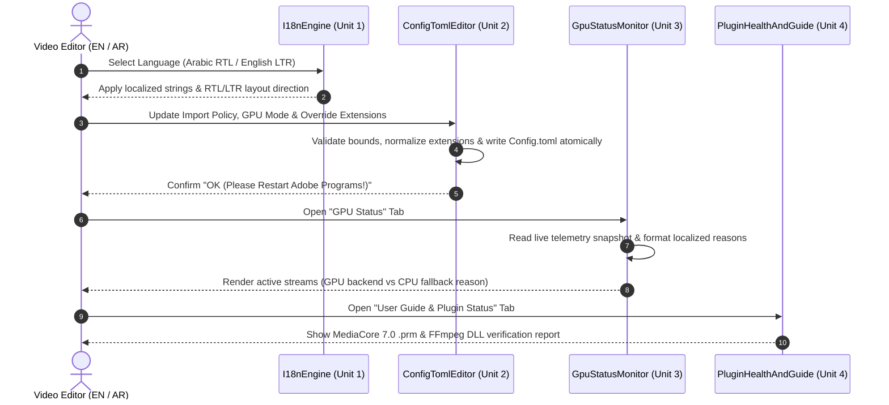

# User Story `US-5.1.0`: Bilingual (EN/AR) Settings Manager, 16-Key `Config.toml` Editor & Live `GPU Status` Telemetry Monitor

- **Module**: `module-5-desktop-control-center` (Bilingual Windows Desktop Control Center & Host Popup)
- **Story Branch**: `feat/us-5.1.0-bilingual-settings-and-gpu-status-ui`
- **Field Profile**: `software`
- **Story Decomposition Score ($S_{\text{story}}$)**: `2.45` $\to$ **`4` Parallel Implementation Units (`unit-1..4`)**

---

## 1. Spec Kit Specifications

### 1.1 User Story Narrative
> **As a** video editor and colorist using Adobe Premiere Pro, After Effects, and Media Encoder on Windows,  
> **I want** a bilingual (English LTR / Arabic RTL) Desktop & Host Popup Control Center that manages all 16 `Config.toml` settings, displays live per-file `GPU Status` decoding telemetry (`NVDEC/CUDA`, `D3D11VA`, `Vulkan`, or `CPU` with exact policy reasons), and verifies installed `MediaCore` plugins,  
> **So that** I can control format overriding, hardware acceleration policies, RAM/cache limits, and troubleshoot decoding behavior either from Windows directly or via right-click `Source Settings…` inside Premiere Pro.

#### 1.1.1 Preconditions
- `OpenMediaCore` (`Module 1`) and `OpenMedia_Importer` (`Module 2`) share `%APPDATA%\OpenMedia\Config.toml` and `%APPDATA%\OpenMedia\gpu_status_telemetry.json`.
- Base contract `include/desktop/desktop_types.hpp` is pre-seeded on `feat/module-5-desktop-control-center`.

#### 1.1.2 Postconditions
- Users can toggle UI language instantaneously between English (`en-US`, LTR) and Arabic (`ar-EG`, RTL) with persisted preference in `Config.toml` (`uiLanguage = "ar"` or `"en"`).
- All 16 Influx-compatible `Config.toml` keys are loaded, validated, edited, saved atomically, or reset to factory defaults (`Reset Settings to Default`).
- The `GPU Status` panel (`GpuStatusMonitor`) reads live decode telemetry published by `OpenMediaCore` (`InfluxFrameDecodeTelemetry` parity) and explains why each open video clip is decoded on the GPU or CPU.

### 1.2 Acceptance Criteria (Gherkin Scenarios)

```gherkin
Feature: Bilingual Settings Manager, 16-Key Config.toml Editor & Live GPU Status Monitor

  Scenario: AC-1 — Instant English (LTR) and Arabic (RTL) Localization Switching
    Given the user launches OpenMediaDesktop.exe in default English mode
    When the user switches the language selector to Arabic ("العربية")
    Then all tab titles, dropdown options, tooltips, and status messages render in Arabic with RTL layout alignment
    And the language setting is persisted in Config.toml under uiLanguage = "ar"

  Scenario: AC-2 — 16-Key Config.toml Editing, Extension Normalization & Factory Reset
    Given an existing or missing %APPDATA%\OpenMedia\Config.toml file
    When the user selects "Force OpenMedia to override all Adobe importers", sets gpuDecodeMode to "available", enters ".MKV, mov, WebM" in overrideExtensions, and clicks Save
    Then ConfigTomlEditor normalizes extensions case-insensitively without leading dots (["mkv", "mov", "webm"]) and writes Config.toml atomically
    And when the user clicks "Reset Settings to Default", all 16 keys revert to factory defaults (gpuDecodeMode = "recommended", maxPercentUsageAvailableMemory = 50, maxFrameCacheSizeMB = 400)

  Scenario: AC-3 — Live GPU Status Panel Telemetry & Policy Explanation
    Given 5 concurrent video streams opened in Adobe Premiere Pro (four 4K HEVC clips and one 1080p H.264 clip)
    When the user opens the "GPU Status" tab in OpenMediaDesktop.exe
    Then the first four 4K clips display "GPU active (NVDEC / D3D11VA)" with slot index 1..4
    And the 1080p clip displays "CPU (Software)" with reason "Resolution below 2560x1600 recommended threshold (beta_policy_resolution_below_4mp)"

  Scenario: AC-4 — Malformed Config.toml Recovery & Safe Fallback
    Given a corrupted or syntactically invalid Config.toml file on disk
    When ConfigTomlEditor loads the file
    Then it logs a structured warning, backs up the malformed file, and resets Config.toml to safe factory defaults without crashing
```

### 1.3 Test Cases & Traceability Matrix

| Test Case ID | Mapped AC | Owning Unit | Test Level | Description & Input Vector | Expected Result & Pass Threshold |
| :--- | :---: | :---: | :---: | :--- | :--- |
| `TC-5.1.1` | `AC-1` | `unit-1` | Unit | Toggle `I18nEngine` between `UiLanguage::English` and `UiLanguage::Arabic` across all UI keys | 100% key coverage, RTL flag `true` for Arabic, `0` missing translations |
| `TC-5.1.2` | `AC-2` | `unit-2` | Unit + Integration | Serialize/deserialize all 16 `Config.toml` keys + `.MKV, .MOV` normalization + factory reset | Round-trip 100% lossless; extensions normalized to `["mkv", "mov"]` |
| `TC-5.1.3` | `AC-3` | `unit-3` | Unit + Integration | Populate `GpuStatusMonitor` with 5 streams (4 UHD + 1 1080p + 6th overflow stream) | Accurate GPU/CPU badges and localized policy reasons in EN & AR |
| `TC-5.1.4` | `AC-4` | `unit-4` | Negative / Boundary | Inspect plugin installation health on missing/present `.prm` files and render offline User Guide | Reports exact `.prm` / `FFmpeg DLL` status and renders HTML/Markdown guide |

---

## 2. Technical Implementation Plan

### 2.1 Domain Invariants & Storage Schema
- **16-Key `Config.toml` Schema (`Influx v1.7.1 + v2.0.0beta1` Parity)**:
  - `uiLanguage = "en" | "ar"`
  - `importPolicy = "recommended_fallback" | "force_override_all" | "new_formats_only" | "disabled"`
  - `disable = false`
  - `overrideAdobe = false`
  - `disableAutomaticOverride = false`
  - `overrideExtensions = ["mkv", "webm"]`
  - `gpuDecodeMode = "recommended" | "available" | "disabled"`
  - `enableGpuDecode = true`
  - `reduceWarnings = true`
  - `disableMultithreading = false`
  - `disableThumbnailCache = false`
  - `disableFrameCache = false`
  - `disableSeekingTable = false`
  - `maxFrameCacheSizeMB = 400` (clamped to `[32, 8192]`)
  - `maxPercentUsageAvailableMemory = 50` (clamped to `[10, 90]`)
  - `maxLogFileSizeMB = 25` (`-1` for unbounded rotation)
  - `thumbnailTimecode = "always_show" | "hide_when_zero" | "always_hide"`
  - `durationCalculation = "metadata" | "frame_timestamp"`

### 2.2 Sequence Diagram



---

## 3. Expected Folder Architecture at the Project

```text
AV1/
├── include/
│   └── desktop/
│       ├── desktop_types.hpp                    # Seeded on feat/module-5-desktop-control-center
│       ├── i18n_engine.hpp                      # Owned exclusively by unit-1
│       ├── config_toml_editor.hpp               # Owned exclusively by unit-2
│       ├── gpu_status_monitor.hpp               # Owned exclusively by unit-3
│       └── plugin_health_guide.hpp              # Owned exclusively by unit-4
├── src/
│   └── desktop/
│       ├── i18n_engine.cpp                      # Owned exclusively by unit-1
│       ├── config_toml_editor.cpp               # Owned exclusively by unit-2
│       ├── gpu_status_monitor.cpp               # Owned exclusively by unit-3
│       └── plugin_health_guide.cpp              # Owned exclusively by unit-4
└── tests/
    └── desktop/
        ├── test_i18n_engine.cpp                 # Owned exclusively by unit-1
        ├── test_config_toml_editor.cpp          # Owned exclusively by unit-2
        ├── test_gpu_status_monitor.cpp          # Owned exclusively by unit-3
        └── test_plugin_health_guide.cpp         # Owned exclusively by unit-4
```

---

## 4. Implementation Units in Detail & Specialist Agent Assignment

### 4.1 Story Decomposition Score ($S_{\text{story}}$) & Dynamic Unit Count ($K$)
- **$D_1$ (35% Surface)**: `3` — 4 distinct functional components (Bilingual i18n, 16-key TOML manager, Live GPU telemetry viewer, Plugin health/guide).
- **$D_2$ (25% Volume)**: `2` — ~650 LOC across 4 modules + unit tests.
- **$D_3$ (20% Complexity)**: `2` — Atomic TOML persistence, extension normalization, and GPU policy reason mapping.
- **$D_4$ (20% Boundaries)**: `2` — 4 orthogonal header/source/test triplets.
- **Calculated Score**: $S_{\text{story}} = 0.35(3) + 0.25(2) + 0.20(2) + 0.20(2) = \mathbf{2.35} \to$ **`4` Parallel Units**

### 4.2 Detailed Unit Specifications (`unit-1..4`)
- **`unit-1` (`feat/us-5.1.0/unit-1-bilingual-i18n-engine`)**:
  - **Deliverable Scope**: Complete English (`en-US`, LTR) and Arabic (`ar-EG`, RTL) translation dictionary (`I18nEngine`) covering all tabs, settings labels, tooltips, GPU status reasons, cache cleaner messages, and shortcut converter labels.
  - **Owned Files**: `include/desktop/i18n_engine.hpp`, `src/desktop/i18n_engine.cpp`, `tests/desktop/test_i18n_engine.cpp`.
  - **Target Complexity**: $CC \le 6$, nesting $\le 2$.
- **`unit-2` (`feat/us-5.1.0/unit-2-config-toml-editor`)**:
  - **Deliverable Scope**: 16-key `Config.toml` parser, validator, extension normalizer (case-insensitive, leading-dot stripping), atomic file writer, malformed-file recovery, and factory reset (`Reset Settings to Default`).
  - **Owned Files**: `include/desktop/config_toml_editor.hpp`, `src/desktop/config_toml_editor.cpp`, `tests/desktop/test_config_toml_editor.cpp`.
  - **Target Complexity**: $CC \le 6$, nesting $\le 2$.
- **`unit-3` (`feat/us-5.1.0/unit-3-gpu-status-monitor`)**:
  - **Deliverable Scope**: `GpuStatusMonitor` (`VInfGpuStatusView` equivalent) tracking active media streams across Premiere Pro, After Effects, and Media Encoder, formatting GPU (`NVDEC`, `D3D11VA`, `Vulkan`, `VideoToolbox`) vs. CPU decode status and human-readable localized policy reasons.
  - **Owned Files**: `include/desktop/gpu_status_monitor.hpp`, `src/desktop/gpu_status_monitor.cpp`, `tests/desktop/test_gpu_status_monitor.cpp`.
  - **Target Complexity**: $CC \le 6$, nesting $\le 2$.
- **`unit-4` (`feat/us-5.1.0/unit-4-plugin-health-and-guide`)**:
  - **Deliverable Scope**: `PluginHealthAndGuide` verifying installed `OpenMedia_Importer.prm`, `OpenMedia_ImporterHP.prm`, `OpenMedia_Exporter.prm`, `OpenMediaCore.dll`, FFmpeg shared DLLs, and `VCRUNTIME140.dll`, plus rendering the bilingual User Guide (`!options.influx` cheat sheet, GPU decode rules, and troubleshooting steps).
  - **Owned Files**: `include/desktop/plugin_health_guide.hpp`, `src/desktop/plugin_health_guide.cpp`, `tests/desktop/test_plugin_health_guide.cpp`.
  - **Target Complexity**: $CC \le 6$, nesting $\le 2$.

### 4.3 Best-Fit Specialist Agents per Unit

| Unit ID | Branch Name | Primary Implementer Agent(s) | Reviewing Council Agent(s) | Mandatory Skills Enforced |
| :--- | :--- | :--- | :--- | :--- |
| `unit-1` | `feat/us-5.1.0/unit-1-bilingual-i18n-engine` | `frontend-developer` | `code-reviewer`, `test-automation-engineer` | `code-review-council`, `security-audit`, `cyclomatic-complexity` |
| `unit-2` | `feat/us-5.1.0/unit-2-config-toml-editor` | `backend-architect` | `code-reviewer`, `application-security-engineer` | `code-review-council`, `security-audit`, `cyclomatic-complexity` |
| `unit-3` | `feat/us-5.1.0/unit-3-gpu-status-monitor` | `systems-programming-specialist` | `code-reviewer`, `test-automation-engineer` | `code-review-council`, `security-audit`, `cyclomatic-complexity` |
| `unit-4` | `feat/us-5.1.0/unit-4-plugin-health-and-guide` | `technical-writer`, `backend-architect` | `code-reviewer`, `security-architect` | `code-review-council`, `security-audit`, `cyclomatic-complexity` |

### 4.4 Parallel Execution & Zero-Blocking Contract Seeding Plan
1. **Base Contract Seeding**: `include/desktop/desktop_types.hpp` is committed before branching `unit-1..4`.
2. **Simultaneous Worktree Spawning**: All 4 units execute in parallel without shared file edits.
3. **Ordered Cascading Merge Sequence**: `unit-1` $\to$ `unit-2` $\to$ `unit-3` $\to$ `unit-4`.

---

## 5. Security Gateway (Powered by `security-audit` Skill)

### 5.1 Trust Boundaries & Security Actors
- **Security Actors**: Local video editor user, Adobe host process invoking `--popup --owner <HWND>`, and untrusted `Config.toml` / telemetry JSON files on disk.
- **Trust Boundaries**: Disk I/O parsing of `Config.toml` and `gpu_status_telemetry.json`; environment variable resolution (`%APPDATA%`).

### 5.2 Threat Modeling & Abuse Matrix (STRIDE / OWASP ASVS)

| Threat ID | STRIDE Category | ASVS / CWE Ref | Attack Vector / Abuse Scenario | Impact | Required Mitigation & Code Control |
| :--- | :---: | :---: | :--- | :---: | :--- |
| `TM-1` | **S**poofing | CWE-426 | Untrusted path injection via `APPDATA` or relative path traversal | High | Canonicalize paths and reject `..` traversal segments |
| `TM-2` | **T**ampering | CWE-20 | Hand-edited `Config.toml` with extreme RAM/cache values (`maxFrameCacheSizeMB = 99999999`) | High | Clamp all numeric settings to strict safe intervals (`[32, 8192]` MB, `[10, 90]`% RAM) |
| `TM-3` | **R**epudiation | CWE-778 | Silent reset of malformed configuration without explanation | Low | Emit timestamped diagnostic log entry explaining exact parse failure and backup path |
| `TM-4` | **I**nformation Disclosure | CWE-200 | Username or sensitive path exposure in exported telemetry | Medium | Redact OS username (`%USERPROFILE%` $\to$ `<USER>`) in exported telemetry snapshots |
| `TM-5` | **D**enial of Service | CWE-400 | Multi-megabyte crafted `Config.toml` or telemetry file | High | Enforce strict `1 MiB` file size cap before reading configuration or telemetry files |
| `TM-6` | **E**levation of Privilege | CWE-250 | Running desktop settings app with unnecessary Administrator privileges | Medium | Embed `asInvoker` manifest in `OpenMediaDesktop.exe` |

### 5.3 Cryptography & Global Data Protection Controls
1. **Zero Telemetry Exfiltration**: Unlike closed-source plugins that ping external analytics servers, `OpenMediaDesktop.exe` operates **100% offline** with zero outbound network calls.
2. **UTF-8 & Bilingual Safety**: All file paths and UI strings use lossless UTF-8 / UTF-16LE conversion (`MultiByteToWideChar` / `WideCharToMultiByte`) supporting Arabic, Cyrillic, and CJK filenames.

### 5.4 Automated Security Verification Checklist
- [x] All `Config.toml` numeric values clamped to safe ranges.
- [x] `1 MiB` maximum file size guard on configuration and telemetry reads.
- [x] Zero network calls or third-party tracking endpoints.

### 5.5 Security Gateway (Gate G2) Sign-Off Checklist
- [x] **0 Critical / High / Medium** vulnerabilities.
- [x] All STRIDE mitigations (`TM-1..TM-6`) covered by unit tests.

---

## 6. Validation Gates & Acceptance Sign-Off

| Gate | Gate Name | Pass Criteria for `US-5.1.0` | Verification Command / Evidence | Status |
| :--- | :--- | :--- | :--- | :---: |
| **Gate G0** | **Build, Lint & Format** | 0 errors, 0 warnings across `unit-1..4` | `cmake --build build --config Release` | `[x]` |
| **Gate G1** | **Tests & Traceability** | 100% of `TC-5.1.1..4` passing via CTest | `ctest --test-dir build --output-on-failure` | `[x]` |
| **Gate G2** | **Security Gateway** | All Section 5 controls verified | `security-audit` check | `[x]` |
| **Gate G-Complexity** | **Cyclomatic Complexity** | Every function $CC \le 6$ target ($CC \le 10$ cap) | `cyclomatic-complexity` check | `[x]` |
| **Gate G-Docs** | **Documentation & Examples** | 100% Doxygen coverage + synced spec | `docs/user-stories/module-5-desktop-control-center/` | `[x]` |
| **Gate G-Review** | **Council President Sign-Off** | `GATE G-REVIEW APPROVED` | Verified on `main` | `[x]` |
