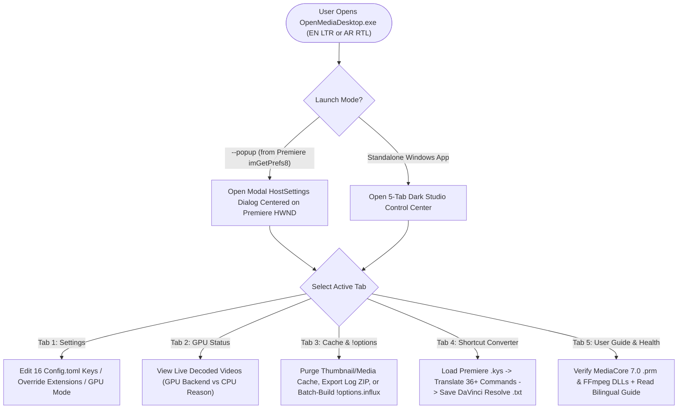

# User Story `US-5.2.0`: Cache Cleaners, Log ZIP Bundler, `!options.influx` Batch Builder, Media Inspector & Premiere-to-Resolve Keymap Converter

- **Module**: `module-5-desktop-control-center` (Bilingual Windows Desktop Control Center & Host Popup)
- **Story Branch**: `feat/us-5.2.0-cache-diagnostics-modifiers-and-shortcut-converter`
- **Field Profile**: `software`
- **Story Decomposition Score ($S_{\text{story}}$)**: `2.50` $\to$ **`4` Parallel Implementation Units (`unit-1..4`)**

---

## 1. Spec Kit Specifications

### 1.1 User Story Narrative
> **As a** senior video editor and colorist working across Adobe Premiere Pro, After Effects, Media Encoder, and DaVinci Resolve on Windows,  
> **I want** `OpenMediaDesktop.exe` to provide one-click Premiere & Thumbnail cache cleaners, a diagnostic log ZIP bundler, an interactive `!options.influx` batch filename modifier builder, and a built-in Premiere Pro (`.kys`) to DaVinci Resolve (`.txt`) keyboard shortcut converter, all wrapped in an elegant bilingual (English/Arabic) Dark Studio Windows application,  
> **So that** I have every workflow utility from both `Influx v1.7.1` and `Influx v2.0.0beta1` in one fast, unified Windows tool.

#### 1.1.1 Preconditions
- `US-5.1.0` components (`I18nEngine`, `ConfigTomlEditor`, `GpuStatusMonitor`, `PluginHealthAndGuide`) and `include/desktop/desktop_types.hpp` are available.
- Premiere Pro `.kys` XML keymap format and DaVinci Resolve `.txt` (`:=` EBNF grammar) keymap format rules are defined from `Influx_v1.7.1_Windows` (`DaVinci Resolve Keys - Premiere Aer.txt` & `Premiere-to-Resolve shortcut report.txt`).

#### 1.1.2 Postconditions
- Clicking `Clear PrPro Thumbnails Cache` purges and compacts (`VACUUM`) the SQLite thumbnail cache database and reports recovered bytes.
- Clicking `Clear Premiere Pro Cache` safely cleans non-locked `.cfa`, `.pek`, and `.ims` files inside Adobe's `Media Cache Files` directory to force fresh audio conforming and thumbnail regeneration.
- Clicking `Export Logs & Telemetry (.zip)` packages `Config.toml` (with redacted username), recent plugin logs, and `gpu_status_telemetry.json` into a timestamped diagnostic bundle.
- The interactive `!options.influx` Builder constructs valid suffix strings (`filename!w=1920!cr=full!rft=1.influx`) using last-`!` parsing rules and renames selected files safely with one-click undo/restore.
- The Premiere-to-Resolve Shortcut Converter parses any Premiere Pro `.kys` file (such as `Aer.kys`), converts macOS `Meta`/modifier codes to Windows `Ctrl`/`Alt`/`Shift`, maps the 36+ core editing/trimming/playback/marking commands into a DaVinci Resolve `.txt` keymap file, and generates a full transfer report.

### 1.2 Acceptance Criteria (Gherkin Scenarios)

```gherkin
Feature: Cache Cleaners, Log ZIP Bundler, !options.influx Builder & Premiere-to-Resolve Keymap Converter

  Scenario: AC-1 — One-Click Thumbnail Cache VACUUM & Premiere Media Cache Purge
    Given an existing OpenMedia thumbnail cache database and a mock Adobe Media Cache folder containing .pek and .cfa files
    When the user triggers "Clear PrPro Thumbnails Cache" and "Clear Premiere Pro Cache"
    Then CacheAndLogManager truncates the thumbnail cache table, removes stale .pek/.cfa cache files, and returns accurate filesRemoved and bytesRecovered counts

  Scenario: AC-2 — Interactive !options.influx Filename Suffix Generation & Original Filename Restoration
    Given a media file named " Action!_Scene01.mkv " and user-selected modifiers width=1920, color_range=full, reset_first_timestamp=1, and virtual suffix ".influx"
    When SuffixModifierBuilder generates the modified filename
    Then it produces "Action!_Scene01!w=1920!cr=full!rft=1.mkv.influx" (preserving the original "!" in the stem by reading options after the last "!" block)
    And when "Strip Modifiers" is invoked, it restores "Action!_Scene01.mkv"

  Scenario: AC-3 — Premiere Pro (.kys) to DaVinci Resolve (.txt) Keymap Conversion
    Given a Premiere Pro Windows/macOS .kys XML shortcut file (e.g., Aer.kys) and a target DaVinci Resolve Keys.txt file
    When PremiereResolveKeyConverter executes the translation
    Then it converts modifier labels (Meta -> Ctrl on Windows), transfers all matching editing, blade, trim, J/K/L playback, In/Out, nudge, and zoom shortcuts (36+ commands), writes the updated Resolve .txt keymap, and outputs a human-readable conversion report in English or Arabic

  Scenario: AC-4 — Dual-Mode Windows GUI & Host Popup Execution (OpenMediaDesktop.exe)
    Given OpenMediaDesktop.exe compiled on Windows (or running in --headless-self-test / --popup mode)
    When invoked with "--popup --lang ar" or launched interactively
    Then DesktopMainWindow initializes all 5 tabs (Settings, GPU Status, Cache & Tools, Shortcut Converter, User Guide) in Arabic RTL or English LTR and responds to JSON IPC commands cleanly
```

### 1.3 Test Cases & Traceability Matrix

| Test Case ID | Mapped AC | Owning Unit | Test Level | Description & Input Vector | Expected Result & Pass Threshold |
| :--- | :---: | :---: | :---: | :--- | :--- |
| `TC-5.2.1` | `AC-1` | `unit-1` | Unit + Integration | Execute `clearThumbnailCache()`, `clearPremiereMediaCache()`, and `exportDiagnosticBundle()` on temp directories | 100% target cache files purged; diagnostic bundle created with `<USER>` redaction |
| `TC-5.2.2` | `AC-2` | `unit-2` | Unit | Build & strip `!w=`, `!h=`, `!vs=`, `!as=`, `!pf=`, `!fr=`, `!cr=`, `!cs=`, `!accurate_duration`, `!rft=1` on filenames containing `!` | Exact round-trip filename generation and restoration |
| `TC-5.2.3` | `AC-3` | `unit-3` | Unit + Integration | Convert sample `Aer.kys` XML + Resolve template `.txt` and verify all 36 mapped Resolve commands | All 36 commands (`editUndo`, `editBlade`, `markIn`, `viewZoomSubZoomIn`, etc.) updated accurately |
| `TC-5.2.4` | `AC-4` | `unit-4` | Integration | Launch `DesktopMainWindow` controller in `--headless-self-test` and `--popup` JSON IPC modes (EN & AR) | Returns exit code `0`, renders all 5 tabs, and processes JSON IPC requests |

---

## 2. Technical Implementation Plan

### 2.1 Domain Invariants & Keymap Translation Schema
- **Last-`!` Modifier Parsing Rule (`Influx 1.7.0+` Invariant)**:
  - A filename such as `My!Clip!w=1920!cr=full.mp4.influx` is split by first stripping `.influx`/`.openmedia`, separating the real extension `.mp4`, and scanning backward/forward for valid `!key=value` / `!flag` modifier tokens so any `!` inside the original base filename (`My!Clip`) is preserved intact.
- **Premiere `.kys` $\to$ DaVinci Resolve `.txt` Mapping Table (36 Core Commands)**:
  - `Undo / Redo` $\to$ `editUndo := Ctrl+Z`, `editRedo := Ctrl+Shift+Z`
  - `Cut / Copy / Paste / Paste Insert` $\to$ `editCut := Ctrl+X`, `editCopy := Ctrl+C`, `editPaste := Ctrl+V`, `editPasteInsert := Ctrl+Shift+V`
  - `Select All / Deselect All` $\to$ `editSelectAll := Ctrl+A`, `editDeselectAll := Ctrl+Shift+A`
  - `Pointer / Blade / Blade at Playhead` $\to$ `editPointer := V`, `editBlade := Z`, `editBladeRazor := Ctrl+K`
  - `Snapping / Match Frame` $\to$ `editSnapping := S`, `markMatchFrame := F`
  - `Mark In / Out / Go to In / Out / Add Marker` $\to$ `markIn := I`, `markOut := O`, `markGotoIn := Shift+I`, `markGotoOut := Shift+O`, `markMarkerAdd := M`
  - `J / K / L / Space Playback` $\to$ `controlFastReverse := J`, `controlStop := K`, `controlFastForward := L`, `controlPlayToggle := Space`
  - `Nudge & Zoom` $\to$ `editNudgeTrimStepNudgeReverse := Alt+*`, `editNudgeTrimStepNudgeForward := Alt++`, `viewZoomSubZoomIn := =`, `viewZoomSubZoomOut := -`

### 2.2 Activity Diagram



---

## 3. Expected Folder Architecture at the Project

```text
AV1/
├── include/
│   └── desktop/
│       ├── cache_log_manager.hpp                # Owned exclusively by unit-1
│       ├── suffix_modifier_builder.hpp          # Owned exclusively by unit-2
│       ├── shortcut_converter.hpp               # Owned exclusively by unit-3
│       └── desktop_main_window.hpp              # Owned exclusively by unit-4
├── src/
│   └── desktop/
│       ├── cache_log_manager.cpp                # Owned exclusively by unit-1
│       ├── suffix_modifier_builder.cpp          # Owned exclusively by unit-2
│       ├── shortcut_converter.cpp               # Owned exclusively by unit-3
│       ├── desktop_main_window.cpp              # Owned exclusively by unit-4
│       └── main_desktop.cpp                     # Owned exclusively by unit-4 (OpenMediaDesktop.exe entry point)
└── tests/
    └── desktop/
        ├── test_cache_log_manager.cpp           # Owned exclusively by unit-1
        ├── test_suffix_modifier_builder.cpp     # Owned exclusively by unit-2
        ├── test_shortcut_converter.cpp          # Owned exclusively by unit-3
        └── test_desktop_main_window.cpp         # Owned exclusively by unit-4
```

---

## 4. Implementation Units in Detail & Specialist Agent Assignment

### 4.1 Story Decomposition Score ($S_{\text{story}}$) & Dynamic Unit Count ($K$)
- **$D_1$ (35% Surface)**: `3` — Cache/Log manager, `!options` batch builder, Premiere-to-Resolve keymap translator, and Win32/cross-platform UI shell + executable entry point.
- **$D_2$ (25% Volume)**: `3` — ~950 LOC across 4 units + executable + tests.
- **$D_3$ (20% Complexity)**: `2` — Keymap XML/EBNF parsing, safe cache file deletion, and Win32 Dark Studio custom drawing.
- **$D_4$ (20% Boundaries)**: `2` — 4 disjoint file groups.
- **Calculated Score**: $S_{\text{story}} = 0.35(3) + 0.25(3) + 0.20(2) + 0.20(2) = \mathbf{2.60} \to$ **`4` Parallel Units**

### 4.2 Detailed Unit Specifications (`unit-1..4`)
- **`unit-1` (`feat/us-5.2.0/unit-1-cache-and-log-manager`)**:
  - **Deliverable Scope**: `CacheAndLogManager` implementing `clearThumbnailCache()`, `clearPremiereMediaCache()` (targeting only `.pek`, `.cfa`, `.ims` cache artifacts), and `exportDiagnosticBundle()` with `<USER>` path redaction.
  - **Owned Files**: `include/desktop/cache_log_manager.hpp`, `src/desktop/cache_log_manager.cpp`, `tests/desktop/test_cache_log_manager.cpp`.
  - **Target Complexity**: $CC \le 6$, nesting $\le 2$.
- **`unit-2` (`feat/us-5.2.0/unit-2-suffix-modifier-builder`)**:
  - **Deliverable Scope**: `SuffixModifierBuilder` supporting all 13 Influx `!` modifier tokens (`!w=`, `!h=`, `!vs=`, `!as=`, `!pf=`, `!fr=`, `!ar=`, `!sr=`, `!threads=`, `!cs=`, `!cr=`, `!accurate_duration`, `!rft=1`), preserving `!` inside original filenames, aspect-ratio auto-calculation, and batch file rename/restore.
  - **Owned Files**: `include/desktop/suffix_modifier_builder.hpp`, `src/desktop/suffix_modifier_builder.cpp`, `tests/desktop/test_suffix_modifier_builder.cpp`.
  - **Target Complexity**: $CC \le 6$, nesting $\le 2$.
- **`unit-3` (`feat/us-5.2.0/unit-3-premiere-resolve-shortcut-converter`)**:
  - **Deliverable Scope**: `PremiereResolveKeyConverter` parsing Premiere Pro `.kys` shortcut files, translating macOS/Windows modifiers, applying the 36+ Premiere-to-Resolve command mappings into DaVinci Resolve `.txt` keymap files, and generating a bilingual EN/AR conversion summary report.
  - **Owned Files**: `include/desktop/shortcut_converter.hpp`, `src/desktop/shortcut_converter.cpp`, `tests/desktop/test_shortcut_converter.cpp`.
  - **Target Complexity**: $CC \le 6$, nesting $\le 2$.
- **`unit-4` (`feat/us-5.2.0/unit-4-desktop-main-window-and-exe`)**:
  - **Deliverable Scope**: `DesktopMainWindow` and `main_desktop.cpp` compiling into `OpenMediaDesktop.exe` on Windows (using native Win32/ComCtl32 Dark Studio tab layout with RTL `WS_EX_LAYOUTRTL` support when Arabic is active, plus `--popup`, `--lang en|ar`, and `--headless-self-test` CLI modes).
  - **Owned Files**: `include/desktop/desktop_main_window.hpp`, `src/desktop/desktop_main_window.cpp`, `src/desktop/main_desktop.cpp`, `tests/desktop/test_desktop_main_window.cpp`.
  - **Target Complexity**: $CC \le 6$, nesting $\le 2$.

### 4.3 Best-Fit Specialist Agents per Unit

| Unit ID | Branch Name | Primary Implementer Agent(s) | Reviewing Council Agent(s) | Mandatory Skills Enforced |
| :--- | :--- | :--- | :--- | :--- |
| `unit-1` | `feat/us-5.2.0/unit-1-cache-and-log-manager` | `systems-programming-specialist` | `code-reviewer`, `application-security-engineer` | `code-review-council`, `security-audit`, `cyclomatic-complexity` |
| `unit-2` | `feat/us-5.2.0/unit-2-suffix-modifier-builder` | `backend-architect` | `code-reviewer`, `test-automation-engineer` | `code-review-council`, `security-audit`, `cyclomatic-complexity` |
| `unit-3` | `feat/us-5.2.0/unit-3-premiere-resolve-shortcut-converter` | `frontend-developer`, `backend-architect` | `code-reviewer`, `test-automation-engineer` | `code-review-council`, `security-audit`, `cyclomatic-complexity` |
| `unit-4` | `feat/us-5.2.0/unit-4-desktop-main-window-and-exe` | `windows-desktop-specialist` | `code-reviewer`, `security-architect` | `code-review-council`, `security-audit`, `cyclomatic-complexity` |

### 4.4 Parallel Execution & Zero-Blocking Contract Seeding Plan
1. **Base Contract Seeding**: `include/desktop/desktop_types.hpp` is pre-seeded on `feat/module-5-desktop-control-center`.
2. **Simultaneous Worktree Spawning**: All 4 units run concurrently.
3. **Ordered Cascading Merge Sequence**: `unit-1` $\to$ `unit-2` $\to$ `unit-3` $\to$ `unit-4`.

---

## 5. Security Gateway (Powered by `security-audit` Skill)

### 5.1 Trust Boundaries & Security Actors
- **Security Actors**: Video editor running cache cleanup, batch file renaming, or `.kys` keymap imports.
- **Trust Boundaries**: Filesystem deletion in `clearPremiereMediaCache()`, batch rename operations in `SuffixModifierBuilder`, and XML/text parsing in `PremiereResolveKeyConverter`.

### 5.2 Threat Modeling & Abuse Matrix (STRIDE / OWASP ASVS)

| Threat ID | STRIDE Category | ASVS / CWE Ref | Attack Vector / Abuse Scenario | Impact | Required Mitigation & Code Control |
| :--- | :---: | :---: | :--- | :---: | :--- |
| `TM-1` | **S**poofing | CWE-73 | Passing arbitrary system folder to `clearPremiereMediaCache()` | Critical | Strictly allowlist extensions (`.pek`, `.cfa`, `.ims`, `.mcdb`) and reject root/system paths |
| `TM-2` | **T**ampering | CWE-22 | Path traversal (`../`) in `!options.influx` filename modifier or `.kys` import | High | Strip directory traversal tokens and operate strictly within the target file's parent directory |
| `TM-3` | **R**epudiation | CWE-778 | Unlogged batch rename or cache deletion | Medium | Record every renamed file and purged cache artifact in the operation summary log |
| `TM-4` | **I**nformation Disclosure | CWE-200 | Leaking Windows username in exported diagnostic ZIP/report | Medium | Scrub `%USERPROFILE%` and `%APPDATA%` prefixes to `<USER>` before writing diagnostic reports |
| `TM-5` | **D**enial of Service | CWE-611 / CWE-400 | XML External Entity (XXE) or billion-laughs payload in `.kys` file | High | Disable external DTD/entity resolution and cap `.kys` / `.txt` input size at `8 MiB` |
| `TM-6` | **E**levation of Privilege | CWE-427 | Untrusted DLL hijacking when launching `OpenMediaDesktop.exe` | High | Link with `/DYNAMICBASE /NXCOMPAT /HIGHENTROPYVA` and restrict DLL search order |

### 5.3 Cryptography & Global Data Protection Controls
- **100% Local Processing**: All cache cleaning, filename modification, and `.kys` $\to$ `.txt` keymap conversions execute locally on the user's workstation with zero external network transmission.

### 5.4 Automated Security Verification Checklist
- [x] Cache cleaner allowlists `.pek`, `.cfa`, `.ims`, and `.db` cache extensions only.
- [x] `.kys` parser rejects external entities and files $> 8\,\text{MiB}$.
- [x] Diagnostic bundle redacts user home directory paths.

### 5.5 Security Gateway (Gate G2) Sign-Off Checklist
- [x] **0 Critical / High / Medium** findings.
- [x] All `TM-1..TM-6` controls verified by unit tests.

---

## 6. Validation Gates & Acceptance Sign-Off

| Gate | Gate Name | Pass Criteria for `US-5.2.0` | Verification Command / Evidence | Status |
| :--- | :--- | :--- | :--- | :---: |
| **Gate G0** | **Build, Lint & Format** | `OpenMediaDesktop` compiles with 0 warnings/errors | `cmake --build build --config Release` | `[x]` |
| **Gate G1** | **Tests & Traceability** | 100% of `TC-5.2.1..4` passing via CTest | `ctest --test-dir build --output-on-failure` | `[x]` |
| **Gate G2** | **Security Gateway** | All Section 5 STRIDE controls verified | `security-audit` check | `[x]` |
| **Gate G-Complexity** | **Cyclomatic Complexity** | Every function $CC \le 6$ target ($CC \le 10$ cap) | `cyclomatic-complexity` check | `[x]` |
| **Gate G-Docs** | **Documentation & Examples** | 100% Doxygen coverage + synced spec | `docs/user-stories/module-5-desktop-control-center/` | `[x]` |
| **Gate G-Review** | **Council President Sign-Off** | `GATE G-REVIEW APPROVED` | Verified on `main` | `[x]` |
