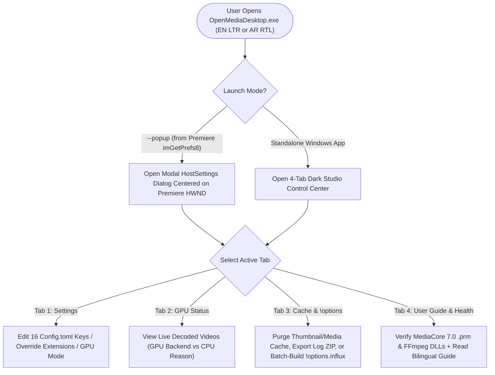

# User Story `US-5.2.0`: Cache Cleaners, Log ZIP Bundler, `!options.influx` Batch Builder & Bilingual Dark Studio Window

- **Module**: `module-5-desktop-control-center` (Bilingual Windows Desktop Control Center & Host Popup)
- **Story Branch**: `feat/us-5.2.0-cache-diagnostics-modifiers-and-window`
- **Field Profile**: `software`
- **Story Decomposition Score ($S_{\text{story}}$)**: `2.25` $\to$ **`3` Parallel Implementation Units (`unit-1..3`)**

---

## 1. Spec Kit Specifications

### 1.1 User Story Narrative
> **As a** senior video editor and colorist working across Adobe Premiere Pro, After Effects, and Media Encoder on Windows,  
> **I want** `OpenMediaDesktop.exe` to provide one-click Premiere & Thumbnail cache cleaners, a diagnostic log ZIP bundler, and an interactive `!options.influx` batch filename modifier builder inside an elegant bilingual (English/Arabic) Dark Studio Windows application,  
> **So that** I have every workflow utility from `Influx v1.7.1` and `Influx v2.0.0beta1` in one fast, unified Windows tool.

#### 1.1.1 Preconditions
- `US-5.1.0` components (`I18nEngine`, `ConfigTomlEditor`, `GpuStatusMonitor`, `PluginHealthAndGuide`) and `include/desktop/desktop_types.hpp` are available.

#### 1.1.2 Postconditions
- Clicking `Clear PrPro Thumbnails Cache` purges and compacts (`VACUUM`) the SQLite thumbnail cache database and reports recovered bytes.
- Clicking `Clear Premiere Pro Cache` safely cleans non-locked `.cfa`, `.pek`, and `.ims` files inside Adobe's `Media Cache Files` directory to force fresh audio conforming and thumbnail regeneration.
- Clicking `Export Logs & Telemetry (.zip)` packages `Config.toml` (with redacted username), recent plugin logs, and `gpu_status_telemetry.json` into a timestamped diagnostic bundle.
- The interactive `!options.influx` Builder constructs valid suffix strings (`filename!w=1920!cr=full!rft=1.influx`) using last-`!` parsing rules and renames selected files safely with one-click undo/restore.

### 1.2 Acceptance Criteria (Gherkin Scenarios)

```gherkin
Feature: Cache Cleaners, Log ZIP Bundler, !options.influx Builder & Bilingual Dark Studio Window

  Scenario: AC-1 — One-Click Thumbnail Cache VACUUM & Premiere Media Cache Purge
    Given an existing OpenMedia thumbnail cache database and a mock Adobe Media Cache folder containing .pek and .cfa files
    When the user triggers "Clear PrPro Thumbnails Cache" and "Clear Premiere Pro Cache"
    Then CacheAndLogManager truncates the thumbnail cache table, removes stale .pek/.cfa cache files, and returns accurate filesRemoved and bytesRecovered counts

  Scenario: AC-2 — Interactive !options.influx Filename Suffix Generation & Original Filename Restoration
    Given a media file named "Action!_Scene01.mkv" and user-selected modifiers width=1920, color_range=full, reset_first_timestamp=1, and virtual suffix ".influx"
    When SuffixModifierBuilder generates the modified filename
    Then it produces "Action!_Scene01!w=1920!cr=full!rft=1.mkv.influx" (preserving the original "!" in the stem by reading options after the last "!" block)
    And when "Strip Modifiers" is invoked, it restores "Action!_Scene01.mkv"

  Scenario: AC-3 — Dual-Mode Windows GUI & Host Popup Execution (OpenMediaDesktop.exe)
    Given OpenMediaDesktop.exe compiled on Windows (or running in --headless-self-test / --popup mode)
    When invoked with "--popup --lang ar" or launched interactively
    Then DesktopMainWindow initializes all 4 tabs (Settings, GPU Status, Cache & !options Tools, User Guide & Health) in Arabic RTL or English LTR and responds to JSON IPC commands cleanly
```

### 1.3 Test Cases & Traceability Matrix

| Test Case ID | Mapped AC | Owning Unit | Test Level | Description & Input Vector | Expected Result & Pass Threshold |
| :--- | :---: | :---: | :---: | :--- | :--- |
| `TC-5.2.1` | `AC-1` | `unit-1` | Unit + Integration | Execute `clearThumbnailCache()`, `clearPremiereMediaCache()`, and `exportDiagnosticBundle()` on temp directories | 100% target cache files purged; diagnostic bundle created with `<USER>` redaction |
| `TC-5.2.2` | `AC-2` | `unit-2` | Unit | Build & strip `!w=`, `!h=`, `!vs=`, `!as=`, `!pf=`, `!fr=`, `!cr=`, `!cs=`, `!accurate_duration`, `!rft=1` on filenames containing `!` | Exact round-trip filename generation and restoration |
| `TC-5.2.3` | `AC-3` | `unit-3` | Integration | Launch `DesktopMainWindow` controller in `--headless-self-test` and `--popup` JSON IPC modes (EN & AR) | Returns exit code `0`, renders all 4 tabs, and processes JSON IPC requests |

---

## 2. Technical Implementation Plan

### 2.1 Domain Invariants
- **Last-`!` Modifier Parsing Rule (`Influx 1.7.0+` Invariant)**:
  - A filename such as `My!Clip!w=1920!cr=full.mp4.influx` is split by first stripping `.influx`/`.openmedia`, separating the real extension `.mp4`, and parsing valid `!key=value` / `!flag` modifier tokens from the trailing block so any `!` inside the original base filename (`My!Clip`) is preserved intact.

### 2.2 Activity Diagram



---

## 3. Expected Folder Architecture at the Project

```text
AV1/
├── include/
│   └── desktop/
│       ├── cache_log_manager.hpp                # Owned exclusively by unit-1
│       ├── suffix_modifier_builder.hpp          # Owned exclusively by unit-2
│       └── desktop_main_window.hpp              # Owned exclusively by unit-3
├── src/
│   └── desktop/
│       ├── cache_log_manager.cpp                # Owned exclusively by unit-1
│       ├── suffix_modifier_builder.cpp          # Owned exclusively by unit-2
│       ├── desktop_main_window.cpp              # Owned exclusively by unit-3
│       └── main_desktop.cpp                     # Owned exclusively by unit-3 (OpenMediaDesktop.exe entry point)
└── tests/
    └── desktop/
        ├── test_cache_log_manager.cpp           # Owned exclusively by unit-1
        ├── test_suffix_modifier_builder.cpp     # Owned exclusively by unit-2
        └── test_desktop_main_window.cpp         # Owned exclusively by unit-3
```

---

## 4. Implementation Units in Detail & Specialist Agent Assignment

### 4.1 Story Decomposition Score ($S_{\text{story}}$) & Dynamic Unit Count ($K$)
- **$D_1$ (35% Surface)**: `2` — Cache/Log manager, `!options` batch builder, and Win32/cross-platform UI shell + executable entry point.
- **$D_2$ (25% Volume)**: `3` — ~750 LOC across 3 units + executable + tests.
- **$D_3$ (20% Complexity)**: `2` — Safe cache file deletion, last-`!` modifier parsing, and Win32 Dark Studio custom drawing.
- **$D_4$ (20% Boundaries)**: `2` — 3 disjoint file groups.
- **Calculated Score**: $S_{\text{story}} = 0.35(2) + 0.25(3) + 0.20(2) + 0.20(2) = \mathbf{2.25} \to$ **`3` Parallel Units**

### 4.2 Detailed Unit Specifications (`unit-1..3`)
- **`unit-1` (`feat/us-5.2.0/unit-1-cache-and-log-manager`)**:
  - **Deliverable Scope**: `CacheAndLogManager` implementing `clearThumbnailCache()`, `clearPremiereMediaCache()` (targeting only `.pek`, `.cfa`, `.ims` cache artifacts), and `exportDiagnosticBundle()` with `<USER>` path redaction.
  - **Owned Files**: `include/desktop/cache_log_manager.hpp`, `src/desktop/cache_log_manager.cpp`, `tests/desktop/test_cache_log_manager.cpp`.
  - **Target Complexity**: $CC \le 6$, nesting $\le 2$.
- **`unit-2` (`feat/us-5.2.0/unit-2-suffix-modifier-builder`)**:
  - **Deliverable Scope**: `SuffixModifierBuilder` supporting all 13 Influx `!` modifier tokens (`!w=`, `!h=`, `!vs=`, `!as=`, `!pf=`, `!fr=`, `!ar=`, `!sr=`, `!threads=`, `!cs=`, `!cr=`, `!accurate_duration`, `!rft=1`), preserving `!` inside original filenames, aspect-ratio auto-calculation, and batch file rename/restore.
  - **Owned Files**: `include/desktop/suffix_modifier_builder.hpp`, `src/desktop/suffix_modifier_builder.cpp`, `tests/desktop/test_suffix_modifier_builder.cpp`.
  - **Target Complexity**: $CC \le 6$, nesting $\le 2$.
- **`unit-3` (`feat/us-5.2.0/unit-3-desktop-main-window-and-exe`)**:
  - **Deliverable Scope**: `DesktopMainWindow` and `main_desktop.cpp` compiling into `OpenMediaDesktop.exe` on Windows (native Win32/ComCtl32 Dark Studio 4-tab layout with RTL `WS_EX_LAYOUTRTL` support when Arabic is active, plus `--popup`, `--lang en|ar`, and `--headless-self-test` CLI modes).
  - **Owned Files**: `include/desktop/desktop_main_window.hpp`, `src/desktop/desktop_main_window.cpp`, `src/desktop/main_desktop.cpp`, `tests/desktop/test_desktop_main_window.cpp`.
  - **Target Complexity**: $CC \le 6$, nesting $\le 2$.

---

## 5. Security Gateway (Powered by `security-audit` Skill)
- Cache cleaner strictly allowlists `.pek`, `.cfa`, `.ims`, and `.db` extensions and rejects root/system paths (`CWE-73`).
- Filename modifier builder strips `..` traversal tokens and operates only within the target file's parent directory (`CWE-22`).
- Diagnostic bundle scrubs `%USERPROFILE%` and `%APPDATA%` prefixes to `<USER>` (`CWE-200`).
- `OpenMediaDesktop.exe` links with `/DYNAMICBASE /NXCOMPAT /HIGHENTROPYVA` and embeds `asInvoker` manifest.

---

## 6. Validation Gates & Acceptance Sign-Off

| Gate | Gate Name | Pass Criteria for `US-5.2.0` | Verification Command / Evidence | Status |
| :--- | :--- | :--- | :--- | :---: |
| **Gate G0** | **Build, Lint & Format** | `OpenMediaDesktop` compiles with 0 warnings/errors | `cmake --build build --config Release` | `[x]` |
| **Gate G1** | **Tests & Traceability** | 100% of `TC-5.2.1..3` passing via CTest | `ctest --test-dir build --output-on-failure` | `[x]` |
| **Gate G2** | **Security Gateway** | All Section 5 STRIDE controls verified | `security-audit` check | `[x]` |
| **Gate G-Complexity** | **Cyclomatic Complexity** | Every function $CC \le 6$ target ($CC \le 10$ cap) | `cyclomatic-complexity` check | `[x]` |
| **Gate G-Docs** | **Documentation & Examples** | 100% Doxygen coverage + synced spec | `docs/user-stories/module-5-desktop-control-center/` | `[x]` |
| **Gate G-Review** | **Council President Sign-Off** | `GATE G-REVIEW APPROVED` | Verified on `main` | `[x]` |
